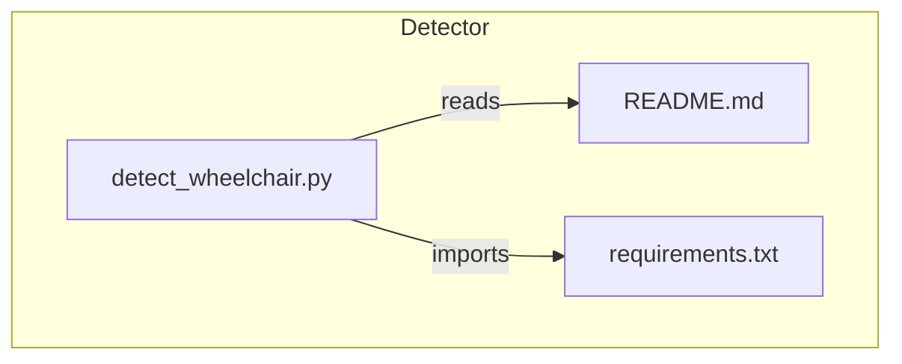
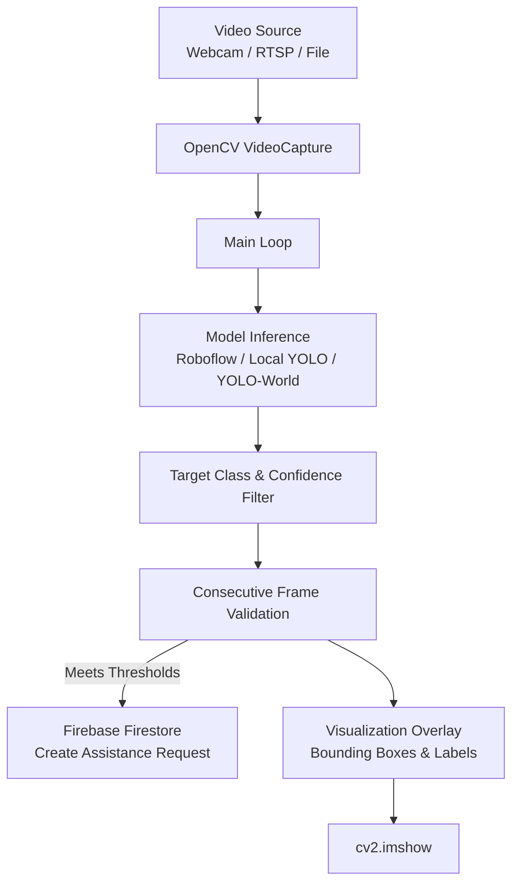
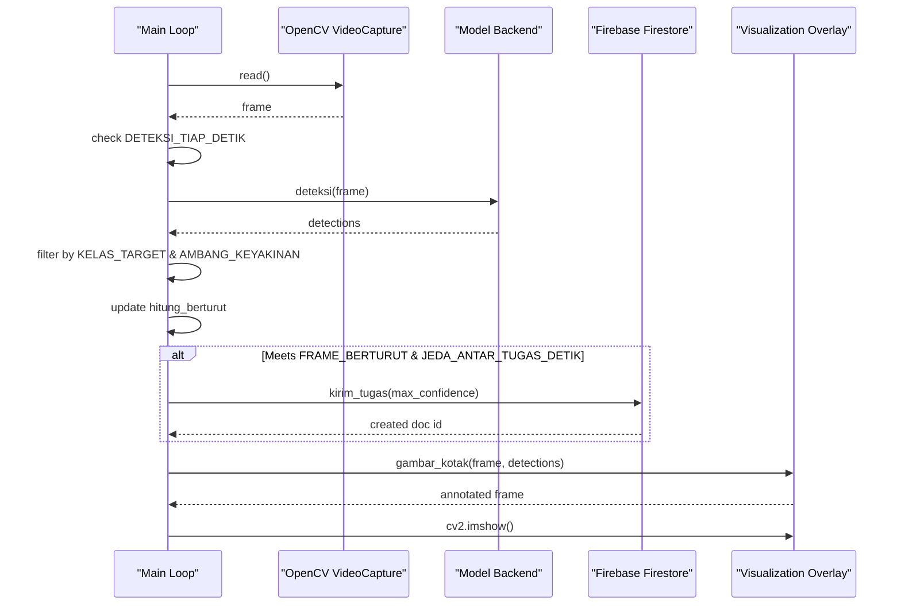
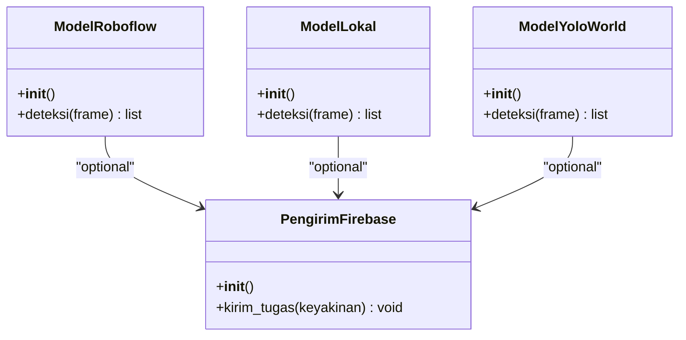
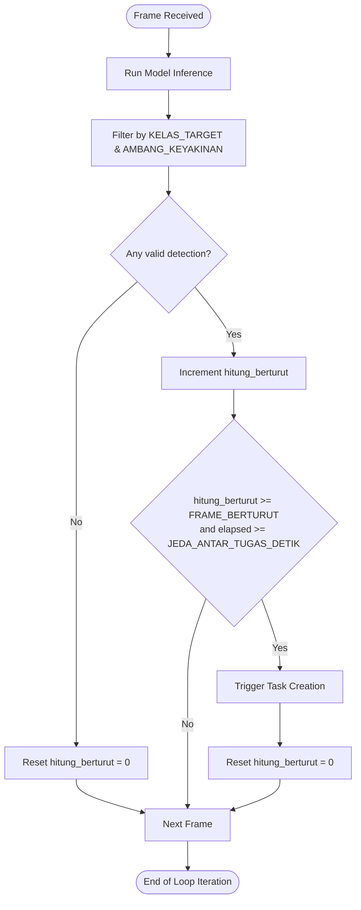
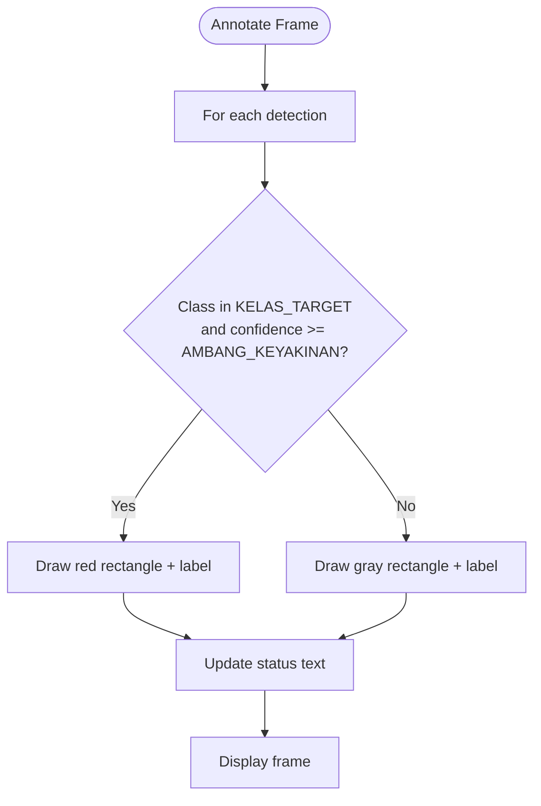
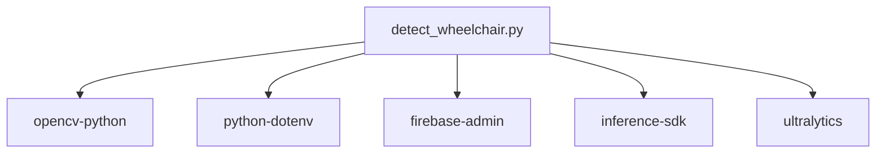

# Detection Pipeline

<cite>
**Referenced Files in This Document**
- [detect_wheelchair.py](file://detector/detect_wheelchair.py)
- [README.md](file://detector/README.md)
- [requirements.txt](file://detector/requirements.txt)
</cite>

## Table of Contents
1. [Introduction](#introduction)
2. [Project Structure](#project-structure)
3. [Core Components](#core-components)
4. [Architecture Overview](#architecture-overview)
5. [Detailed Component Analysis](#detailed-component-analysis)
6. [Dependency Analysis](#dependency-analysis)
7. [Performance Considerations](#performance-considerations)
8. [Troubleshooting Guide](#troubleshooting-guide)
9. [Conclusion](#conclusion)
10. [Appendices](#appendices)

## Introduction
This document explains the wheelchair detection pipeline implemented for Whoosh Ramah. The system reads real-time video from a webcam, CCTV stream, or video file using OpenCV, runs object detection through one of three model strategies, filters and validates detections across consecutive frames, and optionally creates assistance requests in Firebase Firestore. It also documents the visualization overlay used to show detected objects and their confidence scores.

The pipeline supports:
- Roboflow cloud API inference
- Local YOLO models trained with Ultralytics
- YOLO-World zero-shot detection using class names

It includes configuration parameters for confidence thresholds, detection intervals, anti-spam mechanisms, and target class filtering.

## Project Structure
The detector is contained under the `detector` directory:
- `detect_wheelchair.py`: Main script implementing the full pipeline
- `README.md`: Setup instructions, usage examples, and configuration guidance
- `requirements.txt`: Python dependencies

**Diagram sources**
- [detect_wheelchair.py:21-28](file://detector/detect_wheelchair.py#L21-L28)
- [requirements.txt:1-7](file://detector/requirements.txt#L1-L7)

**Section sources**
- [detect_wheelchair.py:1-68](file://detector/detect_wheelchair.py#L1-L68)
- [README.md:1-93](file://detector/README.md#L1-L93)
- [requirements.txt:1-7](file://detector/requirements.txt#L1-L7)

## Core Components
The pipeline consists of several core components:
- Input handling via OpenCV’s VideoCapture for webcam, RTSP streams, and video files
- Model abstraction supporting three backends: Roboflow, local YOLO, and YOLO-World
- Confidence scoring and target class filtering
- Consecutive frame validation to reduce false positives
- Anti-spam mechanism to prevent duplicate tasks
- Optional Firebase integration to create assistance requests
- Visualization overlay showing bounding boxes and labels

Key responsibilities:
- Real-time frame acquisition and display
- Frame preprocessing (none beyond color space conversion handled by OpenCV)
- Object detection via selected model backend
- Filtering detections by target classes and confidence threshold
- Temporal validation across frames
- Alerting and logging
- Rendering overlays on the video feed

**Section sources**
- [detect_wheelchair.py:70-158](file://detector/detect_wheelchair.py#L70-L158)
- [detect_wheelchair.py:198-286](file://detector/detect_wheelchair.py#L198-L286)

## Architecture Overview
The high-level architecture integrates input capture, detection, validation, optional alerting, and visualization.

**Diagram sources**
- [detect_wheelchair.py:214-286](file://detector/detect_wheelchair.py#L214-L286)
- [detect_wheelchair.py:70-158](file://detector/detect_wheelchair.py#L70-L158)
- [detect_wheelchair.py:164-193](file://detector/detect_wheelchair.py#L164-L193)

## Detailed Component Analysis

### Real-Time Video Processing Workflow
The main loop reads frames from an OpenCV VideoCapture source, performs detection at a configured interval, filters results, applies temporal validation, optionally sends alerts to Firebase, and renders overlays.

**Diagram sources**
- [detect_wheelchair.py:214-286](file://detector/detect_wheelchair.py#L214-L286)
- [detect_wheelchair.py:198-211](file://detector/detect_wheelchair.py#L198-L211)
- [detect_wheelchair.py:164-193](file://detector/detect_wheelchair.py#L164-L193)

**Section sources**
- [detect_wheelchair.py:214-286](file://detector/detect_wheelchair.py#L214-L286)

### Model Integration Approaches
Three model backends are supported:

- Roboflow Cloud API
  - Uses InferenceHTTPClient to call serverless inference
  - Converts center-point predictions to bounding boxes
  - Requires ROBOFLOW_API_KEY and ROBOFLOW_MODEL_ID

- Local YOLO Models
  - Loads a .pt model via Ultralytics YOLO
  - Returns class names, confidence, and bounding boxes directly

- YOLO-World Zero-Shot Detection
  - Uses YOLOWorld with configurable class names
  - Downloads model weights once; can run offline after download
  - Sets target classes via set_classes

**Diagram sources**
- [detect_wheelchair.py:70-158](file://detector/detect_wheelchair.py#L70-L158)
- [detect_wheelchair.py:164-193](file://detector/detect_wheelchair.py#L164-L193)

**Section sources**
- [detect_wheelchair.py:70-158](file://detector/detect_wheelchair.py#L70-L158)

### Confidence Scoring, Target Class Filtering, and Consecutive Frame Validation
Confidence scoring and filtering:
- Detections are filtered by target class names (case-insensitive) and a minimum confidence threshold
- Only detections meeting both criteria contribute to the consecutive counter

Consecutive frame validation:
- A running counter increments when any target-class detection meets the confidence threshold
- If the counter reaches FRAME_BERTURUT and enough time has passed since the last task (JEDA_ANTAR_TUGAS_DETIK), an alert is triggered
- After triggering, the counter resets to avoid repeated alerts

Anti-spam mechanism:
- Prevents multiple tasks from being created for the same person within a time window
- Ensures stable operation and reduces noise

**Diagram sources**
- [detect_wheelchair.py:248-274](file://detector/detect_wheelchair.py#L248-L274)

**Section sources**
- [detect_wheelchair.py:248-274](file://detector/detect_wheelchair.py#L248-L274)

### Configuration Parameters
Configuration is loaded from environment variables with sensible defaults:

- MODE_MODEL: Selects backend ("roboflow", "yoloworld", "lokal")
- ROBOFLOW_API_KEY / ROBOFLOW_MODEL_ID: Roboflow credentials and model ID
- MODEL_LOKAL: Path to local YOLO .pt model
- YOLOWORLD_MODEL: YOLO-World model name
- KELAS_YOLOWORLD: Zero-shot class names for YOLO-World
- KELAS_TARGET: Target class names for filtering
- AMBANG_KEYAKINAN: Minimum confidence threshold
- FRAME_BERTURUT: Required consecutive detections before alert
- JEDA_ANTAR_TUGAS_DETIK: Anti-spam delay between tasks
- DETEKSI_TIAP_DETIK: Detection frequency control
- LOKASI_KAMERA / ID_KAMERA: Camera metadata for alerts
- FIREBASE_KEY / KOLEKSI_FIRESTORE: Firebase service account path and collection name

These parameters allow tuning detection sensitivity, performance, and operational behavior.

**Section sources**
- [detect_wheelchair.py:33-68](file://detector/detect_wheelchair.py#L33-L68)
- [README.md:77-84](file://detector/README.md#L77-L84)

### Running the Detector with Different Input Sources
Supported inputs:
- Webcam: default device index (e.g., "0")
- Video file: path to MP4 or other supported formats
- CCTV stream: RTSP URL

Usage examples:
- Webcam with default settings: python detect_wheelchair.py
- Video file without Firebase: python detect_wheelchair.py --sumber video.mp4 --tanpa-firebase
- RTSP stream without Firebase: python detect_wheelchair.py --sumber rtsp://... --tanpa-firebase

The script opens the specified source via OpenCV’s VideoCapture and raises an error if it cannot open the source.

**Section sources**
- [detect_wheelchair.py:214-231](file://detector/detect_wheelchair.py#L214-L231)
- [README.md:21-37](file://detector/README.md#L21-L37)

### Visualization Overlay System
The visualization system draws:
- Bounding rectangles around all detections
- Labels with class name and confidence percentage
- Color coding: red for target-class detections meeting the confidence threshold, gray otherwise
- Status text indicating whether a wheelchair is currently being tracked across frames
- Camera location and status overlay at the top-left corner

**Diagram sources**
- [detect_wheelchair.py:198-211](file://detector/detect_wheelchair.py#L198-L211)
- [detect_wheelchair.py:276-280](file://detector/detect_wheelchair.py#L276-L280)

**Section sources**
- [detect_wheelchair.py:198-211](file://detector/detect_wheelchair.py#L198-L211)
- [detect_wheelchair.py:276-280](file://detector/detect_wheelchair.py#L276-L280)

## Dependency Analysis
External dependencies:
- opencv-python: Video I/O and visualization
- python-dotenv: Environment variable loading
- firebase-admin: Firestore integration
- inference-sdk: Roboflow client
- ultralytics: Local YOLO and YOLO-World support

**Diagram sources**
- [detect_wheelchair.py:21-28](file://detector/detect_wheelchair.py#L21-L28)
- [requirements.txt:1-7](file://detector/requirements.txt#L1-L7)

**Section sources**
- [requirements.txt:1-7](file://detector/requirements.txt#L1-L7)
- [detect_wheelchair.py:21-28](file://detector/detect_wheelchair.py#L21-L28)

## Performance Considerations
- Detection frequency control via DETEKSI_TIAP_DETIK reduces API calls and computational load
- Consecutive frame validation prevents unnecessary alerts and reduces false positives
- Using local YOLO models eliminates network latency and dependency on internet connectivity
- YOLO-World downloads model weights once; subsequent runs are faster and can operate offline
- Adjust AMBANG_KEYAKINAN to balance precision and recall based on deployment conditions
- For RTSP streams, ensure sufficient bandwidth and decoding performance

[No sources needed since this section provides general guidance]

## Troubleshooting Guide
Common issues and resolutions:
- Missing Roboflow API key: Ensure ROBOFLOW_API_KEY is set in .env
- Missing local model file: Train and place the .pt model at MODEL_LOKAL path or use Roboflow mode
- Missing Firebase credentials: Place firebase-key.json in the detector directory or run with --tanpa-firebase
- Cannot open video source: Verify the source path or RTSP URL and permissions
- Frequent false positives: Increase AMBANG_KEYAKINAN or adjust KELAS_TARGET
- Too many alerts: Increase JEDA_ANTAR_TUGAS_DETIK or FRAME_BERTURUT

Error handling:
- Model inference errors are caught and logged; the pipeline continues with empty detections
- Firebase initialization errors cause early exit with clear messages
- Video source failures raise explicit errors to aid debugging

**Section sources**
- [detect_wheelchair.py:76-86](file://detector/detect_wheelchair.py#L76-L86)
- [detect_wheelchair.py:105-114](file://detector/detect_wheelchair.py#L105-L114)
- [detect_wheelchair.py:169-176](file://detector/detect_wheelchair.py#L169-L176)
- [detect_wheelchair.py:228-231](file://detector/detect_wheelchair.py#L228-L231)
- [detect_wheelchair.py:251-255](file://detector/detect_wheelchair.py#L251-L255)

## Conclusion
The wheelchair detection pipeline provides a flexible, configurable system for real-time detection using OpenCV and multiple model backends. It balances accuracy and performance through confidence thresholds, target class filtering, and temporal validation. Optional Firebase integration enables automated assistance requests, while visualization overlays support monitoring and debugging. Operators can tune parameters to suit different environments and requirements.

[No sources needed since this section summarizes without analyzing specific files]

## Appendices

### Example Commands
- Run with webcam and no Firebase: python detect_wheelchair.py --tanpa-firebase
- Run with video file: python detect_wheelchair.py --sumber video.mp4 --tanpa-firebase
- Run with RTSP stream: python detect_wheelchair.py --sumber rtsp://stream-url --tanpa-firebase

**Section sources**
- [README.md:21-37](file://detector/README.md#L21-L37)