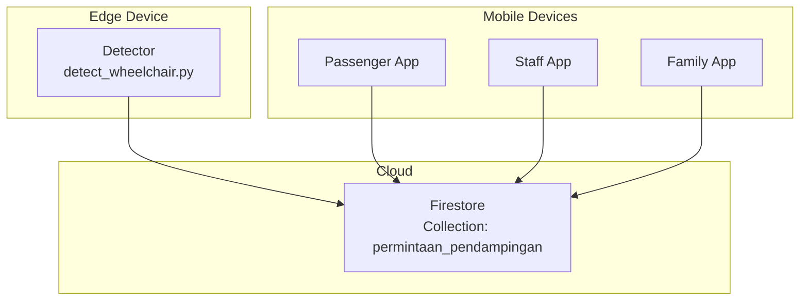
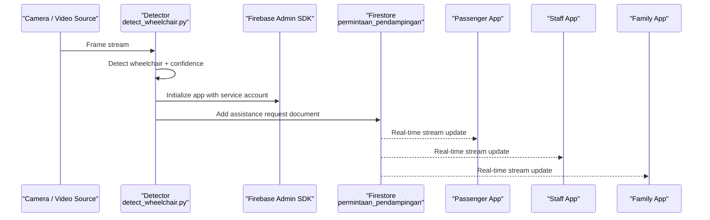
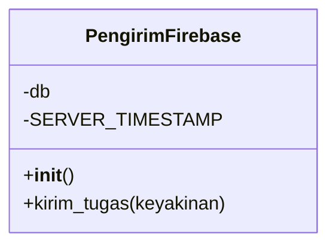
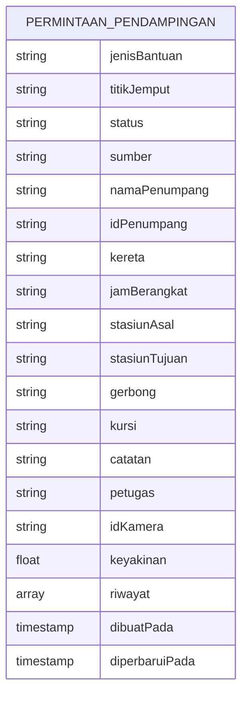
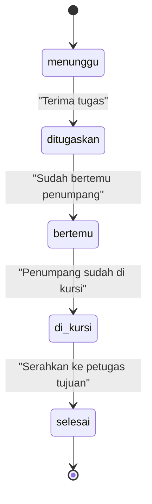
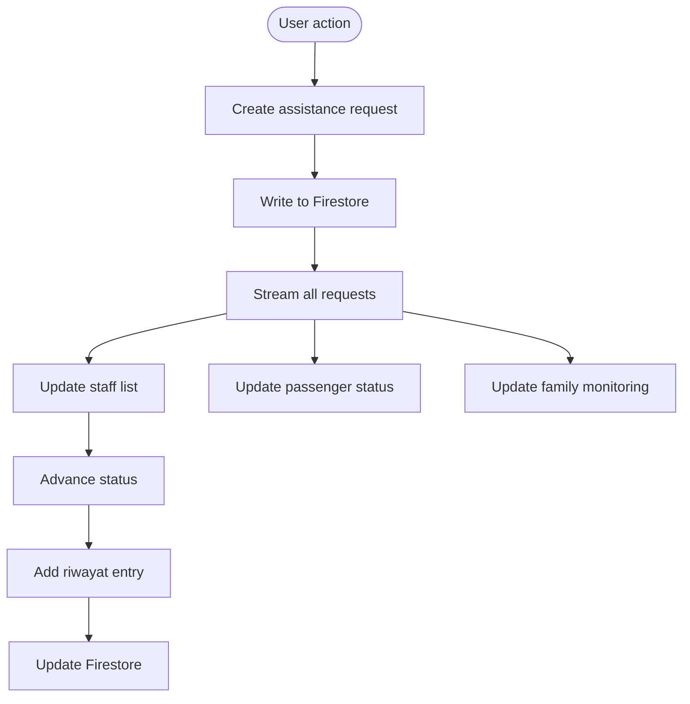
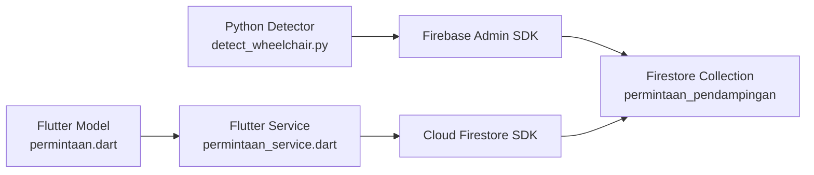

# Firebase Integration

<cite>
**Referenced Files in This Document**
- [detect_wheelchair.py](file://detector/detect_wheelchair.py)
- [permintaan.dart](file://whoosh_ramah/lib/models/permintaan.dart)
- [permintaan_service.dart](file://whoosh_ramah/lib/services/permintaan_service.dart)
- [PROJECT.md](file://PROJECT.md)
</cite>

## Table of Contents
1. [Introduction](#introduction)
2. [Project Structure](#project-structure)
3. [Core Components](#core-components)
4. [Architecture Overview](#architecture-overview)
5. [Detailed Component Analysis](#detailed-component-analysis)
6. [Dependency Analysis](#dependency-analysis)
7. [Performance Considerations](#performance-considerations)
8. [Troubleshooting Guide](#troubleshooting-guide)
9. [Conclusion](#conclusion)

## Introduction
This document explains how the AI detection system integrates with Firebase Firestore to automatically create assistance tasks when wheelchair users are detected by the camera detector. It covers:

- The Python `PengirimFirebase` class that writes new assistance requests into Firestore.
- The Firestore data schema for assistance requests, including fields such as `jenisBantuan`, `titikJemput`, status progression, and metadata.
- Firebase authentication using a service account key file.
- Security rules configuration for demo use.
- Example Firestore document structure created by the detector.
- How the Flutter mobile application consumes these documents through real-time streams.
- Error handling, retry considerations, and monitoring of detection-to-task conversion rates.

## Project Structure
The integration spans two main parts:

- **Detector (Python):** Runs on a laptop or edge device, reads video from a webcam or CCTV, detects wheelchair users, and writes assistance requests to Firestore.
- **Mobile App (Flutter):** Reads and updates assistance requests in real time for passengers, staff, and family members.

**Diagram sources**
- [detect_wheelchair.py:164-192](file://detector/detect_wheelchair.py#L164-L192)
- [PROJECT.md:24-36](file://PROJECT.md#L24-L36)

**Section sources**
- [PROJECT.md:24-36](file://PROJECT.md#L24-L36)

## Core Components
The Firebase integration relies on three core components:

1. **`PengirimFirebase` (Python)**  
   Initializes Firebase Admin SDK with a service account key and creates new assistance request documents in Firestore when wheelchairs are detected.

2. **`Permintaan` model (Flutter)**  
   Defines the Firestore document schema, including enums for `jenisBantuan` and `status`, helper methods for null-safe parsing, and serialization to/from Firestore maps.

3. **`PermintaanService` (Flutter)**  
   Encapsulates all Firestore operations: creating requests, streaming single documents, streaming lists, filtering by passenger, and advancing status with history tracking.

**Section sources**
- [detect_wheelchair.py:164-192](file://detector/detect_wheelchair.py#L164-L192)
- [permintaan.dart:1-214](file://whoosh_ramah/lib/models/permintaan.dart#L1-L214)
- [permintaan_service.dart:1-136](file://whoosh_ramah/lib/services/permintaan_service.dart#L1-L136)

## Architecture Overview
The end-to-end flow is:

1. The detector runs continuously, sampling frames at a controlled rate.
2. When a wheelchair is detected with sufficient confidence for consecutive frames, it calls `PengirimFirebase.kirim_tugas`.
3. `PengirimFirebase` initializes Firebase Admin SDK using a service account JSON file and writes a new document to the `permintaan_pendampingan` collection.
4. Flutter apps subscribe to Firestore streams and update UIs in real time.

**Diagram sources**
- [detect_wheelchair.py:214-290](file://detector/detect_wheelchair.py#L214-L290)
- [detect_wheelchair.py:164-192](file://detector/detect_wheelchair.py#L164-L192)
- [permintaan_service.dart:63-78](file://whoosh_ramah/lib/services/permintaan_service.dart#L63-L78)

## Detailed Component Analysis

### PengirimFirebase Class
`PengirimFirebase` is responsible for:

- Validating the presence of the Firebase service account key file.
- Initializing the Firebase Admin SDK with the certificate.
- Creating Firestore client references.
- Writing new assistance request documents with required fields.

Key behaviors:

- Constructor checks for the service account file path configured via environment variables.
- On initialization, it sets up Firebase Admin SDK and Firestore client.
- `kirim_tugas` builds a document payload containing:
  - `jenisBantuan`: always set to wheelchair assistance for this detector.
  - `titikJemput`: camera location string.
  - `status`: starts as `menunggu`.
  - `sumber`: marks the task as created by AI camera.
  - `idKamera`: camera identifier.
  - `keyakinan`: rounded confidence score.
  - `namaPenumpang`: null because the passenger did not book through the app.
  - `dibuatPada`: server timestamp.

**Diagram sources**
- [detect_wheelchair.py:164-192](file://detector/detect_wheelchair.py#L164-L192)

**Section sources**
- [detect_wheelchair.py:164-192](file://detector/detect_wheelchair.py#L164-L192)

### Firestore Data Schema
The assistance request document lives in the `permintaan_pendampingan` collection. The schema is defined in the Flutter model and documented in the project specification.

Important fields:

| Field | Type | Meaning | Set By |
|---|---|---|---|
| `jenisBantuan` | String enum | Type of assistance requested | Passenger or detector |
| `titikJemput` | String | Pickup location | Passenger or detector |
| `status` | String enum | Workflow state | All actors |
| `sumber` | String | Source of the request (`aplikasi` or `kamera_ai`) | Automatic |
| `namaPenumpang` | String or null | Passenger name | Passenger; null for detector |
| `idPenumpang` | String or null | Passenger ID | Passenger |
| `kereta` | String or null | Train number | Passenger |
| `jamBerangkat` | String or null | Departure time | Passenger |
| `stasiunAsal` | String or null | Origin station | Passenger |
| `stasiunTujuan` | String or null | Destination station | Passenger |
| `gerbong` | String or null | Carriage number | Passenger |
| `kursi` | String or null | Seat number | Passenger |
| `catatan` | String or null | Notes | Passenger |
| `petugas` | String or null | Assigned staff member | Staff workflow |
| `idKamera` | String or null | Camera ID | Detector |
| `keyakinan` | Number or null | Detection confidence | Detector |
| `riwayat` | Array of maps | Status change history | All actors |
| `dibuatPada` | Timestamp | Creation time | Automatic |
| `diperbaruiPada` | Timestamp | Last update time | Automatic |

Enums:

- `jenisBantuan`: includes wheelchair, visually impaired, deaf, elderly, pregnant, porter.
- `status`: mandatory progression from `menunggu` to `selesai`.

**Diagram sources**
- [permintaan.dart:77-214](file://whoosh_ramah/lib/models/permintaan.dart#L77-L214)
- [PROJECT.md:54-95](file://PROJECT.md#L54-L95)

**Section sources**
- [permintaan.dart:77-214](file://whoosh_ramah/lib/models/permintaan.dart#L77-L214)
- [PROJECT.md:54-95](file://PROJECT.md#L54-L95)

### Status Progression and History
Status progression follows a strict order:

1. `menunggu`
2. `ditugaskan`
3. `bertemu`
4. `di_kursi`
5. `selesai`

Each status change:

- Updates the `status` field.
- Updates `diperbaruiPada` with a server timestamp.
- Adds an entry to the `riwayat` array with the new status and a local timestamp.
- Sets `petugas` to a demo staff value when moving to `ditugaskan`.

**Diagram sources**
- [permintaan.dart:27-57](file://whoosh_ramah/lib/models/permintaan.dart#L27-L57)
- [permintaan_service.dart:92-119](file://whoosh_ramah/lib/services/permintaan_service.dart#L92-L119)

**Section sources**
- [permintaan.dart:27-57](file://whoosh_ramah/lib/models/permintaan.dart#L27-L57)
- [permintaan_service.dart:92-119](file://whoosh_ramah/lib/services/permintaan_service.dart#L92-L119)

### Mobile Application Real-Time Integration
The Flutter side uses `PermintaanService` to interact with Firestore:

- `buatPermintaan`: Creates a new assistance request from the passenger app.
- `streamPermintaan(id)`: Streams a single request document.
- `streamSemua()`: Streams all requests, ordered by creation time, limited to 100.
- `streamTerbaruPenumpang(idPenumpang)`: Streams the latest request for a specific passenger.
- `majukanStatus(id)`: Advances the status according to the allowed workflow.

**Diagram sources**
- [permintaan_service.dart:23-78](file://whoosh_ramah/lib/services/permintaan_service.dart#L23-L78)
- [permintaan_service.dart:92-119](file://whoosh_ramah/lib/services/permintaan_service.dart#L92-L119)

**Section sources**
- [permintaan_service.dart:23-119](file://whoosh_ramah/lib/services/permintaan_service.dart#L23-L119)

### Example Firestore Document Created by the Detector
When the detector identifies a wheelchair user, it creates a document similar to the following structure:

- `jenisBantuan`: `"kursi_roda"`
- `titikJemput`: camera location string
- `status`: `"menunggu"`
- `sumber`: `"kamera_ai"`
- `idKamera`: camera identifier
- `keyakinan`: rounded confidence value
- `namaPenumpang`: `null`
- `dibuatPada`: server timestamp

This document appears immediately in the staff app’s real-time list and can be advanced through the status workflow.

**Section sources**
- [detect_wheelchair.py:179-192](file://detector/detect_wheelchair.py#L179-L192)
- [PROJECT.md:60-80](file://PROJECT.md#L60-L80)

## Dependency Analysis
The integration has clear boundaries between Python and Flutter:

- Python detector depends on Firebase Admin SDK and environment configuration.
- Flutter app depends on Cloud Firestore SDK and the `Permintaan` model.
- Both sides must agree on collection names and field values.

**Diagram sources**
- [detect_wheelchair.py:164-192](file://detector/detect_wheelchair.py#L164-L192)
- [permintaan.dart:1-214](file://whoosh_ramah/lib/models/permintaan.dart#L1-L214)
- [permintaan_service.dart:1-136](file://whoosh_ramah/lib/services/permintaan_service.dart#L1-L136)

**Section sources**
- [detect_wheelchair.py:164-192](file://detector/detect_wheelchair.py#L164-L192)
- [permintaan.dart:1-214](file://whoosh_ramah/lib/models/permintaan.dart#L1-L214)
- [permintaan_service.dart:1-136](file://whoosh_ramah/lib/services/permintaan_service.dart#L1-L136)

## Performance Considerations
- **Detection throttling:** The detector limits detection calls per second to reduce API/model load.
- **Anti-spam delay:** A configurable delay prevents duplicate tasks for the same detection event.
- **Consecutive frame requirement:** A wheelchair must be detected multiple times consecutively before creating a task.
- **Firestore query design:** The Flutter service avoids composite indexes by ordering only on one field and sorting locally where needed.
- **Real-time streams:** Streams are used efficiently for passive UI updates rather than polling.

[No sources needed since this section provides general guidance]

## Troubleshooting Guide

### Missing Firebase Service Account Key
If the service account key file is missing, the detector exits early with a clear message. Ensure the Firebase service account JSON file exists at the configured path.

**Section sources**
- [detect_wheelchair.py:169-176](file://detector/detect_wheelchair.py#L169-L176)

### Network Failures During Detection
Detection failures are caught and logged without stopping the detector loop. The detector continues running and retries subsequent frames.

**Section sources**
- [detect_wheelchair.py:251-255](file://detector/detect_wheelchair.py#L251-L255)

### Retry Mechanisms
The current implementation does not implement explicit retry logic for Firestore writes. Recommendations:

- Wrap Firestore write calls in retry logic with exponential backoff.
- Log failed attempts separately for monitoring.
- Consider a background job queue if offline recovery is required.

### Monitoring Detection-to-Task Conversion Rates
To monitor conversion quality:

- Track the number of successful detections per camera.
- Track the number of Firestore documents created per camera.
- Compare `keyakinan` distribution across created tasks.
- Use `idKamera` and `dibuatPada` to compute hourly/daily conversion metrics.
- Alert when conversion drops below expected thresholds.

[No sources needed since this section provides general guidance]

### Security Rules Configuration
For demo purposes, the security rules allow unrestricted read and write access to the `permintaan_pendampingan` collection. This is explicitly marked as demo-only and should not be used in production.

**Section sources**
- [PROJECT.md:97-108](file://PROJECT.md#L97-L108)

## Conclusion
The Firebase integration connects the AI wheelchair detector with the Whoosh Ramah mobile application through Firestore. The Python `PengirimFirebase` class writes structured assistance requests, while the Flutter `Permintaan` model and `PermintaanService` provide type-safe, real-time access to those requests. The schema enforces consistent field naming, enum-based types, and a strict status workflow. For production readiness, add robust retry mechanisms, secure Firestore rules, and monitoring dashboards for detection-to-task conversion metrics.

[No sources needed since this section summarizes without analyzing specific files]