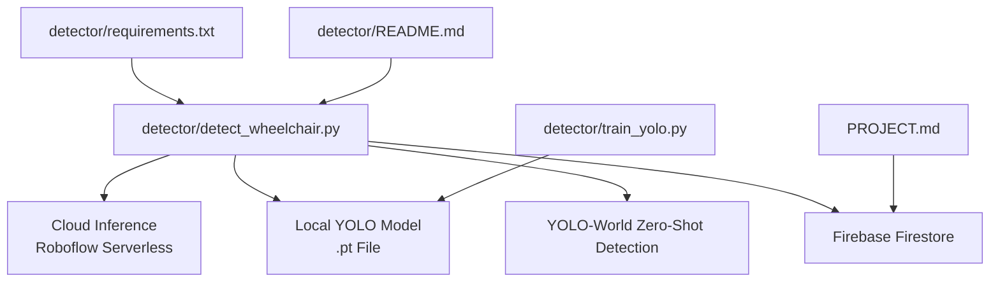
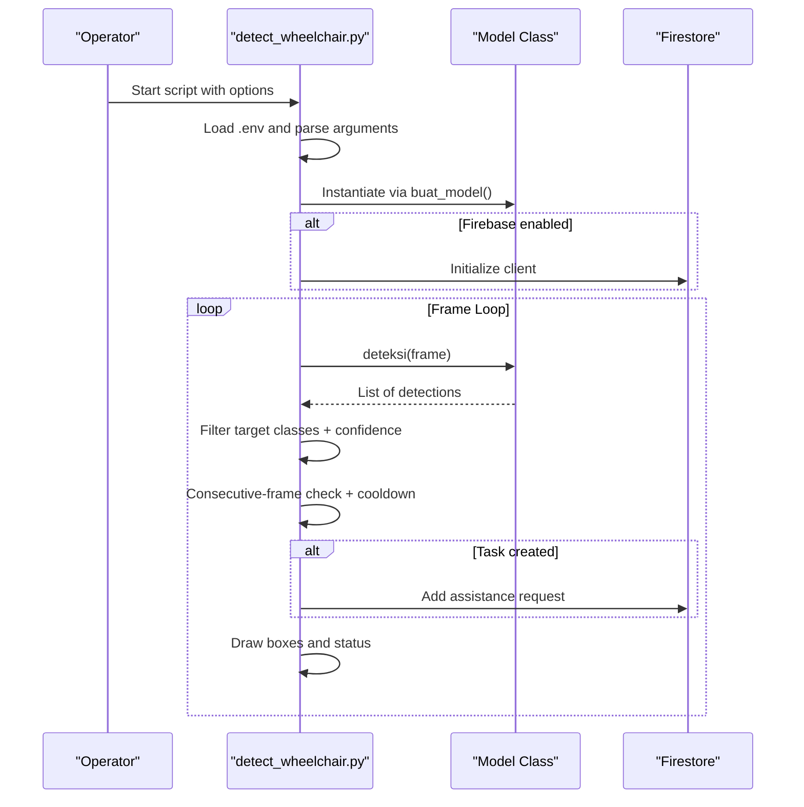
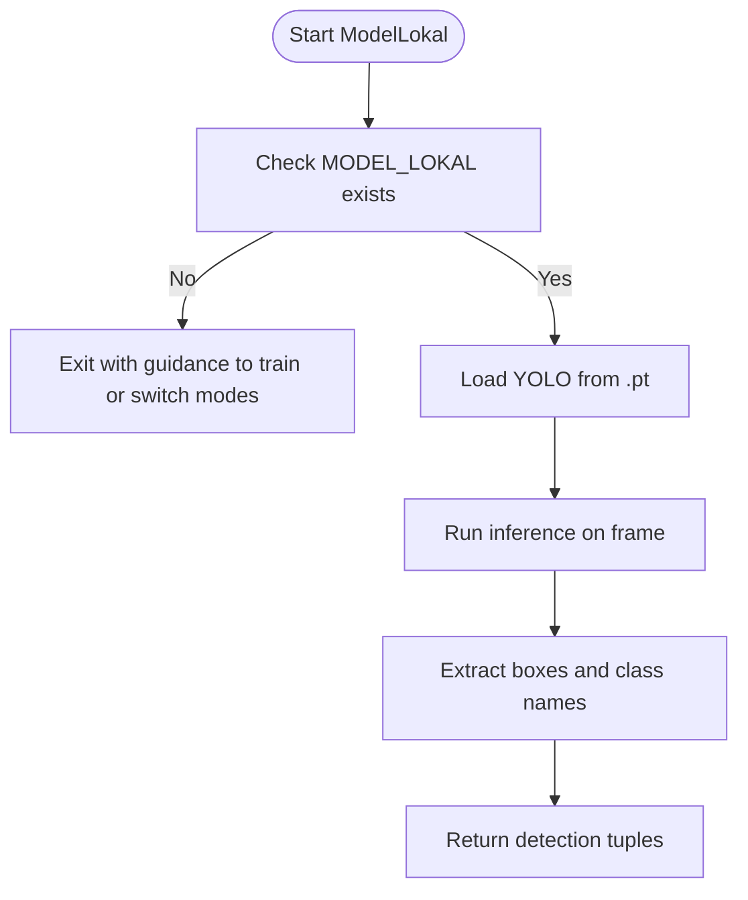
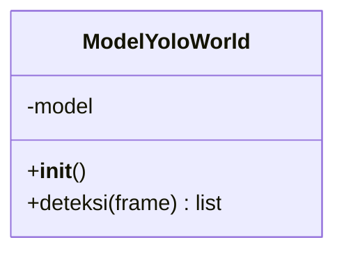
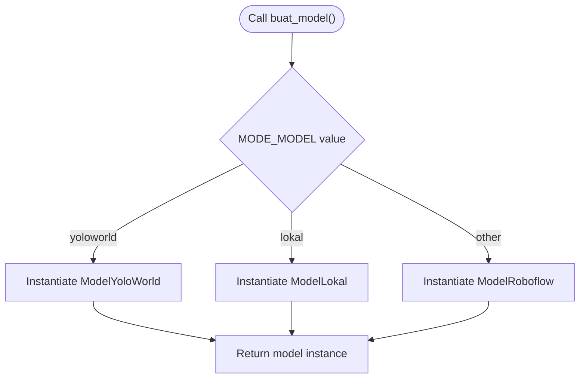
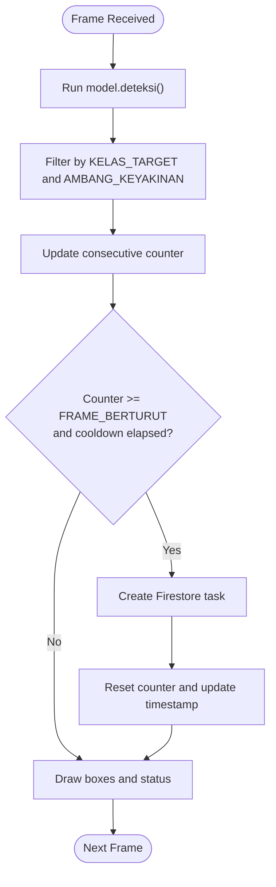
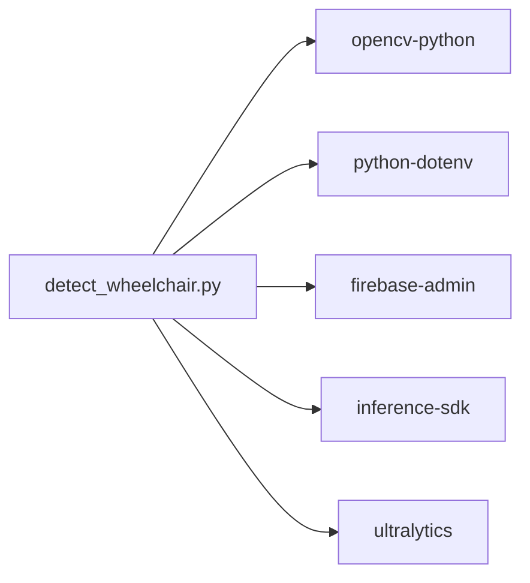

# Model Integration

<cite>
**Referenced Files in This Document**
- [detect_wheelchair.py](file://detector/detect_wheelchair.py)
- [train_yolo.py](file://detector/train_yolo.py)
- [requirements.txt](file://detector/requirements.txt)
- [README.md](file://detector/README.md)
- [PROJECT.md](file://PROJECT.md)
</cite>

## Table of Contents
1. [Introduction](#introduction)
2. [Project Structure](#project-structure)
3. [Core Components](#core-components)
4. [Architecture Overview](#architecture-overview)
5. [Detailed Component Analysis](#detailed-component-analysis)
6. [Dependency Analysis](#dependency-analysis)
7. [Performance Considerations](#performance-considerations)
8. [Troubleshooting Guide](#troubleshooting-guide)
9. [Conclusion](#conclusion)

## Introduction
This document explains the AI model integration system for wheelchair detection in the Whoosh Ramah project. The detector is a Python application that reads video from a webcam, file, or stream, runs object detection through one of three backends, and optionally writes assistance requests to Firebase Firestore.

The supported backends are:
- Roboflow serverless API for cloud inference.
- Local YOLO `.pt` models trained with Ultralytics.
- YOLO-World zero-shot detection with configurable target classes.

The system also includes configuration via environment variables, error handling around camera access, model loading, network calls, and Firebase initialization, as well as logic to avoid duplicate tasks and reduce API usage.

## Project Structure
The AI integration lives under `detector/`. The main entry point is `detect_wheelchair.py`, which implements the model abstraction, selection logic, camera loop, drawing helpers, and optional Firebase publishing. Training a local YOLO model is provided by `train_yolo.py`. Dependencies are declared in `requirements.txt`, and setup instructions are in `detector/README.md`. The broader system context and Firestore schema are defined in `PROJECT.md`.

**Diagram sources**
- [detect_wheelchair.py:70-158](file://detector/detect_wheelchair.py#L70-L158)
- [detect_wheelchair.py:164-192](file://detector/detect_wheelchair.py#L164-L192)
- [train_yolo.py:34-58](file://detector/train_yolo.py#L34-L58)
- [requirements.txt:1-7](file://detector/requirements.txt#L1-L7)
- [README.md:10-75](file://detector/README.md#L10-L75)
- [PROJECT.md:24-36](file://PROJECT.md#L24-L36)

**Section sources**
- [detect_wheelchair.py:1-68](file://detector/detect_wheelchair.py#L1-L68)
- [train_yolo.py:1-16](file://detector/train_yolo.py#L1-L16)
- [requirements.txt:1-7](file://detector/requirements.txt#L1-L7)
- [README.md:10-75](file://detector/README.md#L10-L75)
- [PROJECT.md:24-36](file://PROJECT.md#L24-L36)

## Core Components
The core components are three model classes plus a factory function that selects the active backend based on configuration:

- `ModelRoboflow`: Cloud inference using Roboflow’s serverless API. Requires an API key and a deployed model ID.
- `ModelLokal`: Local inference using a trained Ultralytics YOLO `.pt` model.
- `ModelYoloWorld`: Zero-shot detection using YOLO-World with user-defined target classes.
- `buat_model()`: Factory that returns the correct model class based on `MODE_MODEL`.

All three classes expose a uniform interface:
- Constructor initializes the backend.
- `deteksi(frame)` returns a list of detections in the form `(class_name, confidence, x1, y1, x2, y2)`.

The rest of the program draws bounding boxes, filters target classes, enforces consecutive-frame confirmation, prevents spamming Firebase, and streams video output.

**Section sources**
- [detect_wheelchair.py:70-158](file://detector/detect_wheelchair.py#L70-L158)
- [detect_wheelchair.py:198-211](file://detector/detect_wheelchair.py#L198-L211)
- [detect_wheelchair.py:214-286](file://detector/detect_wheelchair.py#L214-L286)

## Architecture Overview
At runtime, the detector:
1. Loads environment variables.
2. Opens a video source (webcam index, file path, or URL).
3. Instantiates the selected model through `buat_model()`.
4. Optionally initializes Firebase if not running in test-only mode.
5. Loops over frames, throttling inference calls to control API usage.
6. Filters detections against target classes and confidence threshold.
7. Confirms detection across multiple consecutive frames before creating a task.
8. Writes a new Firestore document when conditions are met.

**Diagram sources**
- [detect_wheelchair.py:214-286](file://detector/detect_wheelchair.py#L214-L286)
- [detect_wheelchair.py:164-192](file://detector/detect_wheelchair.py#L164-L192)

## Detailed Component Analysis

### ModelRoboflow: Cloud-Based Inference
`ModelRoboflow` uses Roboflow’s serverless inference endpoint. It requires:
- `ROBOFLOW_API_KEY` set in `.env`.
- `ROBOFLOW_MODEL_ID` pointing to a deployed model.

On construction, it validates the API key and creates an HTTP client. On inference, it sends the frame to Roboflow, converts center-based predictions into bounding boxes, and returns normalized detection tuples.

Key behaviors:
- Missing API key raises a clear exit message directing users to create an account and copy the key.
- Predictions are transformed from center coordinates to corner coordinates.
- Errors during inference are caught at the top-level loop and logged without crashing the entire pipeline.

Setup steps:
1. Create a free Roboflow account.
2. Copy the API key into `.env` as `ROBOFLOW_API_KEY`.
3. Choose a wheelchair detection model from Roboflow Universe and copy its Model ID into `ROBOFLOW_MODEL_ID`.
4. Run the detector; red boxes indicate detected wheelchairs.

Error handling:
- Missing API key exits early with guidance.
- Network failures during inference are caught and logged; the loop continues with empty detections until the next successful call.

Performance considerations:
- Use `DETEKSI_TIAP_DETIK` to limit inference frequency and reduce API costs.
- Increase `AMBANG_KEYAKINAN` to reduce false positives.
- Ensure the chosen model ID matches the target class names configured in `KELAS_TARGET`.

**Diagram sources**
- [detect_wheelchair.py:73-99](file://detector/detect_wheelchair.py#L73-L99)

**Section sources**
- [detect_wheelchair.py:33-36](file://detector/detect_wheelchair.py#L33-L36)
- [detect_wheelchair.py:73-99](file://detector/detect_wheelchair.py#L73-L99)
- [detect_wheelchair.py:248-255](file://detector/detect_wheelchair.py#L248-L255)
- [README.md:21-37](file://detector/README.md#L21-L37)

### ModelLokal: Local YOLO Model Execution
`ModelLokal` loads a trained Ultralytics YOLO model from a `.pt` file. It requires:
- `MODEL_LOKAL` set to the path of the trained model file.
- The file must exist before starting the detector.

On construction, it checks for the model file and raises an informative exit message if missing. On inference, it runs the model on the frame and extracts bounding boxes and class names.

Setup steps:
1. Train a custom model using `train_yolo.py` or obtain a pre-trained `.pt` file.
2. Place the model at the path specified by `MODEL_LOKAL`.
3. Set `MODE_MODEL=lokal` in `.env`.
4. Run the detector; it will use the local model without internet.

Training workflow:
- Download a YOLOv8 dataset from Roboflow Universe.
- Fine-tune a base YOLOv8 model on the dataset.
- Save the best weights as `models/kursi_roda.pt`.
- Update `KELAS_TARGET` to include the trained model’s class name for wheelchairs.

Error handling:
- Missing `.pt` file exits early with guidance to train or switch to Roboflow mode.

Performance considerations:
- Local inference avoids network latency and API quotas.
- Adjust `AMBANG_KEYAKINAN` to balance precision and recall.
- Use appropriate image size during training to match expected input resolution.

**Diagram sources**
- [detect_wheelchair.py:102-123](file://detector/detect_wheelchair.py#L102-L123)
- [train_yolo.py:34-58](file://detector/train_yolo.py#L34-L58)

**Section sources**
- [detect_wheelchair.py:38-38](file://detector/detect_wheelchair.py#L38-L38)
- [detect_wheelchair.py:102-123](file://detector/detect_wheelchair.py#L102-L123)
- [train_yolo.py:34-58](file://detector/train_yolo.py#L34-L58)
- [README.md:63-75](file://detector/README.md#L63-L75)

### ModelYoloWorld: Zero-Shot Detection with Configurable Target Classes
`ModelYoloWorld` enables zero-shot detection using YOLO-World. Instead of training, you specify target classes in English, separated by commas. The model downloads once and can run locally after caching.

Configuration:
- `YOLOWORLD_MODEL`: Base YOLO-World model identifier.
- `KELAS_YOLOWORLD`: Comma-separated list of target classes.
- `KELAS_TARGET`: Canonical target class names used to filter detections and draw red boxes.

Behavior:
- On construction, it prints the model being loaded and the target classes.
- On inference, it predicts with a low confidence threshold and returns all detections, which are later filtered by `KELAS_TARGET` and `AMBANG_KEYAKINAN`.

Setup steps:
1. Set `MODE_MODEL=yoloworld` in `.env`.
2. Configure `YOLOWORLD_MODEL` and `KELAS_YOLOWORLD`.
3. Ensure `KELAS_TARGET` includes the canonical label(s) for wheelchairs.
4. Run the detector; first run may download the model.

Error handling:
- No explicit constructor validation beyond printing messages; errors during prediction are caught at the top-level loop.

Performance considerations:
- Zero-shot detection avoids training but may be less precise than a fine-tuned model.
- Tune `KELAS_YOLOWORLD` to narrow search space and improve relevance.
- Use `DETEKSI_TIAP_DETIK` to throttle inference calls.

**Diagram sources**
- [detect_wheelchair.py:126-148](file://detector/detect_wheelchair.py#L126-L148)

**Section sources**
- [detect_wheelchair.py:40-46](file://detector/detect_wheelchair.py#L40-L46)
- [detect_wheelchair.py:126-148](file://detector/detect_wheelchair.py#L126-L148)

### Model Selection Logic
The factory function `buat_model()` chooses the active backend based on `MODE_MODEL`:
- If `yoloworld`, instantiate `ModelYoloWorld`.
- If `lokal`, instantiate `ModelLokal`.
- Otherwise, default to `ModelRoboflow`.

This design keeps the rest of the code decoupled from backend specifics and allows switching modes via environment configuration.

**Diagram sources**
- [detect_wheelchair.py:151-158](file://detector/detect_wheelchair.py#L151-L158)

**Section sources**
- [detect_wheelchair.py:33-33](file://detector/detect_wheelchair.py#L33-L33)
- [detect_wheelchair.py:151-158](file://detector/detect_wheelchair.py#L151-L158)

### Error Handling Strategies
- Camera/video source failure: Exits with a clear message indicating the source could not be opened.
- Missing Roboflow API key: Exits with instructions to create an account and configure `.env`.
- Missing local model file: Exits with guidance to train or switch modes.
- Missing Firebase credentials: Exits with instructions to download the service account key or run in test-only mode.
- Inference exceptions: Caught in the main loop, logged, and treated as empty detections so the pipeline continues.

These strategies ensure robust operation and provide actionable feedback during setup and runtime.

**Section sources**
- [detect_wheelchair.py:228-231](file://detector/detect_wheelchair.py#L228-L231)
- [detect_wheelchair.py:79-83](file://detector/detect_wheelchair.py#L79-L83)
- [detect_wheelchair.py:108-113](file://detector/detect_wheelchair.py#L108-L113)
- [detect_wheelchair.py:169-174](file://detector/detect_wheelchair.py#L169-L174)
- [detect_wheelchair.py:251-255](file://detector/detect_wheelchair.py#L251-L255)

### Data Flow and Task Creation
After filtering detections:
- Only detections whose class name (lowercased) is in `KELAS_TARGET` and confidence meets `AMBANG_KEYAKINAN` count toward confirmation.
- Consecutive-frame counter increments when a target is seen and resets otherwise.
- When the counter reaches `FRAME_BERTURUT` and enough time has passed since the last task (`JEDA_ANTAR_TUGAS_DETIK`), a Firestore document is created with fields matching the project specification.

**Diagram sources**
- [detect_wheelchair.py:248-274](file://detector/detect_wheelchair.py#L248-L274)

**Section sources**
- [detect_wheelchair.py:248-274](file://detector/detect_wheelchair.py#L248-L274)
- [PROJECT.md:54-95](file://PROJECT.md#L54-L95)

## Dependency Analysis
The detector depends on:
- OpenCV for video capture and drawing.
- python-dotenv for environment variable loading.
- firebase-admin for Firestore integration.
- inference-sdk for Roboflow serverless inference.
- ultralytics for local YOLO and YOLO-World inference.

**Diagram sources**
- [requirements.txt:1-7](file://detector/requirements.txt#L1-L7)
- [detect_wheelchair.py:21-28](file://detector/detect_wheelchair.py#L21-L28)
- [detect_wheelchair.py:73-86](file://detector/detect_wheelchair.py#L73-L86)
- [detect_wheelchair.py:105-107](file://detector/detect_wheelchair.py#L105-L107)
- [detect_wheelchair.py:133-137](file://detector/detect_wheelchair.py#L133-L137)
- [detect_wheelchair.py:164-177](file://detector/detect_wheelchair.py#L164-L177)

**Section sources**
- [requirements.txt:1-7](file://detector/requirements.txt#L1-L7)
- [detect_wheelchair.py:21-28](file://detector/detect_wheelchair.py#L21-L28)

## Performance Considerations
- Throttle inference calls using `DETEKSI_TIIP_DETIK` to reduce API usage and CPU/GPU load.
- Raise `AMBANG_KEYAKINAN` to reduce false positives, especially with cloud models.
- Use `FRAME_BERTURUT` to require repeated detection before creating tasks, reducing noise.
- Use `JEDA_ANTAR_TUGAS_DETIK` to prevent duplicate tasks for the same event.
- Prefer local `.pt` models for offline, low-latency inference when possible.
- For YOLO-World, keep `KELAS_YOLOWORLD` focused to minimize unnecessary predictions.

[No sources needed since this section provides general guidance]

## Troubleshooting Guide
Common issues and resolutions:

- **Missing Roboflow API key**:
  - Symptom: Script exits with guidance to create an account and copy the key.
  - Resolution: Set `ROBOFLOW_API_KEY` in `.env`.

- **Missing local model file**:
  - Symptom: Script exits with guidance to train or switch modes.
  - Resolution: Train with `train_yolo.py` and place the `.pt` file at `MODEL_LOKAL`, or set `MODE_MODEL=roboflow`.

- **Firebase credentials not found**:
  - Symptom: Script exits with guidance to download the service account key or run in test-only mode.
  - Resolution: Place `firebase-key.json` in `detector/` or run with `--tanpa-firebase`.

- **Video source cannot open**:
  - Symptom: Script exits with message about opening the source.
  - Resolution: Verify webcam index or video path/URL.

- **Too many false positives**:
  - Symptom: Tasks created for non-wheelchair objects.
  - Resolution: Increase `AMBANG_KEYAKINAN`, refine `KELAS_TARGET`, or choose a better model.

- **High API usage or cost**:
  - Symptom: Frequent calls to Roboflow.
  - Resolution: Increase `DETEKSI_TIAP_DETIK` to call inference less often.

- **Zero-shot detection misses targets**:
  - Symptom: Wheelchairs not detected with YOLO-World.
  - Resolution: Adjust `KELAS_YOLOWORLD` and ensure `KELAS_TARGET` includes the canonical label.

**Section sources**
- [detect_wheelchair.py:79-83](file://detector/detect_wheelchair.py#L79-L83)
- [detect_wheelchair.py:108-113](file://detector/detect_wheelchair.py#L108-L113)
- [detect_wheelchair.py:169-174](file://detector/detect_wheelchair.py#L169-L174)
- [detect_wheelchair.py:228-231](file://detector/detect_wheelchair.py#L228-L231)
- [detect_wheelchair.py:248-274](file://detector/detect_wheelchair.py#L248-L274)
- [README.md:77-85](file://detector/README.md#L77-L85)

## Conclusion
The Whoosh Ramah detector integrates three complementary model backends behind a unified interface. Roboflow offers convenient cloud inference with minimal setup, local YOLO models provide fast offline performance, and YOLO-World enables flexible zero-shot detection with configurable targets. Robust error handling, environment-driven configuration, and throttling mechanisms make the system practical for hackathon demos and further development. For production, consider refining model selection, adding retry logic for network calls, and monitoring Firestore write rates alongside inference performance.

[No sources needed since this section summarizes without analyzing specific files]