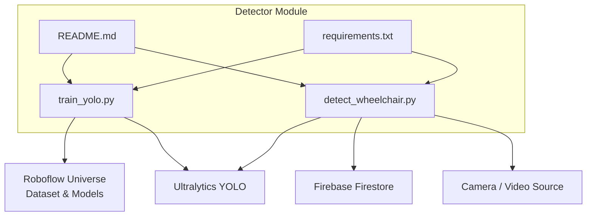
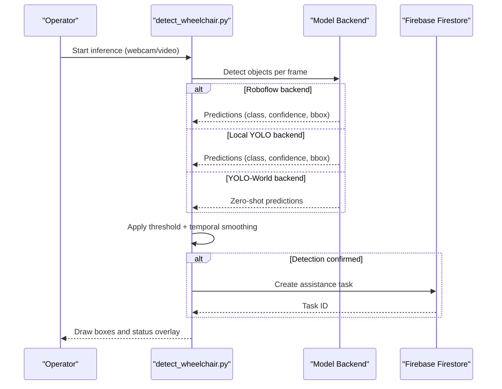
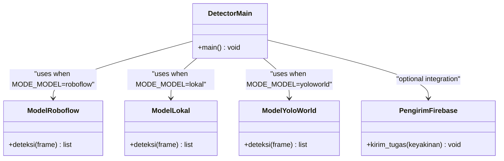
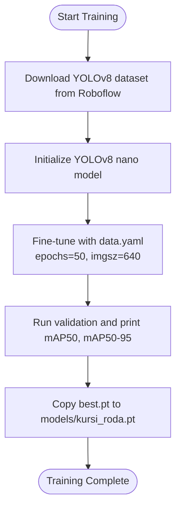
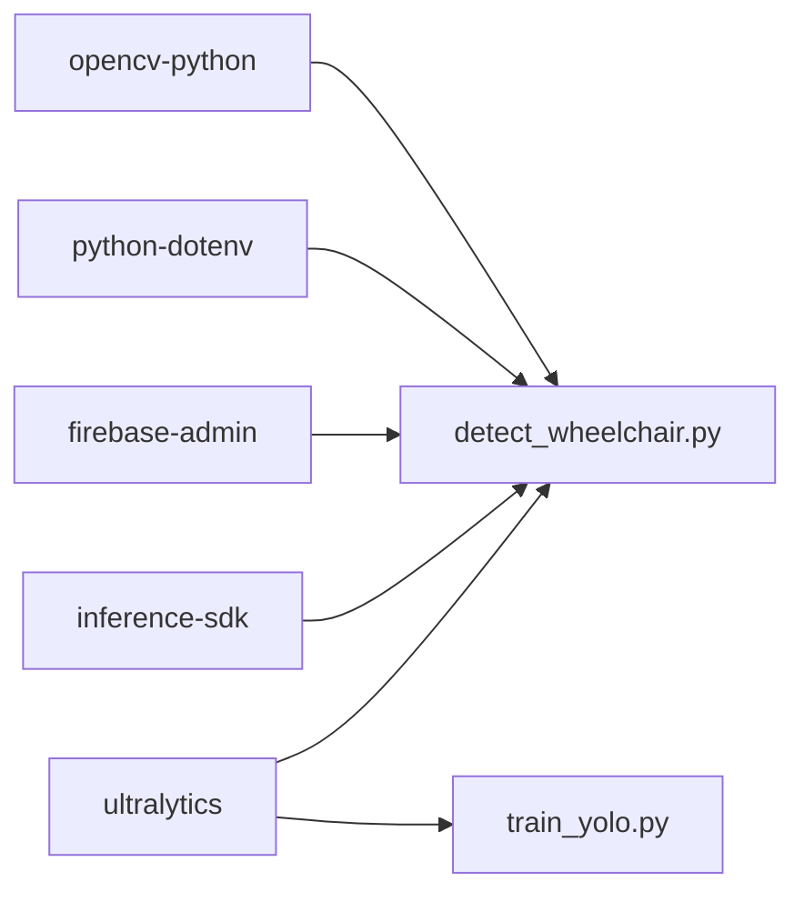

# Model Training

<cite>
**Referenced Files in This Document**
- [train_yolo.py](file://detector/train_yolo.py)
- [detect_wheelchair.py](file://detector/detect_wheelchair.py)
- [README.md](file://detector/README.md)
- [requirements.txt](file://detector/requirements.txt)
</cite>

## Table of Contents
1. [Introduction](#introduction)
2. [Project Structure](#project-structure)
3. [Core Components](#core-components)
4. [Architecture Overview](#architecture-overview)
5. [Detailed Component Analysis](#detailed-component-analysis)
6. [Dependency Analysis](#dependency-analysis)
7. [Performance Considerations](#performance-considerations)
8. [Troubleshooting Guide](#troubleshooting-guide)
9. [Conclusion](#conclusion)
10. [Appendices](#appendices)

## Introduction
This document explains the YOLO model training pipeline for wheelchair detection using Roboflow SDK and Ultralytics YOLO, tailored to accessibility scenarios. It covers dataset preparation, annotation standards, augmentation strategies, training configuration, hyperparameter tuning, evaluation metrics, environment setup, execution steps, validation procedures, best practices for dataset curation and class imbalance, optimization for edge deployment, and model versioning and deployment workflows. The guidance is grounded in the repository’s detector module, which provides both a training script and an inference pipeline that integrates with Firebase Firestore.

## Project Structure
The relevant code for training and deploying the wheelchair detection model resides under the detector directory:
- train_yolo.py: Fine-tunes YOLOv8 on a Roboflow dataset and exports the best model locally.
- detect_wheelchair.py: Runs real-time or video inference using either a Roboflow-hosted model, a local YOLO model, or YOLO-World zero-shot mode, and optionally writes assistance requests to Firebase Firestore.
- README.md: Step-by-step instructions for environment setup, running inference, connecting to Firebase, and training your own model.
- requirements.txt: Python dependencies for OpenCV, dotenv, Firebase Admin, Roboflow Inference SDK, and Ultralytics.

**Diagram sources**
- [train_yolo.py:1-64](file://detector/train_yolo.py#L1-L64)
- [detect_wheelchair.py:1-291](file://detector/detect_wheelchair.py#L1-L291)
- [README.md:1-93](file://detector/README.md#L1-L93)
- [requirements.txt:1-7](file://detector/requirements.txt#L1-L7)

**Section sources**
- [README.md:10-75](file://detector/README.md#L10-L75)
- [requirements.txt:1-7](file://detector/requirements.txt#L1-L7)

## Core Components
- Training Script (train_yolo.py): Downloads a YOLOv8-formatted dataset from Roboflow, fine-tunes a pre-trained YOLOv8 nano model, evaluates performance on the validation set, and copies the best model weights to models/kursi_roda.pt.
- Inference Script (detect_wheelchair.py): Supports three model backends:
  - Roboflow serverless inference via InferenceHTTPClient.
  - Local YOLO model loading from a .pt file.
  - YOLO-World zero-shot detection configured by class names.
  It also integrates with Firebase Firestore to create assistance tasks when wheelchairs are detected consistently across frames.

Key responsibilities:
- Dataset acquisition and format conversion through Roboflow SDK.
- Fine-tuning workflow with Ultralytics YOLO API.
- Real-time or video inference with configurable thresholds and temporal smoothing.
- Optional cloud integration for operational workflows.

**Section sources**
- [train_yolo.py:21-59](file://detector/train_yolo.py#L21-L59)
- [detect_wheelchair.py:30-68](file://detector/detect_wheelchair.py#L30-L68)
- [detect_wheelchair.py:73-148](file://detector/detect_wheelchair.py#L73-L148)
- [detect_wheelchair.py:164-192](file://detector/detect_wheelchair.py#L164-L192)

## Architecture Overview
The system supports two primary paths:
- Jalan A (Roboflow): Use a hosted model via Roboflow serverless inference. Requires internet access and an API key.
- Jalan B (Local): Train a custom YOLO model and run inference offline using the exported .pt file.

Both paths feed into the same post-processing and optional Firebase integration logic.

**Diagram sources**
- [detect_wheelchair.py:73-148](file://detector/detect_wheelchair.py#L73-L148)
- [detect_wheelchair.py:164-192](file://detector/detect_wheelchair.py#L164-L192)
- [detect_wheelchair.py:214-286](file://detector/detect_wheelchair.py#L214-L286)

## Detailed Component Analysis

### Dataset Preparation and Annotation Standards
- Dataset source: Roboflow Universe projects containing wheelchair-related images.
- Format: YOLOv8 dataset format downloaded via Roboflow SDK.
- Annotation expectations:
  - Classes should include wheelchair-related labels such as “wheelchair”, “wheelchair-users”, “wheelchair user”, and “person in wheelchair”.
  - Ensure consistent labeling across images; prefer bounding boxes tightly enclosing wheelchairs and users where applicable.
- Data augmentation:
  - Roboflow provides built-in augmentation options during dataset export; enable augmentations like random flips, brightness adjustments, and scaling to improve robustness.
  - For accessibility scenarios, ensure augmentations preserve visibility of wheelchairs and do not distort spatial relationships critical for detection.

Best practices:
- Curate diverse scenes: indoor stations, outdoor platforms, varied lighting conditions, occlusions, and different wheelchair types.
- Balance classes: If certain labels are rare, consider oversampling or targeted augmentation to mitigate imbalance.
- Validate annotations: Spot-check a subset of images to ensure label correctness and box quality.

**Section sources**
- [train_yolo.py:24-31](file://detector/train_yolo.py#L24-L31)
- [detect_wheelchair.py:40-56](file://detector/detect_wheelchair.py#L40-L56)
- [README.md:63-75](file://detector/README.md#L63-L75)

### Training Configuration and Hyperparameters
- Base model: YOLOv8 nano (yolov8n.pt) for fast fine-tuning.
- Epochs: Default 50; increase if more training time is available.
- Image size: 640 pixels.
- Output naming: “kursi_roda” experiment name.
- Evaluation: Validation metrics printed include mAP50 and mAP50-95.
- Export: Best model saved to models/kursi_roda.pt for local inference.

Recommended tuning:
- Increase epochs gradually while monitoring validation metrics to avoid overfitting.
- Adjust image size based on target device constraints and object scale.
- Experiment with learning rate and batch size if extending the training script beyond defaults.

**Section sources**
- [train_yolo.py:34-59](file://detector/train_yolo.py#L34-L59)

### Inference Pipeline and Post-Processing
- Model backends:
  - Roboflow serverless client requires an API key and model ID.
  - Local YOLO model loads a .pt file path.
  - YOLO-World allows zero-shot detection by specifying class names.
- Thresholding and temporal smoothing:
  - Confidence threshold controlled by AMBANG_KEYAKINAN.
  - Consecutive detections required (FRAME_BERTURUT) before triggering an action.
  - Anti-spam delay between tasks (JEDA_ANTAR_TUGAS_DETIK).
  - Detection frequency throttling (DETEKSI_TIAP_DETIK) to reduce API usage.
- Target class matching:
  - KELAS_TARGET lists acceptable class names; detection must match one of these names and exceed the confidence threshold.

Operational notes:
- Visual overlays indicate detected objects; red boxes denote target class matches.
- Status text shows whether a wheelchair is currently detected or the system is monitoring.

**Section sources**
- [detect_wheelchair.py:30-68](file://detector/detect_wheelchair.py#L30-L68)
- [detect_wheelchair.py:73-148](file://detector/detect_wheelchair.py#L73-L148)
- [detect_wheelchair.py:198-212](file://detector/detect_wheelchair.py#L198-L212)
- [detect_wheelchair.py:214-286](file://detector/detect_wheelchair.py#L214-L286)

### Firebase Integration for Accessibility Workflows
- When a wheelchair is consistently detected, the system creates a new assistance request in Firestore with fields including assistance type, pickup location, status, source, camera ID, confidence, and timestamp.
- The Flutter application can listen to this collection to display new tasks for staff.

Data schema highlights:
- jenisBantuan: Assistance type (e.g., “kursi_roda”).
- titikJemput: Pickup location tied to camera identity.
- status: Workflow state (e.g., “menunggu”).
- sumber: Source (“kamera_ai” for AI-triggered tasks).
- keyakinan: Confidence score rounded to two decimals.
- dibuatPada: Server timestamp for ordering.

**Section sources**
- [detect_wheelchair.py:164-192](file://detector/detect_wheelchair.py#L164-L192)
- [README.md:39-61](file://detector/README.md#L39-L61)

### Class Diagram: Inference Backends and Integrations

**Diagram sources**
- [detect_wheelchair.py:73-148](file://detector/detect_wheelchair.py#L73-L148)
- [detect_wheelchair.py:164-192](file://detector/detect_wheelchair.py#L164-L192)
- [detect_wheelchair.py:214-286](file://detector/detect_wheelchair.py#L214-L286)

### Flowchart: Training Pipeline

**Diagram sources**
- [train_yolo.py:34-59](file://detector/train_yolo.py#L34-L59)

## Dependency Analysis
External libraries and their roles:
- opencv-python: Video capture and drawing overlays.
- python-dotenv: Environment variable management.
- firebase-admin: Firestore integration for creating assistance tasks.
- inference-sdk: Roboflow serverless inference client.
- ultralytics: YOLO and YOLO-World model loading, training, and inference.

**Diagram sources**
- [requirements.txt:1-7](file://detector/requirements.txt#L1-L7)
- [detect_wheelchair.py:21-28](file://detector/detect_wheelchair.py#L21-L28)
- [train_yolo.py:18-22](file://detector/train_yolo.py#L18-L22)

**Section sources**
- [requirements.txt:1-7](file://detector/requirements.txt#L1-L7)

## Performance Considerations
- Model selection:
  - yolov8n.pt offers speed suitable for edge devices; larger models may improve accuracy at the cost of latency.
- Image size:
  - 640px balances accuracy and speed; adjust based on device capabilities and object scales.
- Inference throttling:
  - DETEKSI_TIAP_DETIK reduces API calls and computational load; tune to balance responsiveness and resource usage.
- Temporal smoothing:
  - FRAME_BERTURUT prevents false positives by requiring consecutive detections; higher values reduce noise but may delay alerts.
- Confidence threshold:
  - AMBANG_KEYAKINAN controls precision vs. recall; raise to reduce false alarms, lower to catch more instances.

[No sources needed since this section provides general guidance]

## Troubleshooting Guide
Common issues and resolutions:
- Missing environment variables:
  - Ensure ROBOFLOW_API_KEY and other .env settings are present.
  - For local mode, verify MODEL_LOKAL points to an existing .pt file.
- Camera or video source errors:
  - Confirm the source index or URL is valid; handle exceptions gracefully.
- Roboflow inference failures:
  - Check network connectivity and API key validity; fallback to local model if needed.
- Firebase initialization errors:
  - Verify firebase-key.json exists and has correct permissions; ensure Firestore is enabled.
- No detections:
  - Adjust AMBANG_KEYAKINAN and KELAS_TARGET to match model outputs; test with known images/videos.

Operational tips:
- Run with --tanpa-firebase to isolate detection behavior.
- Use a backup video containing wheelchair examples for testing without live cameras.

**Section sources**
- [detect_wheelchair.py:76-86](file://detector/detect_wheelchair.py#L76-L86)
- [detect_wheelchair.py:105-114](file://detector/detect_wheelchair.py#L105-L114)
- [detect_wheelchair.py:166-176](file://detector/detect_wheelchair.py#L166-L176)
- [detect_wheelchair.py:214-286](file://detector/detect_wheelchair.py#L214-L286)
- [README.md:86-93](file://detector/README.md#L86-L93)

## Conclusion
The detector module provides a practical, extensible pipeline for wheelchair detection tailored to accessibility scenarios. By leveraging Roboflow datasets and Ultralytics YOLO, teams can quickly fine-tune models, evaluate performance, and deploy either cloud-based or offline inference. The integration with Firebase enables automated assistance workflows, while configurable thresholds and temporal smoothing ensure reliable operation. Following the recommended dataset curation, augmentation, and tuning practices will improve accuracy and robustness, especially for edge deployments.

[No sources needed since this section summarizes without analyzing specific files]

## Appendices

### Step-by-Step Setup and Execution
- Environment setup:
  - Install Python 3.10+ and activate a virtual environment.
  - Install dependencies from requirements.txt.
  - Copy .env.example to .env and fill in required keys.
- Running inference:
  - Webcam: python detect_wheelchair.py
  - Video file: python detect_wheelchair.py --sumber video.mp4
  - Test without Firebase: python detect_wheelchair.py --tanpa-firebase
- Training your own model:
  - Use Google Colab with GPU enabled.
  - Upload train_yolo.py, configure workspace/project/version from Roboflow download page.
  - Execute training and download models/kursi_roda.pt.
  - Set MODE_MODEL=lokal in .env to use the local model.

**Section sources**
- [README.md:10-35](file://detector/README.md#L10-L35)
- [README.md:63-75](file://detector/README.md#L63-L75)

### Model Versioning and Deployment Workflows
- Roboflow model versioning:
  - Select a specific model ID and version for reproducible inference.
  - Update ROBOFLOW_MODEL_ID in .env when promoting new versions.
- Local model versioning:
  - Maintain a models/ directory with named artifacts (e.g., kursi_roda_v1.pt).
  - Track training metadata (epochs, image size, dataset version) alongside model files.
- Deployment:
  - For edge devices, package the local .pt model with the inference script.
  - For cloud inference, manage API keys and model IDs securely via environment variables.
- Monitoring and iteration:
  - Log confidence scores and task creation events.
  - Periodically retrain with updated datasets to improve performance.

**Section sources**
- [detect_wheelchair.py:33-38](file://detector/detect_wheelchair.py#L33-L38)
- [train_yolo.py:53-59](file://detector/train_yolo.py#L53-L59)