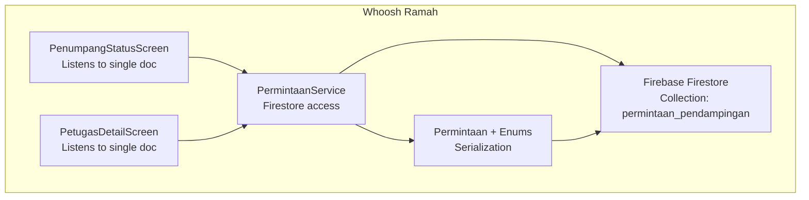
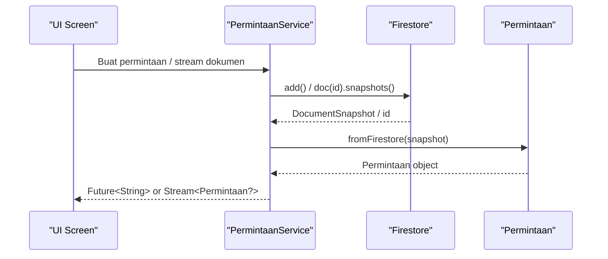
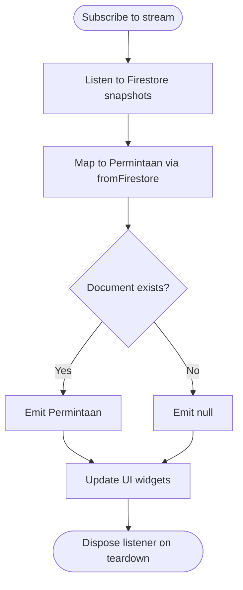
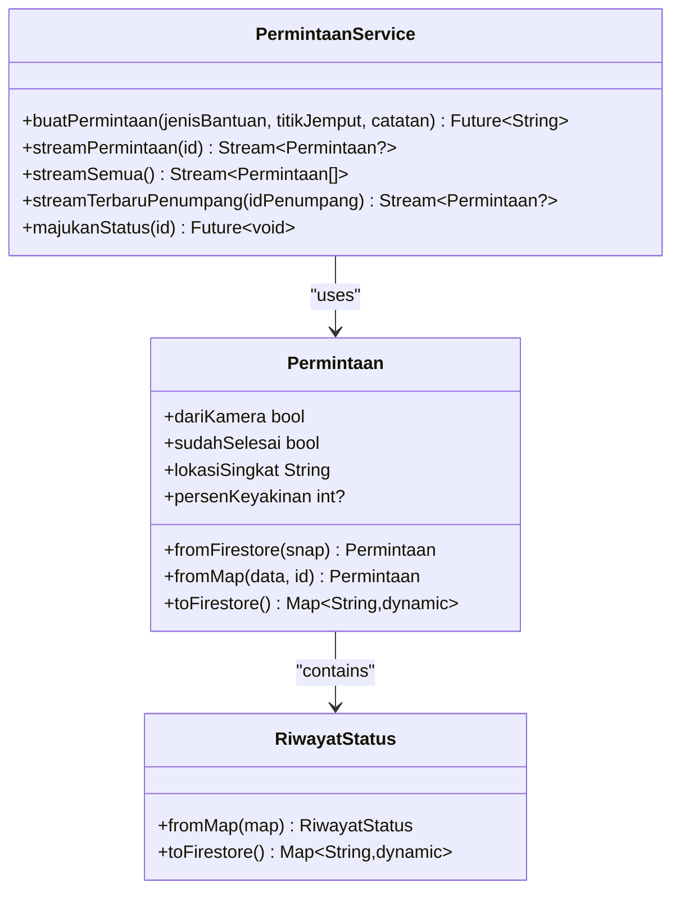

# API Reference

<cite>
**Referenced Files in This Document**
- [permintaan_service.dart](file://whoosh_ramah/lib/services/permintaan_service.dart)
- [permintaan.dart](file://whoosh_ramah/lib/models/permintaan.dart)
- [PROJECT.md](file://PROJECT.md)
- [penumpang_status_screen.dart](file://whoosh_ramah/lib/screens/penumpang_status_screen.dart)
- [petugas_detail_screen.dart](file://whoosh_ramah/lib/screens/petugas_detail_screen.dart)
</cite>

## Table of Contents
1. [Introduction](#introduction)
2. [Project Structure](#project-structure)
3. [Core Components](#core-components)
4. [Architecture Overview](#architecture-overview)
5. [Detailed Component Analysis](#detailed-component-analysis)
6. [Dependency Analysis](#dependency-analysis)
7. [Performance Considerations](#performance-considerations)
8. [Troubleshooting Guide](#troubleshooting-guide)
9. [Conclusion](#conclusion)

## Introduction
This document provides an API reference for the Whoosh Ramah services that manage assistance requests through Firestore. It focuses on the `PermintaanService` class and the `Permintaan` model, documenting public methods, data transformation, real-time stream patterns, error handling, and operational considerations such as rate limiting and connection management.

The service layer encapsulates all Firestore operations for the `permintaan_pendampingan` collection, including creating new requests, streaming live updates, querying the latest request per passenger, and advancing status through a defined workflow. The model layer defines enums, helper types, and serialization logic used by both the service and UI screens.

## Project Structure
The relevant code is organized into:
- Service layer: `whoosh_ramah/lib/services/permintaan_service.dart`
- Model layer: `whoosh_ramah/lib/models/permintaan.dart`
- UI screens consuming streams: `whoosh_ramah/lib/screens/penumpang_status_screen.dart`, `whoosh_ramah/lib/screens/petugas_detail_screen.dart`
- Data contract specification: `PROJECT.md`

**Diagram sources**
- [permintaan_service.dart:10-21](file://whoosh_ramah/lib/services/permintaan_service.dart#L10-L21)
- [permintaan.dart:77-213](file://whoosh_ramah/lib/models/permintaan.dart#L77-L213)
- [penumpang_status_screen.dart:16-41](file://whoosh_ramah/lib/screens/penumpang_status_screen.dart#L16-L41)
- [petugas_detail_screen.dart:32-32](file://whoosh_ramah/lib/screens/petugas_detail_screen.dart#L32-L32)

**Section sources**
- [permintaan_service.dart:1-21](file://whoosh_ramah/lib/services/permintaan_service.dart#L1-L21)
- [permintaan.dart:1-213](file://whoosh_ramah/lib/models/permintaan.dart#L1-L213)
- [PROJECT.md:56-96](file://PROJECT.md#L56-L96)

## Core Components
- PermintaanService: Encapsulates Firestore operations for the `permintaan_pendampingan` collection. Provides creation, streaming, and status advancement APIs.
- Permintaan model: Strongly typed representation of a Firestore document with null-safe fields, enum conversions, and serialization helpers.

Key responsibilities:
- Create new assistance requests from app data (using dummy demo data).
- Stream single-document updates for passenger status screens.
- Stream full collection sorted by creation time.
- Stream the latest request per passenger without requiring composite indexes.
- Advance status through a fixed workflow while recording history.

**Section sources**
- [permintaan_service.dart:10-135](file://whoosh_ramah/lib/services/permintaan_service.dart#L10-L135)
- [permintaan.dart:77-213](file://whoosh_ramah/lib/models/permintaan.dart#L77-L213)

## Architecture Overview
The service uses lazy initialization of `FirebaseFirestore.instance` to avoid touching Firebase during construction, enabling testability. Streams are built using Firestore snapshots and mapped to domain models via `Permintaan.fromFirestore`. Status transitions are enforced by the `StatusPermintaan` enum’s `berikutnya` property.

**Diagram sources**
- [permintaan_service.dart:28-68](file://whoosh_ramah/lib/services/permintaan_service.dart#L28-L68)
- [permintaan.dart:150-153](file://whoosh_ramah/lib/models/permintaan.dart#L150-L153)

## Detailed Component Analysis

### PermintaanService API

#### createPermintaan()
Note: In the source code, this method is named `buatPermintaan()`. It creates a new assistance request and returns the new document ID.

- Method signature
  - `Future<String> buatPermintaan({required JenisBantuan jenisBantuan, required String titikJemput, String? catatan})`
- Parameters
  - `jenisBantuan`: Required. Enum value indicating the type of assistance requested.
  - `titikJemput`: Required. Pickup location string.
  - `catatan`: Optional. Free-text note attached to the request.
- Return value
  - A `Future<String>` resolving to the newly created document ID.
- Behavior
  - Populates payload with dummy passenger and ticket data.
  - Sets initial status to `menunggu`, source to `aplikasi`, and initializes `riwayat` with one entry.
  - Uses server timestamps for `dibuatPada` and `diperbaruiPada`.
- Error handling
  - Propagates Firestore exceptions (e.g., network errors, permission issues) to the caller.
  - No explicit try/catch; callers should handle exceptions.
- Usage example pattern
  - Call `service.buatPermintaan(...)` and await the returned ID.
  - On success, use the ID to subscribe to `streamPermintaan(id)`.
  - Wrap calls in try/catch to display user-friendly errors.

**Section sources**
- [permintaan_service.dart:23-61](file://whoosh_ramah/lib/services/permintaan_service.dart#L23-L61)
- [permintaan.dart:3-25](file://whoosh_ramah/lib/models/permintaan.dart#L3-L25)

#### streamPermintaan(id)
Streams live updates for a single document identified by `id`.

- Method signature
  - `Stream<Permintaan?> streamPermintaan(String id)`
- Parameters
  - `id`: Firestore document ID to listen to.
- Return value
  - A `Stream<Permintaan?>` emitting the current `Permintaan` when the document exists, or `null` if it does not exist.
- Behavior
  - Subscribes to `doc(id).snapshots()` and maps to `Permintaan.fromFirestore(snap)` when present.
- Error handling
  - Emits `null` when the document is missing; other Firestore errors propagate to the stream error channel.
- Resource cleanup
  - Ensure listeners are unsubscribed when the widget is disposed to avoid leaks.

**Section sources**
- [permintaan_service.dart:63-68](file://whoosh_ramah/lib/services/permintaan_service.dart#L63-L68)
- [permintaan.dart:150-153](file://whoosh_ramah/lib/models/permintaan.dart#L150-L153)

#### streamDaftarTugas()
Note: In the source code, this method is named `streamSemua()`. It streams the entire collection ordered by creation time.

- Method signature
  - `Stream<List<Permintaan>> streamSemua()`
- Parameters
  - None.
- Return value
  - A `Stream<List<Permintaan>>` emitting lists of up to 100 documents, newest first.
- Behavior
  - Orders by `dibuatPada` descending and limits results to 100.
  - Maps each snapshot document to `Permintaan.fromFirestore`.
- Indexing note
  - Only orders by one field, so no composite index is required.
- Error handling
  - Propagates Firestore errors to the stream error channel.

**Section sources**
- [permintaan_service.dart:70-78](file://whoosh_ramah/lib/services/permintaan_service.dart#L70-L78)
- [permintaan.dart:150-153](file://whoosh_ramah/lib/models/permintaan.dart#L150-L153)

#### streamPermintaanTerbaru()
Note: In the source code, this method is named `streamTerbaruPenumpang(idPenumpang)`. It streams the latest request for a specific passenger.

- Method signature
  - `Stream<Permintaan?> streamTerbaruPenumpang(String idPenumpang)`
- Parameters
  - `idPenumpang`: Passenger identifier to filter by.
- Return value
  - A `Stream<Permintaan?>` emitting the most recent request for the given passenger, or `null` if none exist.
- Behavior
  - Filters by `idPenumpang`, sorts results locally by `dibuatPada` descending, and returns the first document.
  - Avoids needing a composite index by sorting client-side.
- Error handling
  - Returns `null` when no documents match; other Firestore errors propagate to the stream error channel.

**Section sources**
- [permintaan_service.dart:80-90](file://whoosh_ramah/lib/services/permintaan_service.dart#L80-L90)
- [permintaan_service.dart:121-134](file://whoosh_ramah/lib/services/permintaan_service.dart#L121-L134)
- [permintaan.dart:150-153](file://whoosh_ramah/lib/models/permintaan.dart#L150-L153)

#### majukanStatus(id)
Advances the status of a request to the next stage in the workflow.

- Method signature
  - `Future<void> majukanStatus(String id)`
- Parameters
  - `id`: Firestore document ID to update.
- Return value
  - A `Future<void>` completing when the update finishes.
- Behavior
  - Reads the current document; if missing, does nothing.
  - Computes the next status using `StatusPermintaan.berikutnya`; if already at the final state, does nothing.
  - Updates `status`, sets `diperbaruiPada` to server timestamp, and appends a history entry using `FieldValue.arrayUnion`.
  - When transitioning to `ditugaskan`, assigns the default staff name from dummy data.
- Error handling
  - Silently ignores missing documents or terminal states.
  - Propagates Firestore write errors to the caller.

**Section sources**
- [permintaan_service.dart:92-119](file://whoosh_ramah/lib/services/permintaan_service.dart#L92-L119)
- [permintaan.dart:32-57](file://whoosh_ramah/lib/models/permintaan.dart#L32-L57)

### Data Transformation Methods

#### Permintaan.fromFirestore(snap)
Builds a `Permintaan` instance from a Firestore snapshot.

- Signature
  - `factory Permintaan.fromFirestore(DocumentSnapshot<Map<String, dynamic>> snap)`
- Input
  - Firestore document snapshot.
- Output
  - `Permintaan` object with null-safe field mapping.
- Behavior
  - Delegates to `fromMap` with the snapshot’s data and ID.
- Error handling
  - Safe against missing fields; defaults applied where appropriate.

**Section sources**
- [permintaan.dart:150-153](file://whoosh_ramah/lib/models/permintaan.dart#L150-L153)

#### Permintaan.fromMap(data, {id})
Constructs a `Permintaan` from a raw map.

- Signature
  - `factory Permintaan.fromMap(Map<String, dynamic> data, {String id = ''})`
- Input
  - Raw Firestore document map and optional document ID.
- Output
  - `Permintaan` object.
- Behavior
  - Converts enum strings to typed enums with safe fallbacks.
  - Parses timestamps to `DateTime` when present.
  - Builds `riwayat` list safely even if absent.

**Section sources**
- [permintaan.dart:155-189](file://whoosh_ramah/lib/models/permintaan.dart#L155-L189)

#### Permintaan.toFirestore()
Serializes a `Permintaan` back to a Firestore-compatible map.

- Signature
  - `Map<String, dynamic> toFirestore()`
- Output
  - Map suitable for writing to Firestore.
- Behavior
  - Serializes enums to their string values.
  - Converts `DateTime` fields to Firestore `Timestamp`s when non-null.
  - Serializes nested `riwayat` entries.

**Section sources**
- [permintaan.dart:191-212](file://whoosh_ramah/lib/models/permintaan.dart#L191-L212)

### Real-Time Stream Patterns and Event-Driven Updates
- Single-document stream: `streamPermintaan(id)` is used by passenger-facing screens to reflect live status changes.
- Collection stream: `streamSemua()` provides a paginated view of all requests, ordered by creation time.
- Latest-per-passenger stream: `streamTerbaruPenumpang(idPenumpang)` enables family screens to show the most recent request for a passenger without requiring composite indexes.

**Diagram sources**
- [permintaan_service.dart:63-90](file://whoosh_ramah/lib/services/permintaan_service.dart#L63-L90)
- [permintaan.dart:150-153](file://whoosh_ramah/lib/models/permintaan.dart#L150-L153)

**Section sources**
- [penumpang_status_screen.dart:16-41](file://whoosh_ramah/lib/screens/penumpang_status_screen.dart#L16-L41)
- [petugas_detail_screen.dart:32-32](file://whoosh_ramah/lib/screens/petugas_detail_screen.dart#L32-L32)

## Dependency Analysis
- PermintaanService depends on:
  - `cloud_firestore` for collection/document operations.
  - `DummyData` for demo passenger/ticket/staff data.
  - `Permintaan` model for serialization and enum definitions.
- Permintaan model depends on:
  - `cloud_firestore` for `Timestamp` usage.
  - Enums `JenisBantuan` and `StatusPermintaan` for typed values and workflow rules.

**Diagram sources**
- [permintaan_service.dart:10-135](file://whoosh_ramah/lib/services/permintaan_service.dart#L10-L135)
- [permintaan.dart:59-213](file://whoosh_ramah/lib/models/permintaan.dart#L59-L213)

**Section sources**
- [permintaan_service.dart:1-135](file://whoosh_ramah/lib/services/permintaan_service.dart#L1-L135)
- [permintaan.dart:1-213](file://whoosh_ramah/lib/models/permintaan.dart#L1-L213)

## Performance Considerations
- Query efficiency:
  - `streamSemua()` uses a single-field order (`dibuatPada`) plus limit, avoiding composite index requirements.
  - `streamTerbaruPenumpang()` avoids composite indexes by filtering and sorting client-side.
- Stream lifecycle:
  - Always dispose stream subscriptions in UI components to prevent memory leaks and unnecessary network traffic.
- Firestore best practices:
  - Use server timestamps for authoritative ordering and audit trails.
  - Batch writes where possible; here, status updates use targeted field updates and array unions.
- Rate limiting:
  - Firestore enforces quotas; avoid excessive re-subscriptions or polling.
  - Debounce rapid UI-triggered actions (e.g., repeated status advances) to reduce write storms.

[No sources needed since this section provides general guidance]

## Troubleshooting Guide
Common issues and resolutions:
- Missing document in single-document stream:
  - `streamPermintaan(id)` emits `null` when the document does not exist. Handle this gracefully in UI (e.g., show “not found” state).
- Terminal status:
  - `majukanStatus(id)` is a no-op when the request is already in the final state. Ensure UI disables further action buttons accordingly.
- Timestamp ordering:
  - Documents may temporarily lack `dibuatPada` before server timestamp resolves. Sorting logic treats missing timestamps as older.
- Field compatibility:
  - Documents created by the AI detector may omit certain fields (e.g., `riwayat`). The model handles missing fields safely; ensure UI checks for nulls.

Operational tips:
- Wrap Firestore calls in try/catch blocks to surface errors to users.
- Validate inputs (e.g., non-empty pickup location) before calling service methods.
- Unsubscribe from streams in `dispose` to free resources.

**Section sources**
- [permintaan_service.dart:63-119](file://whoosh_ramah/lib/services/permintaan_service.dart#L63-L119)
- [permintaan.dart:150-189](file://whoosh_ramah/lib/models/permintaan.dart#L150-L189)

## Conclusion
The Whoosh Ramah service layer provides a focused API for managing assistance requests through Firestore. It offers clear creation, streaming, and status progression capabilities, with robust model serialization and null-safe handling. By adhering to the documented method signatures, stream patterns, and operational guidelines, developers can implement responsive, reliable features for passengers, families, and staff while maintaining performance and correctness.

[No sources needed since this section summarizes without analyzing specific files]