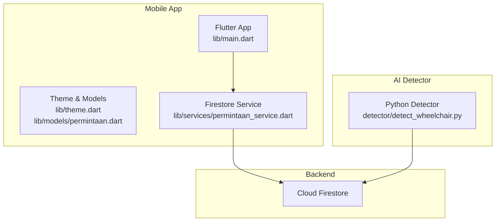
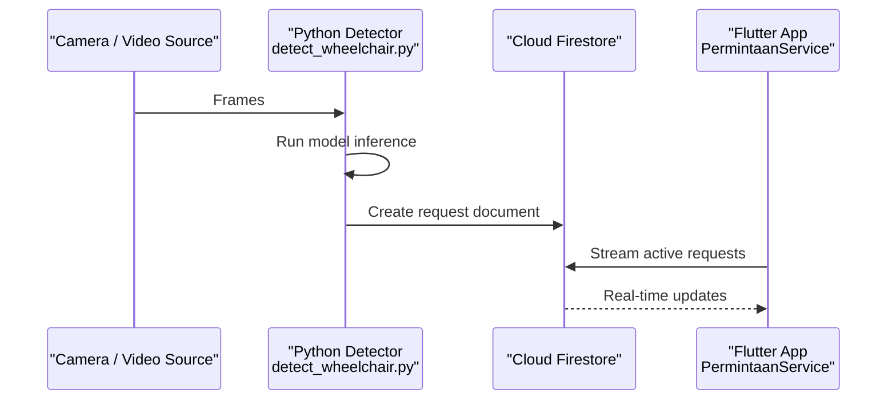
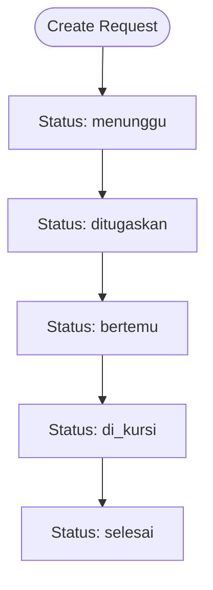
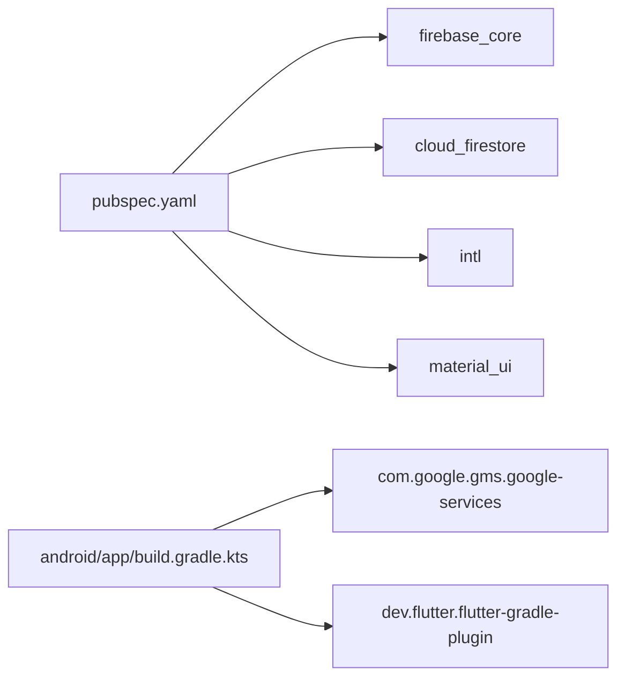

# Deployment & Production

<cite>
**Referenced Files in This Document**
- [PROJECT.md](file://PROJECT.md)
- [whoosh_ramah/pubspec.yaml](file://whoosh_ramah/pubspec.yaml)
- [whoosh_ramah/android/app/build.gradle.kts](file://whoosh_ramah/android/app/build.gradle.kts)
- [whoosh_ramah/android/build.gradle.kts](file://whoosh_ramah/android/build.gradle.kts)
- [whoosh_ramah/android/app/src/main/AndroidManifest.xml](file://whoosh_ramah/android/app/src/main/AndroidManifest.xml)
- [whoosh_ramah/lib/firebase_options.dart](file://whoosh_ramah/lib/firebase_options.dart)
- [whoosh_ramah/lib/main.dart](file://whoosh_ramah/lib/main.dart)
- [whoosh_ramah/lib/theme.dart](file://whoosh_ramah/lib/theme.dart)
- [whoosh_ramah/lib/models/permintaan.dart](file://whoosh_ramah/lib/models/permintaan.dart)
- [whoosh_ramah/lib/services/permintaan_service.dart](file://whoosh_ramah/lib/services/permintaan_service.dart)
- [whoosh_ramah/firebase.json](file://whoosh_ramah/firebase.json)
- [detector/README.md](file://detector/README.md)
- [detector/detect_wheelchair.py](file://detector/detect_wheelchair.py)
- [detector/requirements.txt](file://detector/requirements.txt)
</cite>

## Table of Contents
1. Introduction
2. Project Structure
3. Core Components
4. Architecture Overview
5. Detailed Component Analysis
6. Dependency Analysis
7. Performance Considerations
8. Troubleshooting Guide
9. Conclusion
10. Appendices

## Introduction
This document provides production deployment guidance for the Whoosh Ramah application, covering:
- Android and iOS build configuration, signing, and app store submission
- Migration of Firebase security rules from demo mode to production with authentication and authorization
- Deployment strategies for the Python AI detection system (containerization, cloud options, scaling)
- Performance optimization techniques (app size reduction, asset optimization, efficient Firestore queries)
- Monitoring, logging, crash reporting, and analytics integration
- Security best practices for sensitive passenger data and API endpoints

The project is a Flutter mobile app that reads and writes to Cloud Firestore, plus a separate Python detector service that creates assistance requests when wheelchair users are detected at station entrances.

## Project Structure
At a high level:
- Flutter app under whoosh_ramah/
  - Entry point initializes Firebase and starts the UI
  - Theme and models define consistent UI and data contracts
  - Service layer encapsulates Firestore operations
  - Android Gradle configures build types and Google Services
- Python detector under detector/
  - Reads camera/video, runs object detection, and writes tasks to Firestore
  - Uses environment variables and a Firebase service account key

**Diagram sources**
- [whoosh_ramah/lib/main.dart:8-14](file://whoosh_ramah/lib/main.dart#L8-L14)
- [whoosh_ramah/lib/services/permintaan_service.dart:20-21](file://whoosh_ramah/lib/services/permintaan_service.dart#L20-L21)
- [detector/detect_wheelchair.py:164-192](file://detector/detect_wheelchair.py#L164-L192)

**Section sources**
- [PROJECT.md:24-37](file://PROJECT.md#L24-L37)
- [whoosh_ramah/lib/main.dart:8-14](file://whoosh_ramah/lib/main.dart#L8-L14)

## Core Components
- Application entrypoint initializes Firebase and launches the role selection screen.
- Theme defines colors, typography, and component styles aligned with design guidelines.
- Data model enforces enum constraints for assistance type and status, and handles null-safe mapping for documents created by the detector.
- Service layer centralizes Firestore reads/writes, including real-time streams and status progression logic.

Key responsibilities:
- Initialization and runtime setup: [whoosh_ramah/lib/main.dart:8-14](file://whoosh_ramah/lib/main.dart#L8-L14)
- Design tokens and UI consistency: [whoosh_ramah/lib/theme.dart:67-113](file://whoosh_ramah/lib/theme.dart#L67-L113)
- Data contract and validation: [whoosh_ramah/lib/models/permintaan.dart:7-57](file://whoosh_ramah/lib/models/permintaan.dart#L7-L57), [whoosh_ramah/lib/models/permintaan.dart:81-124](file://whoosh_ramah/lib/models/permintaan.dart#L81-L124)
- Firestore access patterns: [whoosh_ramah/lib/services/permintaan_service.dart:23-61](file://whoosh_ramah/lib/services/permintaan_service.dart#L23-L61), [whoosh_ramah/lib/services/permintaan_service.dart:74-90](file://whoosh_ramah/lib/services/permintaan_service.dart#L74-L90), [whoosh_ramah/lib/services/permintaan_service.dart:98-119](file://whoosh_ramah/lib/services/permintaan_service.dart#L98-L119)

**Section sources**
- [whoosh_ramah/lib/main.dart:8-14](file://whoosh_ramah/lib/main.dart#L8-L14)
- [whoosh_ramah/lib/theme.dart:67-113](file://whoosh_ramah/lib/theme.dart#L67-L113)
- [whoosh_ramah/lib/models/permintaan.dart:7-57](file://whoosh_ramah/lib/models/permintaan.dart#L7-L57)
- [whoosh_ramah/lib/services/permintaan_service.dart:23-61](file://whoosh_ramah/lib/services/permintaan_service.dart#L23-L61)

## Architecture Overview
The system integrates three main parts:
- Flutter app: user interfaces for passengers, officers, and family members; reads and updates Firestore
- Python detector: detects wheelchair users and writes assistance requests to Firestore
- Cloud Firestore: real-time database shared between app and detector

**Diagram sources**
- [detector/detect_wheelchair.py:214-290](file://detector/detect_wheelchair.py#L214-L290)
- [whoosh_ramah/lib/services/permintaan_service.dart:74-78](file://whoosh_ramah/lib/services/permintaan_service.dart#L74-L78)

## Detailed Component Analysis

### Android Build Configuration and Signing
Current state:
- Application ID and versioning are configured via Gradle and pubspec
- Release build uses debug signing by default
- Google Services plugin is applied for Firebase integration

Production steps:
- Generate a release keystore and configure signing in the app-level Gradle file
- Remove debug signing from release builds
- Ensure minSdk/targetSdk align with your support policy
- Verify google-services.json is included and matches the production Firebase project

Relevant files:
- App-level Gradle: [whoosh_ramah/android/app/build.gradle.kts:1-42](file://whoosh_ramah/android/app/build.gradle.kts#L1-L42)
- Root Gradle: [whoosh_ramah/android/build.gradle.kts:1-25](file://whoosh_ramah/android/build.gradle.kts#L1-L25)
- Android manifest: [whoosh_ramah/android/app/src/main/AndroidManifest.xml:1-46](file://whoosh_ramah/android/app/src/main/AndroidManifest.xml#L1-L46)
- Package versioning: [whoosh_ramah/pubspec.yaml:19-19](file://whoosh_ramah/pubspec.yaml#L19-L19)

Signing configuration checklist:
- Create a release keystore and keep it secure
- Add signingConfig pointing to the release keystore in app-level Gradle
- Remove or override debug signing for release builds
- Test signed APK/AAB installation on devices before submission

**Section sources**
- [whoosh_ramah/android/app/build.gradle.kts:1-42](file://whoosh_ramah/android/app/build.gradle.kts#L1-L42)
- [whoosh_ramah/android/build.gradle.kts:1-25](file://whoosh_ramah/android/build.gradle.kts#L1-L25)
- [whoosh_ramah/android/app/src/main/AndroidManifest.xml:1-46](file://whoosh_ramah/android/app/src/main/AndroidManifest.xml#L1-L46)
- [whoosh_ramah/pubspec.yaml:19-19](file://whoosh_ramah/pubspec.yaml#L19-L19)

### iOS Build Configuration and Signing
Current state:
- iOS platform is not configured in generated Firebase options
- You must run FlutterFire CLI again to generate iOS configuration

Production steps:
- Run FlutterFire CLI to generate iOS Firebase configuration
- Configure Xcode signing with an Apple Developer certificate and provisioning profile
- Validate Info.plist entries and bundle identifiers match your Apple Developer account

Relevant file:
- Generated Firebase options (iOS currently unsupported): [whoosh_ramah/lib/firebase_options.dart:25-32](file://whoosh_ramah/lib/firebase_options.dart#L25-L32)

**Section sources**
- [whoosh_ramah/lib/firebase_options.dart:25-32](file://whoosh_ramah/lib/firebase_options.dart#L25-L32)

### App Store Submission Processes
Android:
- Build a signed AAB using release configuration
- Prepare store listing, screenshots, privacy policy, and content rating
- Upload to Google Play Console and manage internal testing tracks

iOS:
- Archive in Xcode with proper signing
- Submit via Transporter/App Store Connect
- Provide metadata, screenshots, and compliance information

No direct code references needed for this section.

### Firebase Security Rules Migration
Current state:
- Demo rules allow read/write to all documents without authentication
- This must be replaced with strict rules for production

Migration plan:
- Enable Firebase Authentication and identify roles (passenger, officer, family)
- Restrict writes to authenticated users and specific roles
- Enforce field-level permissions (e.g., only officers can update status)
- Validate enum values and required fields server-side via rules
- Use Firestore indexes where necessary and avoid client-side sorting when possible

Demo rules reference:
- [PROJECT.md:97-108](file://PROJECT.md#L97-L108)

Recommended rule principles:
- Require authentication for all reads/writes
- Allow passengers to create requests and read their own documents
- Allow officers to update status and assign themselves
- Allow family to read latest request for a known passenger ID
- Validate enums and timestamps server-side

**Section sources**
- [PROJECT.md:97-108](file://PROJECT.md#L97-L108)

### Python AI Detection System Deployment
Current state:
- The detector runs locally, reading camera/video and writing to Firestore
- It supports Roboflow, local YOLO models, and YOLO-World modes
- Requires a Firebase service account key and environment variables

Deployment strategies:
- Containerize the detector with Docker
- Deploy to a managed container platform (Cloud Run, ECS, GKE, AKS)
- Scale horizontally based on camera count and CPU/GPU requirements
- Use secrets management for Firebase key and Roboflow API key
- Monitor inference latency and error rates

Relevant files:
- Detector README: [detector/README.md:10-48](file://detector/README.md#L10-L48)
- Main script: [detector/detect_wheelchair.py:151-192](file://detector/detect_wheelchair.py#L151-L192)
- Dependencies: [detector/requirements.txt:1-7](file://detector/requirements.txt#L1-L7)

Scaling considerations:
- Each camera stream may require dedicated instances if GPU is used
- For CPU-only deployments, consider batching frames or reducing detection frequency
- Use autoscaling policies tied to queue depth or CPU utilization

**Section sources**
- [detector/README.md:10-48](file://detector/README.md#L10-L48)
- [detector/detect_wheelchair.py:151-192](file://detector/detect_wheelchair.py#L151-L192)
- [detector/requirements.txt:1-7](file://detector/requirements.txt#L1-L7)

### Data Model and Status Flow
The data model enforces safe handling of fields from both app-created and detector-created documents. Status progression follows a fixed order and records history.

**Diagram sources**
- [whoosh_ramah/lib/models/permintaan.dart:32-57](file://whoosh_ramah/lib/models/permintaan.dart#L32-L57)
- [whoosh_ramah/lib/services/permintaan_service.dart:98-119](file://whoosh_ramah/lib/services/permintaan_service.dart#L98-L119)

**Section sources**
- [whoosh_ramah/lib/models/permintaan.dart:32-57](file://whoosh_ramah/lib/models/permintaan.dart#L32-L57)
- [whoosh_ramah/lib/services/permintaan_service.dart:98-119](file://whoosh_ramah/lib/services/permintaan_service.dart#L98-L119)

## Dependency Analysis
Flutter dependencies include Firebase core and Firestore, intl for formatting, and Material UI components. Android Gradle applies Google Services and Flutter plugins.

**Diagram sources**
- [whoosh_ramah/pubspec.yaml:30-40](file://whoosh_ramah/pubspec.yaml#L30-L40)
- [whoosh_ramah/android/app/build.gradle.kts:1-8](file://whoosh_ramah/android/app/build.gradle.kts#L1-L8)

**Section sources**
- [whoosh_ramah/pubspec.yaml:30-40](file://whoosh_ramah/pubspec.yaml#L30-L40)
- [whoosh_ramah/android/app/build.gradle.kts:1-8](file://whoosh_ramah/android/app/build.gradle.kts#L1-L8)

## Performance Considerations
App size reduction:
- Bundle fonts locally as configured in pubspec to avoid network fetches
- Remove unused assets and images
- Use ProGuard/R8 for Android and enable bitcode for iOS

Asset optimization:
- Compress images and use appropriate resolutions
- Avoid large video assets in the app bundle

Efficient Firestore queries:
- Prefer single-field orderBy and limit to avoid composite index overhead
- Sort client-side only when necessary; prefer server-side ordering
- Limit snapshot sizes and unsubscribe streams when navigating away

References:
- Font bundling: [whoosh_ramah/pubspec.yaml:64-76](file://whoosh_ramah/pubspec.yaml#L64-L76)
- Query patterns: [whoosh_ramah/lib/services/permintaan_service.dart:74-90](file://whoosh_ramah/lib/services/permintaan_service.dart#L74-L90)

[No sources needed since this section provides general guidance]

## Troubleshooting Guide
Common issues and resolutions:
- iOS Firebase options missing: re-run FlutterFire CLI to generate iOS configuration
- Android release signing errors: ensure release keystore is configured and debug signing is removed
- Detector cannot connect to Firebase: verify service account key path and permissions
- Firestore query index errors: add composite indexes or adjust queries to single-field orderBy

Relevant files:
- iOS options unsupported: [whoosh_ramah/lib/firebase_options.dart:25-32](file://whoosh_ramah/lib/firebase_options.dart#L25-L32)
- Android release signing placeholder: [whoosh_ramah/android/app/build.gradle.kts:35-41](file://whoosh_ramah/android/app/build.gradle.kts#L35-L41)
- Detector Firebase initialization: [detector/detect_wheelchair.py:164-177](file://detector/detect_wheelchair.py#L164-L177)

**Section sources**
- [whoosh_ramah/lib/firebase_options.dart:25-32](file://whoosh_ramah/lib/firebase_options.dart#L25-L32)
- [whoosh_ramah/android/app/build.gradle.kts:35-41](file://whoosh_ramah/android/app/build.gradle.kts#L35-L41)
- [detector/detect_wheelchair.py:164-177](file://detector/detect_wheelchair.py#L164-L177)

## Conclusion
To productionize Whoosh Ramah:
- Securely sign Android releases and configure iOS builds
- Replace demo Firestore rules with role-based authentication and authorization
- Containerize and scale the Python detector appropriately
- Optimize app size and Firestore queries for performance
- Implement monitoring, logging, crash reporting, and analytics
- Apply security best practices for sensitive passenger data

[No sources needed since this section summarizes without analyzing specific files]

## Appendices

### Android Build and Signing Checklist
- Generate release keystore and store securely
- Update app-level Gradle to use release signing
- Remove debug signing from release builds
- Verify google-services.json matches production project
- Build and test signed AAB/APK

**Section sources**
- [whoosh_ramah/android/app/build.gradle.kts:35-41](file://whoosh_ramah/android/app/build.gradle.kts#L35-L41)

### iOS Build and Signing Checklist
- Run FlutterFire CLI to generate iOS Firebase configuration
- Configure Xcode signing with Apple Developer certificate and provisioning profile
- Validate bundle identifier and Info.plist entries

**Section sources**
- [whoosh_ramah/lib/firebase_options.dart:25-32](file://whoosh_ramah/lib/firebase_options.dart#L25-L32)

### Firebase Security Rules Guidelines
- Require authentication for all operations
- Restrict writes to authorized roles
- Validate enums and timestamps server-side
- Use indexes strategically and minimize client-side sorting

**Section sources**
- [PROJECT.md:97-108](file://PROJECT.md#L97-L108)

### Python Detector Deployment Notes
- Use environment variables for configuration
- Manage secrets securely (Firebase key, Roboflow API key)
- Monitor inference performance and error rates
- Scale per-camera or per-instance based on resource needs

**Section sources**
- [detector/README.md:10-48](file://detector/README.md#L10-L48)
- [detector/detect_wheelchair.py:151-192](file://detector/detect_wheelchair.py#L151-L192)