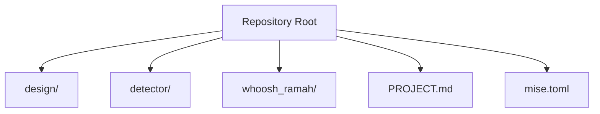
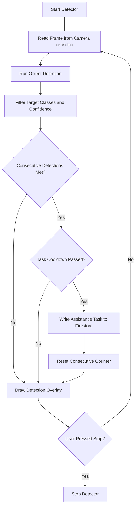
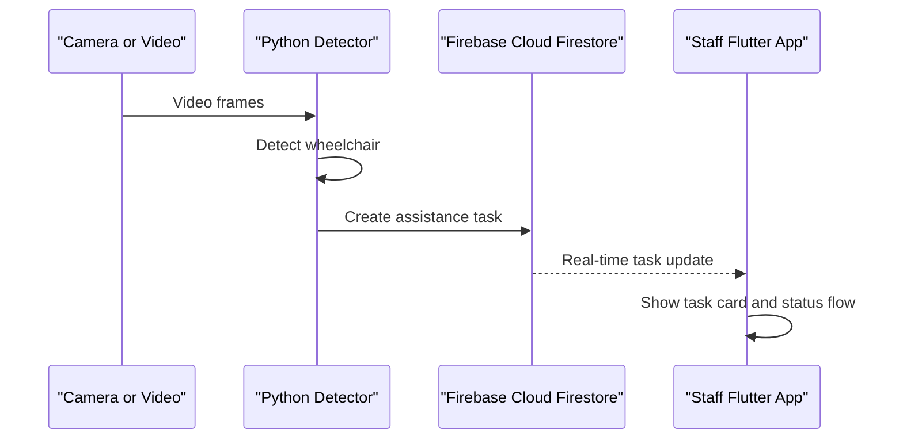

# Getting Started

<cite>
**Referenced Files in This Document**
- [PROJECT.md](file://PROJECT.md)
- [detector/README.md](file://detector/README.md)
- [whoosh_ramah/README.md](file://whoosh_ramah/README.md)
- [mise.toml](file://mise.toml)
- [whoosh_ramah/pubspec.yaml](file://whoosh_ramah/pubspec.yaml)
- [whoosh_ramah/lib/main.dart](file://whoosh_ramah/lib/main.dart)
- [whoosh_ramah/lib/firebase_options.dart](file://whoosh_ramah/lib/firebase_options.dart)
- [detector/detect_wheelchair.py](file://detector/detect_wheelchair.py)
- [detector/requirements.txt](file://detector/requirements.txt)
</cite>

## Table of Contents
1. [Introduction](#introduction)
2. [Project Structure](#project-structure)
3. [Prerequisites](#prerequisites)
4. [Quick Start for Experienced Developers](#quick-start-for-experienced-developers)
5. [Step-by-Step Setup](#step-by-step-setup)
6. [Running the Detector System](#running-the-detector-system)
7. [Flutter App and Python Detector Relationship](#flutter-app-and-python-detector-relationship)
8. [Troubleshooting Guide](#troubleshooting-guide)
9. [Conclusion](#conclusion)

## Introduction
Whoosh Ramah is a hackathon prototype that helps priority passengers at Whoosh high-speed rail stations receive assistance from station staff, while allowing family members to monitor progress. The system has two main parts:
- A Flutter mobile app for Android and iOS that manages passenger requests, staff tasks, and family monitoring through Firebase Cloud Firestore.
- A Python-based AI detector that watches a camera or video feed, detects wheelchair users, and automatically creates assistance tasks in Firestore so they appear on the staff device.

The project is designed to be demonstrated live with 2–3 phones and one laptop. It intentionally avoids production features like real login, ticket integration, payment, automatic scheduling, push notifications, or face photo storage.

**Section sources**
- [PROJECT.md:8-20](file://PROJECT.md#L8-L20)
- [PROJECT.md:24-37](file://PROJECT.md#L24-L37)

## Project Structure
At the repository root, you will find:
- `design/`: HTML design references for each screen layout.
- `detector/`: Python code for the wheelchair detection system.
- `whoosh_ramah/`: Flutter application source code.
- `PROJECT.md`: Full project specification and step-by-step build instructions.
- `mise.toml`: Tool version configuration for Python.



**Diagram sources**
- [PROJECT.md:179-203](file://PROJECT.md#L179-L203)
- [mise.toml:1-3](file://mise.toml#L1-L3)

**Section sources**
- [PROJECT.md:179-203](file://PROJECT.md#L179-L203)
- [whoosh_ramah/README.md:1-18](file://whoosh_ramah/README.md#L1-L18)
- [detector/README.md:1-9](file://detector/README.md#L1-L9)
- [mise.toml:1-3](file://mise.toml#L1-L3)

## Prerequisites
Before starting, prepare your development environment.

### General Tools
- Git for version control.
- A terminal or command prompt.
- Stable internet connection for downloading SDKs, models, and Firebase resources.

### Flutter and Dart
- Install Flutter SDK compatible with Dart SDK `^3.14.0`.
- Verify Flutter installation and connected devices using standard Flutter commands.
- For Android development, ensure Android Studio or equivalent tools are installed and configured.
- For iOS development, ensure Xcode and Apple developer tooling are installed.

### Python Environment
- Use Python 3.10 or newer.
- The repository recommends Python 3.12 through `mise.toml`.
- Create a virtual environment inside the `detector` folder before installing Python dependencies.

### Firebase
- Create a Firebase project.
- Enable Cloud Firestore.
- Generate a service account private key for the Python detector.
- Run FlutterFire CLI to generate `firebase_options.dart` for the Flutter app.

**Section sources**
- [PROJECT.md:40-51](file://PROJECT.md#L40-L51)
- [whoosh_ramah/pubspec.yaml:21-23](file://whoosh_ramah/pubspec.yaml#L21-L23)
- [detector/README.md:10-18](file://detector/README.md#L10-L18)
- [mise.toml:1-3](file://mise.toml#L1-L3)

## Quick Start for Experienced Developers
If you already have Flutter, Dart, Python, and Firebase set up, follow these steps:

1. Clone the repository.
2. Install Flutter dependencies:
   - Navigate to `whoosh_ramah/`.
   - Run `flutter pub get`.
3. Configure Firebase for Flutter:
   - Activate FlutterFire CLI if needed.
   - Run the FlutterFire configuration command.
   - Confirm that `whoosh_ramah/lib/firebase_options.dart` exists and contains your project’s Android configuration.
4. Run the Flutter app:
   - Connect an Android or iOS device.
   - Run the Flutter app from `whoosh_ramah/`.
5. Set up the Python detector:
   - Navigate to `detector/`.
   - Create and activate a Python virtual environment.
   - Install dependencies with `pip install -r requirements.txt`.
   - Copy `.env.example` to `.env` and fill required values.
   - Place `firebase-key.json` in `detector/` if you want the detector to write to Firestore.
6. Run the detector:
   - Test detection without Firebase first.
   - Then run the detector normally to create tasks in Firestore.

**Section sources**
- [whoosh_ramah/pubspec.yaml:30-40](file://whoosh_ramah/pubspec.yaml#L30-L40)
- [whoosh_ramah/lib/firebase_options.dart:1-63](file://whoosh_ramah/lib/firebase_options.dart#L1-L63)
- [detector/README.md:10-48](file://detector/README.md#L10-L48)

## Step-by-Step Setup

### Step 1: Prepare the Repository
Open a terminal and clone the repository into your workspace. Navigate to the root directory where `PROJECT.md`, `detector/`, and `whoosh_ramah/` exist.

**Section sources**
- [PROJECT.md:1-5](file://PROJECT.md#L1-L5)

### Step 2: Install Flutter Dependencies
Go to the Flutter app directory:
```bash
cd whoosh_ramah
flutter pub get
```

This installs packages such as Firebase Core, Cloud Firestore, internationalization utilities, and UI-related dependencies declared in `pubspec.yaml`.

**Section sources**
- [whoosh_ramah/pubspec.yaml:30-40](file://whoosh_ramah/pubspec.yaml#L30-L40)

### Step 3: Set Up Firebase for the Flutter App
1. Create a Firebase project at the Firebase console.
2. Add an Android app to the project.
3. Download the generated `google-services.json` file into `whoosh_ramah/android/app/`.
4. Activate FlutterFire CLI and run the configuration command.
5. Ensure `whoosh_ramah/lib/firebase_options.dart` is generated.

The generated file currently configures Android options and throws unsupported errors for other platforms until they are configured.

**Section sources**
- [whoosh_ramah/lib/firebase_options.dart:17-63](file://whoosh_ramah/lib/firebase_options.dart#L17-L63)

### Step 4: Initialize Firebase in the Flutter App
The Flutter app initializes Firebase before running the app widget. Make sure Firebase initialization succeeds by checking logs when launching the app.

Key behavior:
- The app ensures Flutter bindings are initialized.
- It initializes Firebase with platform-specific options.
- It starts the main app widget and opens the role selection screen.

**Section sources**
- [whoosh_ramah/lib/main.dart:8-14](file://whoosh_ramah/lib/main.dart#L8-L14)
- [whoosh_ramah/lib/main.dart:20-33](file://whoosh_ramah/lib/main.dart#L20-L33)

### Step 5: Set Up the Python Detector Environment
Navigate to the detector directory:
```bash
cd detector
python -m venv venv
source venv/bin/activate
```
On Windows, use:
```cmd
venv\Scripts\activate
```

Install Python dependencies:
```bash
pip install -r requirements.txt
```

Required dependencies include OpenCV, environment variable loading, Firebase Admin SDK, Roboflow inference SDK, and Ultralytics for local YOLO models.

**Section sources**
- [detector/README.md:10-18](file://detector/README.md#L10-L18)
- [detector/requirements.txt:1-7](file://detector/requirements.txt#L1-L7)

### Step 6: Configure the Detector Environment Variables
Create `.env` from `.env.example` and set:
- `ROBOFLOW_API_KEY` for Roboflow model access.
- `ROBOFLOW_MODEL_ID` for the selected wheelchair detection model.
- Optional local model path if training your own model.
- Confidence threshold, frame consistency, task cooldown, detection frequency, camera location, and camera ID.

**Section sources**
- [detector/README.md:77-85](file://detector/README.md#L77-L85)
- [detector/detect_wheelchair.py:33-67](file://detector/detect_wheelchair.py#L33-L67)

### Step 7: Connect the Detector to Firebase
1. Enable Cloud Firestore in your Firebase project.
2. Generate a service account private key.
3. Save it as `firebase-key.json` inside `detector/`.
4. Do not commit this file to version control.
5. Run the detector to write tasks to Firestore.

**Section sources**
- [detector/README.md:39-61](file://detector/README.md#L39-L61)
- [detector/detect_wheelchair.py:164-192](file://detector/detect_wheelchair.py#L164-L192)

### Step 8: Run the Flutter App
From the Flutter app directory:
```bash
cd whoosh_ramah
flutter run
```

Select a connected Android or iOS device. The app should initialize Firebase and open the role selection screen.

**Section sources**
- [whoosh_ramah/lib/main.dart:8-14](file://whoosh_ramah/lib/main.dart#L8-L14)
- [whoosh_ramah/lib/main.dart:24-31](file://whoosh_ramah/lib/main.dart#L24-L31)

## Running the Detector System

### Option A: Use a Pretrained Roboflow Model
This is the recommended starting point because it requires no local model training.

Steps:
1. Create a Roboflow account and copy your API key.
2. Set `ROBOFLOW_API_KEY` in `.env`.
3. Choose a wheelchair model from Roboflow Universe and set `ROBOFLOW_MODEL_ID`.
4. Test detection without Firebase:
   ```bash
   python detect_wheelchair.py --tanpa-firebase
   ```
5. If needed, test with a video file:
   ```bash
   python detect_wheelchair.py --sumber contoh.mp4 --tanpa-firebase
   ```
6. Once confident, connect Firebase and run normally.

**Section sources**
- [detector/README.md:21-37](file://detector/README.md#L21-L37)
- [detector/detect_wheelchair.py:73-99](file://detector/detect_wheelchair.py#L73-L99)

### Option B: Train Your Own Local Model
Use this option only if you have time and GPU access.

Steps:
1. Use Google Colab with GPU enabled.
2. Upload `train_yolo.py` and configure dataset settings.
3. Install Ultralytics and Roboflow, then train the model.
4. Download the trained model file and place it in `detector/models/`.
5. Update `.env` to use the local model path.
6. Run the detector without internet dependency.

**Section sources**
- [detector/README.md:63-76](file://detector/README.md#L63-L76)
- [detector/detect_wheelchair.py:102-123](file://detector/detect_wheelchair.py#L102-L123)

### Detection Flow
The detector reads frames from a webcam or video file, runs object detection, filters results by target class and confidence, counts consecutive detections, and writes a new Firestore document when conditions are met.



**Diagram sources**
- [detector/detect_wheelchair.py:214-286](file://detector/detect_wheelchair.py#L214-L286)

**Section sources**
- [detector/detect_wheelchair.py:214-286](file://detector/detect_wheelchair.py#L214-L286)

## Flutter App and Python Detector Relationship
The Flutter app does not run AI detection. Instead, it reads Firestore documents created by the Python detector.



**Diagram sources**
- [PROJECT.md:24-37](file://PROJECT.md#L24-L37)
- [detector/detect_wheelchair.py:179-192](file://detector/detect_wheelchair.py#L179-L192)

The Firestore collection used by both components is `permintaan_pendampingan`. Important fields include:
- `jenisBantuan`: assistance type.
- `titikJemput`: pickup location.
- `status`: workflow state.
- `sumber`: whether the request came from the app or camera AI.
- `idKamera`: camera identifier.
- `keyakinan`: detection confidence.
- `dibuatPada`: server timestamp.

**Section sources**
- [PROJECT.md:54-95](file://PROJECT.md#L54-L95)
- [detector/detect_wheelchair.py:179-192](file://detector/detect_wheelchair.py#L179-L192)

## Troubleshooting Guide

### Firebase Configuration Problems
- **Android missing configuration**: Ensure `google-services.json` is placed in `whoosh_ramah/android/app/` and that `firebase_options.dart` is generated.
- **iOS/macOS/Linux/Windows unsupported options**: The current `firebase_options.dart` only provides Android options. Re-run FlutterFire configuration for other platforms if needed.
- **Web unsupported**: Web is explicitly unsupported in the generated options.

Common checks:
- Verify Firebase project ID matches the generated options.
- Confirm Firestore is enabled.
- Check network connectivity during app launch.

**Section sources**
- [whoosh_ramah/lib/firebase_options.dart:17-63](file://whoosh_ramah/lib/firebase_options.dart#L17-L63)

### Android Build Issues
- Missing `google-services.json`.
- Gradle or Android SDK mismatches.
- Device emulator or physical device not recognized.

Recommended actions:
- Run Flutter doctor and fix reported issues.
- Sync Gradle projects.
- Clean and rebuild the Android app.

**Section sources**
- [whoosh_ramah/pubspec.yaml:10-16](file://whoosh_ramah/pubspec.yaml#L10-L16)

### iOS Build Issues
- Xcode command-line tools not installed.
- Missing signing configuration.
- CocoaPods not installed or outdated.

Recommended actions:
- Install Xcode and accept licenses.
- Install CocoaPods if needed.
- Configure signing for development builds.

**Section sources**
- [whoosh_ramah/lib/firebase_options.dart:25-52](file://whoosh_ramah/lib/firebase_options.dart#L25-L52)

### Python Dependency Conflicts
- Wrong Python version.
- Virtual environment not activated.
- Outdated or conflicting packages.

Recommended actions:
- Use Python 3.10 or newer; prefer 3.12 as suggested by `mise.toml`.
- Recreate the virtual environment.
- Install dependencies from `requirements.txt` after activation.
- Avoid mixing global Python packages with the detector environment.

**Section sources**
- [detector/README.md:10-18](file://detector/README.md#L10-L18)
- [detector/requirements.txt:1-7](file://detector/requirements.txt#L1-L7)
- [mise.toml:1-3](file://mise.toml#L1-L3)

### Roboflow or Model Errors
- Missing `ROBOFLOW_API_KEY`.
- Invalid `ROBOFLOW_MODEL_ID`.
- Network failure during inference.
- Local model file missing when using local mode.

Recommended actions:
- Verify API key and model ID in `.env`.
- Test detection without Firebase first.
- Use a video file instead of webcam if camera access fails.
- Switch to Roboflow mode if local model training is unavailable.

**Section sources**
- [detector/detect_wheelchair.py:73-99](file://detector/detect_wheelchair.py#L73-L99)
- [detector/detect_wheelchair.py:102-123](file://detector/detect_wheelchair.py#L102-L123)

### Firebase Key Not Found in Detector
- The detector expects `firebase-key.json` unless running without Firebase.
- Ensure the service account key is downloaded and placed in `detector/`.
- Never commit the key file to version control.

**Section sources**
- [detector/README.md:39-48](file://detector/README.md#L39-L48)
- [detector/detect_wheelchair.py:164-176](file://detector/detect_wheelchair.py#L164-L176)

### No Tasks Appear in the Staff App
- Firestore rules may block writes or reads.
- The detector may not be writing to the expected collection.
- The app may not be listening to the correct query.

Recommended actions:
- Confirm the detector writes to `permintaan_pendampingan`.
- Check Firestore security rules for demo mode.
- Verify the app streams active tasks and recent requests.

**Section sources**
- [PROJECT.md:97-109](file://PROJECT.md#L97-L109)
- [PROJECT.md:125-135](file://PROJECT.md#L125-L135)

## Conclusion
To successfully set up Whoosh Ramah:
- Install Flutter and Dart, then run `flutter pub get` in `whoosh_ramah/`.
- Configure Firebase and generate `firebase_options.dart`.
- Set up Python 3.10+, create a virtual environment in `detector/`, and install dependencies with `pip install -r requirements.txt`.
- Configure `.env` and optionally add `firebase-key.json`.
- Run the Flutter app and the Python detector together to see real-time task creation in Firestore.

For newcomers, follow the detailed steps above. For experienced developers, use the quick start to move faster. Always test the full flow: detector creates a task, and the staff Flutter app displays it in real time.

[No sources needed since this section summarizes without analyzing specific files]