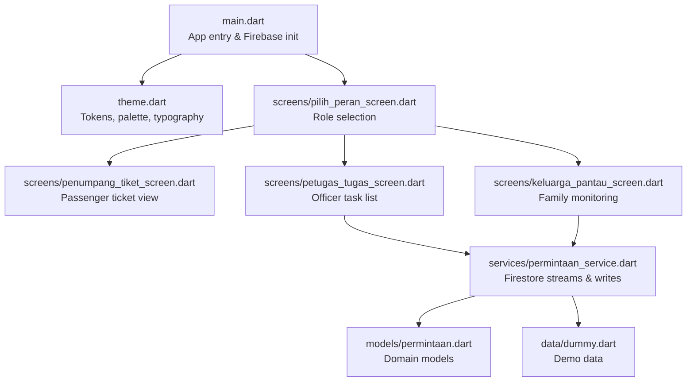
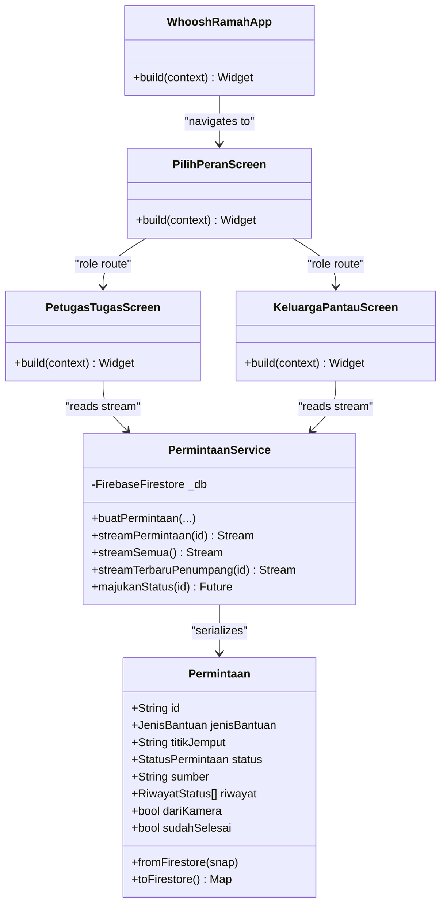
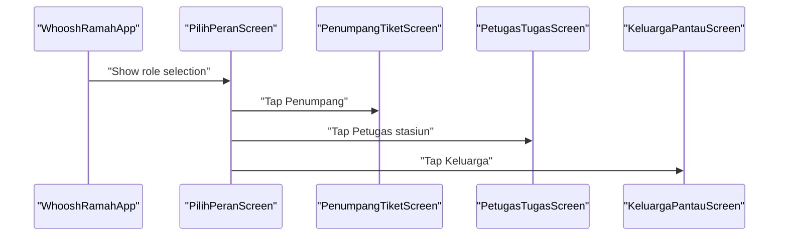
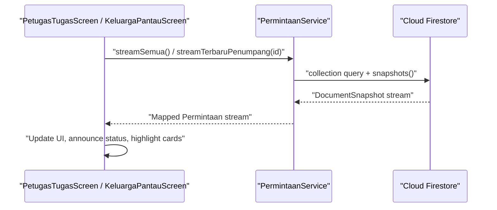
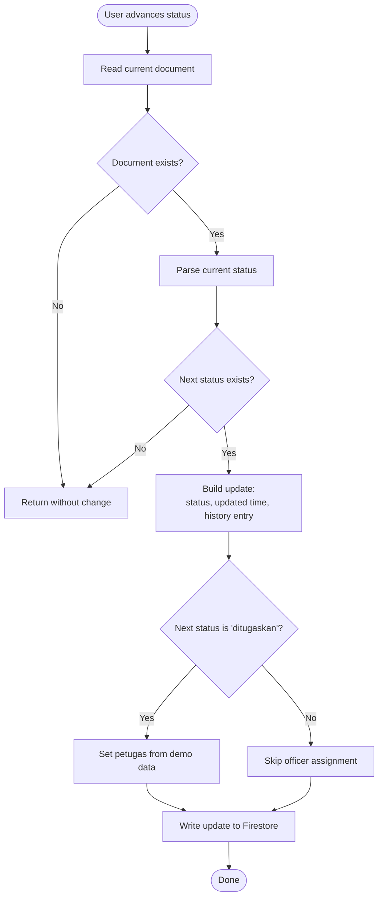
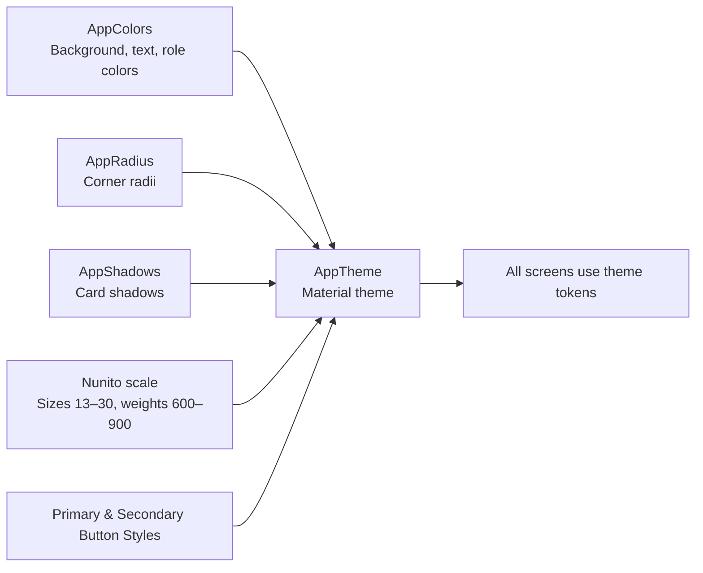
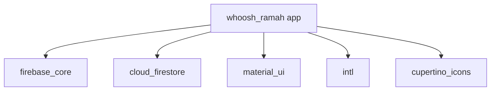

# Application Architecture

<cite>
**Referenced Files in This Document**
- [main.dart](file://whoosh_ramah/lib/main.dart)
- [theme.dart](file://whoosh_ramah/lib/theme.dart)
- [permintaan.dart](file://whoosh_ramah/lib/models/permintaan.dart)
- [permintaan_service.dart](file://whoosh_ramah/lib/services/permintaan_service.dart)
- [dummy.dart](file://whoosh_ramah/lib/data/dummy.dart)
- [pilih_peran_screen.dart](file://whoosh_ramah/lib/screens/pilih_peran_screen.dart)
- [penumpang_tiket_screen.dart](file://whoosh_ramah/lib/screens/penumpang_tiket_screen.dart)
- [petugas_tugas_screen.dart](file://whoosh_ramah/lib/screens/petugas_tugas_screen.dart)
- [keluarga_pantau_screen.dart](file://whoosh_ramah/lib/screens/keluarga_pantau_screen.dart)
- [pubspec.yaml](file://whoosh_ramah/pubspec.yaml)
</cite>

## Table of Contents
1. [Introduction](#introduction)
2. [Project Structure](#project-structure)
3. [Core Components](#core-components)
4. [Architecture Overview](#architecture-overview)
5. [Detailed Component Analysis](#detailed-component-analysis)
6. [Dependency Analysis](#dependency-analysis)
7. [Performance Considerations](#performance-considerations)
8. [Troubleshooting Guide](#troubleshooting-guide)
9. [Conclusion](#conclusion)

## Introduction
This document explains the architecture of the Flutter mobile application for accessible train-station assistance. The app follows a clear separation between View, Model, and service-layer responsibilities:

- **View**: Flutter screens and reusable widgets that render the user interface.
- **Model**: Domain data types such as `Permintaan`, `JenisBantuan`, `StatusPermintaan`, and `RiwayatStatus`.
- **Service layer**: `PermintaanService` encapsulates Firestore operations, including real-time streams, creation, and status progression.

The project is currently a prototype with demo data and role-based navigation. It initializes Firebase at startup, applies a consistent theme, and routes users into three roles: passenger, station officer, and family monitor.

## Project Structure
The Dart source code lives under `whoosh_ramah/lib`:

| Directory | Responsibility | Examples |
|---|---|---|
| `lib/screens` | User-facing screens per role or flow | `pilih_peran_screen.dart`, `penumpang_tiket_screen.dart`, `petugas_tugas_screen.dart`, `keluarga_pantau_screen.dart` |
| `lib/models` | Domain models and enums | `permintaan.dart` |
| `lib/services` | Data access abstraction over Firestore | `permintaan_service.dart` |
| `lib/data` | Demo and static data | `dummy.dart` |
| `lib/widgets` | Reusable UI components | bottom navigation, hero header, buttons, etc. |
| `lib/theme.dart` | Theme tokens, typography, colors, radius, shadows | `AppTheme`, `AppColors`, `AppRadius`, `AppShadows` |
| `lib/main.dart` | App entry point, Firebase initialization, root widget | `WhooshRamahApp` |
| `lib/firebase_options.dart` | Generated Firebase configuration | used by `Firebase.initializeApp` |

**Diagram sources**
- [main.dart:8-33](file://whoosh_ramah/lib/main.dart#L8-L33)
- [theme.dart:67-113](file://whoosh_ramah/lib/theme.dart#L67-L113)
- [pilih_peran_screen.dart:10-147](file://whoosh_ramah/lib/screens/pilih_peran_screen.dart#L10-L147)
- [penumpang_tiket_screen.dart:14-263](file://whoosh_ramah/lib/screens/penumpang_tiket_screen.dart#L14-L263)
- [petugas_tugas_screen.dart:22-133](file://whoosh_ramah/lib/screens/petugas_tugas_screen.dart#L22-L133)
- [keluarga_pantau_screen.dart:13-133](file://whoosh_ramah/lib/screens/keluarga_pantau_screen.dart#L13-L133)
- [permintaan_service.dart:6-78](file://whoosh_ramah/lib/services/permintaan_service.dart#L6-L78)
- [permintaan.dart:7-213](file://whoosh_ramah/lib/models/permintaan.dart#L7-L213)
- [dummy.dart:56-89](file://whoosh_ramah/lib/data/dummy.dart#L56-L89)

**Section sources**
- [main.dart:8-33](file://whoosh_ramah/lib/main.dart#L8-L33)
- [pubspec.yaml:30-40](file://whoosh_ramah/pubspec.yaml#L30-L40)

## Core Components
This section maps the MVVM-like layers to concrete files.

### View Layer
- Role selection screen navigates to role-specific screens.
- Passenger ticket screen shows demo ticket details and opens the assistance request flow.
- Officer task screen listens to all requests and separates active vs completed tasks.
- Family monitoring screen listens to the latest request for a passenger and announces status changes.

Key responsibilities:
- Rendering UI using shared theme tokens.
- Handling navigation via `Navigator.of(context)`.
- Subscribing to service streams through `StreamBuilder`.
- Providing accessibility labels and announcements where needed.

**Section sources**
- [pilih_peran_screen.dart:10-147](file://whoosh_ramah/lib/screens/pilih_peran_screen.dart#L10-L147)
- [penumpang_tiket_screen.dart:14-263](file://whoosh_ramah/lib/screens/penumpang_tiket_screen.dart#L14-L263)
- [petugas_tugas_screen.dart:22-133](file://whoosh_ramah/lib/screens/petugas_tugas_screen.dart#L22-L133)
- [keluarga_pantau_screen.dart:13-133](file://whoosh_ramah/lib/screens/keluarga_pantau_screen.dart#L13-L133)

### Model Layer
The domain model represents a single assistance request stored in Firestore:

- `JenisBantuan`: supported assistance types with Firestore-safe values.
- `StatusPermintaan`: ordered workflow states with next-state logic.
- `RiwayatStatus`: timestamped history entries.
- `Permintaan`: full request entity with Firestore serialization helpers.

Complexity highlights:
- Enum parsing provides safe fallbacks when Firestore fields are missing.
- Derived properties compute short location text, confidence percentage, and completion state.
- List deserialization guards against non-list history fields.

**Section sources**
- [permintaan.dart:7-213](file://whoosh_ramah/lib/models/permintaan.dart#L7-L213)

### Service Layer
`PermintaanService` abstracts Firestore operations:

- Creates new assistance requests from passenger input plus demo passenger/ticket data.
- Streams a single request by ID.
- Streams all requests, limited to the newest 100 documents.
- Streams the latest request for a given passenger ID.
- Advances the request status according to the required workflow.

Design notes:
- Constructor accepts an optional `FirebaseFirestore` instance for testing.
- Collection reference uses the exact collection name expected by the AI detector pipeline.
- Ordering avoids composite index requirements by limiting to one field or sorting client-side.

**Section sources**
- [permintaan_service.dart:6-135](file://whoosh_ramah/lib/services/permintaan_service.dart#L6-L135)

### Demo Data
`DummyData` provides hard-coded passenger, officer, ticket, and pickup-point values used across screens and services during the hackathon prototype.

**Section sources**
- [dummy.dart:8-89](file://whoosh_ramah/lib/data/dummy.dart#L8-L89)

## Architecture Overview
The application follows a lightweight MVVM-inspired structure:

- **View**: Screens compose UI and handle user actions.
- **ViewModel-equivalent**: State is mostly local to screens; there is no global state manager yet.
- **Model**: Domain entities define business rules and serialization.
- **Service**: Data access is centralized in `PermintaanService`.

**Diagram sources**
- [main.dart:20-33](file://whoosh_ramah/lib/main.dart#L20-L33)
- [pilih_peran_screen.dart:14-147](file://whoosh_ramah/lib/screens/pilih_peran_screen.dart#L14-L147)
- [petugas_tugas_screen.dart:28-133](file://whoosh_ramah/lib/screens/petugas_tugas_screen.dart#L28-L133)
- [keluarga_pantau_screen.dart:19-133](file://whoosh_ramah/lib/screens/keluarga_pantau_screen.dart#L19-L133)
- [permintaan_service.dart:10-119](file://whoosh_ramah/lib/services/permintaan_service.dart#L10-L119)
- [permintaan.dart:81-213](file://whoosh_ramah/lib/models/permintaan.dart#L81-L213)

## Detailed Component Analysis

### Navigation Flow
The app starts at the role-selection screen and routes users based on their selected role:

**Diagram sources**
- [main.dart:24-31](file://whoosh_ramah/lib/main.dart#L24-L31)
- [pilih_peran_screen.dart:98-129](file://whoosh_ramah/lib/screens/pilih_peran_screen.dart#L98-L129)

**Section sources**
- [pilih_peran_screen.dart:10-147](file://whoosh_ramah/lib/screens/pilih_peran_screen.dart#L10-L147)

### Real-Time Firestore Streams
Two main screens consume real-time data:

- Officer task list subscribes to all requests and detects newly arrived documents.
- Family monitoring subscribes to the latest request for a specific passenger.

**Diagram sources**
- [petugas_tugas_screen.dart:38-133](file://whoosh_ramah/lib/screens/petugas_tugas_screen.dart#L38-L133)
- [keluarga_pantau_screen.dart:32-133](file://whoosh_ramah/lib/screens/keluarga_pantau_screen.dart#L32-L133)
- [permintaan_service.dart:63-90](file://whoosh_ramah/lib/services/permintaan_service.dart#L63-L90)

**Section sources**
- [petugas_tugas_screen.dart:38-133](file://whoosh_ramah/lib/screens/petugas_tugas_screen.dart#L38-L133)
- [keluarga_pantau_screen.dart:32-133](file://whoosh_ramah/lib/screens/keluarga_pantau_screen.dart#L32-L133)
- [permintaan_service.dart:63-90](file://whoosh_ramah/lib/services/permintaan_service.dart#L63-L90)

### Status Progression Logic
Advancing a request follows a strict order defined by `StatusPermintaan`. The service updates the status, adds a history entry, and sets the assigned officer when moving to the assigned stage.

**Diagram sources**
- [permintaan_service.dart:92-119](file://whoosh_ramah/lib/services/permintaan_service.dart#L92-L119)
- [permintaan.dart:32-57](file://whoosh_ramah/lib/models/permintaan.dart#L32-L57)

**Section sources**
- [permintaan_service.dart:92-119](file://whoosh_ramah/lib/services/permintaan_service.dart#L92-L119)
- [permintaan.dart:32-57](file://whoosh_ramah/lib/models/permintaan.dart#L32-L57)

### Repository Pattern Implementation
Although there is no explicit repository class, `PermintaanService` acts as the repository for assistance requests. It centralizes:

- Query construction
- Snapshot mapping
- Client-side sorting
- Field naming consistency with the external AI detector

Recommendations if you evolve toward a stricter repository pattern:
- Introduce a `PermintaanRepository` interface.
- Keep `PermintaanService` as the Firestore implementation.
- Inject the repository into screens instead of constructing the service directly.

**Section sources**
- [permintaan_service.dart:6-135](file://whoosh_ramah/lib/services/permintaan_service.dart#L6-L135)

### Dependency Injection Patterns
The codebase uses constructor injection for testability:

- `PermintaanService` accepts an optional `FirebaseFirestore` instance.
- `PetugasTugasScreen` accepts an optional `PermintaanService`.
- `KeluargaPantauScreen` accepts an optional `PermintaanService` and optional passenger ID.

This allows unit tests to replace Firestore with mocks or in-memory implementations.

**Section sources**
- [permintaan_service.dart:10-18](file://whoosh_ramah/lib/services/permintaan_service.dart#L10-L18)
- [petugas_tugas_screen.dart:28-39](file://whoosh_ramah/lib/screens/petugas_tugas_screen.dart#L28-L39)
- [keluarga_pantau_screen.dart:19-38](file://whoosh_ramah/lib/screens/keluarga_pantau_screen.dart#L19-L38)

### Theme System Design
The theme system is token-driven and accessibility-aware:

- **Color palette**: background, primary text, secondary text, role-based accents (passenger red, officer blue, family green), supporting tones, outlines, and connector lines.
- **Typography scale**: Nunito font family with sizes from 13 to 30, weights from 600 to 900, and line heights tuned for readability.
- **Radius tokens**: consistent rounded corners for headers, cards, inner boxes, choices, bottom navigation, and pill buttons.
- **Shadows**: soft card shadows and inner-card shadows.
- **Component styles**: primary and secondary button styles with minimum touch targets and pill shapes.

Accessibility considerations:
- Minimum tap target sizes are enforced for buttons.
- Semantic labels are added to interactive cards and buttons.
- TalkBack announcements are used when important status changes occur.

**Diagram sources**
- [theme.dart:7-35](file://whoosh_ramah/lib/theme.dart#L7-L35)
- [theme.dart:37-63](file://whoosh_ramah/lib/theme.dart#L37-L63)
- [theme.dart:67-163](file://whoosh_ramah/lib/theme.dart#L67-L163)

**Section sources**
- [theme.dart:7-163](file://whoosh_ramah/lib/theme.dart#L7-L163)
- [pilih_peran_screen.dart:169-228](file://whoosh_ramah/lib/screens/pilih_peran_screen.dart#L169-L228)
- [keluarga_pantau_screen.dart:62-77](file://whoosh_ramah/lib/screens/keluarga_pantau_screen.dart#L62-L77)

### Common Architectural Patterns

#### State Management Pattern
Screens manage local UI state while delegating data loading to streams:

- Use `StreamBuilder` to react to Firestore updates.
- Separate loading, error, empty, and content states.
- Announce meaningful changes to assistive technologies.

Example references:
- Officer task list handles initial load, errors, and new-document notifications.
- Family monitoring tracks last announced status to avoid duplicate announcements.

**Section sources**
- [petugas_tugas_screen.dart:38-133](file://whoosh_ramah/lib/screens/petugas_tugas_screen.dart#L38-L133)
- [keluarga_pantau_screen.dart:40-77](file://whoosh_ramah/lib/screens/keluarga_pantau_screen.dart#L40-L77)

#### Service Layer Usage
Screens call service methods rather than accessing Firestore directly:

- Create requests through `buatPermintaan`.
- Listen to `streamSemua` or `streamTerbaruPenumpang`.
- Advance status through `majukanStatus`.

**Section sources**
- [permintaan_service.dart:23-119](file://whoosh_ramah/lib/services/permintaan_service.dart#L23-L119)

#### Model Serialization Pattern
Models provide factory constructors for Firestore snapshots and map conversion:

- `Permintaan.fromFirestore`
- `Permintaan.fromMap`
- `Permintaan.toFirestore`
- Safe enum parsing with fallbacks

**Section sources**
- [permintaan.dart:150-213](file://whoosh_ramah/lib/models/permintaan.dart#L150-L213)

## Dependency Analysis
External dependencies relevant to architecture:

| Dependency | Purpose |
|---|---|
| `firebase_core` | Initializes Firebase for the platform |
| `cloud_firestore` | Real-time database access and queries |
| `material_ui` | UI components and styling utilities |
| `intl` | Date formatting for timestamps |
| `cupertino_icons` | iOS-style icons |

**Diagram sources**
- [pubspec.yaml:30-40](file://whoosh_ramah/pubspec.yaml#L30-L40)

**Section sources**
- [pubspec.yaml:30-40](file://whoosh_ramah/pubspec.yaml#L30-L40)

## Performance Considerations
- Firestore queries limit results to 100 documents to avoid unbounded streams.
- Sorting is kept simple: either single-field ordering or client-side sorting for the latest passenger request.
- Avoiding composite indexes reduces deployment friction but moves sorting work to the client.
- Real-time listeners should be disposed properly; screens already manage timers and state lifecycles.
- Large lists of tasks benefit from pagination if the number of requests grows beyond the current limit.

[No sources needed since this section provides general guidance]

## Troubleshooting Guide
Common issues and where to look:

- **Firestore connection errors**: Check network connectivity and Firestore rules. The officer task screen displays a generic loading/error message when the stream fails.
- **Missing or null fields**: Models include safe parsing and fallbacks; verify that Firestore documents contain expected keys like `jenisBantuan`, `status`, `titikJemput`, and `sumber`.
- **Index errors**: If adding more complex queries, consider composite indexes or adjust query design to match current patterns.
- **Accessibility announcements not firing**: Ensure `SemanticsService.sendAnnouncement` is called after frame build and that the device has accessibility services enabled.
- **Demo data mismatch**: Confirm that dummy passenger IDs and names align with expectations in family monitoring and service creation.

**Section sources**
- [petugas_tugas_screen.dart:98-133](file://whoosh_ramah/lib/screens/petugas_tugas_screen.dart#L98-L133)
- [keluarga_pantau_screen.dart:80-133](file://whoosh_ramah/lib/screens/keluarga_pantau_screen.dart#L80-L133)
- [permintaan.dart:150-213](file://whoosh_ramah/lib/models/permintaan.dart#L150-L213)

## Conclusion
The application implements a clean separation between UI, domain models, and data access. Screens focus on presentation and user interaction, models encode business rules and serialization, and the service layer centralizes Firestore operations. The theme system provides consistent, accessible design tokens. For future growth, consider introducing a formal repository layer, a dedicated state-management solution, and stronger authentication flows while preserving the current clarity and accessibility-first approach.

[No sources needed since this section summarizes without analyzing specific files]