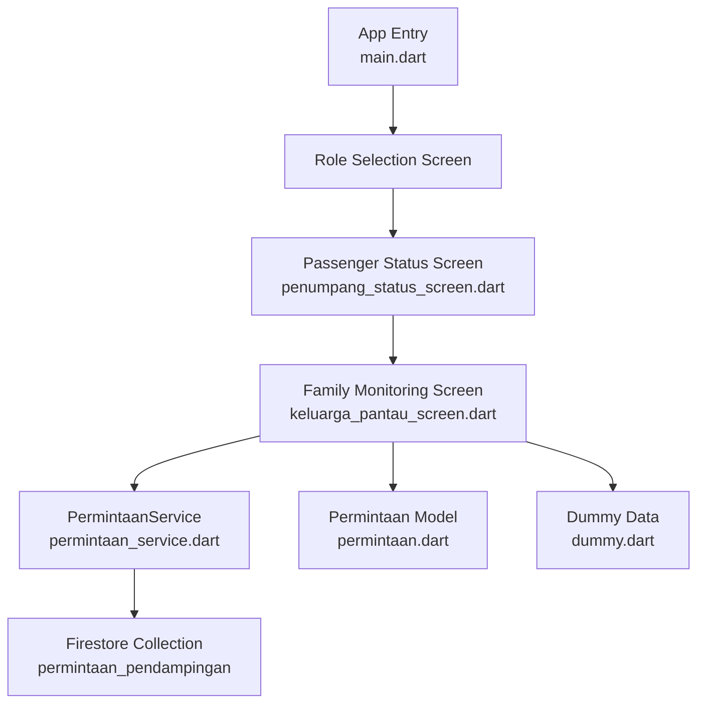
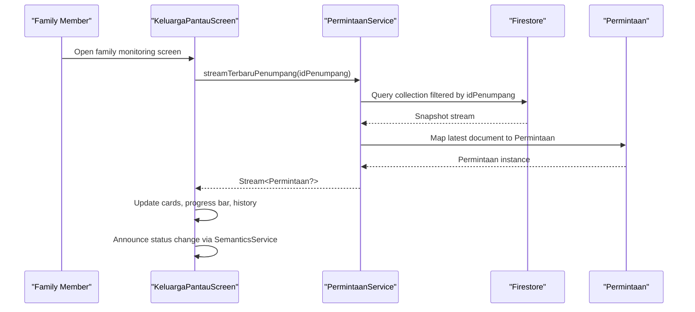
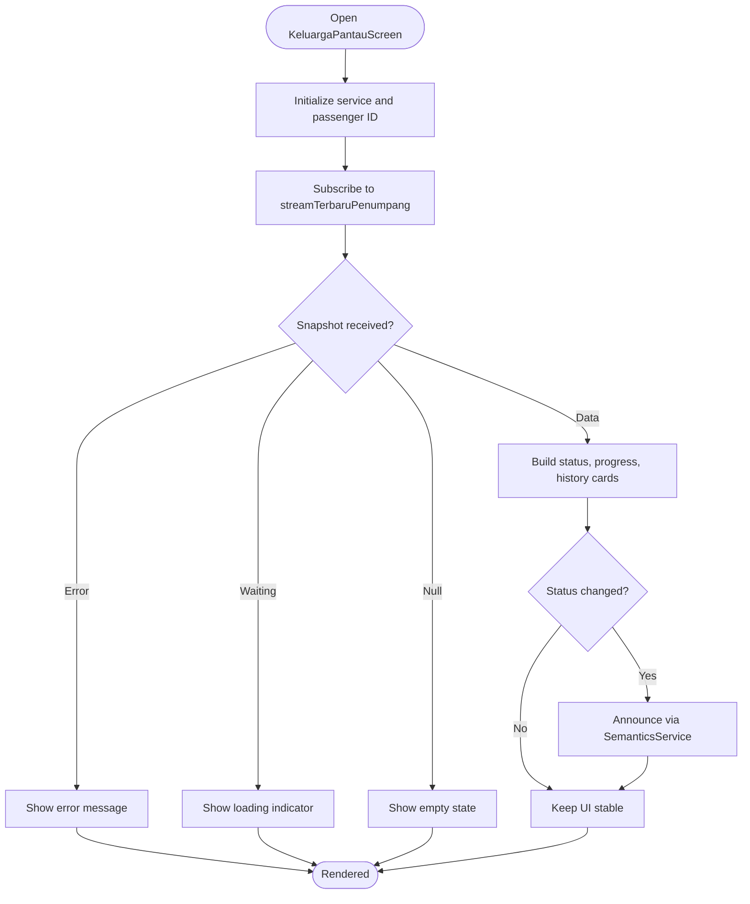
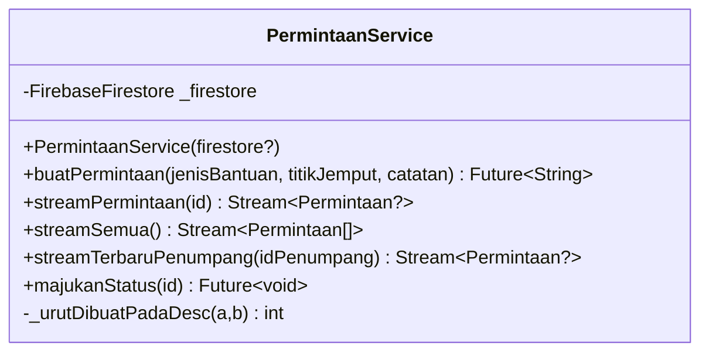
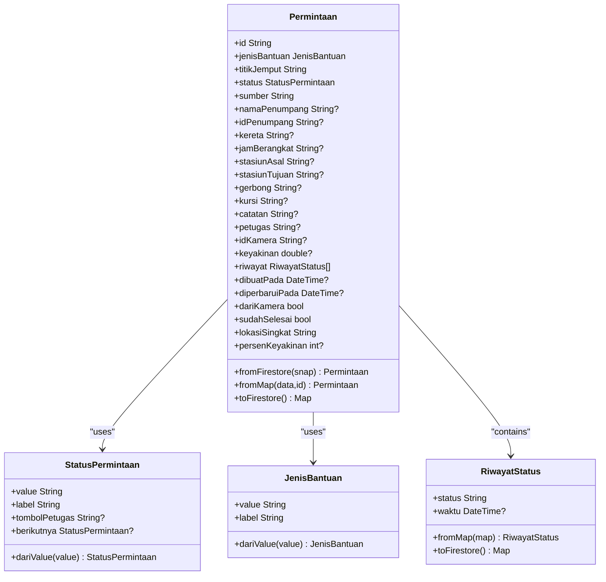
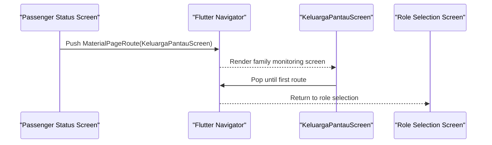
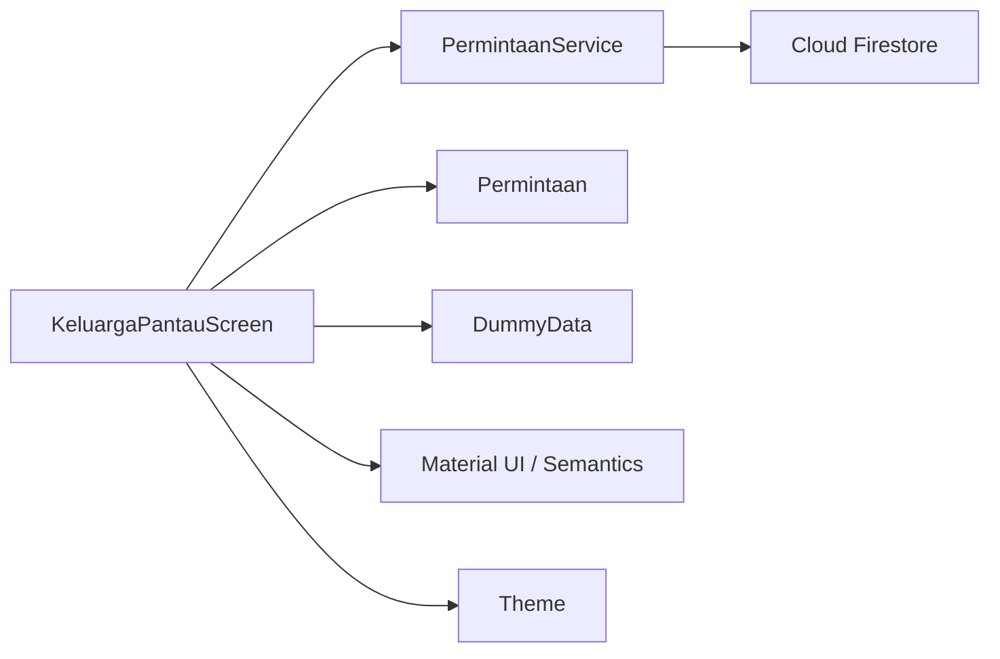

# Family Monitoring

<cite>
**Referenced Files in This Document**   
- [keluarga_pantau_screen.dart](file://whoosh_ramah/lib/screens/keluarga_pantau_screen.dart)
- [permintaan_service.dart](file://whoosh_ramah/lib/services/permintaan_service.dart)
- [permintaan.dart](file://whoosh_ramah/lib/models/permintaan.dart)
- [dummy.dart](file://whoosh_ramah/lib/data/dummy.dart)
- [penumpang_status_screen.dart](file://whoosh_ramah/lib/screens/penumpang_status_screen.dart)
- [main.dart](file://whoosh_ramah/lib/main.dart)
- [ganti_peran_pill.dart](file://whoosh_ramah/lib/widgets/ganti_peran_pill.dart)
- [keluarga_pantau_test.dart](file://whoosh_ramah/test/keluarga_pantau_test.dart)
</cite>

## Table of Contents
1. [Introduction](#introduction)
2. [Project Structure](#project-structure)
3. [Core Components](#core-components)
4. [Architecture Overview](#architecture-overview)
5. [Detailed Component Analysis](#detailed-component-analysis)
6. [Dependency Analysis](#dependency-analysis)
7. [Performance Considerations](#performance-considerations)
8. [Troubleshooting Guide](#troubleshooting-guide)
9. [Conclusion](#conclusion)

## Introduction
This document explains the family monitoring interface that lets family members watch a passenger’s assistance journey in real time. The core screen listens to live updates, shows current status and progress, renders a timeline with timestamps, and provides accessibility announcements when status changes. It also documents how data is modeled, streamed from Firestore, visualized, and shared through the application flow.

The implementation uses:
- A Flutter stateful screen for the family dashboard.
- A service layer that streams the latest assistance request for a passenger.
- A model layer defining assistance types, status progression, and history entries.
- Dummy demo data used by default in this prototype.
- Navigation between the passenger status screen and the family monitoring screen.

## Project Structure
The family monitoring feature lives under the Flutter application module. The most relevant parts are:
- `lib/screens/keluarga_pantau_screen.dart`: the family monitoring UI.
- `lib/services/permintaan_service.dart`: Firestore streaming and status progression.
- `lib/models/permintaan.dart`: domain models for assistance requests and status.
- `lib/data/dummy.dart`: demo passenger, staff, and ticket data.
- `lib/screens/penumpang_status_screen.dart`: passenger status screen that navigates to the family view.
- `lib/widgets/ganti_peran_pill.dart`: role-switching pill used in the hero area.
- `lib/main.dart`: app entry point initializing Firebase and routing to the role selection screen.

**Diagram sources**
- [main.dart:8-33](file://whoosh_ramah/lib/main.dart#L8-L33)
- [penumpang_status_screen.dart:512-517](file://whoosh_ramah/lib/screens/penumpang_status_screen.dart#L512-L517)
- [keluarga_pantau_screen.dart:19-38](file://whoosh_ramah/lib/screens/keluarga_pantau_screen.dart#L19-L38)
- [permintaan_service.dart:6-21](file://whoosh_ramah/lib/services/permintaan_service.dart#L6-L21)
- [permintaan.dart:77-103](file://whoosh_ramah/lib/models/permintaan.dart#L77-L103)
- [dummy.dart:56-81](file://whoosh_ramah/lib/data/dummy.dart#L56-L81)

**Section sources**
- [main.dart:8-33](file://whoosh_ramah/lib/main.dart#L8-L33)
- [keluarga_pantau_screen.dart:13-38](file://whoosh_ramah/lib/screens/keluarga_pantau_screen.dart#L13-L38)

## Core Components
- **Family Monitoring Screen**: Displays the latest assistance request for a passenger, including current status card, travel progress bar, and timestamped history. It announces status changes via accessibility services.
- **PermintaanService**: Provides Firestore-backed streams for creating requests, listening to all requests, filtering the latest request per passenger, and advancing status.
- **Permintaan Model**: Encapsulates assistance type, status progression, history entries, optional AI detection fields, and serialization helpers.
- **Dummy Data**: Demo passenger, staff, and ticket information used as defaults in this prototype.
- **Navigation Flow**: The passenger status screen can open the family monitoring screen; the family screen includes a “Change role” pill to return to the role selection screen.

Key responsibilities:
- Real-time data streaming using Firestore snapshots.
- Progress visualization based on a fixed five-step status sequence.
- Accessibility announcements when status changes.
- Empty, loading, and error states for robust user experience.

**Section sources**
- [keluarga_pantau_screen.dart:19-133](file://whoosh_ramah/lib/screens/keluarga_pantau_screen.dart#L19-L133)
- [permintaan_service.dart:23-90](file://whoosh_ramah/lib/services/permintaan_service.dart#L23-L90)
- [permintaan.dart:27-57](file://whoosh_ramah/lib/models/permintaan.dart#L27-L57)
- [dummy.dart:56-81](file://whoosh_ramah/lib/data/dummy.dart#L56-L81)

## Architecture Overview
The family monitoring dashboard follows a reactive architecture:
- The screen subscribes to a stream of the latest assistance request for a specific passenger.
- Each update triggers UI rebuilds and accessibility announcements if the status changed.
- The service abstracts Firestore queries and maps raw documents into typed models.
- The model defines the canonical status progression and history structure.

**Diagram sources**
- [keluarga_pantau_screen.dart:32-38](file://whoosh_ramah/lib/screens/keluarga_pantau_screen.dart#L32-L38)
- [keluarga_pantau_screen.dart:85-133](file://whoosh_ramah/lib/screens/keluarga_pantau_screen.dart#L85-L133)
- [permintaan_service.dart:80-90](file://whoosh_ramah/lib/services/permintaan_service.dart#L80-L90)
- [permintaan.dart:150-180](file://whoosh_ramah/lib/models/permintaan.dart#L150-L180)

## Detailed Component Analysis

### Family Monitoring Screen
The family monitoring screen is a stateful widget that:
- Initializes the service and passenger ID (defaulting to dummy data).
- Subscribes to the latest request stream for the passenger.
- Renders hero header, current status card, travel progress card, and history card.
- Handles loading, empty, and error states.
- Announces status changes to accessibility services only when the status differs from the last announced one.

Progress tracking implementation:
- Current status card displays the formatted time, large status label, passenger name, and assigned staff when available.
- Travel progress card shows origin and destination stations, departure and arrival times, train/carriage/seat info, and a progress bar whose fraction is derived from the current status index.
- History card lists completed steps with timestamps and shows the next step when not finished.

Real-time data streaming:
- Uses `StreamBuilder` over `streamTerbaruPenumpang`.
- On each snapshot, it checks errors, waiting state, null data, and then builds the content.

Accessibility and notifications:
- Tracks `_statusTerakhir` to avoid duplicate announcements.
- Uses `SemanticsService.sendAnnouncement` with localized messages for each status.

Sharing functionality:
- The screen indicates that the journey is shared and automatically updated.
- The bottom action opens an “Urgent help” screen; sharing to family is initiated from the passenger status screen.

**Diagram sources**
- [keluarga_pantau_screen.dart:32-77](file://whoosh_ramah/lib/screens/keluarga_pantau_screen.dart#L32-L77)
- [keluarga_pantau_screen.dart:85-133](file://whoosh_ramah/lib/screens/keluarga_pantau_screen.dart#L85-L133)
- [keluarga_pantau_screen.dart:267-530](file://whoosh_ramah/lib/screens/keluarga_pantau_screen.dart#L267-L530)

**Section sources**
- [keluarga_pantau_screen.dart:19-133](file://whoosh_ramah/lib/screens/keluarga_pantau_screen.dart#L19-L133)
- [keluarga_pantau_screen.dart:267-530](file://whoosh_ramah/lib/screens/keluarga_pantau_screen.dart#L267-L530)
- [keluarga_pantau_screen.dart:532-561](file://whoosh_ramah/lib/screens/keluarga_pantau_screen.dart#L532-L561)

### PermintaanService
Responsibilities:
- Create new assistance requests with initial status and history.
- Stream all requests ordered by creation time.
- Stream the latest request for a given passenger by filtering and sorting client-side.
- Advance status to the next stage, updating timestamps and appending history entries.

Real-time streaming:
- `streamPermintaan` returns a single-document stream mapped to `Permintaan`.
- `streamSemua` returns a list stream of up to 100 requests.
- `streamTerbaruPenumpang` filters by passenger ID, sorts by creation timestamp, and returns the latest request.

Status progression:
- `majukanStatus` reads the current status, computes the next status, updates the document, and appends a history entry. When transitioning to “assigned,” it sets the staff name from dummy data.

**Diagram sources**
- [permintaan_service.dart:10-21](file://whoosh_ramah/lib/services/permintaan_service.dart#L10-L21)
- [permintaan_service.dart:23-61](file://whoosh_ramah/lib/services/permintaan_service.dart#L23-L61)
- [permintaan_service.dart:63-90](file://whoosh_ramah/lib/services/permintaan_service.dart#L63-L90)
- [permintaan_service.dart:92-134](file://whoosh_ramah/lib/services/permintaan_service.dart#L92-L134)

**Section sources**
- [permintaan_service.dart:6-21](file://whoosh_ramah/lib/services/permintaan_service.dart#L6-L21)
- [permintaan_service.dart:23-90](file://whoosh_ramah/lib/services/permintaan_service.dart#L23-L90)
- [permintaan_service.dart:92-134](file://whoosh_ramah/lib/services/permintaan_service.dart#L92-L134)

### Permintaan Model
Responsibilities:
- Define assistance types (`JenisBantuan`) and their display labels.
- Define the mandatory status progression (`StatusPermintaan`) with helper methods for next status and string conversion.
- Represent history entries (`RiwayatStatus`) with status and optional timestamp.
- Represent a full assistance request (`Permintaan`) with nullable fields for AI-detected tasks and optional passenger/ticket details.
- Provide Firestore mapping and serialization helpers.

Complexity considerations:
- Status progression is O(1) due to enum indexing.
- History parsing iterates over the array once, O(n).
- Client-side sorting of snapshots avoids composite indexes but adds O(k log k) where k is the number of returned documents.

**Diagram sources**
- [permintaan.dart:7-25](file://whoosh_ramah/lib/models/permintaan.dart#L7-L25)
- [permintaan.dart:27-57](file://whoosh_ramah/lib/models/permintaan.dart#L27-L57)
- [permintaan.dart:59-75](file://whoosh_ramah/lib/models/permintaan.dart#L59-L75)
- [permintaan.dart:77-214](file://whoosh_ramah/lib/models/permintaan.dart#L77-L214)

**Section sources**
- [permintaan.dart:7-25](file://whoosh_ramah/lib/models/permintaan.dart#L7-L25)
- [permintaan.dart:27-57](file://whoosh_ramah/lib/models/permintaan.dart#L27-L57)
- [permintaan.dart:59-75](file://whoosh_ramah/lib/models/permintaan.dart#L59-L75)
- [permintaan.dart:77-214](file://whoosh_ramah/lib/models/permintaan.dart#L77-L214)

### Dummy Data
Purpose:
- Provide demo passenger, staff, and ticket information used throughout the prototype.
- Supply default values for fields such as passenger ID, staff name, train number, carriage, seat, and station names.

Usage:
- Default passenger ID for the family monitoring screen.
- Staff name shown when a staff member is assigned.
- Ticket details displayed in the travel progress card.

**Section sources**
- [dummy.dart:8-26](file://whoosh_ramah/lib/data/dummy.dart#L8-L26)
- [dummy.dart:28-53](file://whoosh_ramah/lib/data/dummy.dart#L28-L53)
- [dummy.dart:56-81](file://whoosh_ramah/lib/data/dummy.dart#L56-L81)

### Navigation and Sharing Flow
- The passenger status screen offers a “Share to family” action that navigates to the family monitoring screen.
- The family monitoring screen includes a “Change role” pill that returns to the role selection screen.

**Diagram sources**
- [penumpang_status_screen.dart:501-517](file://whoosh_ramah/lib/screens/penumpang_status_screen.dart#L501-L517)
- [keluarga_pantau_screen.dart:135-174](file://whoosh_ramah/lib/screens/keluarga_pantau_screen.dart#L135-L174)
- [ganti_peran_pill.dart:10-47](file://whoosh_ramah/lib/widgets/ganti_peran_pill.dart#L10-L47)

**Section sources**
- [penumpang_status_screen.dart:501-517](file://whoosh_ramah/lib/screens/penumpang_status_screen.dart#L501-L517)
- [keluarga_pantau_screen.dart:135-174](file://whoosh_ramah/lib/screens/keluarga_pantau_screen.dart#L135-L174)
- [ganti_peran_pill.dart:10-47](file://whoosh_ramah/lib/widgets/ganti_peran_pill.dart#L10-L47)

## Dependency Analysis
The family monitoring feature depends on:
- Flutter semantics and internationalization utilities for accessibility and formatting.
- Material UI components for layout and styling.
- Cloud Firestore for real-time data streaming.
- Internal modules: models, services, widgets, and dummy data.

**Diagram sources**
- [keluarga_pantau_screen.dart:1-11](file://whoosh_ramah/lib/screens/keluarga_pantau_screen.dart#L1-L11)
- [permintaan_service.dart:1-4](file://whoosh_ramah/lib/services/permintaan_service.dart#L1-L4)
- [permintaan.dart:1](file://whoosh_ramah/lib/models/permintaan.dart#L1)

**Section sources**
- [keluarga_pantau_screen.dart:1-11](file://whoosh_ramah/lib/screens/keluarga_pantau_screen.dart#L1-L11)
- [permintaan_service.dart:1-4](file://whoosh_ramah/lib/services/permintaan_service.dart#L1-L4)

## Performance Considerations
- Streaming efficiency:
  - `streamTerbaruPenumpang` filters by passenger ID and sorts results client-side to avoid composite indexes. This reduces backend complexity but may sort many documents locally.
  - Limiting `streamSemua` to 100 documents prevents unbounded memory growth.
- UI responsiveness:
  - Using `StreamBuilder` ensures minimal rebuilds when data is unchanged.
  - Avoiding duplicate accessibility announcements reduces unnecessary system calls.
- Data mapping:
  - Mapping Firestore snapshots to typed models happens in the service layer, keeping UI logic clean.

Recommendations:
- If the number of requests per passenger grows significantly, consider server-side pagination or querying only the latest document using a dedicated query strategy.
- Cache recent history entries locally if offline support is required.
- Debounce heavy computations during rapid status changes.

[No sources needed since this section provides general guidance]

## Troubleshooting Guide
Common issues and resolutions:
- No data shown:
  - Verify the passenger ID matches a real request in Firestore.
  - Ensure the stream is subscribed and the connection state is not stuck in waiting.
- Error state displayed:
  - Check network connectivity and Firestore permissions.
  - Inspect the error message provided by the screen’s error branch.
- Accessibility announcements not triggered:
  - Confirm that the status actually changed and is different from the last announced status.
  - Ensure the device’s accessibility services are enabled.

Testing patterns:
- Tests use a fake service that overrides `streamTerbaruPenumpang`, allowing deterministic control over stream emissions.
- Tests mock accessibility channels to verify announcements.

**Section sources**
- [keluarga_pantau_screen.dart:85-133](file://whoosh_ramah/lib/screens/keluarga_pantau_screen.dart#L85-L133)
- [keluarga_pantau_test.dart:11-19](file://whoosh_ramah/test/keluarga_pantau_test.dart#L11-L19)

## Conclusion
The family monitoring interface provides a clear, accessible, and real-time view of a passenger’s assistance journey. It combines reactive data streaming, structured models, and thoughtful UI components to deliver timely status updates, progress visualization, and historical context. While the current prototype relies on dummy data and simple sharing navigation, the architecture supports future enhancements such as secure access control, richer sharing mechanisms, and improved performance optimizations.

[No sources needed since this section summarizes without analyzing specific files]