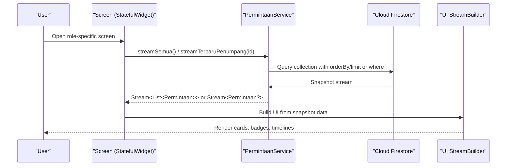
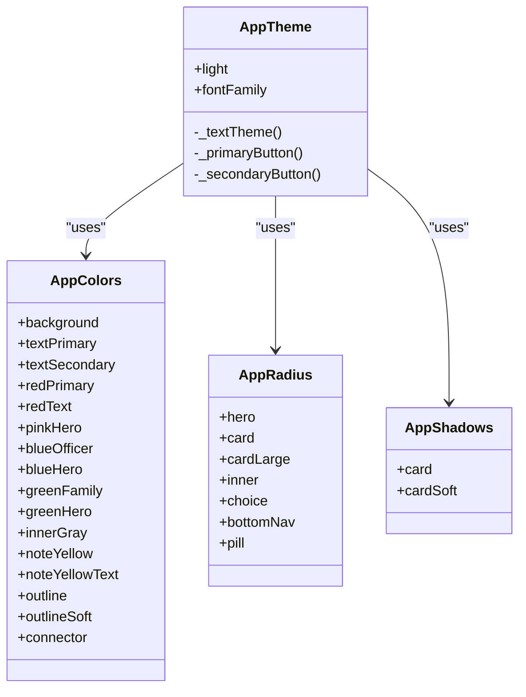
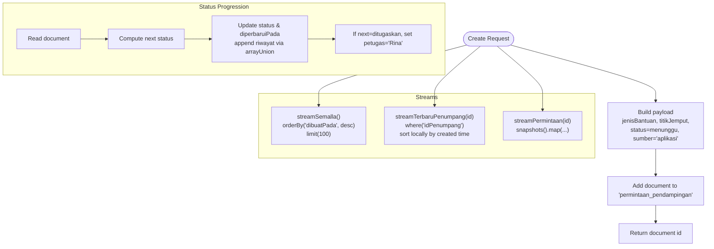
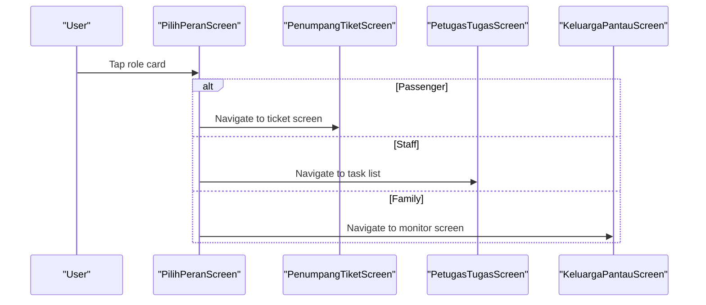
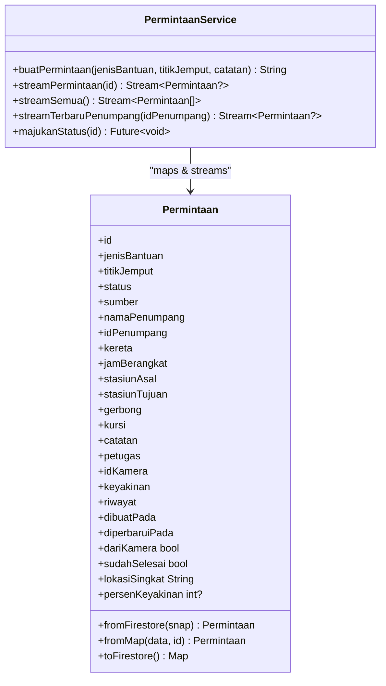
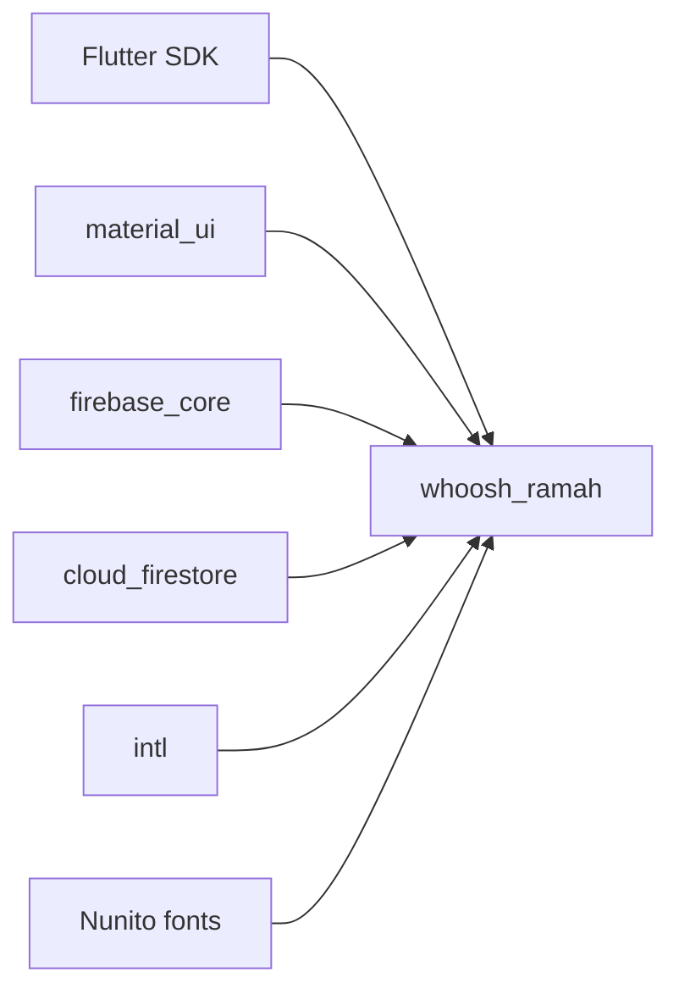
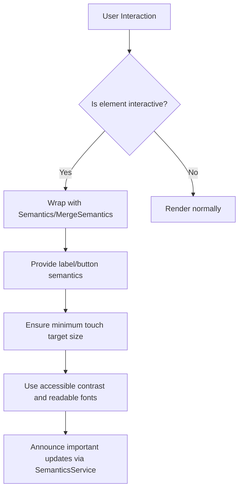

# Mobile Application

<cite>
**Referenced Files in This Document**
- [main.dart](file://whoosh_ramah/lib/main.dart)
- [theme.dart](file://whoosh_ramah/lib/theme.dart)
- [pubspec.yaml](file://whoosh_ramah/pubspec.yaml)
- [permintaan.dart](file://whoosh_ramah/lib/models/permintaan.dart)
- [permintaan_service.dart](file://whoosh_ramah/lib/services/permintaan_service.dart)
- [pilih_peran_screen.dart](file://whoosh_ramah/lib/screens/pilih_peran_screen.dart)
- [penumpang_tiket_screen.dart](file://whoosh_ramah/lib/screens/penumpang_tiket_screen.dart)
- [petugas_tugas_screen.dart](file://whoosh_ramah/lib/screens/petugas_tugas_screen.dart)
- [keluarga_pantau_screen.dart](file://whoosh_ramah/lib/screens/keluarga_pantau_screen.dart)
- [bottom_nav.dart](file://whoosh_ramah/lib/widgets/bottom_nav.dart)
- [dummy.dart](file://whoosh_ramah/lib/data/dummy.dart)
</cite>

## Table of Contents
1. [Introduction](#introduction)
2. [Project Structure](#project-structure)
3. [Core Components](#core-components)
4. [Architecture Overview](#architecture-overview)
5. [Detailed Component Analysis](#detailed-component-analysis)
6. [Dependency Analysis](#dependency-analysis)
7. [Performance Considerations](#performance-considerations)
8. [Accessibility and WCAG Compliance](#accessibility-and-wcag-compliance)
9. [Troubleshooting Guide](#troubleshooting-guide)
10. [Conclusion](#conclusion)

## Introduction
This Flutter mobile application provides a real-time assistance workflow for train passengers, station staff, and family members. It uses Firebase Firestore streams to synchronize assistance requests across roles, while keeping the UI organized by screens, models, services, and reusable widgets. The app follows an MVVM-inspired structure:
- Models represent domain data and persistence contracts.
- Services encapsulate Firestore operations and business rules.
- Screens manage user-facing state and orchestrate service calls.
- Widgets provide reusable UI building blocks.

The theme system is built around accessible design tokens, including color palettes per role, typography scales, spacing, radii, shadows, and button styles. Navigation starts with a role selection screen that routes passengers, staff, and family members into their respective flows.

## Project Structure
The Flutter code lives under `whoosh_ramah/lib` and is organized by feature layers:
- `lib/main.dart`: App entry point, Firebase initialization, and root widget.
- `lib/theme.dart`: Design tokens, colors, typography, and Material theme configuration.
- `lib/models/`: Domain models such as assistance requests and status history.
- `lib/services/`: Data layer using Cloud Firestore streams and writes.
- `lib/screens/`: Role-based screens for passengers, staff, and family monitoring.
- `lib/widgets/`: Shared UI components like bottom navigation and hero headers.
- `lib/data/`: Demo and dummy data used during development and testing.

```mermaid
graph TB
subgraph "App Entry"
Main["main.dart<br/>Firebase init + MaterialApp"]
end
subgraph "Theme"
Theme["theme.dart<br/>Colors, Radius, Shadows, Typography"]
end
subgraph "Data Layer"
Model["models/permintaan.dart<br/>JenisBantuan, StatusPermintaan, Permintaan"]
Service["services/permintaan_service.dart<br/>Firestore streams & writes"]
Dummy["data/dummy.dart<br/>Demo passenger, staff, ticket"]
end
subgraph "Screens"
RoleSel["screens/pilih_peran_screen.dart<br/>Role selector"]
Passenger["screens/penumpang_tiket_screen.dart<br/>Passenger ticket"]
Staff["screens/petugas_tugas_screen.dart<br/>Staff tasks"]
Family["screens/keluarga_pantau_screen.dart<br/>Family monitor"]
end
subgraph "Widgets"
BottomNav["widgets/bottom_nav.dart<br/>Bottom navigation"]
end
Main --> Theme
Main --> RoleSel
RoleSel --> Passenger
RoleSel --> Staff
RoleSel --> Family
Passenger --> BottomNav
Staff --> BottomNav
Family --> BottomNav
Staff --> Service
Family --> Service
Service --> Model
Service --> Dummy
```

**Diagram sources**
- [main.dart:8-33](file://whoosh_ramah/lib/main.dart#L8-L33)
- [theme.dart:67-113](file://whoosh_ramah/lib/theme.dart#L67-L113)
- [permintaan.dart:7-213](file://whoosh_ramah/lib/models/permintaan.dart#L7-L213)
- [permintaan_service.dart:10-135](file://whoosh_ramah/lib/services/permintaan_service.dart#L10-L135)
- [pilih_peran_screen.dart:14-146](file://whoosh_ramah/lib/screens/pilih_peran_screen.dart#L14-L146)
- [penumpang_tiket_screen.dart:18-263](file://whoosh_ramah/lib/screens/penumpang_tiket_screen.dart#L18-L263)
- [petugas_tugas_screen.dart:28-133](file://whoosh_ramah/lib/screens/petugas_tugas_screen.dart#L28-L133)
- [keluarga_pantau_screen.dart:19-133](file://whoosh_ramah/lib/screens/keluarga_pantau_screen.dart#L19-L133)
- [bottom_nav.dart:22-54](file://whoosh_ramah/lib/widgets/bottom_nav.dart#L22-L54)
- [dummy.dart:56-89](file://whoosh_ramah/lib/data/dummy.dart#L56-L89)

**Section sources**
- [main.dart:8-33](file://whoosh_ramah/lib/main.dart#L8-L33)
- [pubspec.yaml:30-40](file://whoosh_ramah/pubspec.yaml#L30-L40)

## Core Components
- App entry and theme:
  - The app initializes Firebase and sets up a light theme with custom colors, typography, and button styles.
  - The root screen is the role selection screen.
- Models:
  - Assistance request model includes type of help, pickup location, source (app or AI camera), status, timestamps, and status history.
  - Enums define supported assistance types and a strict status progression.
- Services:
  - Firestore collection access for creating requests, streaming all tasks, streaming the latest request for a passenger, and advancing status.
- Screens:
  - Role selector routes to passenger ticket, staff task list, and family monitoring.
  - Passenger ticket shows trip details and invites assistance requests.
  - Staff task list listens to Firestore and highlights new tasks with haptic feedback and announcements.
  - Family monitor displays current status, journey progress, and timeline, announcing changes to assistive technologies.
- Widgets:
  - Bottom navigation provides role-themed active states and accessible labels.

**Section sources**
- [main.dart:8-33](file://whoosh_ramah/lib/main.dart#L8-L33)
- [permintaan.dart:7-213](file://whoosh_ramah/lib/models/permintaan.dart#L7-L213)
- [permintaan_service.dart:10-135](file://whoosh_ramah/lib/services/permintaan_service.dart#L10-L135)
- [pilih_peran_screen.dart:14-146](file://whoosh_ramah/lib/screens/pilih_peran_screen.dart#L14-L146)
- [penumpang_tiket_screen.dart:18-263](file://whoosh_ramah/lib/screens/penumpang_tiket_screen.dart#L18-L263)
- [petugas_tugas_screen.dart:28-133](file://whoosh_ramah/lib/screens/petugas_tugas_screen.dart#L28-L133)
- [keluarga_pantau_screen.dart:19-133](file://whoosh_ramah/lib/screens/keluarga_pantau_screen.dart#L19-L133)
- [bottom_nav.dart:22-54](file://whoosh_ramah/lib/widgets/bottom_nav.dart#L22-L54)

## Architecture Overview
The application follows a layered architecture:
- Presentation layer: Screens and widgets render UI and handle user interactions.
- State management: Streams from Firestore drive reactive UI updates; local state tracks notifications and highlights.
- Data layer: Service abstracts Firestore queries and mutations; models map documents to typed objects.
- Theme layer: Centralized design tokens ensure consistent styling and accessibility.



**Diagram sources**
- [petugas_tugas_screen.dart:38-133](file://whoosh_ramah/lib/screens/petugas_tugas_screen.dart#L38-L133)
- [keluarga_pantau_screen.dart:32-133](file://whoosh_ramah/lib/screens/keluarga_pantau_screen.dart#L32-L133)
- [permintaan_service.dart:63-90](file://whoosh_ramah/lib/services/permintaan_service.dart#L63-L90)

## Detailed Component Analysis

### Theme System and Accessibility-Focused Tokens
The theme defines:
- Color palette:
  - Background and text colors for readability.
  - Role-based accent colors: red for passengers, blue for staff, green for family/success.
  - Supporting colors for notes, outlines, connectors, and hero backgrounds.
- Radii:
  - Consistent rounded corners for hero sections, cards, inner boxes, choices, bottom navigation, and pill buttons.
- Shadows:
  - Soft card shadows for depth without heavy elevation.
- Typography:
  - Nunito font family with sizes and weights aligned to accessibility guidelines (minimum 13, body 15–17, titles 25–30).
- Buttons:
  - Primary and secondary button styles with minimum touch targets and accessible tap target sizing.



**Diagram sources**
- [theme.dart:7-163](file://whoosh_ramah/lib/theme.dart#L7-L163)

**Section sources**
- [theme.dart:7-163](file://whoosh_ramah/lib/theme.dart#L7-L163)
- [pubspec.yaml:64-76](file://whoosh_ramah/pubspec.yaml#L64-L76)

### Data Layer: Firestore Streams and Real-Time Sync
The data layer centers on:
- `Permintaan` model mapping Firestore documents to strongly-typed Dart objects.
- `PermintaanService` providing:
  - Creating assistance requests with initial status and timestamps.
  - Streaming all tasks ordered by creation time.
  - Streaming the latest request for a specific passenger.
  - Advancing status through a strict sequence and recording history.



**Diagram sources**
- [permintaan_service.dart:23-61](file://whoosh_ramah/lib/services/permintaan_service.dart#L23-L61)
- [permintaan_service.dart:63-90](file://whoosh_ramah/lib/services/permintaan_service.dart#L63-L90)
- [permintaan_service.dart:92-119](file://whoosh_ramah/lib/services/permintaan_service.dart#L92-L119)

**Section sources**
- [permintaan.dart:7-213](file://whoosh_ramah/lib/models/permintaan.dart#L7-L213)
- [permintaan_service.dart:10-135](file://whoosh_ramah/lib/services/permintaan_service.dart#L10-L135)

### Role-Based Navigation System
The app supports three user types:
- Passengers: View ticket details and initiate assistance requests.
- Staff: Receive and manage tasks, advance statuses, and view summaries.
- Family members: Monitor the latest assistance request for a passenger and receive status updates.

Navigation flow:
- Root screen presents role cards.
- Each card navigates to a dedicated screen.
- Screens use shared bottom navigation and hero headers.



**Diagram sources**
- [pilih_peran_screen.dart:14-146](file://whoosh_ramah/lib/screens/pilih_peran_screen.dart#L14-L146)
- [penumpang_tiket_screen.dart:18-263](file://whoosh_ramah/lib/screens/penumpang_tiket_screen.dart#L18-L263)
- [petugas_tugas_screen.dart:28-133](file://whoosh_ramah/lib/screens/petugas_tugas_screen.dart#L28-L133)
- [keluarga_pantau_screen.dart:19-133](file://whoosh_ramah/lib/screens/keluarga_pantau_screen.dart#L19-L133)

**Section sources**
- [pilih_peran_screen.dart:14-146](file://whoosh_ramah/lib/screens/pilih_peran_screen.dart#L14-L146)

### Common Patterns: State Management, Firebase Integration, UI Components
- State management:
  - Screens use `StreamBuilder` to reactively update UI based on Firestore snapshots.
  - Local state tracks known IDs, highlighted cards, timers, and last announced status.
- Firebase integration:
  - Service methods encapsulate reads and writes; streams return typed model lists or single objects.
  - Server timestamps are used for creation/update times; client timestamps are used for history entries.
- UI components:
  - Hero headers, white cards, bottom navigation, and pill buttons are reused across screens.
  - Semantics and MergeSemantics enhance accessibility for screen readers.



**Diagram sources**
- [permintaan_service.dart:10-135](file://whoosh_ramah/lib/services/permintaan_service.dart#L10-L135)
- [permintaan.dart:81-213](file://whoosh_ramah/lib/models/permintaan.dart#L81-L213)

**Section sources**
- [petugas_tugas_screen.dart:38-133](file://whoosh_ramah/lib/screens/petugas_tugas_screen.dart#L38-L133)
- [keluarga_pantau_screen.dart:32-133](file://whoosh_ramah/lib/screens/keluarga_pantau_screen.dart#L32-L133)
- [bottom_nav.dart:22-54](file://whoosh_ramah/lib/widgets/bottom_nav.dart#L22-L54)

## Dependency Analysis
The main dependencies include:
- Flutter SDK and Material UI package for UI components.
- Firebase Core and Cloud Firestore for backend integration.
- Internationalization library for date formatting.
- Custom fonts bundled via pubspec.



**Diagram sources**
- [pubspec.yaml:30-40](file://whoosh_ramah/pubspec.yaml#L30-L40)
- [pubspec.yaml:64-76](file://whoosh_ramah/pubspec.yaml#L64-L76)

**Section sources**
- [pubspec.yaml:30-40](file://whoosh_ramah/pubspec.yaml#L30-L40)
- [pubspec.yaml:64-76](file://whoosh_ramah/pubspec.yaml#L64-L76)

## Performance Considerations
- Firestore queries:
  - Use single-field ordering (`dibuatPada`) to avoid composite index requirements.
  - Limit results to recent documents to reduce bandwidth and processing.
- Client-side sorting:
  - For queries requiring additional filters, sort locally to avoid composite indexes.
- Stream handling:
  - Avoid redundant rebuilds by minimizing state changes and using efficient builders.
- UI rendering:
  - Reuse widgets and avoid deep nested layouts where possible.
  - Use semantic wrappers sparingly to balance accessibility and performance.

[No sources needed since this section provides general guidance]

## Accessibility and WCAG Compliance
The app implements several accessibility practices:
- Semantic labeling:
  - Interactive cards and buttons wrap content in `Semantics` and `MergeSemantics` to provide clear labels and roles.
- Screen reader announcements:
  - New tasks and status changes trigger `SemanticsService.sendAnnouncement` to inform assistive technology users.
- Touch targets:
  - Button styles enforce minimum heights and padded tap targets to meet WCAG guidelines.
- Contrast and typography:
  - Text colors and sizes follow accessibility recommendations; minimum font size is 13, body text is larger, and headings are prominent.
- Visual cues:
  - Status badges and progress bars use both color and text labels to convey meaning beyond color alone.



**Diagram sources**
- [pilih_peran_screen.dart:168-228](file://whoosh_ramah/lib/screens/pilih_peran_screen.dart#L168-L228)
- [petugas_tugas_screen.dart:62-90](file://whoosh_ramah/lib/screens/petugas_tugas_screen.dart#L62-L90)
- [keluarga_pantau_screen.dart:46-77](file://whoosh_ramah/lib/screens/keluarga_pantau_screen.dart#L46-L77)
- [theme.dart:138-162](file://whoosh_ramah/lib/theme.dart#L138-L162)

**Section sources**
- [pilih_peran_screen.dart:168-228](file://whoosh_ramah/lib/screens/pilih_peran_screen.dart#L168-L228)
- [petugas_tugas_screen.dart:62-90](file://whoosh_ramah/lib/screens/petugas_tugas_screen.dart#L62-L90)
- [keluarga_pantau_screen.dart:46-77](file://whoosh_ramah/lib/screens/keluarga_pantau_screen.dart#L46-L77)
- [theme.dart:138-162](file://whoosh_ramah/lib/theme.dart#L138-L162)

## Troubleshooting Guide
Common issues and resolutions:
- Firestore query errors:
  - Ensure queries use single-field ordering; add composite indexes if required by more complex filters.
- Missing data:
  - Verify that dummy data fields match Firestore field names when creating requests.
- Status not updating:
  - Confirm that status progression logic computes the next valid status and updates history correctly.
- Accessibility not working:
  - Check that interactive elements have proper semantics and labels; verify announcements are triggered on state changes.

**Section sources**
- [permintaan_service.dart:70-90](file://whoosh_ramah/lib/services/permintaan_service.dart#L70-L90)
- [permintaan_service.dart:92-119](file://whoosh_ramah/lib/services/permintaan_service.dart#L92-L119)
- [petugas_tugas_screen.dart:62-90](file://whoosh_ramah/lib/screens/petugas_tugas_screen.dart#L62-L90)

## Conclusion
This application provides a robust, accessible, and real-time assistance workflow for train travel. Its layered architecture separates concerns clearly, while its theme system ensures consistent and inclusive design. Firestore streams enable live synchronization across roles, and the role-based navigation guides passengers, staff, and family members through tailored experiences. By adhering to accessibility best practices and maintaining clean data modeling, the app offers a solid foundation for further enhancements and scalability.

[No sources needed since this section summarizes without analyzing specific files]