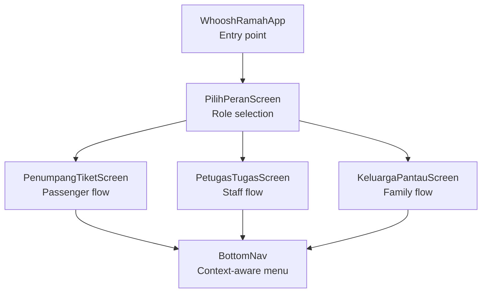
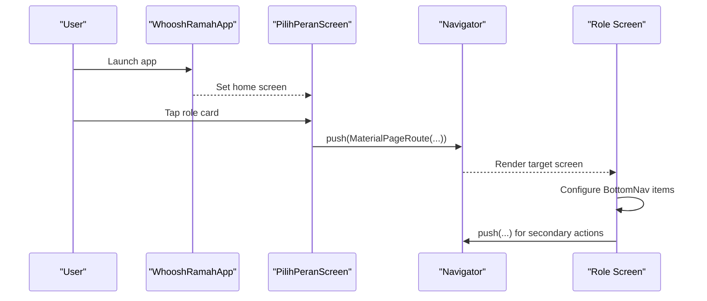
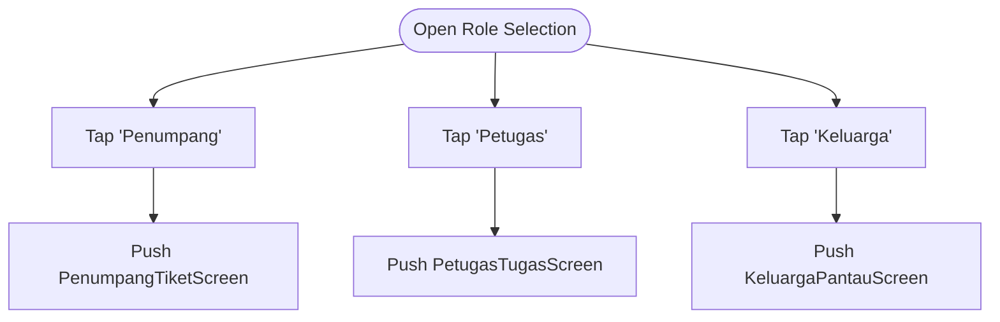
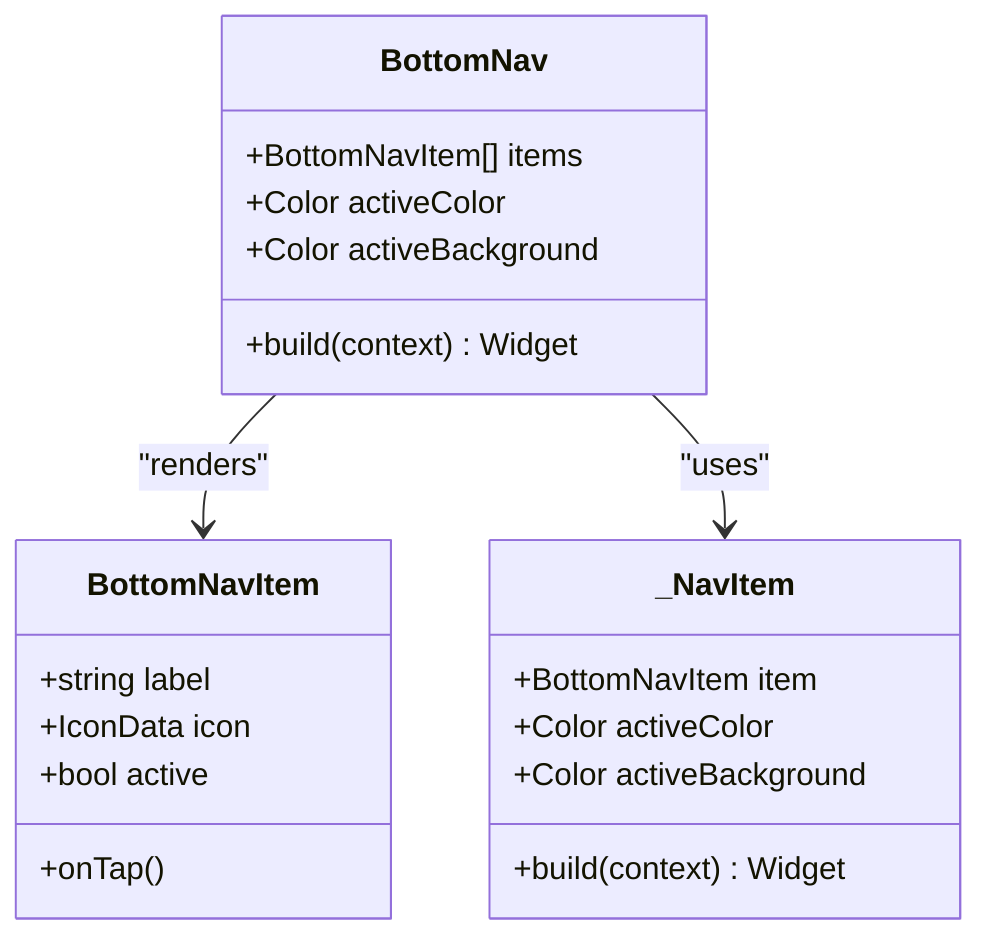
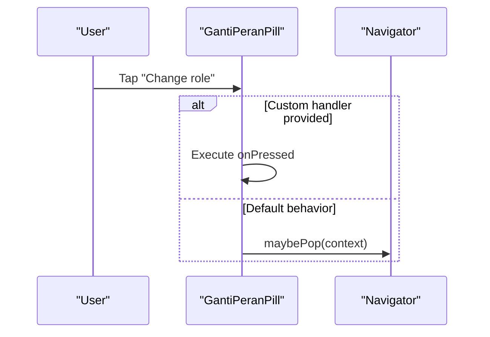
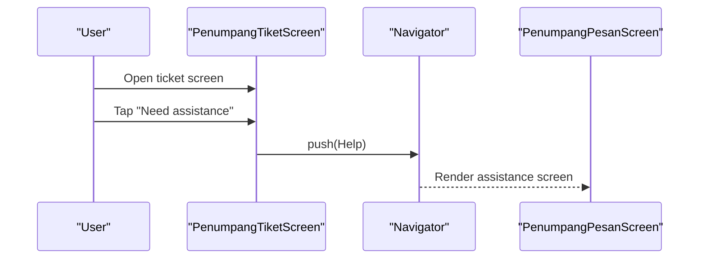
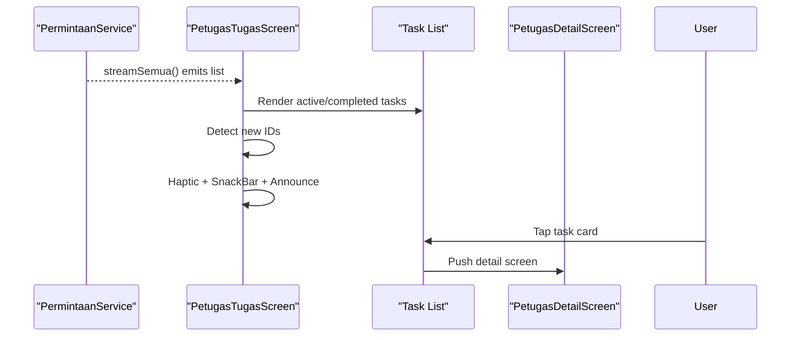
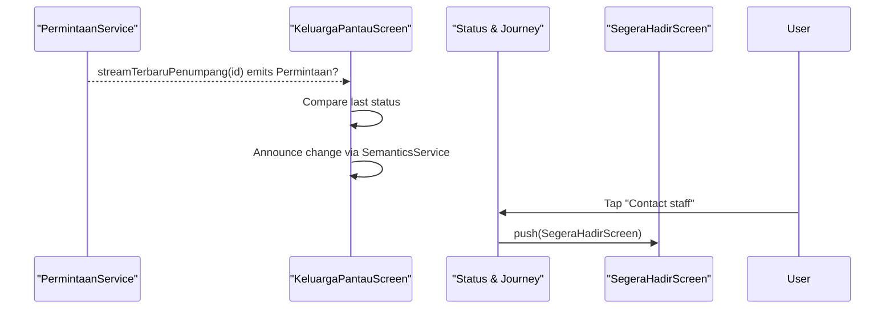
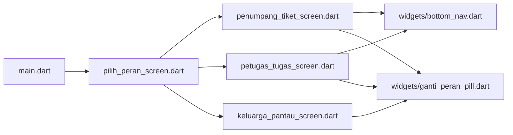

# Navigation System

<cite>
**Referenced Files in This Document**
- [main.dart](file://whoosh_ramah/lib/main.dart)
- [pilih_peran_screen.dart](file://whoosh_ramah/lib/screens/pilih_peran_screen.dart)
- [penumpang_tiket_screen.dart](file://whoosh_ramah/lib/screens/penumpang_tiket_screen.dart)
- [petugas_tugas_screen.dart](file://whoosh_ramah/lib/screens/petugas_tugas_screen.dart)
- [keluarga_pantau_screen.dart](file://whoosh_ramah/lib/screens/keluarga_pantau_screen.dart)
- [bottom_nav.dart](file://whoosh_ramah/lib/widgets/bottom_nav.dart)
- [ganti_peran_pill.dart](file://whoosh_ramah/lib/widgets/ganti_peran_pill.dart)
</cite>

## Table of Contents
1. [Introduction](#introduction)
2. [Project Structure](#project-structure)
3. [Core Components](#core-components)
4. [Architecture Overview](#architecture-overview)
5. [Detailed Component Analysis](#detailed-component-analysis)
6. [Dependency Analysis](#dependency-analysis)
7. [Performance Considerations](#performance-considerations)
8. [Troubleshooting Guide](#troubleshooting-guide)
9. [Conclusion](#conclusion)

## Introduction
This document explains the role-based navigation system used by the application. The app starts with a role selection screen that supports three user types: passengers, staff, and family members. Each role navigates to a dedicated flow with its own bottom navigation menu and context-aware actions. The implementation uses Flutter’s Navigator for routing, StreamBuilder for live data updates, and Semantics widgets for accessibility.

The goal is to help developers understand how roles are selected, how screens are dynamically rendered based on those roles, and how navigation state is managed consistently across flows. It also documents accessibility patterns and best practices for maintaining a consistent user experience.

## Project Structure
At a high level, the navigation entry point initializes the app and opens the role selection screen. From there, users choose one of three roles, each leading to a different screen:
- Passenger: ticket detail and assistance request flow
- Staff: task list and detail flow
- Family: real-time monitoring flow

**Diagram sources**
- [main.dart:20-33](file://whoosh_ramah/lib/main.dart#L20-L33)
- [pilih_peran_screen.dart:14-147](file://whoosh_ramah/lib/screens/pilih_peran_screen.dart#L14-L147)
- [penumpang_tiket_screen.dart:18-264](file://whoosh_ramah/lib/screens/penumpang_tiket_screen.dart#L18-L264)
- [petugas_tugas_screen.dart:28-158](file://whoosh_ramah/lib/screens/petugas_tugas_screen.dart#L28-L158)
- [keluarga_pantau_screen.dart:19-133](file://whoosh_ramah/lib/screens/keluarga_pantau_screen.dart#L19-L133)
- [bottom_nav.dart:22-55](file://whoosh_ramah/lib/widgets/bottom_nav.dart#L22-L55)

**Section sources**
- [main.dart:8-33](file://whoosh_ramah/lib/main.dart#L8-L33)
- [pilih_peran_screen.dart:14-147](file://whoosh_ramah/lib/screens/pilih_peran_screen.dart#L14-L147)

## Core Components
- Role selection screen: Presents three role cards (passenger, staff, family). Tapping a card navigates directly to the corresponding screen using MaterialPageRoute.
- Bottom navigation widget: A reusable component that renders a floating bar with role-specific active colors and background tones. Each item can be interactive or static depending on the screen.
- Role switcher pill: A small “Change role” control at the top-left of hero sections that returns users to the role selection screen.

Key responsibilities:
- Route decisions: handled by explicit taps on role cards and within screens.
- Context-aware menus: each screen configures its own BottomNavItem list and active color scheme.
- Accessibility: buttons and semantic labels are provided via Semantics and MergeSemantics.

**Section sources**
- [pilih_peran_screen.dart:98-129](file://whoosh_ramah/lib/screens/pilih_peran_screen.dart#L98-L129)
- [bottom_nav.dart:6-18](file://whoosh_ramah/lib/widgets/bottom_nav.dart#L6-L18)
- [bottom_nav.dart:22-55](file://whoosh_ramah/lib/widgets/bottom_nav.dart#L22-L55)
- [ganti_peran_pill.dart:10-48](file://whoosh_ramah/lib/widgets/ganti_peran_pill.dart#L10-L48)

## Architecture Overview
The navigation architecture is simple and explicit:
- The app root sets the home screen to the role selection screen.
- Role selection pushes specific screens onto the Navigator stack.
- Each role screen owns its content and bottom navigation configuration.
- Screens may push additional routes (e.g., assistance request, task detail, immediate action screens).

**Diagram sources**
- [main.dart:20-33](file://whoosh_ramah/lib/main.dart#L20-L33)
- [pilih_peran_screen.dart:104-128](file://whoosh_ramah/lib/screens/pilih_peran_screen.dart#L104-L128)
- [penumpang_tiket_screen.dart:178-254](file://whoosh_ramah/lib/screens/penumpang_tiket_screen.dart#L178-L254)
- [petugas_tugas_screen.dart:147-155](file://whoosh_ramah/lib/screens/petugas_tugas_screen.dart#L147-L155)
- [keluarga_pantau_screen.dart:532-560](file://whoosh_ramah/lib/screens/keluarga_pantau_screen.dart#L532-L560)

## Detailed Component Analysis

### Role Selection Screen
The role selection screen provides three role cards:
- Penumpang (Passenger): navigates to the ticket screen.
- Petugas stasiun (Station staff): navigates to the task list screen.
- Keluarga (Family): navigates to the monitoring screen.

Each card wraps its content in MergeSemantics and Semantics to ensure screen readers treat it as a single button with a descriptive label.

**Diagram sources**
- [pilih_peran_screen.dart:98-129](file://whoosh_ramah/lib/screens/pilih_peran_screen.dart#L98-L129)

Implementation notes:
- Direct route pushes via Navigator.of(context).push(MaterialPageRoute(...)).
- No global role state; the current role is implicit in the displayed screen.
- Accessibility: role cards use Semantics(button: true) and MergeSemantics to group visual elements into one accessible action.

**Section sources**
- [pilih_peran_screen.dart:14-147](file://whoosh_ramah/lib/screens/pilih_peran_screen.dart#L14-L147)
- [pilih_peran_screen.dart:150-229](file://whoosh_ramah/lib/screens/pilih_peran_screen.dart#L150-L229)

### Bottom Navigation Widget
The bottom navigation widget renders a floating bar with rounded corners and soft shadows. Each item is defined by a BottomNavItem containing:
- label
- icon
- active flag
- optional onTap callback

Active items receive role-specific colors and backgrounds passed from the parent screen.

**Diagram sources**
- [bottom_nav.dart:6-18](file://whoosh_ramah/lib/widgets/bottom_nav.dart#L6-L18)
- [bottom_nav.dart:22-55](file://whoosh_ramah/lib/widgets/bottom_nav.dart#L22-L55)
- [bottom_nav.dart:57-105](file://whoosh_ramah/lib/widgets/bottom_nav.dart#L57-L105)

Accessibility:
- Items are wrapped in MergeSemantics and Semantics(button: true), with selected state exposed via Semantics(selected: true).
- Minimum touch target height is enforced to meet accessibility guidelines.

Usage examples:
- Passenger flow: Home, Ticket, Help, Account.
- Staff flow: Tasks, History, Profile.
- Family flow: Uses a custom bottom bar instead of BottomNav.

**Section sources**
- [bottom_nav.dart:22-55](file://whoosh_ramah/lib/widgets/bottom_nav.dart#L22-L55)
- [bottom_nav.dart:57-105](file://whoosh_ramah/lib/widgets/bottom_nav.dart#L57-L105)
- [penumpang_tiket_screen.dart:227-254](file://whoosh_ramah/lib/screens/penumpang_tiket_screen.dart#L227-L254)
- [petugas_tugas_screen.dart:147-155](file://whoosh_ramah/lib/screens/petugas_tugas_screen.dart#L147-L155)

### Role Switcher Pill
The “Change role” pill allows users to return to the role selection screen from any role screen. If no custom onPressed is provided, it defaults to Navigator.maybePop(context).

**Diagram sources**
- [ganti_peran_pill.dart:10-48](file://whoosh_ramah/lib/widgets/ganti_peran_pill.dart#L10-L48)

Accessibility:
- Wrapped in MergeSemantics and Semantics(button: true).
- Touch area meets minimum size requirements.

**Section sources**
- [ganti_peran_pill.dart:10-48](file://whoosh_ramah/lib/widgets/ganti_peran_pill.dart#L10-L48)

### Passenger Flow
The passenger flow shows ticket details and offers an assistance request action. The bottom navigation includes contextual items like Help, which navigates to the assistance request screen.

**Diagram sources**
- [penumpang_tiket_screen.dart:178-254](file://whoosh_ramah/lib/screens/penumpang_tiket_screen.dart#L178-L254)

Navigation patterns:
- Direct route pushes for primary actions.
- Bottom navigation items can trigger secondary routes.

Accessibility:
- Header text marked with Semantics(header: true).
- Buttons provide clear labels and tap targets.

**Section sources**
- [penumpang_tiket_screen.dart:18-264](file://whoosh_ramah/lib/screens/penumpang_tiket_screen.dart#L18-L264)

### Staff Flow
The staff flow listens to a stream of requests and displays active tasks and completed tasks for the day. New tasks trigger haptic feedback, SnackBar notifications, and accessibility announcements.

**Diagram sources**
- [petugas_tugas_screen.dart:38-90](file://whoosh_ramah/lib/screens/petugas_tugas_screen.dart#L38-L90)
- [petugas_tugas_screen.dart:92-158](file://whoosh_ramah/lib/screens/petugas_tugas_screen.dart#L92-L158)
- [petugas_tugas_screen.dart:276-282](file://whoosh_ramah/lib/screens/petugas_tugas_screen.dart#L276-L282)

Navigation patterns:
- Stream-driven rendering with post-frame callbacks to detect new items.
- Task cards navigate to detail screens.

Accessibility:
- Uses SemanticsService.sendAnnouncement for status changes.
- Cards expose combined labels via Semantics(label: ...) for richer screen reader output.

**Section sources**
- [petugas_tugas_screen.dart:28-158](file://whoosh_ramah/lib/screens/petugas_tugas_screen.dart#L28-L158)
- [petugas_tugas_screen.dart:351-437](file://whoosh_ramah/lib/screens/petugas_tugas_screen.dart#L351-L437)

### Family Flow
The family flow monitors the latest request for a passenger and announces status changes via SemanticsService. It shows current status, journey progress, and history.

**Diagram sources**
- [keluarga_pantau_screen.dart:32-77](file://whoosh_ramah/lib/screens/keluarga_pantau_screen.dart#L32-L77)
- [keluarga_pantau_screen.dart:79-133](file://whoosh_ramah/lib/screens/keluarga_pantau_screen.dart#L79-L133)
- [keluarga_pantau_screen.dart:532-560](file://whoosh_ramah/lib/screens/keluarga_pantau_screen.dart#L532-L560)

Navigation patterns:
- Stream-driven UI updates with minimal re-renders.
- Primary action navigates to an immediate-action screen.

Accessibility:
- Status changes announced only when they differ from the previous status.
- Button components wrap semantics explicitly for clarity.

**Section sources**
- [keluarga_pantau_screen.dart:19-133](file://whoosh_ramah/lib/screens/keluarga_pantau_screen.dart#L19-L133)
- [keluarga_pantau_screen.dart:532-560](file://whoosh_ramah/lib/screens/keluarga_pantau_screen.dart#L532-L560)

## Dependency Analysis
The navigation dependencies are straightforward:
- main.dart depends on the role selection screen and theme.
- Role selection screen depends on the three role screens.
- Role screens depend on shared widgets (hero header, bottom nav, role switcher pill).
- Some screens depend on services and models for data streaming.

**Diagram sources**
- [main.dart:4-6](file://whoosh_ramah/lib/main.dart#L4-L6)
- [pilih_peran_screen.dart:6-8](file://whoosh_ramah/lib/screens/pilih_peran_screen.dart#L6-L8)
- [penumpang_tiket_screen.dart:5-12](file://whoosh_ramah/lib/screens/penumpang_tiket_screen.dart#L5-L12)
- [petugas_tugas_screen.dart:7-14](file://whoosh_ramah/lib/screens/petugas_tugas_screen.dart#L7-L14)
- [keluarga_pantau_screen.dart:5-11](file://whoosh_ramah/lib/screens/keluarga_pantau_screen.dart#L5-L11)
- [bottom_nav.dart:1-3](file://whoosh_ramah/lib/widgets/bottom_nav.dart#L1-L3)
- [ganti_peran_pill.dart:1-3](file://whoosh_ramah/lib/widgets/ganti_peran_pill.dart#L1-L3)

**Section sources**
- [main.dart:4-6](file://whoosh_ramah/lib/main.dart#L4-L6)
- [pilih_peran_screen.dart:6-8](file://whoosh_ramah/lib/screens/pilih_peran_screen.dart#L6-L8)
- [penumpang_tiket_screen.dart:5-12](file://whoosh_ramah/lib/screens/penumpang_tiket_screen.dart#L5-L12)
- [petugas_tugas_screen.dart:7-14](file://whoosh_ramah/lib/screens/petugas_tugas_screen.dart#L7-L14)
- [keluarga_pantau_screen.dart:5-11](file://whoosh_ramah/lib/screens/keluarga_pantau_screen.dart#L5-L11)

## Performance Considerations
- StreamBuilder usage: Both staff and family screens use streams to update UI reactively. Ensure streams are scoped to the relevant screen lifecycle to avoid unnecessary rebuilds.
- Post-frame callbacks: New task detection uses addPostFrameCallback to avoid blocking the first frame.
- Minimal state: Role selection does not maintain global role state; navigation is driven by direct route pushes, reducing complexity.
- Reusable widgets: BottomNav and GantiPeranPill encapsulate common UI logic, improving consistency and reducing duplication.

[No sources needed since this section provides general guidance]

## Troubleshooting Guide
Common issues and resolutions:
- Unexpected back navigation from role screens: Use GantiPeranPill with a custom onPressed if you need to reset to the role selection screen rather than popping the stack.
- Missing accessibility announcements: Verify that SemanticsService.sendAnnouncement is called after UI updates and that the View context is valid.
- Bottom navigation not reflecting active state: Ensure the active flag and activeColor/activeBackground are correctly configured per screen.
- Stream errors: Handle snapshot.hasError in StreamBuilder and display user-friendly messages.

**Section sources**
- [petugas_tugas_screen.dart:92-133](file://whoosh_ramah/lib/screens/petugas_tugas_screen.dart#L92-L133)
- [keluarga_pantau_screen.dart:79-133](file://whoosh_ramah/lib/screens/keluarga_pantau_screen.dart#L79-L133)
- [ganti_peran_pill.dart:10-48](file://whoosh_ramah/lib/widgets/ganti_peran_pill.dart#L10-L48)

## Conclusion
The role-based navigation system is built around a simple, explicit routing model:
- Role selection drives initial navigation.
- Each role screen manages its own content and bottom navigation configuration.
- Shared widgets standardize navigation controls and accessibility.
- Streams enable real-time updates for staff and family flows.

To maintain consistency:
- Keep route decisions explicit and localized within screens.
- Use BottomNav for consistent bottom navigation patterns.
- Provide meaningful Semantics labels and ensure minimum touch targets.
- Announce important state changes via SemanticsService for screen reader compatibility.

[No sources needed since this section summarizes without analyzing specific files]