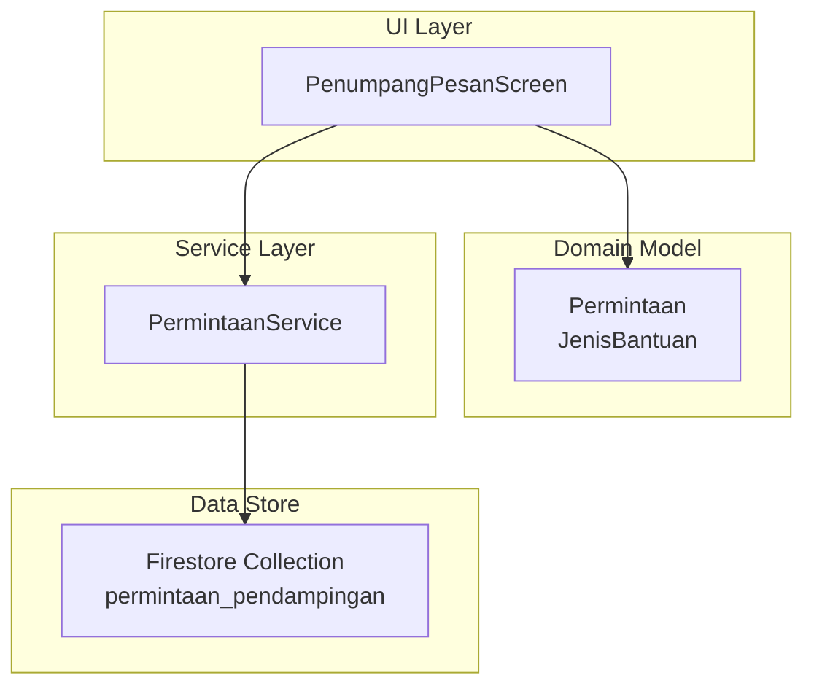
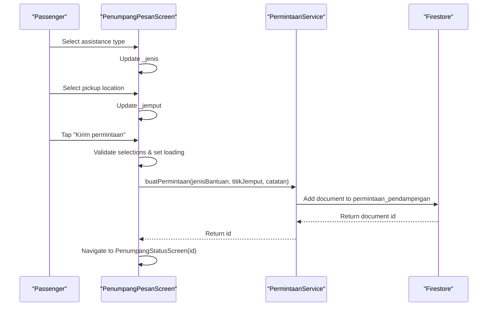
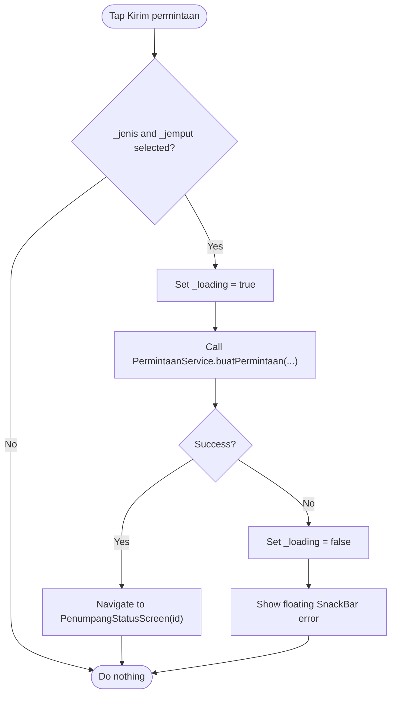
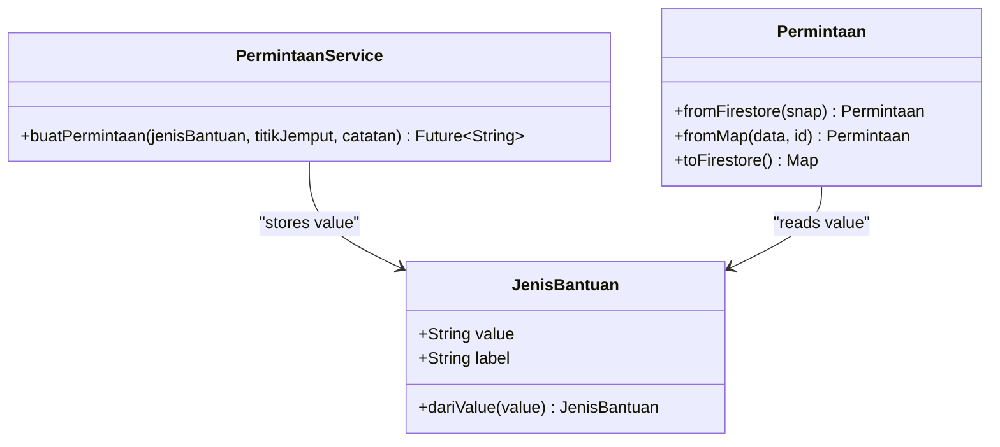
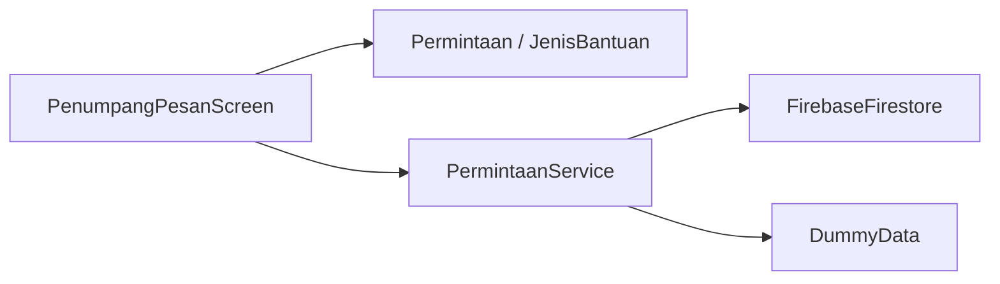

# Assistance Request Form

<cite>
**Referenced Files in This Document**
- [penumpang_pesan_screen.dart](file://whoosh_ramah/lib/screens/penumpang_pesan_screen.dart)
- [permintaan.dart](file://whoosh_ramah/lib/models/permintaan.dart)
- [permintaan_service.dart](file://whoosh_ramah/lib/services/permintaan_service.dart)
- [penumpang_pesan_test.dart](file://whoosh_ramah/test/penumpang_pesan_test.dart)
</cite>

## Table of Contents
1. [Introduction](#introduction)
2. [Project Structure](#project-structure)
3. [Core Components](#core-components)
4. [Architecture Overview](#architecture-overview)
5. [Detailed Component Analysis](#detailed-component-analysis)
6. [Dependency Analysis](#dependency-analysis)
7. [Performance Considerations](#performance-considerations)
8. [Troubleshooting Guide](#troubleshooting-guide)
9. [Conclusion](#conclusion)

## Introduction
This document explains the assistance request form implemented by PenumpangPesanScreen. It covers how passengers select an assistance type, choose a pickup location, optionally add notes, and submit the request. It also documents validation rules, input handling, submission workflow, enum-based assistance types, state management patterns, data binding to Firestore via PermintaanService, accessibility considerations, and integration with the passenger service layer for persistence and real-time updates.

## Project Structure
The assistance request feature spans three main layers:
- UI layer: PenumpangPesanScreen renders the form, handles user interactions, and manages local state.
- Domain model layer: Permintaan and JenisBantuan define the data contract and enums used across the app.
- Service layer: PermintaanService persists requests to Firestore and provides streams for real-time updates.

**Diagram sources**
- [penumpang_pesan_screen.dart:19-38](file://whoosh_ramah/lib/screens/penumpang_pesan_screen.dart#L19-L38)
- [permintaan.dart:7-25](file://whoosh_ramah/lib/models/permintaan.dart#L7-L25)
- [permintaan_service.dart:10-21](file://whoosh_ramah/lib/services/permintaan_service.dart#L10-L21)

**Section sources**
- [penumpang_pesan_screen.dart:11-18](file://whoosh_ramah/lib/screens/penumpang_pesan_screen.dart#L11-L18)
- [permintaan_service.dart:6-9](file://whoosh_ramah/lib/services/permintaan_service.dart#L6-L9)

## Core Components
- PenumpangPesanScreen: A StatefulWidget that owns form state (selected assistance type, selected pickup point, optional notes, loading flag). It renders selection grids, a notes field, and a submit button.
- JenisBantuan: An enum mapping Firestore string values to user-facing labels and icons.
- PermintaanService: Provides buatPermintaan to create a new request and stream methods for real-time updates.

Key responsibilities:
- Validation: The submit button is enabled only when both assistance type and pickup location are selected.
- Input handling: Selections update local state; notes are trimmed before submission.
- Submission: Calls service to persist data and navigates to status screen on success; shows error feedback on failure.

**Section sources**
- [penumpang_pesan_screen.dart:30-38](file://whoosh_ramah/lib/screens/penumpang_pesan_screen.dart#L30-L38)
- [penumpang_pesan_screen.dart:63-90](file://whoosh_ramah/lib/screens/penumpang_pesan_screen.dart#L63-L90)
- [permintaan.dart:7-25](file://whoosh_ramah/lib/models/permintaan.dart#L7-L25)
- [permintaan_service.dart:23-61](file://whoosh_ramah/lib/services/permintaan_service.dart#L23-L61)

## Architecture Overview
The assistance request flow connects UI state to Firestore through a service layer.

**Diagram sources**
- [penumpang_pesan_screen.dart:63-90](file://whoosh_ramah/lib/screens/penumpang_pesan_screen.dart#L63-L90)
- [permintaan_service.dart:28-61](file://whoosh_ramah/lib/services/permintaan_service.dart#L28-L61)

## Detailed Component Analysis

### PenumpangPesanScreen Implementation
State variables:
- _jenis: Selected JenisBantuan.
- _jemput: Selected pickup location string.
- _catatan: Notes text controller.
- _loading: Submission progress flag.

Form validation rules:
- Assistance type must be selected.
- Pickup location must be selected.
- Notes are optional; empty notes are submitted as null.

Input handling mechanisms:
- Assistance type grid iterates over JenisBantuan.values and sets _jenis on tap.
- Pickup location grid iterates over DummyData.titikJemput and sets _jemput on tap.
- Notes TextField uses a TextEditingController and is disabled during submission.

Submission workflow:
- On submit, if either selection is missing or already loading, return early.
- Set loading true, call service.buatPermintaan with trimmed notes.
- On success, navigate to PenumpangStatusScreen with returned id.
- On failure, reset loading and show a floating SnackBar error message.

Accessibility considerations:
- Submit button wrapped in Semantics with button and enabled flags.
- Section headings use Semantics header.
- Choice boxes use Semantics with selected and label attributes; non-color indicators (border, badge) ensure assistive tech compatibility.

Keyboard navigation support:
- Interactive elements are wrapped in GestureDetector with HitTestBehavior.opaque, enabling focus traversal and activation via keyboard where supported by the platform.
- Semantics annotations improve screen reader announcements.

Code example paths:
- Form state and lazy service initialization: [penumpang_pesan_screen.dart:30-38](file://whoosh_ramah/lib/screens/penumpang_pesan_screen.dart#L30-L38)
- Submission logic and error handling: [penumpang_pesan_screen.dart:63-90](file://whoosh_ramah/lib/screens/penumpang_pesan_screen.dart#L63-L90)
- Assistance type grid rendering: [penumpang_pesan_screen.dart:178-209](file://whoosh_ramah/lib/screens/penumpang_pesan_screen.dart#L178-L209)
- Pickup location grid rendering: [penumpang_pesan_screen.dart:211-242](file://whoosh_ramah/lib/screens/penumpang_pesan_screen.dart#L211-L242)
- Notes field configuration: [penumpang_pesan_screen.dart:244-264](file://whoosh_ramah/lib/screens/penumpang_pesan_screen.dart#L244-L264)
- Submit button semantics and behavior: [penumpang_pesan_screen.dart:271-321](file://whoosh_ramah/lib/screens/penumpang_pesan_screen.dart#L271-L321)
- Choice box semantics and visual selection: [penumpang_pesan_screen.dart:347-458](file://whoosh_ramah/lib/screens/penumpang_pesan_screen.dart#L347-L458)

**Diagram sources**
- [penumpang_pesan_screen.dart:63-90](file://whoosh_ramah/lib/screens/penumpang_pesan_screen.dart#L63-L90)

**Section sources**
- [penumpang_pesan_screen.dart:30-38](file://whoosh_ramah/lib/screens/penumpang_pesan_screen.dart#L30-L38)
- [penumpang_pesan_screen.dart:63-90](file://whoosh_ramah/lib/screens/penumpang_pesan_screen.dart#L63-L90)
- [penumpang_pesan_screen.dart:178-209](file://whoosh_ramah/lib/screens/penumpang_pesan_screen.dart#L178-L209)
- [penumpang_pesan_screen.dart:211-242](file://whoosh_ramah/lib/screens/penumpang_pesan_screen.dart#L211-L242)
- [penumpang_pesan_screen.dart:244-264](file://whoosh_ramah/lib/screens/penumpang_pesan_screen.dart#L244-L264)
- [penumpang_pesan_screen.dart:271-321](file://whoosh_ramah/lib/screens/penumpang_pesan_screen.dart#L271-L321)
- [penumpang_pesan_screen.dart:347-458](file://whoosh_ramah/lib/screens/penumpang_pesan_screen.dart#L347-L458)

### Enum-Based Assistance Type Selection: JenisBantuan
JenisBantuan defines six assistance types with stable Firestore string values and user-facing labels:
- kursiRoda: 'kursi_roda' — "Kursi roda"
- tunanetra: 'tunanetra' — "Tunanetra"
- tuli: 'tuli' — "Tuli"
- lansia: 'lansia' — "Lansia"
- hamil: 'hamil' — "Ibu hamil"
- porter: 'porter' — "Porter barang"

UI representation:
- Each enum value maps to a Material icon for visual clarity.
- The grid renders all enum values, allowing single selection.
- Selected items display a check badge and distinct border/background colors.

Persistence mapping:
- PermintaanService stores jenisBantuan.value in Firestore.
- Permintaan.fromMap reads the stored string back into the enum using JenisBantuan.dariValue.

Code example paths:
- Enum definition and mapping: [permintaan.dart:7-25](file://whoosh_ramah/lib/models/permintaan.dart#L7-L25)
- Icon mapping in UI: [penumpang_pesan_screen.dart:42-49](file://whoosh_ramah/lib/screens/penumpang_pesan_screen.dart#L42-L49)
- Grid iteration over enum values: [penumpang_pesan_screen.dart:188-204](file://whoosh_ramah/lib/screens/penumpang_pesan_screen.dart#L188-L204)
- Firestore storage of enum value: [permintaan_service.dart:35-37](file://whoosh_ramah/lib/services/permintaan_service.dart#L35-L37)
- Firestore read-back mapping: [permintaan.dart:157-161](file://whoosh_ramah/lib/models/permintaan.dart#L157-L161)

**Diagram sources**
- [permintaan.dart:7-25](file://whoosh_ramah/lib/models/permintaan.dart#L7-L25)
- [permintaan_service.dart:28-61](file://whoosh_ramah/lib/services/permintaan_service.dart#L28-L61)
- [permintaan.dart:150-179](file://whoosh_ramah/lib/models/permintaan.dart#L150-L179)

**Section sources**
- [permintaan.dart:7-25](file://whoosh_ramah/lib/models/permintaan.dart#L7-L25)
- [penumpang_pesan_screen.dart:42-49](file://whoosh_ramah/lib/screens/penumpang_pesan_screen.dart#L42-L49)
- [penumpang_pesan_screen.dart:188-204](file://whoosh_ramah/lib/screens/penumpang_pesan_screen.dart#L188-L204)
- [permintaan_service.dart:35-37](file://whoosh_ramah/lib/services/permintaan_service.dart#L35-L37)
- [permintaan.dart:157-161](file://whoosh_ramah/lib/models/permintaan.dart#L157-L161)

### Form State Management Patterns and Data Binding
State management approach:
- Local state variables (_jenis, _jemput, _catatan, _loading) are updated via setState.
- Lazy service initialization avoids touching Firestore during widget build; service instance is created on first submit.

Data binding:
- Assistance type selection binds to JenisBantuan enum values.
- Pickup location selection binds to strings from DummyData.titikJemput.
- Notes bind to TextEditingController and are trimmed before submission.

Validation and enablement:
- Submit button enabled only when both selections exist and not loading.
- Visual feedback includes color changes and shadow effects when active.

Real-time submission feedback:
- Loading spinner shown while submitting.
- Floating SnackBar displayed on failure.

Code example paths:
- Lazy service getter: [penumpang_pesan_screen.dart:37-38](file://whoosh_ramah/lib/screens/penumpang_pesan_screen.dart#L37-L38)
- Submit enablement logic: [penumpang_pesan_screen.dart:271-274](file://whoosh_ramah/lib/screens/penumpang_pesan_screen.dart#L271-L274)
- Notes trimming and submission payload: [penumpang_pesan_screen.dart:70-75](file://whoosh_ramah/lib/screens/penumpang_pesan_screen.dart#L70-L75)

**Section sources**
- [penumpang_pesan_screen.dart:37-38](file://whoosh_ramah/lib/screens/penumpang_pesan_screen.dart#L37-L38)
- [penumpang_pesan_screen.dart:70-75](file://whoosh_ramah/lib/screens/penumpang_pesan_screen.dart#L70-L75)
- [penumpang_pesan_screen.dart:271-274](file://whoosh_ramah/lib/screens/penumpang_pesan_screen.dart#L271-L274)

### Integration with Passenger Service Layer for Persistence and Real-Time Updates
Persistence:
- PermintaanService.buatPermintaan creates a new document in the permintaan_pendampingan collection with fields including jenisBantuan.value, titikJemput, catatan, passenger/ticket info from DummyData, initial riwayat entry, and server timestamps.

Real-time updates:
- Stream methods provide live updates for a single request, all requests, and the latest request per passenger.
- These streams map Firestore snapshots to Permintaan objects using Permintaan.fromFirestore.

Navigation after submission:
- PenumpangPesanScreen navigates to PenumpangStatusScreen with the returned id, enabling real-time status tracking.

Code example paths:
- Create request and initial history: [permintaan_service.dart:28-61](file://whoosh_ramah/lib/services/permintaan_service.dart#L28-L61)
- Single document stream: [permintaan_service.dart:63-68](file://whoosh_ramah/lib/services/permintaan_service.dart#L63-L68)
- All requests stream: [permintaan_service.dart:70-78](file://whoosh_ramah/lib/services/permintaan_service.dart#L70-L78)
- Latest per passenger stream: [permintaan_service.dart:80-90](file://whoosh_ramah/lib/services/permintaan_service.dart#L80-L90)
- Navigation to status screen: [penumpang_pesan_screen.dart:77-79](file://whoosh_ramah/lib/screens/penumpang_pesan_screen.dart#L77-L79)

**Section sources**
- [permintaan_service.dart:28-61](file://whoosh_ramah/lib/services/permintaan_service.dart#L28-L61)
- [permintaan_service.dart:63-90](file://whoosh_ramah/lib/services/permintaan_service.dart#L63-L90)
- [penumpang_pesan_screen.dart:77-79](file://whoosh_ramah/lib/screens/penumpang_pesan_screen.dart#L77-L79)

## Dependency Analysis
Component relationships:
- PenumpangPesanScreen depends on JenisBantuan for selection options and PermintaanService for persistence.
- PermintaanService depends on FirebaseFirestore and DummyData for passenger/ticket context.
- Permintaan models bridge between Firestore data and domain types.

**Diagram sources**
- [penumpang_pesan_screen.dart:3-9](file://whoosh_ramah/lib/screens/penumpang_pesan_screen.dart#L3-L9)
- [permintaan_service.dart:1-4](file://whoosh_ramah/lib/services/permintaan_service.dart#L1-L4)

**Section sources**
- [penumpang_pesan_screen.dart:3-9](file://whoosh_ramah/lib/screens/penumpang_pesan_screen.dart#L3-L9)
- [permintaan_service.dart:1-4](file://whoosh_ramah/lib/services/permintaan_service.dart#L1-L4)

## Performance Considerations
- Lazy service instantiation prevents unnecessary Firestore initialization during widget build.
- Avoiding heavy computations in build; state updates are minimal and localized.
- Streams provided by PermintaanService limit results and order by a single field to avoid composite index requirements.

[No sources needed since this section provides general guidance]

## Troubleshooting Guide
Common issues and strategies:
- Submit button inactive: Ensure both assistance type and pickup location are selected. Tests assert that the submit callback is null until selections are made.
- Submission failure: A floating SnackBar is shown; verify network connectivity and Firestore permissions. The service throws exceptions on failure, which are caught and surfaced to the user.
- Incorrect enum mapping: Confirm that Firestore stores jenisBantuan.value and that Permintaan.fromMap uses JenisBantuan.dariValue.

Verification via tests:
- Assertions confirm rendering of all assistance types and pickup locations.
- Assertions validate that no check badges appear initially and that submit is disabled.
- After selecting options, check badges appear and submit becomes active.

Code example paths:
- Test assertions for initial state and interactivity: [penumpang_pesan_test.dart:20-48](file://whoosh_ramah/test/penumpang_pesan_test.dart#L20-L48)
- Test assertions for selection and submit activation: [penumpang_pesan_test.dart:50-61](file://whoosh_ramah/test/penumpang_pesan_test.dart#L50-L61)
- Error feedback in UI: [penumpang_pesan_screen.dart:80-89](file://whoosh_ramah/lib/screens/penumpang_pesan_screen.dart#L80-L89)

**Section sources**
- [penumpang_pesan_test.dart:20-48](file://whoosh_ramah/test/penumpang_pesan_test.dart#L20-L48)
- [penumpang_pesan_test.dart:50-61](file://whoosh_ramah/test/penumpang_pesan_test.dart#L50-L61)
- [penumpang_pesan_screen.dart:80-89](file://whoosh_ramah/lib/screens/penumpang_pesan_screen.dart#L80-L89)

## Conclusion
PenumpangPesanScreen implements a clear, accessible assistance request form with robust validation, intuitive selection grids, and reliable submission handling. The enum-driven JenisBantuan ensures consistent mapping between UI and Firestore. PermintaanService centralizes persistence and real-time streaming, enabling seamless transitions to status tracking. Accessibility features such as Semantics annotations and non-color selection indicators improve compatibility with assistive technologies. Together, these components deliver a dependable and user-friendly experience for requesting assistance at train stations.