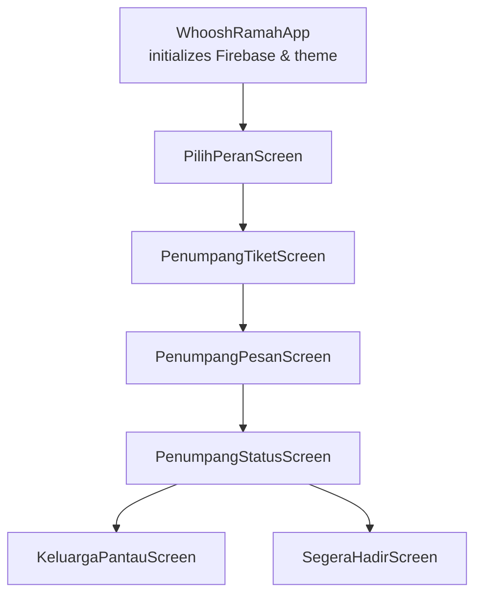
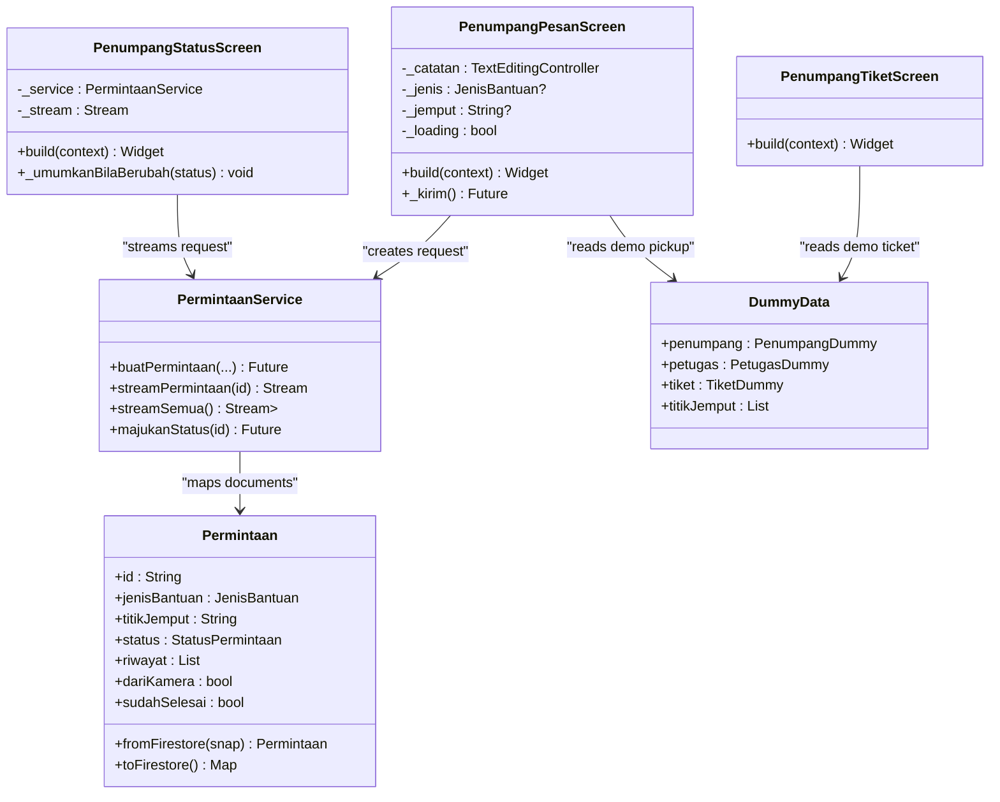
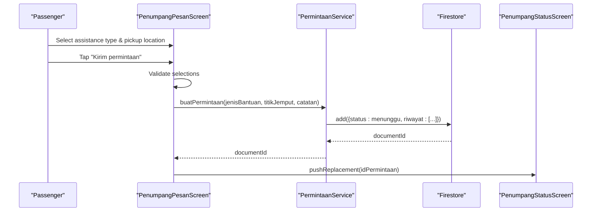
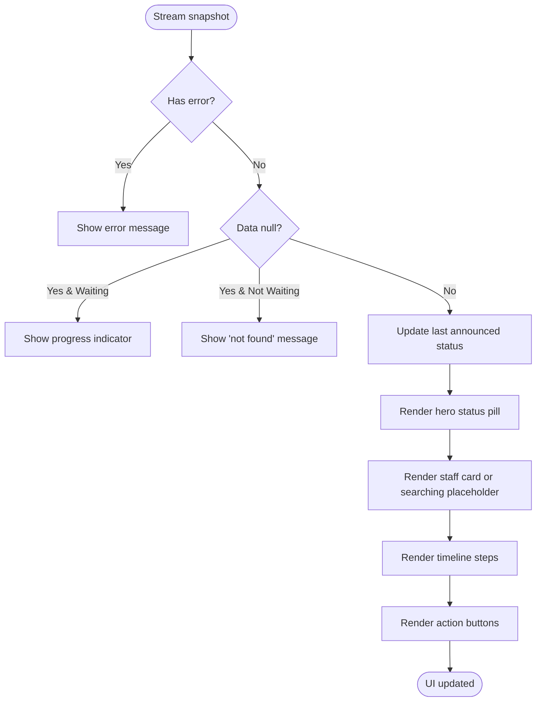
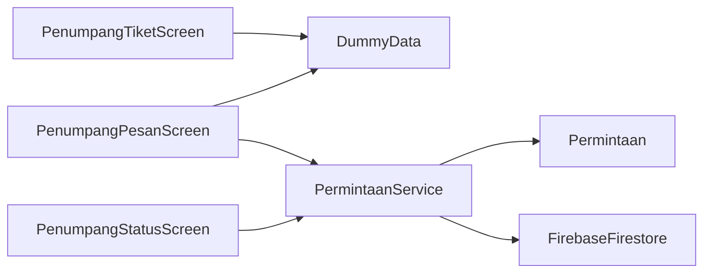

# Passenger Interface

<cite>
**Referenced Files in This Document**
- [main.dart](file://whoosh_ramah/lib/main.dart)
- [penumpang_tiket_screen.dart](file://whoosh_ramah/lib/screens/penumpang_tiket_screen.dart)
- [penumpang_pesan_screen.dart](file://whoosh_ramah/lib/screens/penumpang_pesan_screen.dart)
- [penumpang_status_screen.dart](file://whoosh_ramah/lib/screens/penumpang_status_screen.dart)
- [permintaan_service.dart](file://whoosh_ramah/lib/services/permintaan_service.dart)
- [permintaan.dart](file://whoosh_ramah/lib/models/permintaan.dart)
- [dummy.dart](file://whoosh_ramah/lib/data/dummy.dart)
- [theme.dart](file://whoosh_ramah/lib/theme.dart)
</cite>

## Table of Contents
1. [Introduction](#introduction)
2. [Project Structure](#project-structure)
3. [Core Components](#core-components)
4. [Architecture Overview](#architecture-overview)
5. [Detailed Component Analysis](#detailed-component-analysis)
6. [Dependency Analysis](#dependency-analysis)
7. [Performance Considerations](#performance-considerations)
8. [Troubleshooting Guide](#troubleshooting-guide)
9. [Conclusion](#conclusion)

## Introduction
This document explains the passenger-facing interface components that support assistance requests for train passengers. It covers:
- The ticket display screen showing active assistance context and navigation to request assistance.
- The assistance request form, including validation rules, input handling, and submission workflow.
- The status tracking interface with real-time progress visualization and timeline history.
- Data binding to Firestore streams, form state management, and UI responsiveness.
- Accessibility features such as screen reader support, high contrast considerations, and assistive technology compatibility.
- User interaction patterns and error handling strategies.

The implementation is a Flutter application using Material 3, Firebase Firestore for real-time data, and a consistent design system defined in the theme layer.

## Project Structure
The passenger journey spans three main screens:
- Ticket detail screen: shows the active ticket and provides entry points to request assistance.
- Assistance request screen: collects assistance type, pickup location, and optional notes, then submits the request.
- Status tracking screen: listens to real-time updates and visualizes the assistance lifecycle.

**Diagram sources**
- [main.dart:8-33](file://whoosh_ramah/lib/main.dart#L8-L33)
- [penumpang_tiket_screen.dart:14-263](file://whoosh_ramah/lib/screens/penumpang_tiket_screen.dart#L14-L263)
- [penumpang_pesan_screen.dart:11-176](file://whoosh_ramah/lib/screens/penumpang_pesan_screen.dart#L11-L176)
- [penumpang_status_screen.dart:14-215](file://whoosh_ramah/lib/screens/penumpang_status_screen.dart#L14-L215)

**Section sources**
- [main.dart:8-33](file://whoosh_ramah/lib/main.dart#L8-L33)
- [penumpang_tiket_screen.dart:14-263](file://whoosh_ramah/lib/screens/penumpang_tiket_screen.dart#L14-L263)
- [penumpang_pesan_screen.dart:11-176](file://whoosh_ramah/lib/screens/penumpang_pesan_screen.dart#L11-L176)
- [penumpang_status_screen.dart:14-215](file://whoosh_ramah/lib/screens/penumpang_status_screen.dart#L14-L215)

## Core Components
- PenumpangTiketScreen: Displays the active ticket, highlights key trip details, and exposes actions to request assistance or view other tickets.
- PenumpangPesanScreen: Presents a guided form to select assistance type and pickup point, validates inputs, and submits the request to Firestore.
- PenumpangStatusScreen: Subscribes to a single Firestore document stream, renders a hero status pill, staff card, five-step timeline, and action buttons.
- PermintaanService: Encapsulates Firestore operations: create request, stream single document, stream all documents, and advance status.
- Permintaan model: Defines enums for assistance type and status, plus a robust document mapper with history tracking.
- DummyData: Provides demo passenger, staff, ticket, and pickup locations used by screens and service during development.
- Theme: Centralized color palette, typography, radius, shadows, and button styles aligned with the design system.

**Section sources**
- [penumpang_tiket_screen.dart:14-263](file://whoosh_ramah/lib/screens/penumpang_tiket_screen.dart#L14-L263)
- [penumpang_pesan_screen.dart:11-176](file://whoosh_ramah/lib/screens/penumpang_pesan_screen.dart#L11-L176)
- [penumpang_status_screen.dart:14-215](file://whoosh_ramah/lib/screens/penumpang_status_screen.dart#L14-L215)
- [permintaan_service.dart:6-136](file://whoosh_ramah/lib/services/permintaan_service.dart#L6-L136)
- [permintaan.dart:1-214](file://whoosh_ramah/lib/models/permintaan.dart#L1-L214)
- [dummy.dart:1-90](file://whoosh_ramah/lib/data/dummy.dart#L1-L90)
- [theme.dart:1-164](file://whoosh_ramah/lib/theme.dart#L1-L164)

## Architecture Overview
The passenger flow uses a layered approach:
- UI Layer: Screens compose reusable widgets and handle user interactions.
- Service Layer: PermintaanService abstracts Firestore queries and mutations.
- Model Layer: Permintaan and related enums map Firestore documents to strongly typed Dart objects.
- Data Layer: DummyData supplies demo values; Firestore provides live data.

**Diagram sources**
- [penumpang_tiket_screen.dart:14-263](file://whoosh_ramah/lib/screens/penumpang_tiket_screen.dart#L14-L263)
- [penumpang_pesan_screen.dart:11-176](file://whoosh_ramah/lib/screens/penumpang_pesan_screen.dart#L11-L176)
- [penumpang_status_screen.dart:14-215](file://whoosh_ramah/lib/screens/penumpang_status_screen.dart#L14-L215)
- [permintaan_service.dart:6-136](file://whoosh_ramah/lib/services/permintaan_service.dart#L6-L136)
- [permintaan.dart:1-214](file://whoosh_ramah/lib/models/permintaan.dart#L1-L214)
- [dummy.dart:1-90](file://whoosh_ramah/lib/data/dummy.dart#L1-L90)

## Detailed Component Analysis

### Ticket Display Screen (Active Assistance Context)
Purpose:
- Show the active ticket details and provide clear entry points to request assistance.
- Maintain accessibility semantics for headers and interactive elements.

Key behaviors:
- Hero header displays greeting and illustration.
- White card stacks over the hero to show ticket label, class, departure/arrival time points, and core fields (train, date, carriage, seat).
- Primary action “Butuh pendampingan” navigates to the assistance request screen.
- Secondary action allows viewing other tickets.
- Bottom navigation includes “Bantuan” which also opens the request screen.

Accessibility:
- Header text wrapped with semantic header marking.
- Interactive buttons are exposed via standard Material controls.

User interaction pattern:
- Tap “Butuh pendampingan” → navigate to PenumpangPesanScreen.
- Tap bottom nav “Bantuan” → same navigation.

Error handling:
- No network calls on this screen; errors are not expected here.

Performance:
- Static dummy data avoids unnecessary rebuilds.

Code snippet paths:
- Ticket card layout and info columns: [penumpang_tiket_screen.dart:89-172](file://whoosh_ramah/lib/screens/penumpang_tiket_screen.dart#L89-L172)
- Action buttons and navigation: [penumpang_tiket_screen.dart:173-224](file://whoosh_ramah/lib/screens/penumpang_tiket_screen.dart#L173-L224)
- Bottom navigation Bantuan item: [penumpang_tiket_screen.dart:227-254](file://whoosh_ramah/lib/screens/penumpang_tiket_screen.dart#L227-L254)

**Section sources**
- [penumpang_tiket_screen.dart:14-263](file://whoosh_ramah/lib/screens/penumpang_tiket_screen.dart#L14-L263)

### Assistance Request Form (Validation, Input Handling, Submission)
Purpose:
- Collect assistance type, pickup location, and optional notes.
- Validate required fields before enabling submission.
- Submit to Firestore and navigate to the status screen.

Form state management:
- State variables track selected assistance type, selected pickup location, and loading flag.
- Notes field uses a TextEditingController with min/max lines and disabled state during submission.

Validation rules:
- Assistance type must be selected from the grid.
- Pickup location must be selected from the grid.
- Notes are optional; empty strings are normalized to null when submitting.

Submission workflow:
- On submit, set loading state, call PermintaanService.buatPermintaan with selected options and trimmed notes.
- On success, replace current route with PenumpangStatusScreen passing the new request id.
- On failure, reset loading and show a floating SnackBar instructing the user to retry.

UI responsiveness:
- Grid layouts adapt to available width using LayoutBuilder and Wrap.
- Submit button visually indicates enabled/disabled state and shows a circular progress indicator while loading.

Accessibility:
- Submit button uses Semantics with button, enabled, label, and onTap.
- Choice boxes use Semantics with selected state and explicit labels for TalkBack.
- Section headings are marked as semantic headers.

Code snippet paths:
- Form state and submission method: [penumpang_pesan_screen.dart:30-90](file://whoosh_ramah/lib/screens/penumpang_pesan_screen.dart#L30-L90)
- Assistance type grid: [penumpang_pesan_screen.dart:178-209](file://whoosh_ramah/lib/screens/penumpang_pesan_screen.dart#L178-L209)
- Pickup location grid: [penumpang_pesan_screen.dart:211-242](file://whoosh_ramah/lib/screens/penumpang_pesan_screen.dart#L211-L242)
- Notes TextField: [penumpang_pesan_screen.dart:244-264](file://whoosh_ramah/lib/screens/penumpang_pesan_screen.dart#L244-L264)
- Submit button with Semantics and loading state: [penumpang_pesan_screen.dart:271-321](file://whoosh_ramah/lib/screens/penumpang_pesan_screen.dart#L271-L321)
- Choice box component with accessibility: [penumpang_pesan_screen.dart:342-459](file://whoosh_ramah/lib/screens/penumpang_pesan_screen.dart#L342-L459)

**Diagram sources**
- [penumpang_pesan_screen.dart:63-90](file://whoosh_ramah/lib/screens/penumpang_pesan_screen.dart#L63-L90)
- [permintaan_service.dart:23-61](file://whoosh_ramah/lib/services/permintaan_service.dart#L23-L61)

**Section sources**
- [penumpang_pesan_screen.dart:11-176](file://whoosh_ramah/lib/screens/penumpang_pesan_screen.dart#L11-L176)
- [penumpang_pesan_screen.dart:271-321](file://whoosh_ramah/lib/screens/penumpang_pesan_screen.dart#L271-L321)
- [permintaan_service.dart:23-61](file://whoosh_ramah/lib/services/permintaan_service.dart#L23-L61)

### Status Tracking Interface (Real-Time Progress and Timeline)
Purpose:
- Provide real-time visibility into the assistance lifecycle.
- Show a hero status pill, staff card, five-step timeline, and contextual actions.

Real-time data binding:
- Uses StreamBuilder bound to PermintaanService.streamPermintaan(id).
- Handles waiting, data present, and error states.
- Announces status changes to screen readers via SemanticsService.

Progress visualization:
- Hero pill summarizes current status with label, color, and icon.
- Staff card appears after assignment; otherwise shows “Mencari petugas…”.
- Timeline renders five steps with states: completed, active, next. Completed steps show timestamps from history; active step shows “sekarang”; next steps are grayed out.

Timeline logic:
- Active index derived from current status enum position.
- Labels per step are computed based on status and request data (e.g., carriage and seat for seated status).
- Timestamps are formatted using intl DateFormat.

Accessibility:
- Status announcements are sent through SemanticsService.sendAnnouncement when status changes.
- Hero title and status pill use Semantics for proper labeling.
- Buttons use MergeSemantics and Semantics with button attributes.

Error handling:
- If stream has an error, show a message advising to check connection.
- If no document exists, show “not found” message.
- While waiting for initial data, show a centered progress indicator.

Code snippet paths:
- Stream subscription and build: [penumpang_status_screen.dart:39-43](file://whoosh_ramah/lib/screens/penumpang_status_screen.dart#L39-L43), [penumpang_status_screen.dart:163-215](file://whoosh_ramah/lib/screens/penumpang_status_screen.dart#L163-L215)
- Status announcement helper: [penumpang_status_screen.dart:146-161](file://whoosh_ramah/lib/screens/penumpang_status_screen.dart#L146-L161)
- Hero status pill: [penumpang_status_screen.dart:217-253](file://whoosh_ramah/lib/screens/penumpang_status_screen.dart#L217-L253)
- Staff card and placeholder: [penumpang_status_screen.dart:283-449](file://whoosh_ramah/lib/screens/penumpang_status_screen.dart#L283-L449)
- Timeline rendering and step states: [penumpang_status_screen.dart:451-482](file://whoosh_ramah/lib/screens/penumpang_status_screen.dart#L451-L482), [penumpang_status_screen.dart:590-730](file://whoosh_ramah/lib/screens/penumpang_status_screen.dart#L590-L730)
- Actions and sharing: [penumpang_status_screen.dart:484-523](file://whoosh_ramah/lib/screens/penumpang_status_screen.dart#L484-L523)

**Diagram sources**
- [penumpang_status_screen.dart:163-215](file://whoosh_ramah/lib/screens/penumpang_status_screen.dart#L163-L215)
- [penumpang_status_screen.dart:255-281](file://whoosh_ramah/lib/screens/penumpang_status_screen.dart#L255-L281)

**Section sources**
- [penumpang_status_screen.dart:14-215](file://whoosh_ramah/lib/screens/penumpang_status_screen.dart#L14-L215)
- [penumpang_status_screen.dart:217-523](file://whoosh_ramah/lib/screens/penumpang_status_screen.dart#L217-L523)

### Data Binding to Firestore Streams
- Single-document stream: PermintaanService.streamPermintaan returns a stream of Permintaan? for a given document id.
- Collection stream: PermintaanService.streamSemua returns a stream of lists ordered by creation time, limited to 100 items.
- Latest-by-passenger stream: PermintaanService.streamTerbaruPenumpang filters by passenger id and sorts client-side by creation timestamp.

Model mapping:
- Permintaan.fromFirestore safely maps Firestore snapshots to domain models, handling nullable fields and converting timestamps.
- RiwayatStatus maps history entries with status and time.

Code snippet paths:
- Stream methods: [permintaan_service.dart:63-90](file://whoosh_ramah/lib/services/permintaan_service.dart#L63-L90)
- Model mapping and history: [permintaan.dart:59-75](file://whoosh_ramah/lib/models/permintaan.dart#L59-L75), [permintaan.dart:150-189](file://whoosh_ramah/lib/models/permintaan.dart#L150-L189)

**Section sources**
- [permintaan_service.dart:63-90](file://whoosh_ramah/lib/services/permintaan_service.dart#L63-L90)
- [permintaan.dart:59-75](file://whoosh_ramah/lib/models/permintaan.dart#L59-L75)
- [permintaan.dart:150-189](file://whoosh_ramah/lib/models/permintaan.dart#L150-L189)

### Form State Management and UI Responsiveness
- State variables: _jenis, _jemput, _loading, and TextEditingController for notes.
- Validation: Submit enabled only when both assistance type and pickup location are selected and not loading.
- Responsive grids: LayoutBuilder computes column widths; Wrap arranges items with spacing.
- Visual feedback: Disabled submit button uses reduced opacity; loading spinner replaces text during submission.

Code snippet paths:
- State initialization and disposal: [penumpang_pesan_screen.dart:30-61](file://whoosh_ramah/lib/screens/penumpang_pesan_screen.dart#L30-L61)
- Submit enablement logic: [penumpang_pesan_screen.dart:271-274](file://whoosh_ramah/lib/screens/penumpang_pesan_screen.dart#L271-L274)
- Grid builders: [penumpang_pesan_screen.dart:178-242](file://whoosh_ramah/lib/screens/penumpang_pesan_screen.dart#L178-L242)

**Section sources**
- [penumpang_pesan_screen.dart:30-61](file://whoosh_ramah/lib/screens/penumpang_pesan_screen.dart#L30-L61)
- [penumpang_pesan_screen.dart:178-242](file://whoosh_ramah/lib/screens/penumpang_pesan_screen.dart#L178-L242)
- [penumpang_pesan_screen.dart:271-321](file://whoosh_ramah/lib/screens/penumpang_pesan_screen.dart#L271-L321)

### Accessibility Features
- Screen reader support:
  - Semantic headers for section titles and hero titles.
  - Semantics.button and Semantics.selected for choice boxes and submit button.
  - SemanticsService.sendAnnouncement for status change announcements.
- High contrast modes:
  - Colors are defined centrally; ensure sufficient contrast between text and backgrounds.
  - Selected states use both color and border/badge indicators to avoid relying solely on color.
- Assistive technology compatibility:
  - Touch targets meet minimum size guidelines via Material tap target sizing.
  - Text scales appropriately due to font sizes and weights defined in theme.

Code snippet paths:
- Semantic headers and labels: [penumpang_pesan_screen.dart:324-339](file://whoosh_ramah/lib/screens/penumpang_pesan_screen.dart#L324-L339), [penumpang_pesan_screen.dart:429-457](file://whoosh_ramah/lib/screens/penumpang_pesan_screen.dart#L429-L457)
- Status announcements: [penumpang_status_screen.dart:146-161](file://whoosh_ramah/lib/screens/penumpang_status_screen.dart#L146-L161)
- Button semantics and tap targets: [penumpang_status_screen.dart:735-788](file://whoosh_ramah/lib/screens/penumpang_status_screen.dart#L735-L788), [theme.dart:138-162](file://whoosh_ramah/lib/theme.dart#L138-L162)

**Section sources**
- [penumpang_pesan_screen.dart:324-339](file://whoosh_ramah/lib/screens/penumpang_pesan_screen.dart#L324-L339)
- [penumpang_pesan_screen.dart:429-457](file://whoosh_ramah/lib/screens/penumpang_pesan_screen.dart#L429-L457)
- [penumpang_status_screen.dart:146-161](file://whoosh_ramah/lib/screens/penumpang_status_screen.dart#L146-L161)
- [penumpang_status_screen.dart:735-788](file://whoosh_ramah/lib/screens/penumpang_status_screen.dart#L735-L788)
- [theme.dart:138-162](file://whoosh_ramah/lib/theme.dart#L138-L162)

## Dependency Analysis
The passenger screens depend on shared services and models:
- PenumpangPesanScreen depends on PermintaanService for creating requests and DummyData for pickup options.
- PenumpangStatusScreen depends on PermintaanService for streaming a single request and on models for status/timeline logic.
- PermintaanService depends on FirebaseFirestore and maps to Permintaan model.
- DummyData provides static demo values consumed across screens and service.

**Diagram sources**
- [penumpang_tiket_screen.dart:14-263](file://whoosh_ramah/lib/screens/penumpang_tiket_screen.dart#L14-L263)
- [penumpang_pesan_screen.dart:11-176](file://whoosh_ramah/lib/screens/penumpang_pesan_screen.dart#L11-L176)
- [penumpang_status_screen.dart:14-215](file://whoosh_ramah/lib/screens/penumpang_status_screen.dart#L14-L215)
- [permintaan_service.dart:6-136](file://whoosh_ramah/lib/services/permintaan_service.dart#L6-L136)
- [permintaan.dart:1-214](file://whoosh_ramah/lib/models/permintaan.dart#L1-L214)
- [dummy.dart:1-90](file://whoosh_ramah/lib/data/dummy.dart#L1-L90)

**Section sources**
- [penumpang_tiket_screen.dart:14-263](file://whoosh_ramah/lib/screens/penumpang_tiket_screen.dart#L14-L263)
- [penumpang_pesan_screen.dart:11-176](file://whoosh_ramah/lib/screens/penumpang_pesan_screen.dart#L11-L176)
- [penumpang_status_screen.dart:14-215](file://whoosh_ramah/lib/screens/penumpang_status_screen.dart#L14-L215)
- [permintaan_service.dart:6-136](file://whoosh_ramah/lib/services/permintaan_service.dart#L6-L136)
- [permintaan.dart:1-214](file://whoosh_ramah/lib/models/permintaan.dart#L1-L214)
- [dummy.dart:1-90](file://whoosh_ramah/lib/data/dummy.dart#L1-L90)

## Performance Considerations
- Stream efficiency:
  - Single-document stream avoids unnecessary collection scans.
  - Collection stream limits results to 100 and orders by a single field to avoid composite indexes.
- UI performance:
  - Use of LayoutBuilder and Wrap prevents heavy rebuilds and adapts to screen sizes.
  - Avoid redundant setState calls; only update state when necessary (e.g., selection changes, loading flags).
- Data mapping:
  - Permintaan.fromMap handles nullability efficiently and separates Firestore-specific mapping from pure data conversion.

[No sources needed since this section provides general guidance]

## Troubleshooting Guide
Common issues and resolutions:
- Firestore connection errors:
  - Status screen shows an error message advising to check connectivity.
  - Ensure Firebase is initialized and permissions allow reads/writes.
- Request not found:
  - If the document does not exist, the status screen displays a “not found” message.
  - Verify the id passed to PenumpangStatusScreen matches the created document id.
- Submission failures:
  - PenumpangPesanScreen catches exceptions and resets loading state, showing a SnackBar prompting retry.
  - Check network conditions and Firestore rules.
- Accessibility concerns:
  - Confirm semantic labels are present for custom widgets.
  - Test with TalkBack/VoiceOver to verify announcements and focus order.

Code snippet paths:
- Error handling in status screen: [penumpang_status_screen.dart:169-184](file://whoosh_ramah/lib/screens/penumpang_status_screen.dart#L169-L184)
- Submission error handling in request screen: [penumpang_pesan_screen.dart:80-89](file://whoosh_ramah/lib/screens/penumpang_pesan_screen.dart#L80-L89)

**Section sources**
- [penumpang_status_screen.dart:169-184](file://whoosh_ramah/lib/screens/penumpang_status_screen.dart#L169-L184)
- [penumpang_pesan_screen.dart:80-89](file://whoosh_ramah/lib/screens/penumpang_pesan_screen.dart#L80-L89)

## Conclusion
The passenger interface provides a clear, accessible, and responsive experience for requesting and tracking assistance:
- The ticket screen establishes context and guides users to request help.
- The request form enforces validation, manages state, and integrates with Firestore.
- The status screen delivers real-time updates, visual progress, and accessibility-friendly announcements.
Together, these components implement a robust passenger workflow aligned with the project’s design and technical goals.

[No sources needed since this section summarizes without analyzing specific files]