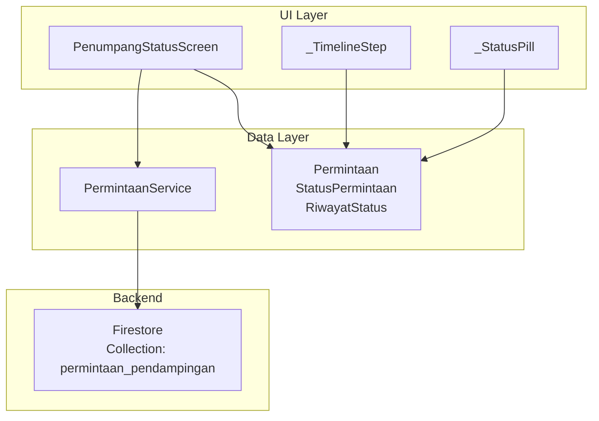
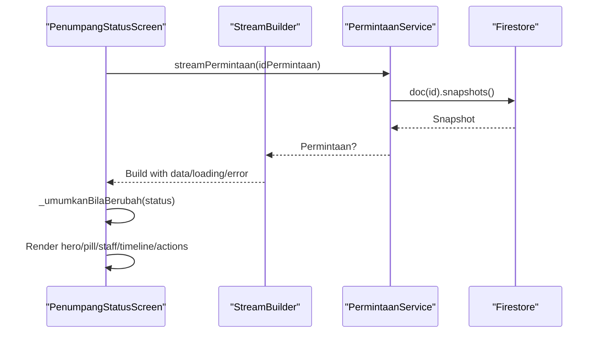
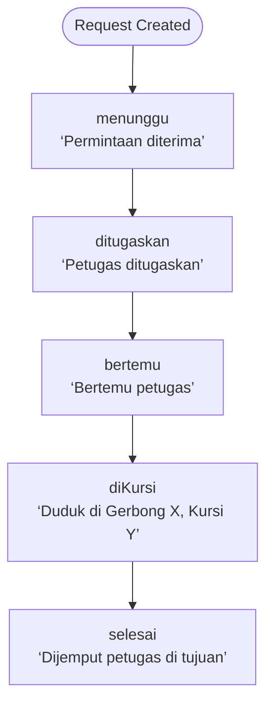
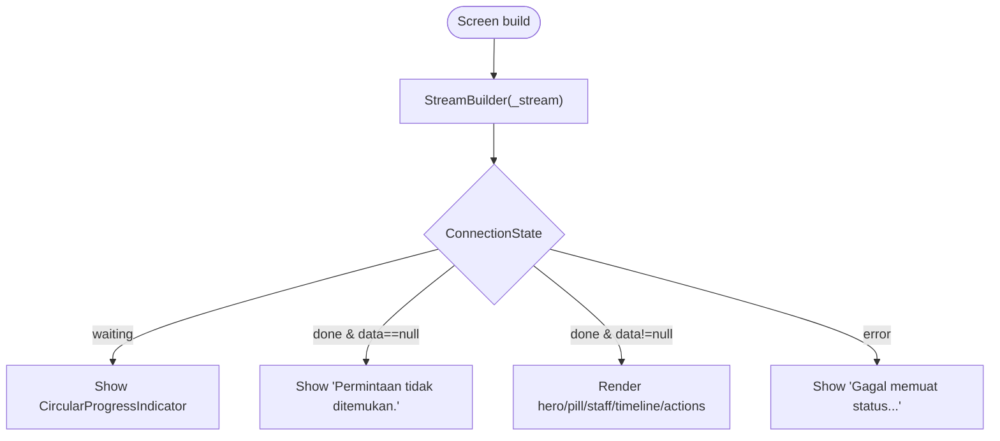
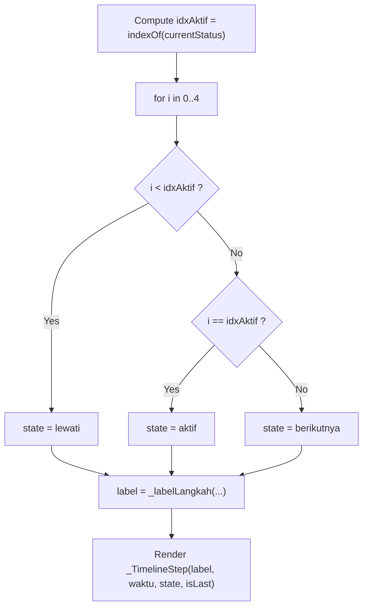
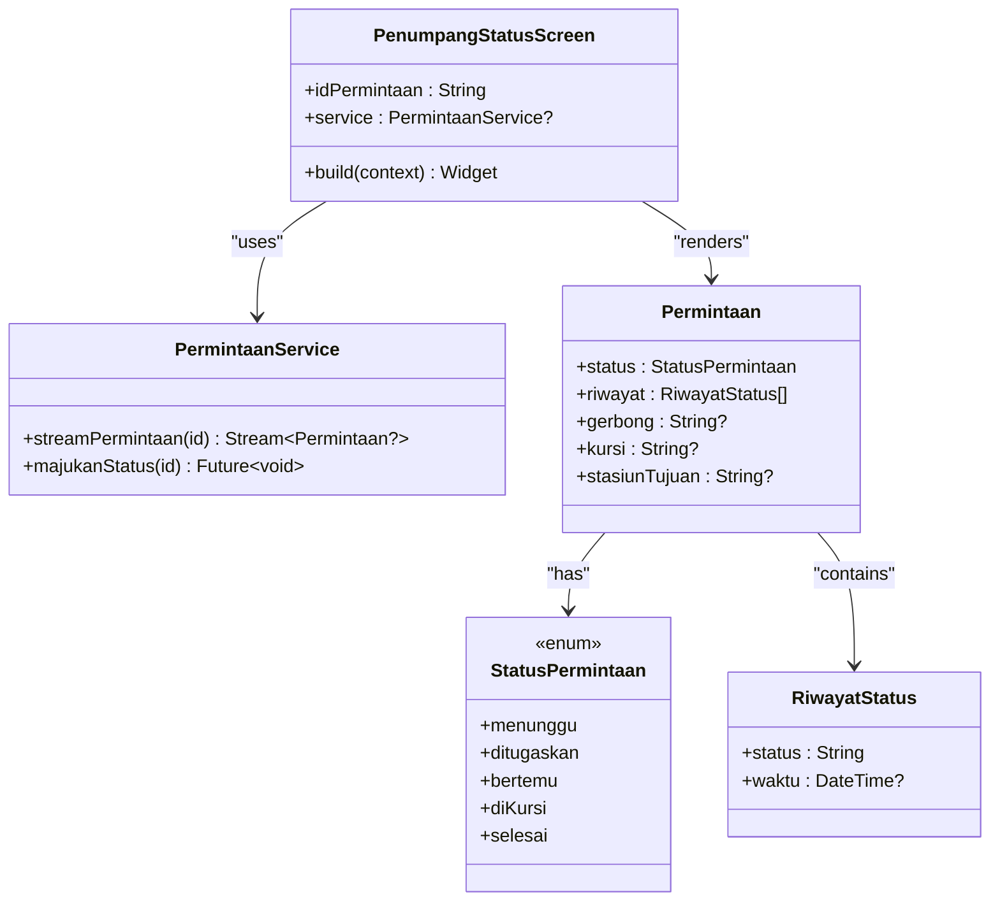

# Status Tracking Interface

<cite>
**Referenced Files in This Document**
- [penumpang_status_screen.dart](file://whoosh_ramah/lib/screens/penumpang_status_screen.dart)
- [permintaan_service.dart](file://whoosh_ramah/lib/services/permintaan_service.dart)
- [permintaan.dart](file://whoosh_ramah/lib/models/permintaan.dart)
- [penumpang_status_test.dart](file://whoosh_ramah/test/penumpang_status_test.dart)
- [Penumpang-Status.dc.html](file://design/Penumpang-Status.dc.html)
</cite>

## Table of Contents
1. [Introduction](#introduction)
2. [Project Structure](#project-structure)
3. [Core Components](#core-components)
4. [Architecture Overview](#architecture-overview)
5. [Detailed Component Analysis](#detailed-component-analysis)
6. [Dependency Analysis](#dependency-analysis)
7. [Performance Considerations](#performance-considerations)
8. [Troubleshooting Guide](#troubleshooting-guide)
9. [Conclusion](#conclusion)

## Introduction
This document explains the status tracking interface for passengers, centered on `PenumpangStatusScreen`. It shows how real-time progress is visualized, how timeline history is rendered, and how Firestore streams keep the UI synchronized with backend changes. It also documents the status progression workflow using the `StatusPermintaan` enum, accessibility announcements, responsive layout behavior, and error handling for network or missing-data scenarios.

## Project Structure
The status tracking feature spans three main layers:
- Screen layer: `PenumpangStatusScreen` renders the hero header, status pill, staff card, timeline, and action buttons.
- Service layer: `PermintaanService` provides Firestore streams and status updates.
- Model layer: `Permintaan`, `RiwayatStatus`, and `StatusPermintaan` define data structures and state transitions.

**Diagram sources**
- [penumpang_status_screen.dart:22-215](file://whoosh_ramah/lib/screens/penumpang_status_screen.dart#L22-L215)
- [permintaan_service.dart:10-21](file://whoosh_ramah/lib/services/permintaan_service.dart#L10-L21)
- [permintaan.dart:32-57](file://whoosh_ramah/lib/models/permintaan.dart#L32-L57)

**Section sources**
- [penumpang_status_screen.dart:14-21](file://whoosh_ramah/lib/screens/penumpang_status_screen.dart#L14-L21)
- [permintaan_service.dart:6-9](file://whoosh_ramah/lib/services/permintaan_service.dart#L6-L9)
- [permintaan.dart:27-57](file://whoosh_ramah/lib/models/permintaan.dart#L27-L57)

## Core Components
- PenumpangStatusScreen: A stateful screen that subscribes to a single Firestore document stream and renders:
  - Hero header with back navigation and title.
  - Status pill showing current status label, color, and icon.
  - Staff card (appears after assignment), including name, role, pickup location, and quick actions.
  - Five-step timeline reflecting assistance request lifecycle.
  - Primary CTA and share-to-family button.
- PermintaanService: Provides Firestore-backed streams and mutation helpers:
  - `streamPermintaan(id)` returns a stream of `Permintaan?` for one document.
  - `majukanStatus(id)` advances status and appends a history entry.
- Models:
  - `StatusPermintaan`: Ordered enum representing the mandatory progression from waiting to completed.
  - `Permintaan`: Data model for a request, including optional fields like seat info and staff name.
  - `RiwayatStatus`: History entries with status value and timestamp.

Key responsibilities:
- Real-time synchronization via StreamBuilder.
- Accessibility announcements when status changes.
- Responsive layout through SingleChildScrollView and constrained containers.
- Error and loading states handled within the stream builder.

**Section sources**
- [penumpang_status_screen.dart:22-215](file://whoosh_ramah/lib/screens/penumpang_status_screen.dart#L22-L215)
- [permintaan_service.dart:63-68](file://whoosh_ramah/lib/services/permintaan_service.dart#L63-L68)
- [permintaan.dart:32-57](file://whoosh_ramah/lib/models/permintaan.dart#L32-L57)

## Architecture Overview
The screen listens to a single Firestore document stream and maps each snapshot into a `Permintaan` object. The UI reacts to:
- Connection state: shows a spinner while waiting.
- Null data: shows “not found” message.
- Errors: shows an error message.
- Valid data: renders hero, staff card, timeline, and actions.

**Diagram sources**
- [penumpang_status_screen.dart:163-215](file://whoosh_ramah/lib/screens/penumpang_status_screen.dart#L163-L215)
- [permintaan_service.dart:63-68](file://whoosh_ramah/lib/services/permintaan_service.dart#L63-L68)

## Detailed Component Analysis

### Status Progression Workflow and Visual Representation
The assistance request follows a strict five-step progression defined by `StatusPermintaan`:
- menunggu: Request received; UI shows “Mencari petugas…” and first step active.
- ditugaskan: Staff assigned; staff card appears; second step becomes active.
- bertemu: Staff approaching passenger; third step active.
- diKursi: Passenger seated; fourth step active; seat details shown in timeline.
- selesai: Assistance completed; all steps marked as passed.

Visual mapping:
- Status pill: dynamic label, color, and icon per status.
- Timeline step states:
  - Lewati (passed): green checkmark.
  - Aktif (current): red ring with inner dot and “· sekarang”.
  - Berikutnya (upcoming): gray outline circle.
- Timeline labels:
  - Dynamic text based on status and payload (e.g., seat number, destination station).
  - Timestamps shown only for passed steps.

**Diagram sources**
- [permintaan.dart:32-57](file://whoosh_ramah/lib/models/permintaan.dart#L32-L57)
- [penumpang_status_screen.dart:48-67](file://whoosh_ramah/lib/screens/penumpang_status_screen.dart#L48-L67)

**Section sources**
- [permintaan.dart:32-57](file://whoosh_ramah/lib/models/permintaan.dart#L32-L57)
- [penumpang_status_screen.dart:48-67](file://whoosh_ramah/lib/screens/penumpang_status_screen.dart#L48-L67)

### Real-Time Data Synchronization with Firestore Streams
- Subscription management:
  - The screen constructs `_service.streamPermintaan(idPermintaan)` once in state initialization.
  - `StreamBuilder` handles connection states and rebuilds the UI on new snapshots.
- Data mapping:
  - `PermintaanService.streamPermintaan` maps Firestore snapshots to `Permintaan?`.
  - If the document does not exist, it emits null.
- UI reactions:
  - Loading: spinner under hero.
  - Not found: static message under hero.
  - Error: error message under hero.
  - Success: full content with hero, staff card, timeline, and actions.

**Diagram sources**
- [penumpang_status_screen.dart:163-215](file://whoosh_ramah/lib/screens/penumpang_status_screen.dart#L163-L215)
- [permintaan_service.dart:63-68](file://whoosh_ramah/lib/services/permintaan_service.dart#L63-L68)

**Section sources**
- [penumpang_status_screen.dart:163-215](file://whoosh_ramah/lib/screens/penumpang_status_screen.dart#L163-L215)
- [permintaan_service.dart:63-68](file://whoosh_ramah/lib/services/permintaan_service.dart#L63-L68)

### Status Indicator Components
- `_StatusPill`: Displays a compact status badge with:
  - Icon matching status semantics.
  - Color derived from status summary.
  - Label describing current stage.
- `_TimelineStep`: Renders a single timeline row with:
  - Marker (check/ring/outline).
  - Connector line between steps.
  - Label and optional timestamp for passed steps.
  - Active step highlights with “· sekarang”.

Accessibility:
- Pill uses Semantics to expose label for screen readers.
- Buttons use Semantics/MergeSemantics for proper focus and announcement.

**Section sources**
- [penumpang_status_screen.dart:543-588](file://whoosh_ramah/lib/screens/penumpang_status_screen.dart#L543-L588)
- [penumpang_status_screen.dart:590-730](file://whoosh_ramah/lib/screens/penumpang_status_screen.dart#L590-L730)

### Timeline History Rendering
- Timeline generation:
  - Iterates over `StatusPermintaan.values` to render five steps.
  - Determines step state based on current index vs. current status.
  - Uses `_labelLangkah` to compute human-readable labels, including dynamic seat and destination.
  - Uses `_jamRiwayat` to find the timestamp for passed steps from `riwayat`.
- Final step customization:
  - When status is `selesai`, all steps are treated as passed.
  - Last step label uses `stasiunTujuan` if available.

**Diagram sources**
- [penumpang_status_screen.dart:451-482](file://whoosh_ramah/lib/screens/penumpang_status_screen.dart#L451-L482)
- [penumpang_status_screen.dart:48-67](file://whoosh_ramah/lib/screens/penumpang_status_screen.dart#L48-L67)
- [penumpang_status_screen.dart:123-131](file://whoosh_ramah/lib/screens/penumpang_status_screen.dart#L123-L131)

**Section sources**
- [penumpang_status_screen.dart:451-482](file://whoosh_ramah/lib/screens/penumpang_status_screen.dart#L451-L482)
- [penumpang_status_screen.dart:48-67](file://whoosh_ramah/lib/screens/penumpang_status_screen.dart#L48-L67)
- [penumpang_status_screen.dart:123-131](file://whoosh_ramah/lib/screens/penumpang_status_screen.dart#L123-L131)

### Responsive Design Patterns
- Layout strategy:
  - Uses `SingleChildScrollView` to ensure scrollability across content heights.
  - Hero section uses fixed padding and rounded top corners to match design.
  - Content below hero is shifted upward using `Transform.translate` to overlap the hero, mimicking negative margin behavior.
- Card constraints:
  - Cards use fixed horizontal margins and padding, with rounded corners and shadows.
  - Buttons have minimum heights and flexible text to adapt to different screen widths.
- Orientation and size changes:
  - Flexible widgets (`Expanded`, `Flexible`) allow text wrapping and resizing.
  - No explicit orientation-specific logic; layout adapts naturally via Flexbox-like Flutter widgets.

Design alignment:
- The implementation mirrors the design mockup’s structure: hero with back button and title, status pill, staff card overlapping hero, timeline block, and bottom action buttons.

**Section sources**
- [penumpang_status_screen.dart:163-215](file://whoosh_ramah/lib/screens/penumpang_status_screen.dart#L163-L215)
- [penumpang_status_screen.dart:217-253](file://whoosh_ramah/lib/screens/penumpang_status_screen.dart#L217-L253)
- [penumpang_status_screen.dart:283-335](file://whoosh_ramah/lib/screens/penumpang_status_screen.dart#L283-L335)
- [Penumpang-Status.dc.html:17-95](file://design/Penumpang-Status.dc.html#L17-L95)

### Error Handling and Data Loading States
- Error handling:
  - If the stream reports an error, the screen displays a user-friendly message under the hero.
- Loading state:
  - While waiting for the first snapshot, a spinner is shown under the hero.
- Missing data:
  - If the document does not exist, a “not found” message is displayed.
- TalkBack announcements:
  - On status change (excluding initial load), the screen announces the new status via `SemanticsService.sendAnnouncement`.

Test coverage:
- Tests verify loading spinner visibility, correct rendering for specific statuses, and graceful handling of missing documents.

**Section sources**
- [penumpang_status_screen.dart:163-215](file://whoosh_ramah/lib/screens/penumpang_status_screen.dart#L163-L215)
- [penumpang_status_screen.dart:146-161](file://whoosh_ramah/lib/screens/penumpang_status_screen.dart#L146-L161)
- [penumpang_status_test.dart:42-55](file://whoosh_ramah/test/penumpang_status_test.dart#L42-L55)
- [penumpang_status_test.dart:111-114](file://whoosh_ramah/test/penumpang_status_test.dart#L111-L114)

## Dependency Analysis
The following diagram shows component relationships and dependencies:

**Diagram sources**
- [penumpang_status_screen.dart:22-37](file://whoosh_ramah/lib/screens/penumpang_status_screen.dart#L22-L37)
- [permintaan_service.dart:10-21](file://whoosh_ramah/lib/services/permintaan_service.dart#L10-L21)
- [permintaan.dart:32-57](file://whoosh_ramah/lib/models/permintaan.dart#L32-L57)
- [permintaan.dart:59-75](file://whoosh_ramah/lib/models/permintaan.dart#L59-L75)

**Section sources**
- [penumpang_status_screen.dart:22-37](file://whoosh_ramah/lib/screens/penumpang_status_screen.dart#L22-L37)
- [permintaan_service.dart:10-21](file://whoosh_ramah/lib/services/permintaan_service.dart#L10-L21)
- [permintaan.dart:32-57](file://whoosh_ramah/lib/models/permintaan.dart#L32-L57)

## Performance Considerations
- Stream subscription:
  - Single document stream avoids heavy queries; efficient for real-time updates.
- UI rebuilds:
  - StreamBuilder rebuilds only when new data arrives; minimal overhead.
- Timeline rendering:
  - Fixed five-step loop keeps computation constant time.
- Avoid unnecessary allocations:
  - Static helper functions for labels and timestamps reduce repeated work.

[No sources needed since this section provides general guidance]

## Troubleshooting Guide
Common issues and resolutions:
- Network connectivity problems:
  - Symptom: “Gagal memuat status. Periksa koneksi Anda.”
  - Cause: Firestore stream reports an error.
  - Resolution: Check device connectivity and retry; the screen shows an error message under the hero.
- Data not loaded yet:
  - Symptom: Spinner under hero.
  - Cause: Stream still waiting for the first snapshot.
  - Resolution: Wait for data; tests confirm spinner visibility during loading.
- Document not found:
  - Symptom: “Permintaan tidak ditemukan.”
  - Cause: Firestore document does not exist.
  - Resolution: Verify the request ID and backend creation flow.
- Status not updating:
  - Ensure backend calls `majukanStatus` to advance status and append history entries.
  - Confirm that `riwayat` contains entries with valid timestamps for timeline timestamps.

**Section sources**
- [penumpang_status_screen.dart:163-215](file://whoosh_ramah/lib/screens/penumpang_status_screen.dart#L163-L215)
- [permintaan_service.dart:92-119](file://whoosh_ramah/lib/services/permintaan_service.dart#L92-L119)
- [penumpang_status_test.dart:42-55](file://whoosh_ramah/test/penumpang_status_test.dart#L42-L55)
- [penumpang_status_test.dart:111-114](file://whoosh_ramah/test/penumpang_status_test.dart#L111-L114)

## Conclusion
`PenumpangStatusScreen` delivers a clear, accessible, and responsive status tracking experience. It leverages Firestore streams for real-time synchronization, maps `StatusPermintaan` values to intuitive visuals, and maintains a detailed timeline history. Error and loading states are handled gracefully, and the layout adapts to various screen sizes without complex conditional logic. Together with `PermintaanService` and the domain models, the component forms a robust foundation for passenger assistance workflows.