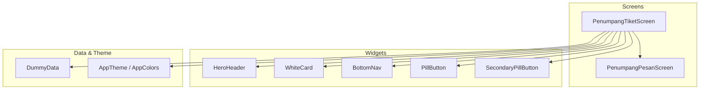
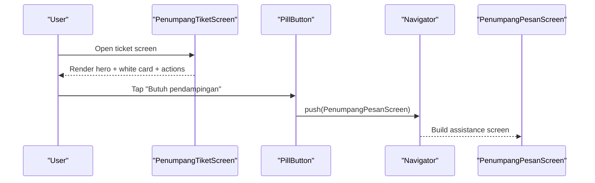
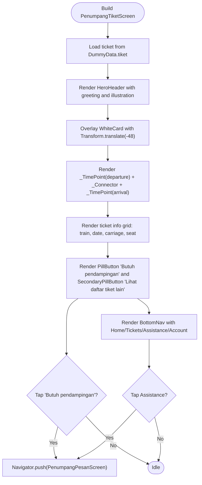
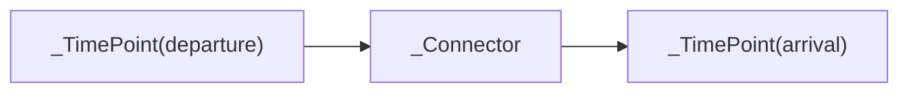
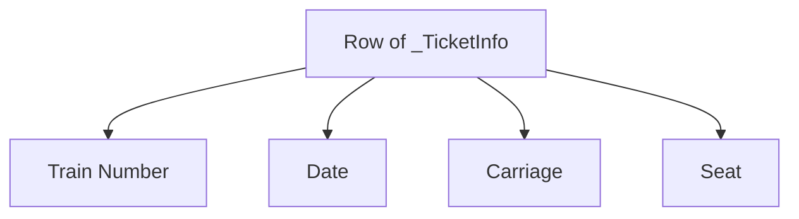
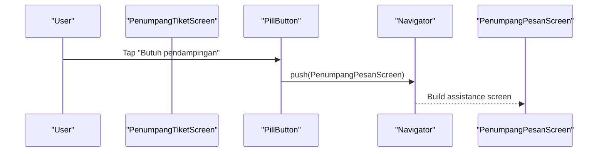
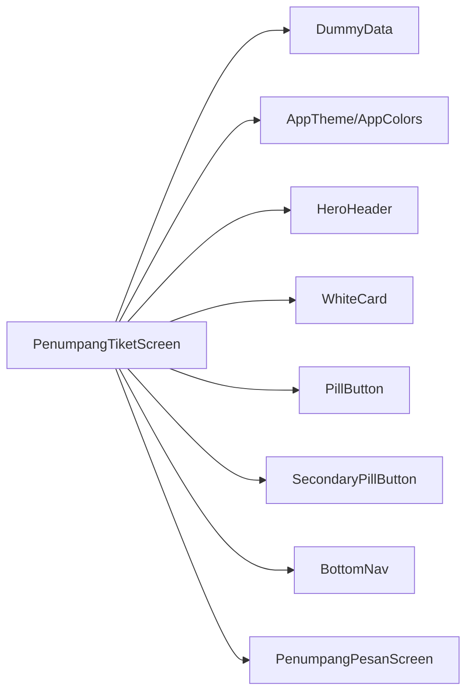

# Ticket Display Screen

<cite>
**Referenced Files in This Document**   
- [penumpang_tiket_screen.dart](file://whoosh_ramah/lib/screens/penumpang_tiket_screen.dart)
- [hero_header.dart](file://whoosh_ramah/lib/widgets/hero_header.dart)
- [white_card.dart](file://whoosh_ramah/lib/widgets/white_card.dart)
- [bottom_nav.dart](file://whoosh_ramah/lib/widgets/bottom_nav.dart)
- [pill_button.dart](file://whoosh_ramah/lib/widgets/pill_button.dart)
- [secondary_pill_button.dart](file://whoosh_ramah/lib/widgets/secondary_pill_button.dart)
- [dummy.dart](file://whoosh_ramah/lib/data/dummy.dart)
- [theme.dart](file://whoosh_ramah/lib/theme.dart)
- [penumpang_pesan_screen.dart](file://whoosh_ramah/lib/screens/penumpang_pesan_screen.dart)
- [penumpang_tiket_test.dart](file://whoosh_ramah/test/penumpang_tiket_test.dart)
</cite>

## Table of Contents
1. [Introduction](#introduction)
2. [Project Structure](#project-structure)
3. [Core Components](#core-components)
4. [Architecture Overview](#architecture-overview)
5. [Detailed Component Analysis](#detailed-component-analysis)
6. [Dependency Analysis](#dependency-analysis)
7. [Performance Considerations](#performance-considerations)
8. [Troubleshooting Guide](#troubleshooting-guide)
9. [Conclusion](#conclusion)

## Introduction
This document explains the ticket display screen component that shows an active assistance request for a passenger. It focuses on the `PenumpangTiketScreen` implementation, which renders:
- A personalized hero header with greeting and profile area
- A white card overlay containing train information, departure/arrival time points, and a connector line
- A ticket information grid (train number, date, carriage, seat)
- Primary and secondary buttons for requesting assistance and viewing other tickets
- A floating bottom navigation bar

The design is driven by the Penumpang-Tiket design file and uses dummy data to demonstrate the layout and interactions.

## Project Structure
The ticket screen lives under the screens directory and composes reusable widgets from the widgets directory. Dummy data and theme definitions provide content and visual consistency.

**Diagram sources**
- [penumpang_tiket_screen.dart:1-12](file://whoosh_ramah/lib/screens/penumpang_tiket_screen.dart#L1-L12)
- [penumpang_tiket_screen.dart:22-263](file://whoosh_ramah/lib/screens/penumpang_tiket_screen.dart#L22-L263)
- [hero_header.dart:9-43](file://whoosh_ramah/lib/widgets/hero_header.dart#L9-L43)
- [white_card.dart:11-44](file://whoosh_ramah/lib/widgets/white_card.dart#L11-L44)
- [bottom_nav.dart:22-54](file://whoosh_ramah/lib/widgets/bottom_nav.dart#L22-L54)
- [pill_button.dart:10-58](file://whoosh_ramah/lib/widgets/pill_button.dart#L10-L58)
- [secondary_pill_button.dart:9-39](file://whoosh_ramah/lib/widgets/secondary_pill_button.dart#L9-L39)
- [dummy.dart:56-81](file://whoosh_ramah/lib/data/dummy.dart#L56-L81)
- [theme.dart:7-35](file://whoosh_ramah/lib/theme.dart#L7-L35)

**Section sources**
- [penumpang_tiket_screen.dart:1-12](file://whoosh_ramah/lib/screens/penumpang_tiket_screen.dart#L1-L12)
- [dummy.dart:56-81](file://whoosh_ramah/lib/data/dummy.dart#L56-L81)
- [theme.dart:7-35](file://whoosh_ramah/lib/theme.dart#L7-L35)

## Core Components
- `PenumpangTiketScreen`: Main screen widget that composes the hero header, white card, action buttons, and bottom navigation. It reads ticket data from `DummyData.tiket`.
- `HeroHeader`: Colored header with rounded bottom corners, safe area handling, and dark system UI overlay for light backgrounds.
- `WhiteCard`: Reusable white card with configurable radius, padding, margin, and shadow; used to overlay the hero section.
- `_TimePoint`, `_Connector`, `_TicketInfo`: Internal components rendering departure/arrival time points, the connecting line with arrow, and ticket info grid cells.
- `PillButton` and `SecondaryPillButton`: Primary and secondary pill-shaped buttons with accessibility semantics and consistent sizing.
- `BottomNav`: Floating bottom navigation with accessible items and active state styling.

Key responsibilities:
- Render personalized greeting using passenger name from dummy data
- Show active ticket details with clear time points and connector
- Provide “Request assistance” primary action and “View other tickets” secondary action
- Offer navigation to home, tickets, assistance, and account via bottom nav

**Section sources**
- [penumpang_tiket_screen.dart:18-263](file://whoosh_ramah/lib/screens/penumpang_tiket_screen.dart#L18-L263)
- [hero_header.dart:9-43](file://whoosh_ramah/lib/widgets/hero_header.dart#L9-L43)
- [white_card.dart:11-44](file://whoosh_ramah/lib/widgets/white_card.dart#L11-L44)
- [pill_button.dart:10-58](file://whoosh_ramah/lib/widgets/pill_button.dart#L10-L58)
- [secondary_pill_button.dart:9-39](file://whoosh_ramah/lib/widgets/secondary_pill_button.dart#L9-L39)
- [bottom_nav.dart:22-54](file://whoosh_ramah/lib/widgets/bottom_nav.dart#L22-L54)

## Architecture Overview
The screen follows a composition-based architecture:
- Data layer: `DummyData` provides static ticket and passenger data
- Presentation layer: `PenumpangTiketScreen` composes UI widgets
- Shared widgets: `HeroHeader`, `WhiteCard`, `PillButton`, `SecondaryPillButton`, `BottomNav`
- Navigation: Pushes to `PenumpangPesanScreen` when requesting assistance or tapping Assistance in bottom nav

**Diagram sources**
- [penumpang_tiket_screen.dart:178-184](file://whoosh_ramah/lib/screens/penumpang_tiket_screen.dart#L178-L184)
- [penumpang_tiket_screen.dart:240-247](file://whoosh_ramah/lib/screens/penumpang_tiket_screen.dart#L240-L247)
- [penumpang_pesan_screen.dart](file://whoosh_ramah/lib/screens/penumpang_pesan_screen.dart)

## Detailed Component Analysis

### PenumpangTiketScreen
Responsibilities:
- Reads ticket data from `DummyData.tiket`
- Builds a scrollable column with hero header and overlaid white card
- Renders departure/arrival time points with a connector
- Displays ticket information grid (train, date, carriage, seat)
- Provides primary button to request assistance and secondary button to view other tickets
- Integrates bottom navigation with active states and Assistance route

Implementation highlights:
- Hero header uses `HeroHeader` with pink background and custom border radius
- White card overlay technique uses `Transform.translate` to shift content upward by 48 pixels, simulating negative margin
- Time point visualization uses `_TimePoint` and `_Connector`
- Ticket info grid uses four `_TicketInfo` widgets arranged in a row
- Primary button navigates to `PenumpangPesanScreen`; Assistance item in bottom nav also navigates there

**Diagram sources**
- [penumpang_tiket_screen.dart:22-263](file://whoosh_ramah/lib/screens/penumpang_tiket_screen.dart#L22-L263)
- [dummy.dart:70-81](file://whoosh_ramah/lib/data/dummy.dart#L70-L81)

**Section sources**
- [penumpang_tiket_screen.dart:22-263](file://whoosh_ramah/lib/screens/penumpang_tiket_screen.dart#L22-L263)
- [dummy.dart:70-81](file://whoosh_ramah/lib/data/dummy.dart#L70-L81)

### HeroHeader Integration
- Provides a colored header with rounded bottom corners and safe area support
- Uses dark system UI overlay for visibility on light backgrounds
- Wraps child content with SafeArea and ClipRRect for proper clipping and status bar integration

Accessibility and contrast:
- Light background color ensures dark icons and text are readable
- System UI overlay style is set to dark for legibility

**Section sources**
- [hero_header.dart:9-43](file://whoosh_ramah/lib/widgets/hero_header.dart#L9-L43)

### White Card Overlay Technique
- The white card is placed below the hero but visually overlaps it by shifting the entire content block upward with `Transform.translate(offset: Offset(0, -48))`
- `WhiteCard` applies a soft shadow and rounded corners, with Material transparency to preserve container decoration

Why this technique:
- Flutter does not allow negative margins on Container/Padding; translating the parent achieves the same visual effect
- Keeps the card’s internal padding/margin non-negative while achieving the overlapping look

**Section sources**
- [penumpang_tiket_screen.dart:80-92](file://whoosh_ramah/lib/screens/penumpang_tiket_screen.dart#L80-L92)
- [white_card.dart:11-44](file://whoosh_ramah/lib/widgets/white_card.dart#L11-L44)

### Time Point Visualization with Connectors
- `_TimePoint` displays large time text and station name, aligning left for departure and right for arrival
- `_Connector` draws a dotted-style divider and an arrow indicating direction from departure to arrival
- Together they form a clear timeline within the ticket card

**Diagram sources**
- [penumpang_tiket_screen.dart:266-334](file://whoosh_ramah/lib/screens/penumpang_tiket_screen.dart#L266-L334)

**Section sources**
- [penumpang_tiket_screen.dart:133-150](file://whoosh_ramah/lib/screens/penumpang_tiket_screen.dart#L133-L150)
- [penumpang_tiket_screen.dart:266-334](file://whoosh_ramah/lib/screens/penumpang_tiket_screen.dart#L266-L334)

### Ticket Information Grid Layout
- Four `_TicketInfo` widgets render label/value pairs: train number, date, carriage, and seat
- Each cell uses FittedBox to scale text appropriately and maintains alignment based on position (left/right)
- The grid is implemented as a Row with Expanded children for equal distribution

**Diagram sources**
- [penumpang_tiket_screen.dart:158-169](file://whoosh_ramah/lib/screens/penumpang_tiket_screen.dart#L158-L169)
- [penumpang_tiket_screen.dart:336-389](file://whoosh_ramah/lib/screens/penumpang_tiket_screen.dart#L336-L389)

**Section sources**
- [penumpang_tiket_screen.dart:158-169](file://whoosh_ramah/lib/screens/penumpang_tiket_screen.dart#L158-L169)
- [penumpang_tiket_screen.dart:336-389](file://whoosh_ramah/lib/screens/penumpang_tiket_screen.dart#L336-L389)

### Button Interactions
- Primary button (“Butuh pendampingan”) triggers navigation to `PenumpangPesanScreen`
- Secondary button (“Lihat daftar tiket lain”) is present for future expansion; currently has no action
- Bottom navigation includes Assistance item that also navigates to `PenumpangPesanScreen`

**Diagram sources**
- [penumpang_tiket_screen.dart:178-184](file://whoosh_ramah/lib/screens/penumpang_tiket_screen.dart#L178-L184)
- [penumpang_tiket_screen.dart:240-247](file://whoosh_ramah/lib/screens/penumpang_tiket_screen.dart#L240-L247)

**Section sources**
- [penumpang_tiket_screen.dart:178-184](file://whoosh_ramah/lib/screens/penumpang_tiket_screen.dart#L178-L184)
- [penumpang_tiket_screen.dart:218-223](file://whoosh_ramah/lib/screens/penumpang_tiket_screen.dart#L218-L223)
- [penumpang_tiket_screen.dart:240-247](file://whoosh_ramah/lib/screens/penumpang_tiket_screen.dart#L240-L247)

### Accessibility Features
- Semantics wrapper around the greeting header ensures screen readers announce it as a header
- Buttons use `MergeSemantics` and `Semantics(button: true)` to expose interactive elements properly
- Bottom navigation items use `MergeSemantics` and `Semantics(selected: ...)` to indicate selection state
- High contrast colors:
  - Primary red (`AppColors.redPrimary`) for key actions and accents
  - Dark text (`AppColors.textPrimary`) on light backgrounds
  - Pink hero background (`AppColors.pinkHero`) with dark system UI overlay for readability
  - Connector and outline colors ensure clear separation between elements

Best practices observed:
- Minimum tap target sizes enforced by button themes
- Clear semantic roles for headers and buttons
- Consistent color roles across components

**Section sources**
- [penumpang_tiket_screen.dart:45-57](file://whoosh_ramah/lib/screens/penumpang_tiket_screen.dart#L45-L57)
- [pill_button.dart:28-55](file://whoosh_ramah/lib/widgets/pill_button.dart#L28-L55)
- [bottom_nav.dart:67-103](file://whoosh_ramah/lib/widgets/bottom_nav.dart#L67-L103)
- [theme.dart:7-35](file://whoosh_ramah/lib/theme.dart#L7-L35)

## Dependency Analysis
The ticket screen depends on:
- Dummy data for content
- Theme for colors, radii, shadows, and typography
- Widgets for header, card, buttons, and navigation
- Navigation to the assistance screen

**Diagram sources**
- [penumpang_tiket_screen.dart:1-12](file://whoosh_ramah/lib/screens/penumpang_tiket_screen.dart#L1-L12)
- [penumpang_tiket_screen.dart:22-263](file://whoosh_ramah/lib/screens/penumpang_tiket_screen.dart#L22-L263)

**Section sources**
- [penumpang_tiket_screen.dart:1-12](file://whoosh_ramah/lib/screens/penumpang_tiket_screen.dart#L1-L12)
- [dummy.dart:56-81](file://whoosh_ramah/lib/data/dummy.dart#L56-L81)
- [theme.dart:7-35](file://whoosh_ramah/lib/theme.dart#L7-L35)

## Performance Considerations
- Static dummy data avoids unnecessary rebuilds during development
- Using `FittedBox` for labels and values prevents overflow and reduces layout complexity
- Minimal nested widgets inside the white card keep build cost low
- Avoid heavy animations in the ticket card to maintain smooth scrolling

[No sources needed since this section provides general guidance]

## Troubleshooting Guide
Common issues and resolutions:
- White card not overlapping hero: Ensure the parent column uses `Transform.translate(offset: Offset(0, -48))` before the white card; do not rely on negative margins
- Greeting not announced as header: Verify `Semantics(header: true)` wraps the greeting text
- Button not accessible: Confirm `MergeSemantics` and `Semantics(button: true)` are applied to custom buttons
- Low contrast text: Use `AppColors.textPrimary` and `AppColors.textSecondary` consistently; avoid placing light text on light backgrounds
- Assistance navigation not working: Check that `Navigator.of(context).push(MaterialPageRoute(...))` targets `PenumpangPesanScreen`

Validation via tests:
- Tests assert presence of ticket info labels and values
- Tests verify navigation to the assistance screen when tapping “Butuh pendampingan”
- Tests confirm the ticket screen can be reached from role selection

**Section sources**
- [penumpang_tiket_test.dart:34-49](file://whoosh_ramah/test/penumpang_tiket_test.dart#L34-L49)
- [penumpang_tiket_test.dart:51-59](file://whoosh_ramah/test/penumpang_tiket_test.dart#L51-L59)
- [penumpang_tiket_test.dart:61-73](file://whoosh_ramah/test/penumpang_tiket_test.dart#L61-L73)

## Conclusion
The ticket display screen provides a clear, accessible presentation of an active train ticket with departure/arrival time points, train details, and actionable controls. The hero header personalizes the experience, while the white card overlay creates a modern layered layout. The primary “Request assistance” button and bottom navigation streamline access to support features. The implementation leverages reusable widgets and consistent theming to maintain visual and accessibility standards.

[No sources needed since this section summarizes without analyzing specific files]