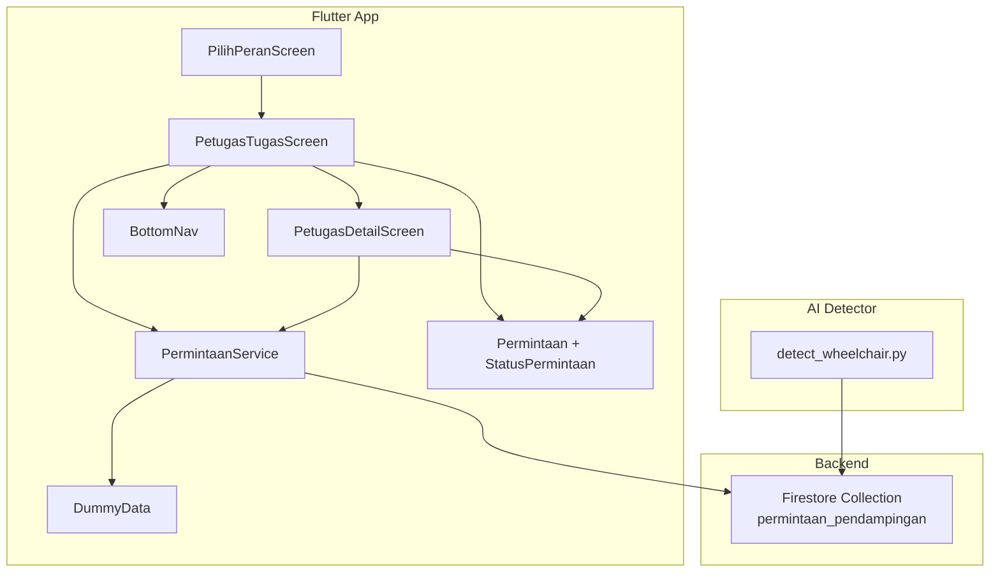
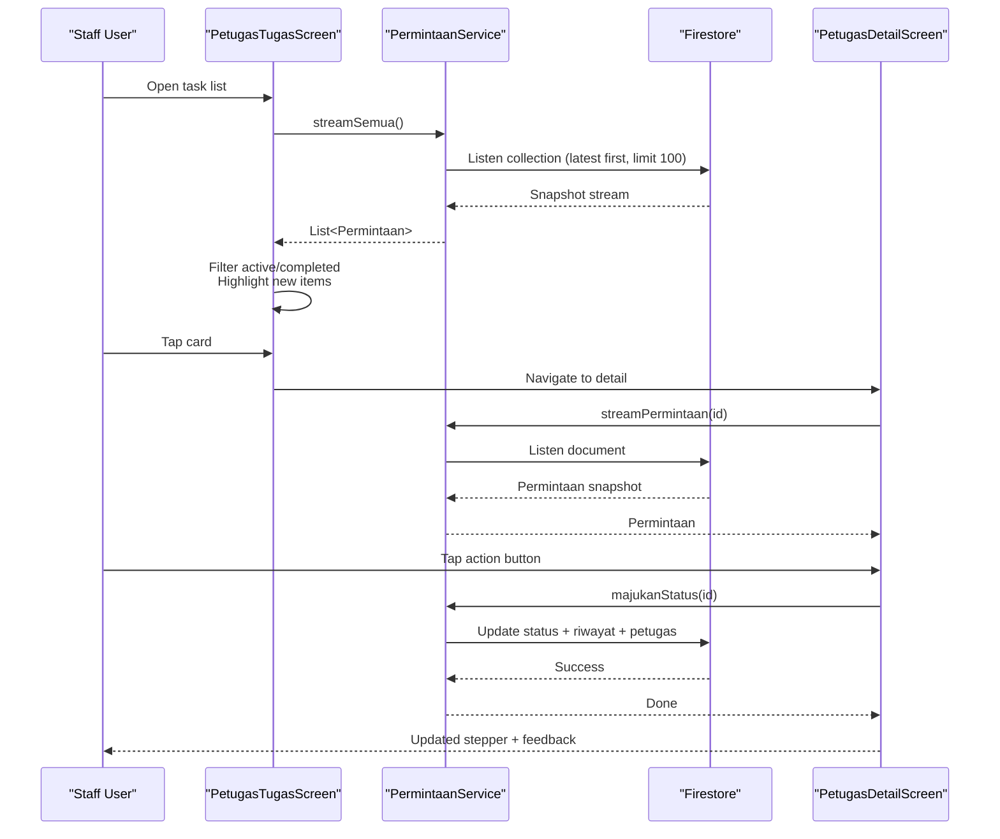
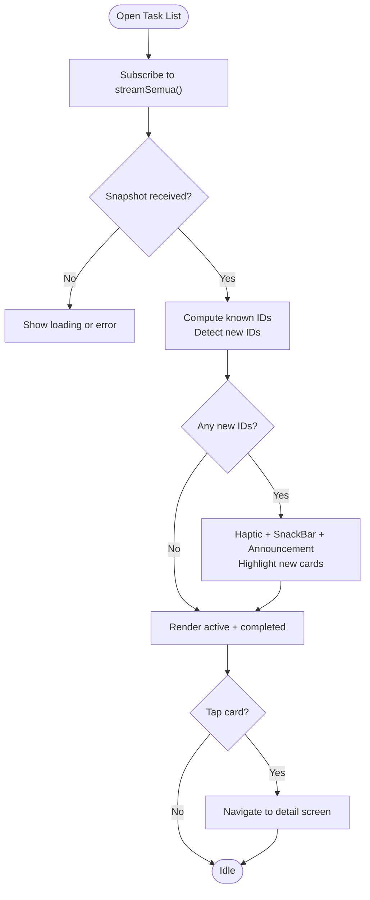
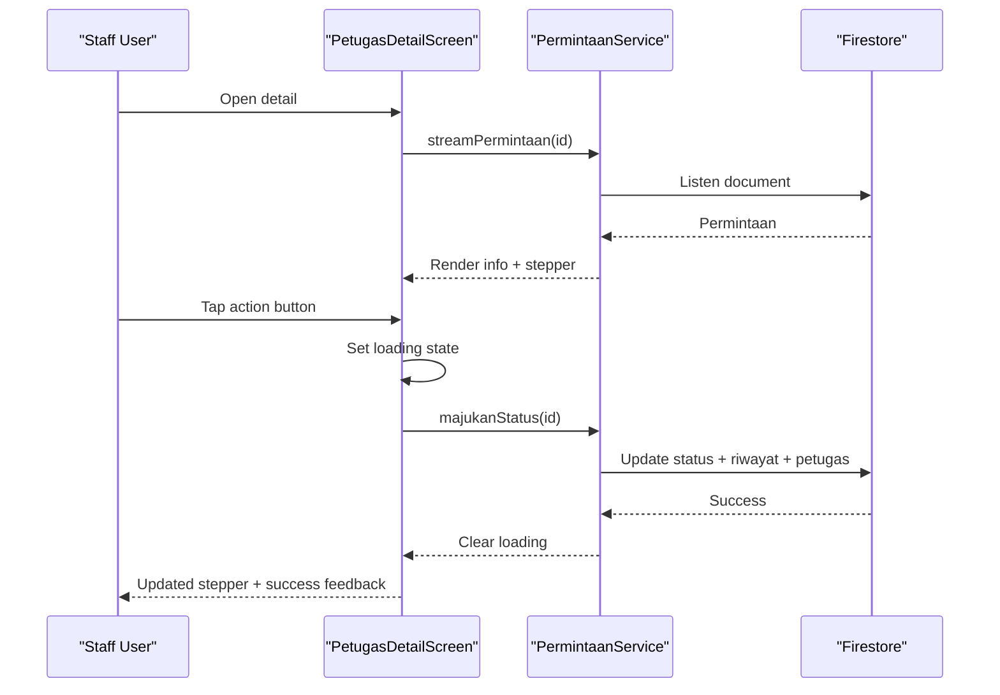
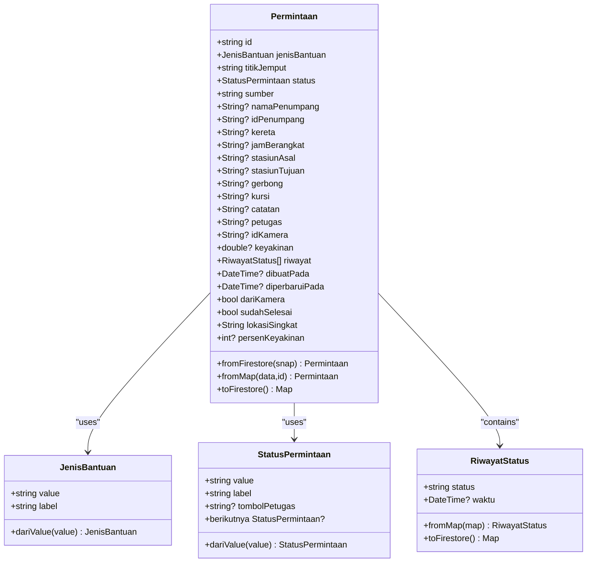
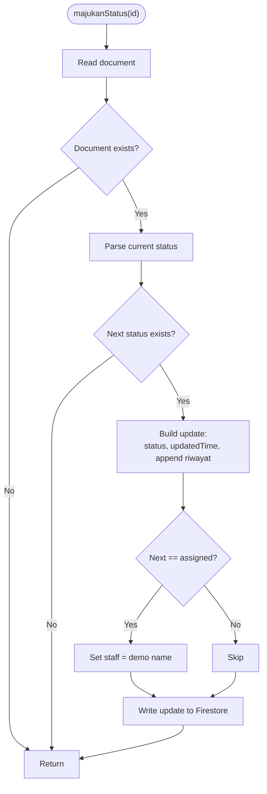
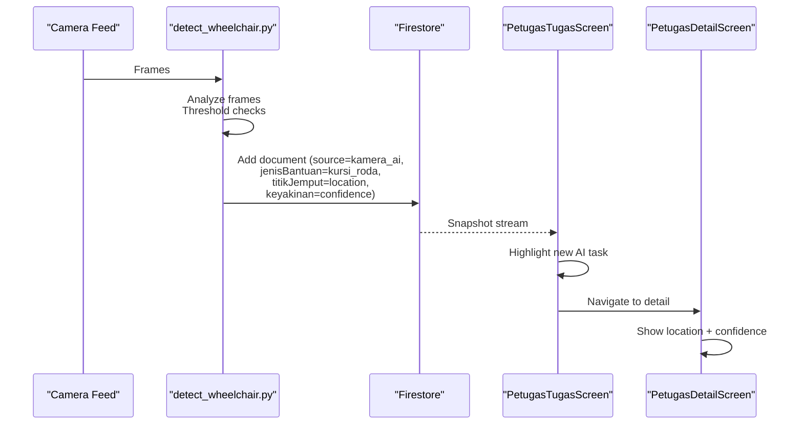
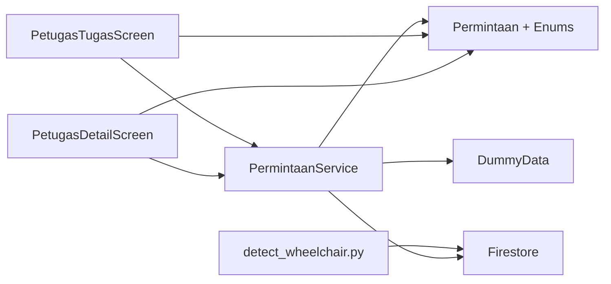

# Staff Workflow

<cite>
**Referenced Files in This Document**   
- [petugas_tugas_screen.dart](file://whoosh_ramah/lib/screens/petugas_tugas_screen.dart)
- [petugas_detail_screen.dart](file://whoosh_ramah/lib/screens/petugas_detail_screen.dart)
- [permintaan_service.dart](file://whoosh_ramah/lib/services/permintaan_service.dart)
- [permintaan.dart](file://whoosh_ramah/lib/models/permintaan.dart)
- [dummy.dart](file://whoosh_ramah/lib/data/dummy.dart)
- [pilih_peran_screen.dart](file://whoosh_ramah/lib/screens/pilih_peran_screen.dart)
- [bottom_nav.dart](file://whoosh_ramah/lib/widgets/bottom_nav.dart)
- [detect_wheelchair.py](file://detector/detect_wheelchair.py)
- [PROJECT.md](file://PROJECT.md)
</cite>

## Table of Contents
1. [Introduction](#introduction)
2. [Project Structure](#project-structure)
3. [Core Components](#core-components)
4. [Architecture Overview](#architecture-overview)
5. [Detailed Component Analysis](#detailed-component-analysis)
6. [Dependency Analysis](#dependency-analysis)
7. [Performance Considerations](#performance-considerations)
8. [Troubleshooting Guide](#troubleshooting-guide)
9. [Conclusion](#conclusion)

## Introduction
This document explains the staff workflow management interface for the Whoosh Ramah application. It focuses on:
- The task list screen that shows all assistance requests with real-time updates, filtering, and sorting.
- The task detail view that implements a five-step status progression workflow, action buttons, and an audit trail.
- AI-generated tasks created by the camera detection system and how they appear to staff.
- Stream-based data synchronization, status update workflows, and user permission handling patterns.
- Staff-specific UI patterns, notifications, accessibility, and performance optimizations for large task lists.
- Integration between the Python AI detector and the Flutter staff screens through Firestore.

The implementation is built in Flutter, uses Firestore streams for live updates, and separates concerns into screens, services, models, and shared widgets.

## Project Structure
The staff workflow lives primarily under `whoosh_ramah/lib`:
- Screens: `PetugasTugasScreen` (task list), `PetugasDetailScreen` (task detail).
- Service: `PermintaanService` for Firestore reads and writes.
- Model: `Permintaan`, `StatusPermintaan`, `JenisBantuan`, and `RiwayatStatus`.
- Shared data: `DummyData` for demo passenger, ticket, and staff information.
- Navigation entry point: role selection screen routes to the staff task list.
- Bottom navigation widget used by the staff task list.
- External integration: Python detector writes AI tasks directly to Firestore.

**Diagram sources**
- [pilih_peran_screen.dart:108-118](file://whoosh_ramah/lib/screens/pilih_peran_screen.dart#L108-L118)
- [petugas_tugas_screen.dart:22-36](file://whoosh_ramah/lib/screens/petugas_tugas_screen.dart#L22-L36)
- [petugas_detail_screen.dart:13-28](file://whoosh_ramah/lib/screens/petugas_detail_screen.dart#L13-L28)
- [permintaan_service.dart:6-21](file://whoosh_ramah/lib/services/permintaan_service.dart#L6-L21)
- [permintaan.dart:7-57](file://whoosh_ramah/lib/models/permintaan.dart#L7-L57)
- [dummy.dart:16-26](file://whoosh_ramah/lib/data/dummy.dart#L16-L26)
- [bottom_nav.dart:20-54](file://whoosh_ramah/lib/widgets/bottom_nav.dart#L20-L54)
- [detect_wheelchair.py:179-192](file://detector/detect_wheelchair.py#L179-L192)

**Section sources**
- [pilih_peran_screen.dart:10-147](file://whoosh_ramah/lib/screens/pilih_peran_screen.dart#L10-L147)
- [petugas_tugas_screen.dart:22-283](file://whoosh_ramah/lib/screens/petugas_tugas_screen.dart#L22-L283)
- [petugas_detail_screen.dart:13-123](file://whoosh_ramah/lib/screens/petugas_detail_screen.dart#L13-L123)
- [permintaan_service.dart:6-78](file://whoosh_ramah/lib/services/permintaan_service.dart#L6-L78)
- [permintaan.dart:7-57](file://whoosh_ramah/lib/models/permintaan.dart#L7-L57)
- [dummy.dart:16-26](file://whoosh_ramah/lib/data/dummy.dart#L16-L26)
- [bottom_nav.dart:20-54](file://whoosh_ramah/lib/widgets/bottom_nav.dart#L20-L54)
- [detect_wheelchair.py:179-192](file://detector/detect_wheelchair.py#L179-L192)

## Core Components
- Task list screen (`PetugasTugasScreen`): Streams all assistance requests, separates active and completed tasks, highlights new items, and navigates to details.
- Task detail screen (`PetugasDetailScreen`): Streams a single request, displays passenger or AI-detected passenger info, shows a five-step status stepper, and advances status via one primary action button.
- Service layer (`PermintaanService`): Provides stream methods for all documents and a single document, creates new requests, and advances status while maintaining an audit trail.
- Data model (`Permintaan`, `StatusPermintaan`, `JenisBantuan`, `RiwayatStatus`): Encodes assistance types, required status order, optional AI fields, and history entries.
- Demo data (`DummyData`): Supplies sample passenger, ticket, and staff names used when creating and assigning tasks.
- Navigation and bottom nav: Role selection routes to the staff task list; bottom navigation provides staff app tabs.

Key responsibilities:
- Real-time sync: Firestore snapshots feed both list and detail views.
- Status workflow: Strict progression from waiting to assigned, met, seated, and completed.
- AI integration: Camera detector writes tasks with source `kamera_ai`; UI distinguishes them visually and semantically.

**Section sources**
- [petugas_tugas_screen.dart:22-283](file://whoosh_ramah/lib/screens/petugas_tugas_screen.dart#L22-L283)
- [petugas_detail_screen.dart:13-123](file://whoosh_ramah/lib/screens/petugas_detail_screen.dart#L13-L123)
- [permintaan_service.dart:23-119](file://whoosh_ramah/lib/services/permintaan_service.dart#L23-L119)
- [permintaan.dart:7-214](file://whoosh_ramah/lib/models/permintaan.dart#L7-L214)
- [dummy.dart:56-81](file://whoosh_ramah/lib/data/dummy.dart#L56-L81)
- [pilih_peran_screen.dart:108-118](file://whoosh_ramah/lib/screens/pilih_peran_screen.dart#L108-L118)
- [bottom_nav.dart:20-54](file://whoosh_ramah/lib/widgets/bottom_nav.dart#L20-L54)

## Architecture Overview
The staff workflow follows a layered architecture:
- Presentation layer: Flutter screens render lists and details using Material components and custom widgets.
- Service layer: `PermintaanService` encapsulates Firestore operations and exposes streams.
- Domain model: `Permintaan` and related enums define business rules like status progression and assistance type mapping.
- External integration: Python detector writes AI tasks directly to Firestore, which Flutter screens consume via streams.

**Diagram sources**
- [petugas_tugas_screen.dart:92-133](file://whoosh_ramah/lib/screens/petugas_tugas_screen.dart#L92-L133)
- [petugas_tugas_screen.dart:276-282](file://whoosh_ramah/lib/screens/petugas_tugas_screen.dart#L276-L282)
- [petugas_detail_screen.dart:30-50](file://whoosh_ramah/lib/screens/petugas_detail_screen.dart#L30-L50)
- [permintaan_service.dart:63-78](file://whoosh_ramah/lib/services/permintaan_service.dart#L63-L78)
- [permintaan_service.dart:92-119](file://whoosh_ramah/lib/services/permintaan_service.dart#L92-L119)

## Detailed Component Analysis

### Task List Screen: PetugasTugasScreen
Responsibilities:
- Subscribe to all assistance requests via a Firestore stream.
- Separate active tasks (not completed) and completed tasks from today.
- Count new, in-progress, and completed tasks for the hero summary.
- Highlight newly arrived cards temporarily.
- Provide haptic, SnackBar, TalkBack announcement, and visual highlight for new tasks.
- Navigate to the detail screen when a card is tapped.

Real-time updates and notifications:
- Uses `StreamBuilder<List<Permintaan>>` to rebuild UI on each snapshot.
- Detects new IDs compared to previous snapshot set.
- Triggers multiple notification channels:
  - Haptic feedback.
  - Accessibility announcement via Semantics service.
  - SnackBar message indicating source (AI vs app).
  - Temporary border highlight on new cards for three seconds.

Filtering and sorting:
- Sorting: Firestore orders by creation time descending and limits to 100 documents.
- Filtering: UI splits into active and completed-today lists.
- New count: Tasks with status waiting are counted as new.

Staff-specific UI patterns:
- Hero header with greeting, role label, and badge.
- Stat cards for new, in-progress, and completed counts.
- Task cards show source badge (AI or app), status label, title, subtitle, and relative time.
- Bottom navigation with “Tasks”, “History”, and “Profile”.

Accessibility:
- Cards use `MergeSemantics` and `Semantics(button: true)` for screen readers.
- Labels include title, subtitle, status, and time.

**Diagram sources**
- [petugas_tugas_screen.dart:38-90](file://whoosh_ramah/lib/screens/petugas_tugas_screen.dart#L38-L90)
- [petugas_tugas_screen.dart:92-133](file://whoosh_ramah/lib/screens/petugas_tugas_screen.dart#L92-L133)
- [petugas_tugas_screen.dart:223-282](file://whoosh_ramah/lib/screens/petugas_tugas_screen.dart#L223-L282)

**Section sources**
- [petugas_tugas_screen.dart:22-283](file://whoosh_ramah/lib/screens/petugas_tugas_screen.dart#L22-L283)
- [petugas_tugas_screen.dart:351-436](file://whoosh_ramah/lib/screens/petugas_tugas_screen.dart#L351-L436)
- [petugas_tugas_screen.dart:439-467](file://whoosh_ramah/lib/screens/petugas_tugas_screen.dart#L439-L467)
- [petugas_tugas_screen.dart:512-528](file://whoosh_ramah/lib/screens/petugas_tugas_screen.dart#L512-L528)
- [petugas_tugas_screen.dart:556-571](file://whoosh_ramah/lib/screens/petugas_tugas_screen.dart#L556-L571)

### Task Detail Screen: PetugasDetailScreen
Responsibilities:
- Stream a single assistance request by ID.
- Display passenger info or AI-detected passenger info (location and confidence).
- Show a five-step status stepper reflecting current progress.
- Provide two secondary actions (“Send message” and “Call”) that navigate to a placeholder screen.
- Provide one primary action button whose label depends on the next status.
- Maintain an audit trail by appending history entries when advancing status.

Status progression workflow:
- The next status is computed from the current status enum.
- When advancing to “assigned”, the staff name is filled automatically.
- The last step’s label includes destination station text.

Action buttons:
- Primary action button disables during processing and shows a spinner.
- Secondary outline buttons open a temporary “Segera Hadir” screen for quick actions.

Audit trail:
- Each status change appends a history entry with timestamp.
- History is persisted in the document and displayed elsewhere (family view).

**Diagram sources**
- [petugas_detail_screen.dart:30-50](file://whoosh_ramah/lib/screens/petugas_detail_screen.dart#L30-L50)
- [petugas_detail_screen.dart:312-389](file://whoosh_ramah/lib/screens/petugas_detail_screen.dart#L312-L389)
- [permintaan_service.dart:92-119](file://whoosh_ramah/lib/services/permintaan_service.dart#L92-L119)

**Section sources**
- [petugas_detail_screen.dart:13-123](file://whoosh_ramah/lib/screens/petugas_detail_screen.dart#L13-L123)
- [petugas_detail_screen.dart:161-310](file://whoosh_ramah/lib/screens/petugas_detail_screen.dart#L161-L310)
- [petugas_detail_screen.dart:312-389](file://whoosh_ramah/lib/screens/petugas_detail_screen.dart#L312-L389)
- [petugas_detail_screen.dart:396-424](file://whoosh_ramah/lib/screens/petugas_detail_screen.dart#L396-L424)
- [petugas_detail_screen.dart:622-670](file://whoosh_ramah/lib/screens/petugas_detail_screen.dart#L622-L670)

### Data Model: Permintaan, StatusPermintaan, JenisBantuan, RiwayatStatus
Key aspects:
- Assistance types map Firestore strings to display labels.
- Status progression is enforced by ordered enum values and a computed next status.
- Optional AI fields include camera ID and confidence percentage.
- History entries store status and timestamp per change.
- Null-safe parsing handles missing fields from AI-created documents.

Complexity considerations:
- Parsing and serialization are O(n) over fields; history list iteration is O(h) where h is history length.
- Confidence percentage conversion is constant time.

**Diagram sources**
- [permintaan.dart:7-57](file://whoosh_ramah/lib/models/permintaan.dart#L7-L57)
- [permintaan.dart:59-75](file://whoosh_ramah/lib/models/permintaan.dart#L59-L75)
- [permintaan.dart:77-214](file://whoosh_ramah/lib/models/permintaan.dart#L77-L214)

**Section sources**
- [permintaan.dart:7-57](file://whoosh_ramah/lib/models/permintaan.dart#L7-L57)
- [permintaan.dart:59-75](file://whoosh_ramah/lib/models/permintaan.dart#L59-L75)
- [permintaan.dart:77-214](file://whoosh_ramah/lib/models/permintaan.dart#L77-L214)

### Service Layer: PermintaanService
Responsibilities:
- Create new assistance requests from app flow with dummy passenger/ticket data.
- Stream all requests (latest first, limit 100).
- Stream a single request by ID.
- Stream latest request for a passenger (used by family view).
- Advance status with audit trail and automatic assignment.

Stream-based synchronization:
- `streamSemua()` returns a stream of lists, enabling reactive UI without manual polling.
- `streamPermintaan()` returns a nullable document stream, allowing graceful empty/error states.

Status update workflow:
- Reads current status, computes next status, updates Firestore atomically.
- Appends history entry with server timestamp for updated time and local timestamp for history.
- Sets staff name when transitioning to assigned.

**Diagram sources**
- [permintaan_service.dart:92-119](file://whoosh_ramah/lib/services/permintaan_service.dart#L92-L119)

**Section sources**
- [permintaan_service.dart:23-61](file://whoosh_ramah/lib/services/permintaan_service.dart#L23-L61)
- [permintaan_service.dart:63-90](file://whoosh_ramah/lib/services/permintaan_service.dart#L63-L90)
- [permintaan_service.dart:92-134](file://whoosh_ramah/lib/services/permintaan_service.dart#L92-L134)

### AI Detection System Integration
The Python detector writes AI-generated tasks directly to Firestore:
- Source field is set to `kamera_ai`.
- Assistance type defaults to wheelchair.
- Location and confidence are included.
- Timestamps are handled via server timestamps.

On the Flutter side:
- Task list and detail distinguish AI tasks via `dariKamera`.
- UI shows “Penumpang belum diketahui” for unknown passengers.
- Confidence percentage is shown in subtitles and info tiles.

**Diagram sources**
- [detect_wheelchair.py:179-192](file://detector/detect_wheelchair.py#L179-L192)
- [petugas_tugas_screen.dart:71-90](file://whoosh_ramah/lib/screens/petugas_tugas_screen.dart#L71-L90)
- [petugas_detail_screen.dart:161-288](file://whoosh_ramah/lib/screens/petugas_detail_screen.dart#L161-L288)

**Section sources**
- [detect_wheelchair.py:179-192](file://detector/detect_wheelchair.py#L179-L192)
- [petugas_tugas_screen.dart:71-90](file://whoosh_ramah/lib/screens/petugas_tugas_screen.dart#L71-L90)
- [petugas_detail_screen.dart:161-288](file://whoosh_ramah/lib/screens/petugas_detail_screen.dart#L161-L288)

### Staff-Specific UI Patterns and Notifications
Patterns:
- Hero header with role badge and greeting.
- Stat cards summarizing task counts.
- Source badges distinguishing AI and app tasks.
- Relative time formatting for freshness.
- Bottom navigation with role-appropriate colors.

Notifications:
- Haptic feedback for new tasks.
- SnackBar messages with source context.
- TalkBack announcements for accessibility.
- Temporary card highlighting for visual attention.

Accessibility:
- Semantic labeling for interactive elements.
- Header semantics for screen reader context.
- Merge semantics to group card content.

**Section sources**
- [petugas_tugas_screen.dart:160-221](file://whoosh_ramah/lib/screens/petugas_tugas_screen.dart#L160-L221)
- [petugas_tugas_screen.dart:351-436](file://whoosh_ramah/lib/screens/petugas_tugas_screen.dart#L351-L436)
- [petugas_tugas_screen.dart:439-467](file://whoosh_ramah/lib/screens/petugas_tugas_screen.dart#L439-L467)
- [petugas_tugas_screen.dart:556-571](file://whoosh_ramah/lib/screens/petugas_tugas_screen.dart#L556-L571)
- [bottom_nav.dart:20-54](file://whoosh_ramah/lib/widgets/bottom_nav.dart#L20-L54)

### User Permission Handling
Current behavior:
- No explicit role-based access control is implemented in the screens or service.
- The role selection screen routes users to different flows, but once inside the staff screens, any user can operate them.
- Automatic assignment sets a demo staff name when moving to assigned status.

Recommendations:
- Introduce a session or auth provider to enforce staff-only access.
- Validate user roles before rendering staff screens.
- Restrict write operations based on permissions.

[No sources needed since this section provides general guidance]

## Dependency Analysis
Coupling and cohesion:
- Screens depend on `PermintaanService` for data operations.
- Services depend on Firestore and dummy data for demo payloads.
- Models are independent and reusable across screens.
- External dependency: Python detector writes to Firestore, decoupled from Flutter code.

Potential circular dependencies:
- None observed; screens import service and models, service imports models and dummy data.

External integrations:
- Firestore streams connect UI to backend.
- Python detector integrates via Firestore collection naming conventions.

**Diagram sources**
- [petugas_tugas_screen.dart:7-14](file://whoosh_ramah/lib/screens/petugas_tugas_screen.dart#L7-L14)
- [petugas_detail_screen.dart:3-8](file://whoosh_ramah/lib/screens/petugas_detail_screen.dart#L3-L8)
- [permintaan_service.dart:1-4](file://whoosh_ramah/lib/services/permintaan_service.dart#L1-L4)
- [permintaan_service.dart:20-21](file://whoosh_ramah/lib/services/permintaan_service.dart#L20-L21)
- [detect_wheelchair.py:179-192](file://detector/detect_wheelchair.py#L179-L192)

**Section sources**
- [petugas_tugas_screen.dart:7-14](file://whoosh_ramah/lib/screens/petugas_tugas_screen.dart#L7-L14)
- [petugas_detail_screen.dart:3-8](file://whoosh_ramah/lib/screens/petugas_detail_screen.dart#L3-L8)
- [permintaan_service.dart:1-21](file://whoosh_ramah/lib/services/permintaan_service.dart#L1-L21)
- [detect_wheelchair.py:179-192](file://detector/detect_wheelchair.py#L179-L192)

## Performance Considerations
Optimizations already present:
- Firestore query uses a single-field order-by and limit to avoid composite indexes and reduce payload size.
- UI performs client-side splitting of active vs completed tasks rather than complex queries.
- Stream listeners are scoped to screens; dispose cancels timers for highlights.

Recommendations for large task lists:
- Implement pagination or infinite scrolling if more than 100 tasks are common.
- Debounce heavy computations (e.g., relative time formatting) if list grows significantly.
- Use virtualized lists (e.g., ListView.builder) for better memory usage.
- Cache recent snapshots locally to handle brief network outages gracefully.
- Avoid redundant setState calls by isolating small UI updates.

[No sources needed since this section provides general guidance]

## Troubleshooting Guide
Common issues and resolutions:
- No tasks appearing:
  - Verify Firestore connection and collection name matches detector configuration.
  - Check that AI detector writes to the same collection and fields.
- Status not updating:
  - Ensure the document exists and is not already completed.
  - Confirm service method is called and Firestore permissions allow updates.
- Incorrect AI task display:
  - Confirm `sumber` is `kamera_ai` and fields like `titikJemput` and `keyakinan` are present.
- Accessibility problems:
  - Ensure semantic labels are attached to interactive cards and buttons.
  - Test with TalkBack/VoiceOver to verify announcements.

Relevant implementation references:
- Error handling in detail screen shows SnackBar on failure and clears loading state.
- Task list handles null snapshots and errors with centered messages.
- History entries are appended only when advancing status successfully.

**Section sources**
- [petugas_detail_screen.dart:37-50](file://whoosh_ramah/lib/screens/petugas_detail_screen.dart#L37-L50)
- [petugas_tugas_screen.dart:98-112](file://whoosh_ramah/lib/screens/petugas_tugas_screen.dart#L98-L112)
- [permintaan_service.dart:92-119](file://whoosh_ramah/lib/services/permintaan_service.dart#L92-L119)

## Conclusion
The staff workflow interface provides a robust, real-time experience for managing assistance requests:
- The task list screen offers clear summaries, filtering, sorting, and immediate notifications for new tasks.
- The detail screen enforces a strict status progression with an audit trail and contextual action labels.
- AI-generated tasks integrate seamlessly via Firestore, with distinct UI treatment for unknown passengers.
- Stream-based synchronization ensures consistent state across screens and external systems.
- Future enhancements should include role-based access control, pagination, and improved caching for scalability.

[No sources needed since this section summarizes without analyzing specific files]