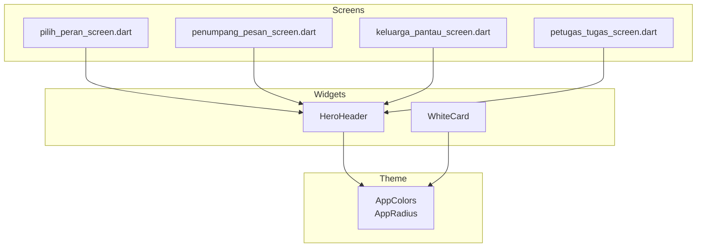
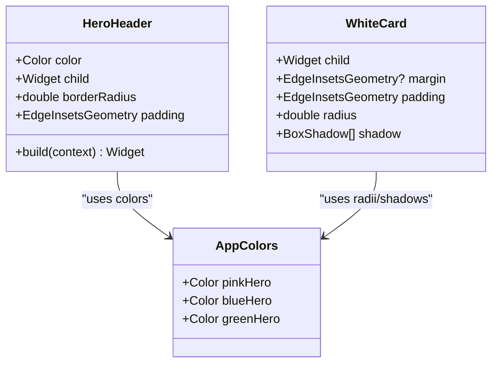
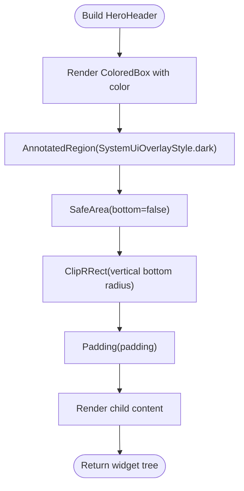
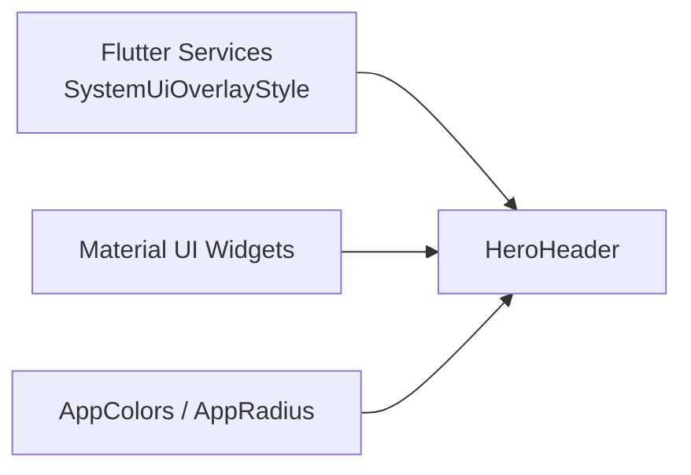

# Hero Header Component

<cite>
**Referenced Files in This Document**
- [hero_header.dart](file://whoosh_ramah/lib/widgets/hero_header.dart)
- [theme.dart](file://whoosh_ramah/lib/theme.dart)
- [white_card.dart](file://whoosh_ramah/lib/widgets/white_card.dart)
- [pilih_peran_screen.dart](file://whoosh_ramah/lib/screens/pilih_peran_screen.dart)
- [penumpang_pesan_screen.dart](file://whoosh_ramah/lib/screens/penumpang_pesan_screen.dart)
- [keluarga_pantau_screen.dart](file://whoosh_ramah/lib/screens/keluarga_pantau_screen.dart)
- [petugas_tugas_screen.dart](file://whoosh_ramah/lib/screens/petugas_tugas_screen.dart)
</cite>

## Table of Contents
1. [Introduction](#introduction)
2. [Project Structure](#project-structure)
3. [Core Components](#core-components)
4. [Architecture Overview](#architecture-overview)
5. [Detailed Component Analysis](#detailed-component-analysis)
6. [Dependency Analysis](#dependency-analysis)
7. [Performance Considerations](#performance-considerations)
8. [Troubleshooting Guide](#troubleshooting-guide)
9. [Conclusion](#conclusion)
10. [Appendices](#appendices)

## Introduction
The HeroHeader widget is a prominent, branded header component used across screens to establish visual identity and provide navigation context. It renders a colored banner that extends into the status bar area with rounded bottom corners, while keeping content safely within SafeArea. It is designed to be paired with a white card below it (often using negative vertical offset) so the card visually overlaps the hero banner.

Its primary responsibilities:
- Provide a consistent, colorful header region for branding and page context.
- Ensure system UI elements (status bar icons) remain visible by setting dark overlay style.
- Offer configurable padding and corner radius to match design tokens.
- Keep child content accessible via SafeArea and compatible with screen reader semantics provided by children.

## Project Structure
HeroHeader lives in the widgets layer and is consumed by multiple screens to create consistent headers. The theme system defines color tokens and radii used throughout the app, including hero colors and standard radii.

**Diagram sources**
- [hero_header.dart:9-43](file://whoosh_ramah/lib/widgets/hero_header.dart#L9-L43)
- [theme.dart:7-48](file://whoosh_ramah/lib/theme.dart#L7-L48)
- [white_card.dart:11-44](file://whoosh_ramah/lib/widgets/white_card.dart#L11-L44)
- [pilih_peran_screen.dart:26-82](file://whoosh_ramah/lib/screens/pilih_peran_screen.dart#L26-L82)
- [penumpang_pesan_screen.dart:104-149](file://whoosh_ramah/lib/screens/penumpang_pesan_screen.dart#L104-L149)
- [keluarga_pantau_screen.dart:135-173](file://whoosh_ramah/lib/screens/keluarga_pantau_screen.dart#L135-L173)
- [petugas_tugas_screen.dart:160-194](file://whoosh_ramah/lib/screens/petugas_tugas_screen.dart#L160-L194)

**Section sources**
- [hero_header.dart:1-43](file://whoosh_ramah/lib/widgets/hero_header.dart#L1-L43)
- [theme.dart:1-48](file://whoosh_ramah/lib/theme.dart#L1-L48)

## Core Components
- HeroHeader: A stateless widget that renders a colored background, applies safe insets, clips rounded corners at the bottom, and sets system UI overlay style to ensure visibility of status bar icons.
- Theme tokens: AppColors provides hero-specific colors (pink, blue, green), and AppRadius defines standard radii used across the app.
- WhiteCard: The companion card often overlapped by the hero; its documentation explains how to achieve the overlapping effect.

Key props of HeroHeader:
- color (required): Background color of the hero banner. Typically one of the hero palette colors from AppColors.
- child (required): The header content (title, subtitle, navigation controls).
- borderRadius (optional, default 40): Radius applied to the bottom corners of the hero banner.
- padding (optional, default EdgeInsets.fromLTRB(22, 20, 22, 26)): Internal spacing around child content.

Behavior highlights:
- Status bar integration: Uses AnnotatedRegion with SystemUiOverlayStyle.dark so light-colored hero backgrounds keep status bar icons readable.
- SafeArea: Ensures content avoids notches and system bars; bottom SafeArea is disabled to allow the hero to extend to the bottom edge.
- Rounded clipping: ClipRRect applies a vertical bottom radius to the entire hero area.

**Section sources**
- [hero_header.dart:9-43](file://whoosh_ramah/lib/widgets/hero_header.dart#L9-L43)
- [theme.dart:7-48](file://whoosh_ramah/lib/theme.dart#L7-L48)
- [white_card.dart:5-10](file://whoosh_ramah/lib/widgets/white_card.dart#L5-L10)

## Architecture Overview
HeroHeader is a presentation-only component. Screens compose their own header content inside HeroHeader’s child, selecting appropriate colors and padding per role or feature. The component does not manage state or data; it focuses on layout, theming, and accessibility support.

**Diagram sources**
- [hero_header.dart:9-43](file://whoosh_ramah/lib/widgets/hero_header.dart#L9-L43)
- [theme.dart:7-48](file://whoosh_ramah/lib/theme.dart#L7-L48)
- [white_card.dart:11-44](file://whoosh_ramah/lib/widgets/white_card.dart#L11-L44)

## Detailed Component Analysis

### Props and Customization
- color: Sets the hero background. Use AppColors.pinkHero for passenger flows, AppColors.blueHero for officer flows, and AppColors.greenHero for family flows.
- child: Any widget tree representing the header content. Typical patterns include:
  - Branding row with logo and title.
  - Page title and descriptive subtitle.
  - Navigation controls such as back buttons or role switchers.
- borderRadius: Controls the bottom corner rounding. Common values are 32–40.
- padding: Controls internal spacing. Adjust top/bottom/left/right to fit specific layouts.

Accessibility considerations:
- The component itself does not add semantic labels to child content. Screen readers rely on Semantics wrappers around text and interactive elements inside child.
- Status bar contrast is handled automatically via SystemUiOverlayStyle.dark.

Responsive behavior:
- HeroHeader does not implement device-specific logic. Responsiveness is achieved by composing different child layouts per screen and adjusting padding/radius as needed.
- SafeArea ensures content remains readable on devices with notches or dynamic islands.

Integration with theme:
- Colors come from AppColors.
- Radii and shadows are defined in AppRadius and AppShadows for consistency across components like WhiteCard.

Usage examples (described without code):
- Basic usage: Wrap a Column containing a brand row and a title/subtitle pair inside HeroHeader, set color to the appropriate hero token, and use default borderRadius and padding.
- Custom styling: Adjust borderRadius to 32 for tighter curves, and tweak padding to align with your screen’s grid.
- Overlapping card: Place a WhiteCard below the HeroHeader and shift the content downward using a negative vertical transform to overlap the card onto the hero banner.

**Section sources**
- [hero_header.dart:9-43](file://whoosh_ramah/lib/widgets/hero_header.dart#L9-L43)
- [theme.dart:7-48](file://whoosh_ramah/lib/theme.dart#L7-L48)
- [white_card.dart:5-10](file://whoosh_ramah/lib/widgets/white_card.dart#L5-L10)

### Usage Patterns Across Screens
- Role selection screen: Uses pink hero color with a brand row and introductory text.
- Passenger messaging screen: Uses pink hero color with a back button and page title.
- Family monitoring screen: Uses green hero color with a role switcher and personalized greeting.
- Officer tasks screen: Uses blue hero color with a role switcher and greeting.

These examples demonstrate consistent structure:
- Select a hero color from AppColors.
- Provide a child Column with navigation and textual context.
- Optionally adjust borderRadius and padding to match the screen’s layout.

**Section sources**
- [pilih_peran_screen.dart:26-82](file://whoosh_ramah/lib/screens/pilih_peran_screen.dart#L26-L82)
- [penumpang_pesan_screen.dart:104-149](file://whoosh_ramah/lib/screens/penumpang_pesan_screen.dart#L104-L149)
- [keluarga_pantau_screen.dart:135-173](file://whoosh_ramah/lib/screens/keluarga_pantau_screen.dart#L135-L173)
- [petugas_tugas_screen.dart:160-194](file://whoosh_ramah/lib/screens/petugas_tugas_screen.dart#L160-L194)

### Build Flow and Rendering

**Diagram sources**
- [hero_header.dart:27-42](file://whoosh_ramah/lib/widgets/hero_header.dart#L27-L42)

## Dependency Analysis
HeroHeader depends on:
- Flutter services for system UI overlay configuration.
- Material UI utilities for basic widgets.
- Theme tokens (colors and radii) defined elsewhere in the app.

It has no direct dependency on screen state or business logic, making it highly reusable and easy to test.

**Diagram sources**
- [hero_header.dart:1-2](file://whoosh_ramah/lib/widgets/hero_header.dart#L1-L2)
- [theme.dart:7-48](file://whoosh_ramah/lib/theme.dart#L7-L48)

**Section sources**
- [hero_header.dart:1-43](file://whoosh_ramah/lib/widgets/hero_header.dart#L1-L43)
- [theme.dart:1-48](file://whoosh_ramah/lib/theme.dart#L1-L48)

## Performance Considerations
- HeroHeader is lightweight and stateless; rendering cost is minimal.
- Avoid heavy computations inside child; keep header content simple for fast builds.
- Reuse predefined colors and radii from the theme to avoid unnecessary allocations.

[No sources needed since this section provides general guidance]

## Troubleshooting Guide
Common issues and resolutions:
- Status bar icons hard to read: Ensure you pass a light hero color (e.g., pink/blue/green from AppColors). HeroHeader uses dark overlay style by default; if you override overlay style elsewhere, verify it remains compatible.
- Content clipped unexpectedly: Check borderRadius; too small values may clip tall content near the bottom. Increase borderRadius or reduce child height.
- Padding misalignment: Adjust padding to match your screen’s grid. Remember that SafeArea excludes system insets but does not add extra space beyond what you specify.
- Card overlap not working: Follow WhiteCard’s guidance to shift content downward using a negative vertical transform rather than relying on Container margins.

**Section sources**
- [hero_header.dart:27-42](file://whoosh_ramah/lib/widgets/hero_header.dart#L27-L42)
- [white_card.dart:5-10](file://whoosh_ramah/lib/widgets/white_card.dart#L5-L10)

## Conclusion
HeroHeader provides a consistent, accessible, and customizable branded header across the app. By leveraging theme colors and radii, and by composing meaningful child content, screens can maintain visual consistency while adapting to different roles and contexts. Its simple API and predictable behavior make it an ideal building block for maintaining a cohesive user experience.

[No sources needed since this section summarizes without analyzing specific files]

## Appendices

### Accessibility Checklist
- Wrap important headings in Semantics with header: true when needed.
- Provide descriptive labels for interactive elements inside child.
- Verify contrast between text and hero background; prefer AppColors.textPrimary for text over light hero colors.

**Section sources**
- [keluarga_pantau_screen.dart:150-160](file://whoosh_ramah/lib/screens/keluarga_pantau_screen.dart#L150-L160)
- [petugas_tugas_screen.dart:180-190](file://whoosh_ramah/lib/screens/petugas_tugas_screen.dart#L180-L190)

### Extending HeroHeader
If you need additional customization:
- Add optional parameters for top/bottom padding or separate left/right padding.
- Introduce a theme-aware color resolver to pick hero colors based on current role or mode.
- Support alternative corner strategies (e.g., all corners rounded) via an enum parameter.

[No sources needed since this section provides general guidance]