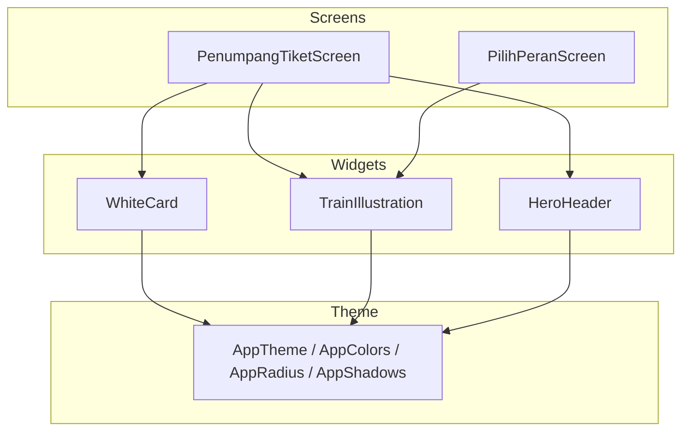
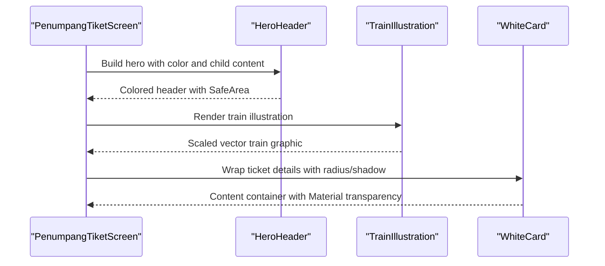
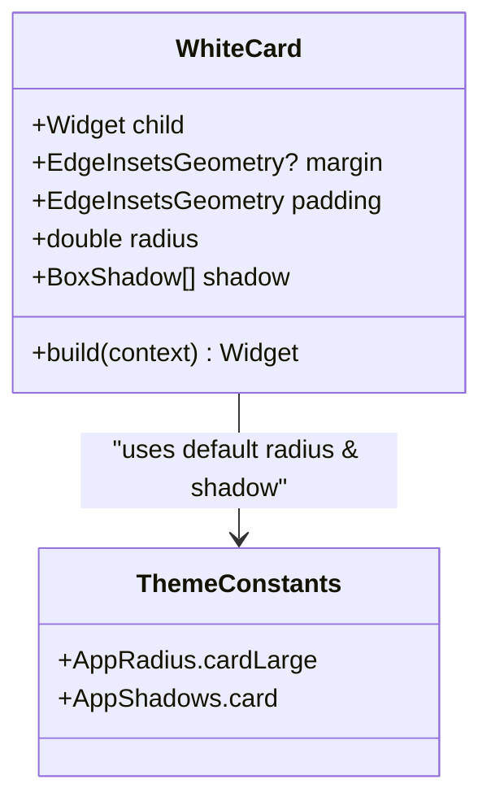
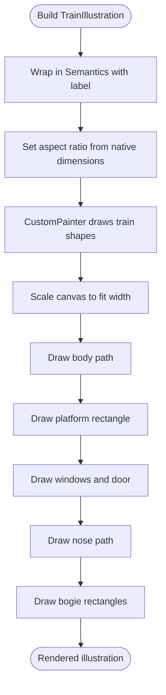
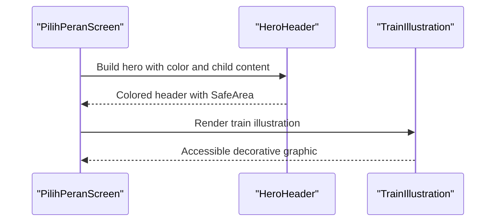
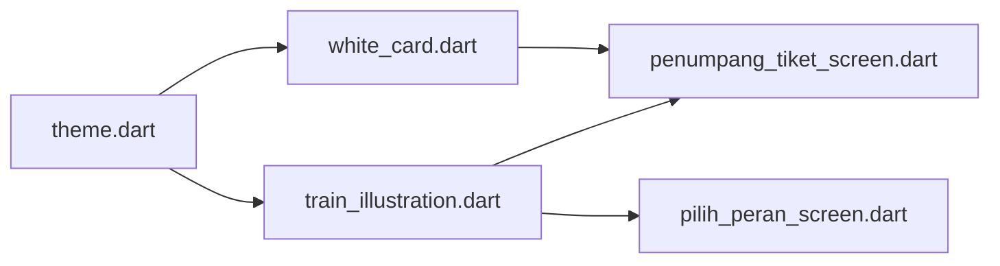

# Layout Components

<cite>
**Referenced Files in This Document**
- [white_card.dart](file://whoosh_ramah/lib/widgets/white_card.dart)
- [train_illustration.dart](file://whoosh_ramah/lib/widgets/train_illustration.dart)
- [theme.dart](file://whoosh_ramah/lib/theme.dart)
- [hero_header.dart](file://whoosh_ramah/lib/widgets/hero_header.dart)
- [penumpang_tiket_screen.dart](file://whoosh_ramah/lib/screens/penumpang_tiket_screen.dart)
- [pilih_peran_screen.dart](file://whoosh_ramah/lib/screens/pilih_peran_screen.dart)
</cite>

## Table of Contents
1. [Introduction](#introduction)
2. [Project Structure](#project-structure)
3. [Core Components](#core-components)
4. [Architecture Overview](#architecture-overview)
5. [Detailed Component Analysis](#detailed-component-analysis)
6. [Dependency Analysis](#dependency-analysis)
7. [Performance Considerations](#performance-considerations)
8. [Troubleshooting Guide](#troubleshooting-guide)
9. [Conclusion](#conclusion)

## Introduction
This document explains two layout and decorative components that establish a consistent, accessible visual language across the application:
- WhiteCard: a reusable white container for content with consistent spacing, rounded corners, and soft shadows.
- TrainIllustration: an accessibility-themed decorative illustration of a train on a platform.

These components are part of a design system focused on clarity, approachability, and inclusivity. They provide predictable visual structure while allowing controlled customization through props.

## Project Structure
The relevant files live under the Flutter app’s lib directory:
- Widgets: white_card.dart, train_illustration.dart, hero_header.dart
- Theme: theme.dart (colors, radii, shadows, typography)
- Screens demonstrating composition: penumpang_tiket_screen.dart, pilih_peran_screen.dart

**Diagram sources**
- [white_card.dart:11-44](file://whoosh_ramah/lib/widgets/white_card.dart#L11-L44)
- [train_illustration.dart:7-29](file://whoosh_ramah/lib/widgets/train_illustration.dart#L7-L29)
- [hero_header.dart:9-42](file://whoosh_ramah/lib/widgets/hero_header.dart#L9-L42)
- [theme.dart:7-63](file://whoosh_ramah/lib/theme.dart#L7-L63)
- [penumpang_tiket_screen.dart:33-92](file://whoosh_ramah/lib/screens/penumpang_tiket_screen.dart#L33-L92)
- [pilih_peran_screen.dart:26-80](file://whoosh_ramah/lib/screens/pilih_peran_screen.dart#L26-L80)

**Section sources**
- [white_card.dart:1-45](file://whoosh_ramah/lib/widgets/white_card.dart#L1-L45)
- [train_illustration.dart:1-106](file://whoosh_ramah/lib/widgets/train_illustration.dart#L1-L106)
- [theme.dart:1-164](file://whoosh_ramah/lib/theme.dart#L1-L164)
- [hero_header.dart:1-44](file://whoosh_ramah/lib/widgets/hero_header.dart#L1-L44)
- [penumpang_tiket_screen.dart:1-390](file://whoosh_ramah/lib/screens/penumpang_tiket_screen.dart#L1-L390)
- [pilih_peran_screen.dart:1-230](file://whoosh_ramah/lib/screens/pilih_peran_screen.dart#L1-L230)

## Core Components
- WhiteCard provides a consistent white container with configurable padding, radius, shadow, and margin. It ensures proper Material ink behavior while preserving the Container’s decoration.
- TrainIllustration renders a scalable vector-like train illustration using CustomPainter, wrapped in Semantics for screen readers.

Key responsibilities:
- Visual consistency: shared radii, shadows, and colors from theme.
- Accessibility: semantic labeling for decorative imagery.
- Composability: simple props to adapt appearance without duplicating style logic.

**Section sources**
- [white_card.dart:5-44](file://whoosh_ramah/lib/widgets/white_card.dart#L5-L44)
- [train_illustration.dart:3-29](file://whoosh_ramah/lib/widgets/train_illustration.dart#L3-L29)

## Architecture Overview
The components integrate into screens as follows:
- HeroHeader creates a colored header area with rounded bottom edges.
- TrainIllustration sits inside the hero to reinforce the accessibility theme.
- WhiteCard overlaps the hero by translating the content upward, creating a layered card effect.

**Diagram sources**
- [penumpang_tiket_screen.dart:33-92](file://whoosh_ramah/lib/screens/penumpang_tiket_screen.dart#L33-L92)
- [hero_header.dart:9-42](file://whoosh_ramah/lib/widgets/hero_header.dart#L9-L42)
- [train_illustration.dart:17-28](file://whoosh_ramah/lib/widgets/train_illustration.dart#L17-L28)
- [white_card.dart:28-43](file://whoosh_ramah/lib/widgets/white_card.dart#L28-L43)

## Detailed Component Analysis

### WhiteCard
Purpose:
- Provide a consistent white container for content blocks.
- Enforce design-system radii and shadows.
- Ensure text and interactive elements render correctly via transparent Material.

Props:
- child: required widget tree to be contained.
- margin: optional outer spacing; must be non-negative.
- padding: inner spacing around child; defaults to 20.
- radius: corner radius; defaults to large card radius from theme.
- shadow: list of BoxShadow; defaults to primary card shadow from theme.

Styling behavior:
- Background is white.
- Border radius applied to both Container decoration and inner Material.
- Shadow list applied to Container decoration.
- Inner Material uses transparency so Container decoration remains visible.

Responsive considerations:
- Uses EdgeInsetsGeometry for flexible spacing.
- No intrinsic size constraints; adapts to parent layout.

Usage example references:
- Ticket detail screen composes WhiteCard with a smaller radius and horizontal margins to overlap the hero header.

**Diagram sources**
- [white_card.dart:11-44](file://whoosh_ramah/lib/widgets/white_card.dart#L11-L44)
- [theme.dart:37-63](file://whoosh_ramah/lib/theme.dart#L37-L63)

**Section sources**
- [white_card.dart:5-44](file://whoosh_ramah/lib/widgets/white_card.dart#L5-L44)
- [theme.dart:37-63](file://whoosh_ramah/lib/theme.dart#L37-L63)
- [penumpang_tiket_screen.dart:80-92](file://whoosh_ramah/lib/screens/penumpang_tiket_screen.dart#L80-L92)

### TrainIllustration
Purpose:
- Decorative illustration reinforcing the accessibility-focused theme.
- Provides semantic label for assistive technologies.

Props:
- color: stripe color on the train body; defaults to passenger red.

Rendering behavior:
- AspectRatio maintains native proportions.
- CustomPainter draws the train shape, platform, windows, door, nose, and bogies.
- Semantics wraps the illustration with a descriptive label.

Accessibility:
- Label describes the illustration for screen readers.
- Decorative role is clear; no interactive semantics.

Responsive considerations:
- Scales proportionally based on available width via AspectRatio and painter scaling.

Usage example references:
- Appears within the hero header on multiple screens to visually anchor the accessibility narrative.

**Diagram sources**
- [train_illustration.dart:17-28](file://whoosh_ramah/lib/widgets/train_illustration.dart#L17-L28)
- [train_illustration.dart:31-104](file://whoosh_ramah/lib/widgets/train_illustration.dart#L31-L104)

**Section sources**
- [train_illustration.dart:3-104](file://whoosh_ramah/lib/widgets/train_illustration.dart#L3-L104)
- [pilih_peran_screen.dart:76-80](file://whoosh_ramah/lib/screens/pilih_peran_screen.dart#L76-L80)
- [penumpang_tiket_screen.dart:75-77](file://whoosh_ramah/lib/screens/penumpang_tiket_screen.dart#L75-L77)

### Composition Patterns
Common patterns observed in screens:
- HeroHeader with a light background color and rounded bottom edge.
- TrainIllustration placed inside the hero to emphasize accessibility.
- WhiteCard overlapping the hero by translating the column upward, simulating negative margin behavior.

**Diagram sources**
- [pilih_peran_screen.dart:26-80](file://whoosh_ramah/lib/screens/pilih_peran_screen.dart#L26-L80)
- [hero_header.dart:9-42](file://whoosh_ramah/lib/widgets/hero_header.dart#L9-L42)
- [train_illustration.dart:17-28](file://whoosh_ramah/lib/widgets/train_illustration.dart#L17-L28)

**Section sources**
- [penumpang_tiket_screen.dart:33-92](file://whoosh_ramah/lib/screens/penumpang_tiket_screen.dart#L33-L92)
- [pilih_peran_screen.dart:26-80](file://whoosh_ramah/lib/screens/pilih_peran_screen.dart#L26-L80)

## Dependency Analysis
Component dependencies:
- WhiteCard depends on theme constants for default radius and shadow.
- TrainIllustration is self-contained but styled via theme colors when used in context.
- Both components are consumed by screens to build layouts.

**Diagram sources**
- [theme.dart:37-63](file://whoosh_ramah/lib/theme.dart#L37-L63)
- [white_card.dart:1-4](file://whoosh_ramah/lib/widgets/white_card.dart#L1-L4)
- [train_illustration.dart:1-1](file://whoosh_ramah/lib/widgets/train_illustration.dart#L1-L1)
- [penumpang_tiket_screen.dart:1-12](file://whoosh_ramah/lib/screens/penumpang_tiket_screen.dart#L1-L12)
- [pilih_peran_screen.dart:1-8](file://whoosh_ramah/lib/screens/pilih_peran_screen.dart#L1-L8)

**Section sources**
- [white_card.dart:1-4](file://whoosh_ramah/lib/widgets/white_card.dart#L1-L4)
- [train_illustration.dart:1-1](file://whoosh_ramah/lib/widgets/train_illustration.dart#L1-L1)
- [penumpang_tiket_screen.dart:1-12](file://whoosh_ramah/lib/screens/penumpang_tiket_screen.dart#L1-L12)
- [pilih_peran_screen.dart:1-8](file://whoosh_ramah/lib/screens/pilih_peran_screen.dart#L1-L8)

## Performance Considerations
- WhiteCard:
  - Minimal overhead; uses Container and Material with transparency.
  - Avoid excessive nested widgets inside child to keep layout efficient.
- TrainIllustration:
  - CustomPainter scales drawing operations; ensure it is not rebuilt unnecessarily.
  - shouldRepaint compares stripeColor to avoid redundant painting.

Best practices:
- Keep child trees inside WhiteCard concise.
- Use const constructors where possible for static parts.
- Avoid animating TrainIllustration frequently; if needed, cache or throttle updates.

[No sources needed since this section provides general guidance]

## Troubleshooting Guide
Common issues and resolutions:
- Negative margins:
  - WhiteCard does not support negative margin values due to Container constraints.
  - Solution: wrap the entire content below the hero with Transform.translate to simulate negative margin.
- Shadow visibility:
  - Ensure parent backgrounds do not clip shadows unintentionally.
  - Verify that Container decoration applies boxShadow and that Material type is transparent.
- Illustration sizing:
  - If TrainIllustration appears too small or stretched, confirm AspectRatio is respected and parent constraints allow proportional scaling.
- Accessibility labels:
  - Confirm TrainIllustration retains its Semantics wrapper so screen readers announce the intended description.

**Section sources**
- [white_card.dart:5-10](file://whoosh_ramah/lib/widgets/white_card.dart#L5-L10)
- [white_card.dart:28-43](file://whoosh_ramah/lib/widgets/white_card.dart#L28-L43)
- [train_illustration.dart:17-28](file://whoosh_ramah/lib/widgets/train_illustration.dart#L17-L28)
- [penumpang_tiket_screen.dart:80-92](file://whoosh_ramah/lib/screens/penumpang_tiket_screen.dart#L80-L92)

## Conclusion
WhiteCard and TrainIllustration together establish a cohesive, accessible visual foundation:
- WhiteCard standardizes content containers with consistent spacing, shadows, and rounded corners.
- TrainIllustration reinforces the accessibility theme while remaining lightweight and responsive.
By composing these components within HeroHeader and screen layouts, developers can maintain visual consistency and improve user experience across roles and devices.

[No sources needed since this section summarizes without analyzing specific files]