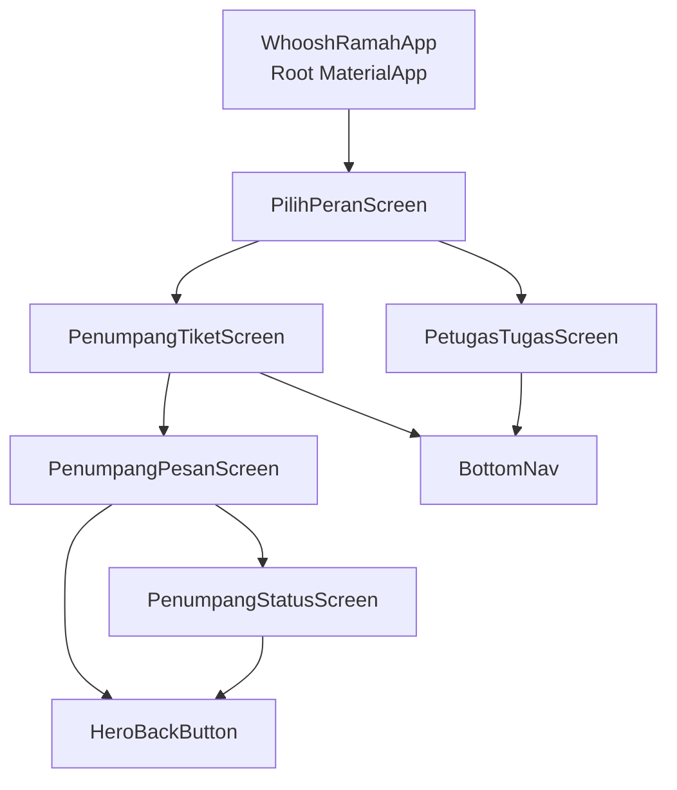
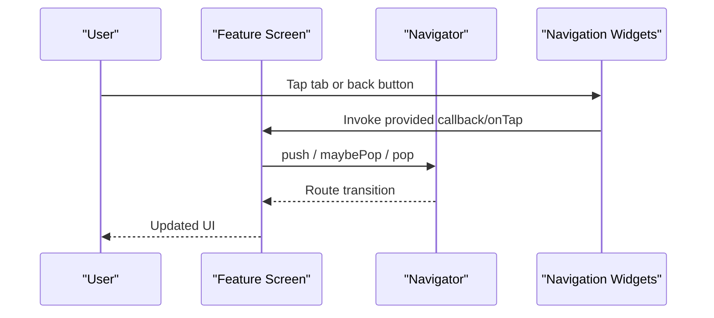
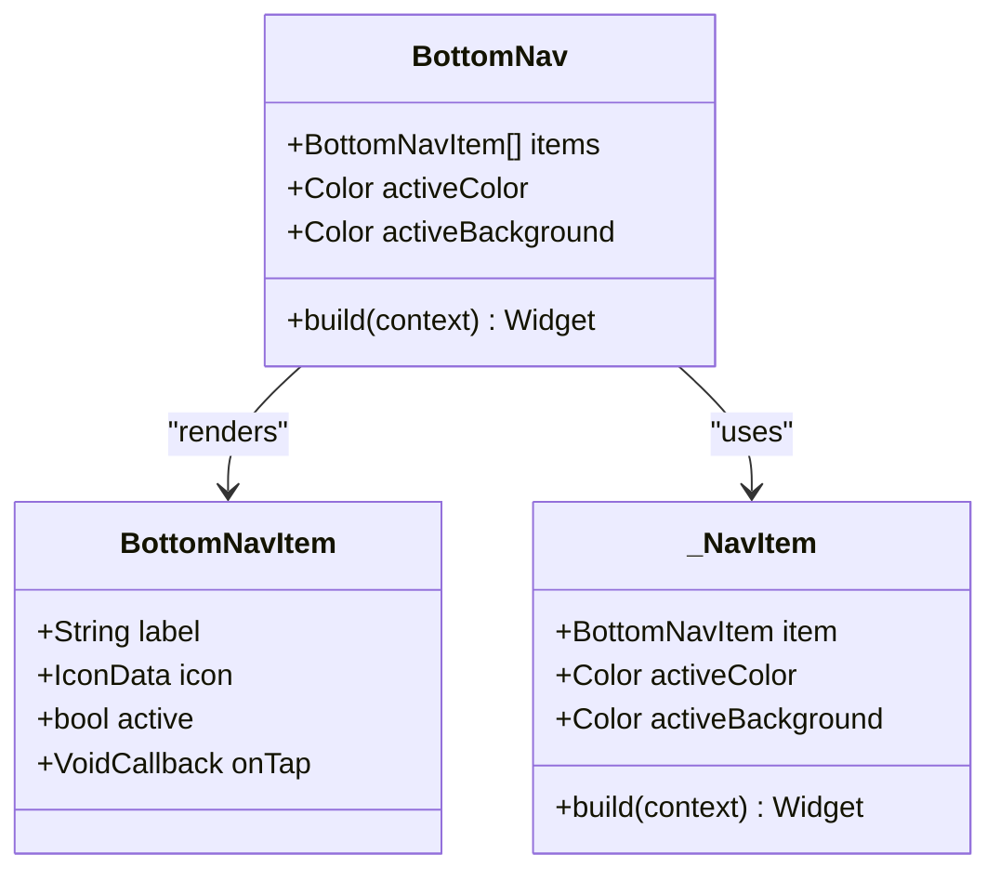
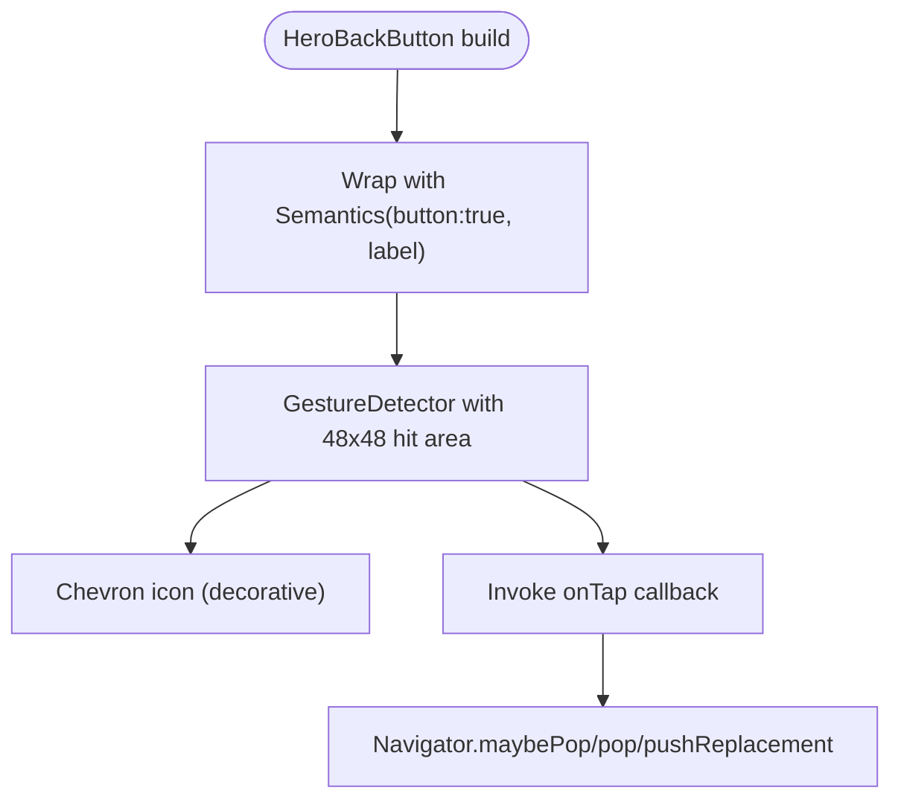
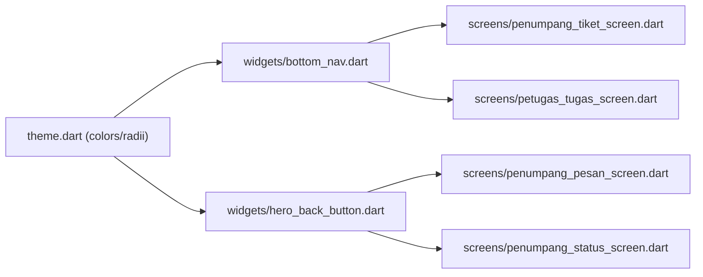

# Navigation Components

<cite>
**Referenced Files in This Document**
- [bottom_nav.dart](file://whoosh_ramah/lib/widgets/bottom_nav.dart)
- [hero_back_button.dart](file://whoosh_ramah/lib/widgets/hero_back_button.dart)
- [penumpang_tiket_screen.dart](file://whoosh_ramah/lib/screens/penumpang_tiket_screen.dart)
- [petugas_tugas_screen.dart](file://whoosh_ramah/lib/screens/petugas_tugas_screen.dart)
- [penumpang_pesan_screen.dart](file://whoosh_ramah/lib/screens/penumpang_pesan_screen.dart)
- [penumpang_status_screen.dart](file://whoosh_ramah/lib/screens/penumpang_status_screen.dart)
- [main.dart](file://whoosh_ramah/lib/main.dart)
</cite>

## Table of Contents
1. [Introduction](#introduction)
2. [Project Structure](#project-structure)
3. [Core Components](#core-components)
4. [Architecture Overview](#architecture-overview)
5. [Detailed Component Analysis](#detailed-component-analysis)
6. [Dependency Analysis](#dependency-analysis)
7. [Performance Considerations](#performance-considerations)
8. [Troubleshooting Guide](#troubleshooting-guide)
9. [Conclusion](#conclusion)

## Introduction
This document explains the navigation-related widgets used across the application: the bottom navigation bar and the hero back button. It covers their structure, tab management, active state handling, props, callbacks, customization options, integration with Flutter’s routing system, accessibility considerations, and guidelines for consistent user experience.

## Project Structure
The navigation components live under lib/widgets and are consumed by feature screens under lib/screens. The app entry point initializes Firebase and launches the root screen, which navigates into role-based flows that use these navigation widgets.

**Diagram sources**
- [main.dart:8-33](file://whoosh_ramah/lib/main.dart#L8-L33)
- [penumpang_tiket_screen.dart:227-254](file://whoosh_ramah/lib/screens/penumpang_tiket_screen.dart#L227-L254)
- [petugas_tugas_screen.dart:147-155](file://whoosh_ramah/lib/screens/petugas_tugas_screen.dart#L147-L155)
- [penumpang_pesan_screen.dart:113-113](file://whoosh_ramah/lib/screens/penumpang_pesan_screen.dart#L113-L113)
- [penumpang_status_screen.dart:228-228](file://whoosh_ramah/lib/screens/penumpang_status_screen.dart#L228-L228)

**Section sources**
- [main.dart:8-33](file://whoosh_ramah/lib/main.dart#L8-L33)

## Core Components
- Bottom navigation bar (BottomNav) provides a floating, rounded container with evenly distributed tabs. Each tab is defined via BottomNavItem and can be marked active to change color and background.
- Hero back button (HeroBackButton) provides a consistent circular back control inside the hero area, with explicit accessibility label and minimum 48dp touch target.

Key responsibilities:
- BottomNav: render tab items, apply active styling, expose onTap per item, and maintain accessible semantics.
- HeroBackButton: provide a semantic button with an accessible label and a chevron icon; handle onTap to navigate back.

**Section sources**
- [bottom_nav.dart:5-106](file://whoosh_ramah/lib/widgets/bottom_nav.dart#L5-L106)
- [hero_back_button.dart:5-45](file://whoosh_ramah/lib/widgets/hero_back_button.dart#L5-L45)

## Architecture Overview
The navigation architecture follows a simple pattern:
- Screens compose BottomNav at the bottom to present primary destinations.
- Screens compose HeroBackButton in the hero header to return to the previous screen or ticket detail.
- Routing is handled via Navigator.push and Navigator.maybePop/pop from within the widget trees.

**Diagram sources**
- [penumpang_tiket_screen.dart:227-254](file://whoosh_ramah/lib/screens/penumpang_tiket_screen.dart#L227-L254)
- [penumpang_pesan_screen.dart:113-113](file://whoosh_ramah/lib/screens/penumpang_pesan_screen.dart#L113-L113)
- [penumpang_status_screen.dart:228-228](file://whoosh_ramah/lib/screens/penumpang_status_screen.dart#L228-L228)

## Detailed Component Analysis

### Bottom Navigation Bar (BottomNav)
Purpose:
- Present a set of primary destinations at the bottom of the screen.
- Highlight the active tab using a distinct text/icon color and a light background.
- Provide accessible semantics for each tab.

Data model:
- BottomNavItem:
  - label: String
  - icon: IconData
  - active: bool (default false)
  - onTap: VoidCallback?

Props:
- items: List<BottomNavItem>
- activeColor: Color (text/icon color for active tab)
- activeBackground: Color (light background for active tab)

Behavior:
- Each tab uses a minimum height constraint to meet accessibility targets.
- Active state changes both color and background.
- Semantics mark each tab as a button and selected when active.

Usage examples:
- Passenger ticket screen defines four tabs including an active “Home” tab and a “Help” tab that navigates to the assistance request screen.
- Officer tasks screen defines three tabs with the active “Tasks” tab.

**Diagram sources**
- [bottom_nav.dart:5-106](file://whoosh_ramah/lib/widgets/bottom_nav.dart#L5-L106)

Integration with routing:
- Tabs can call Navigator.of(context).push(MaterialPageRoute(...)) to open new routes.
- For example, the “Help” tab opens the assistance request screen.

Accessibility:
- Each tab is wrapped with MergeSemantics and Semantics(button: true), and selected is set based on active state.
- Minimum hit area and clear labels ensure good assistive technology support.

Customization:
- Use activeColor and activeBackground to match role-specific themes (e.g., passenger pink/red vs officer blue).
- Adjust items list to add/remove tabs; keep labels concise and icons meaningful.

**Section sources**
- [bottom_nav.dart:5-106](file://whoosh_ramah/lib/widgets/bottom_nav.dart#L5-L106)
- [penumpang_tiket_screen.dart:227-254](file://whoosh_ramah/lib/screens/penumpang_tiket_screen.dart#L227-L254)
- [petugas_tugas_screen.dart:147-155](file://whoosh_ramah/lib/screens/petugas_tugas_screen.dart#L147-L155)

### Hero Back Button (HeroBackButton)
Purpose:
- Provide a consistent, accessible back control inside the hero header.
- Ensure a 48x48dp touch target and explicit accessibility label.

Props:
- onTap: VoidCallback (required)
- label: String (default “Kembali”)

Behavior:
- Renders a white circular button with a left chevron icon.
- Wraps content with Semantics(button: true, label: ...) and ExcludeSemantics for the inner visual elements.

Usage examples:
- Assistance request screen passes a localized label and calls Navigator.maybePop(context).
- Status screen wires back to the ticket screen with a custom handler that either pops or replaces depending on navigator state.

**Diagram sources**
- [hero_back_button.dart:5-45](file://whoosh_ramah/lib/widgets/hero_back_button.dart#L5-L45)
- [penumpang_pesan_screen.dart:113-113](file://whoosh_ramah/lib/screens/penumpang_pesan_screen.dart#L113-L113)
- [penumpang_status_screen.dart:133-144](file://whoosh_ramah/lib/screens/penumpang_status_screen.dart#L133-L144)

Accessibility:
- Explicit label ensures screen readers announce the action clearly.
- Decorative icon is excluded from semantics to avoid redundant announcements.

Customization:
- Provide a localized label string appropriate to context.
- Compose within HeroHeader to maintain consistent placement.

**Section sources**
- [hero_back_button.dart:5-45](file://whoosh_ramah/lib/widgets/hero_back_button.dart#L5-L45)
- [penumpang_pesan_screen.dart:113-113](file://whoosh_ramah/lib/screens/penumpang_pesan_screen.dart#L113-L113)
- [penumpang_status_screen.dart:228-228](file://whoosh_ramah/lib/screens/penumpang_status_screen.dart#L228-L228)

## Dependency Analysis
- BottomNav depends on theme colors and radii from the shared theme file.
- HeroBackButton depends on theme colors for icon color.
- Screens import and compose these widgets to implement navigation patterns.

**Diagram sources**
- [bottom_nav.dart:1-4](file://whoosh_ramah/lib/widgets/bottom_nav.dart#L1-L4)
- [hero_back_button.dart:1-4](file://whoosh_ramah/lib/widgets/hero_back_button.dart#L1-L4)
- [penumpang_tiket_screen.dart:1-12](file://whoosh_ramah/lib/screens/penumpang_tiket_screen.dart#L1-L12)
- [petugas_tugas_screen.dart:1-14](file://whoosh_ramah/lib/screens/petugas_tugas_screen.dart#L1-L14)
- [penumpang_pesan_screen.dart:1-10](file://whoosh_ramah/lib/screens/penumpang_pesan_screen.dart#L1-L10)
- [penumpang_status_screen.dart:1-12](file://whoosh_ramah/lib/screens/penumpang_status_screen.dart#L1-L12)

**Section sources**
- [bottom_nav.dart:1-4](file://whoosh_ramah/lib/widgets/bottom_nav.dart#L1-L4)
- [hero_back_button.dart:1-4](file://whoosh_ramah/lib/widgets/hero_back_button.dart#L1-L4)

## Performance Considerations
- BottomNav renders a flat Row of Expanded items; complexity is O(n) where n is the number of tabs. Keep the number of tabs small (typically 3–5) for optimal performance and usability.
- Avoid rebuilding BottomNav frequently by keeping its configuration stable or using const constructors for BottomNavItem instances.
- HeroBackButton is lightweight; ensure onTap does not perform heavy work synchronously. Offload network or long-running tasks to services and update UI afterward.

[No sources needed since this section provides general guidance]

## Troubleshooting Guide
Common issues and resolutions:
- Tab does not appear highlighted:
  - Ensure the correct BottomNavItem has active: true and that activeColor/activeBackground are set appropriately for the current role.
  - Verify that the same BottomNav instance is rebuilt with updated items when switching tabs.
- Back button does nothing:
  - Confirm onTap is wired to Navigator.maybePop(context) or another valid navigation method.
  - If the route stack is empty, consider pushing a replacement route instead of popping.
- Accessibility announcements are missing:
  - Ensure HeroBackButton includes a descriptive label.
  - For custom interactive areas, wrap with Semantics(button: true) and provide a clear label.

**Section sources**
- [bottom_nav.dart:57-106](file://whoosh_ramah/lib/widgets/bottom_nav.dart#L57-L106)
- [hero_back_button.dart:18-45](file://whoosh_ramah/lib/widgets/hero_back_button.dart#L18-L45)
- [penumpang_status_screen.dart:133-144](file://whoosh_ramah/lib/screens/penumpang_status_screen.dart#L133-L144)

## Conclusion
BottomNav and HeroBackButton provide a consistent, accessible navigation foundation across the app. By configuring BottomNavItem lists, active states, and theme-aware colors, screens can deliver clear navigation experiences. HeroBackButton standardizes the back interaction in hero headers with strong accessibility support. Following the usage patterns and guidelines here will help maintain a cohesive UX across different roles and screens.

[No sources needed since this section summarizes without analyzing specific files]