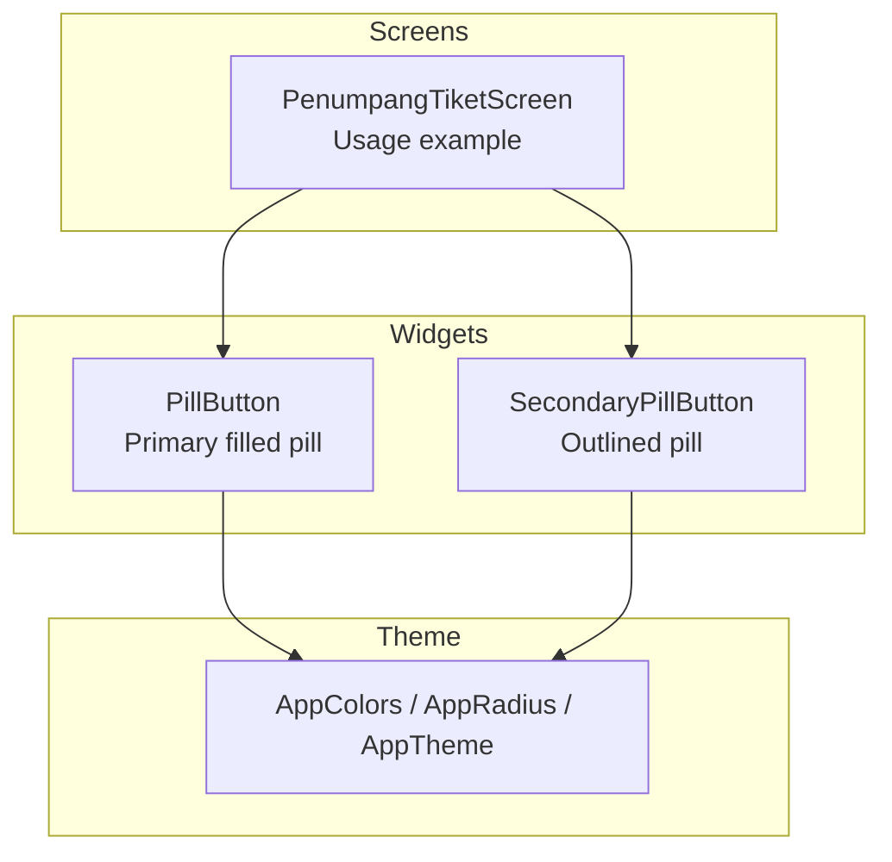
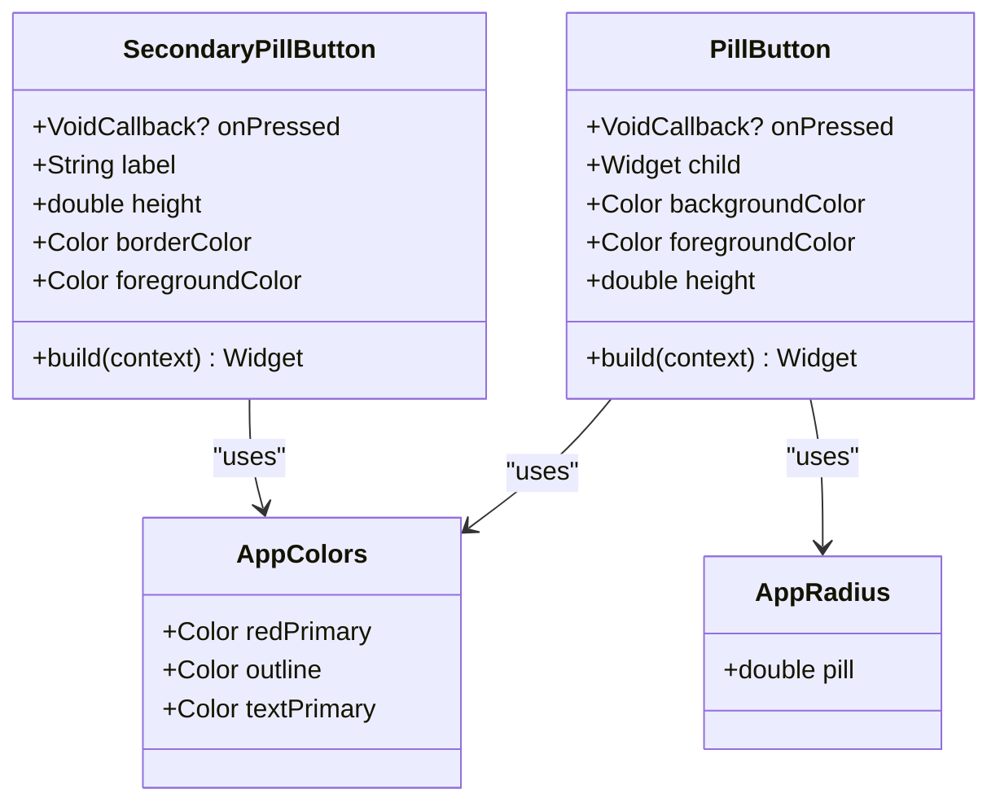
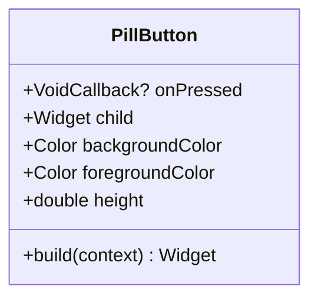
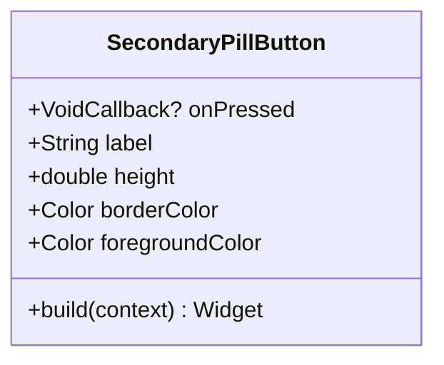
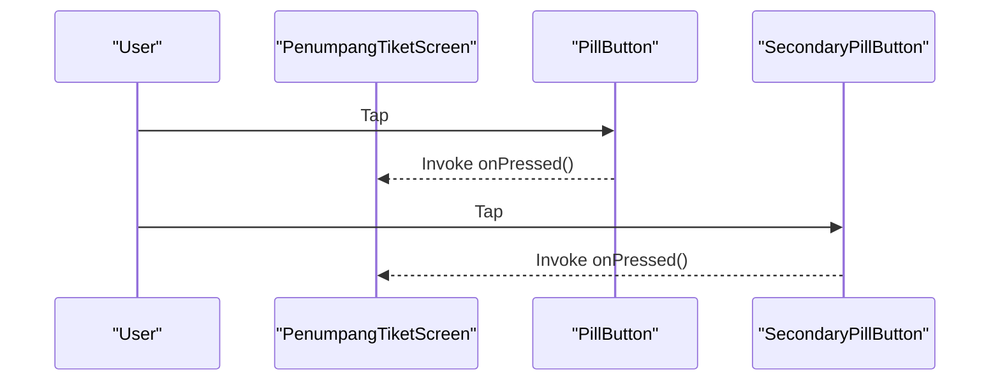
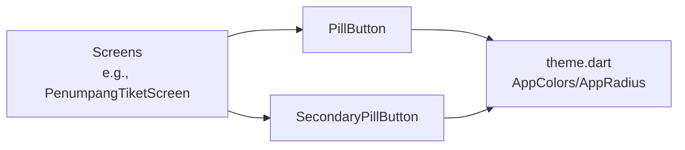

# Pill Button Components

<cite>
**Referenced Files in This Document**
- [pill_button.dart](file://whoosh_ramah/lib/widgets/pill_button.dart)
- [secondary_pill_button.dart](file://whoosh_ramah/lib/widgets/secondary_pill_button.dart)
- [theme.dart](file://whoosh_ramah/lib/theme.dart)
- [penumpang_tiket_screen.dart](file://whoosh_ramah/lib/screens/penumpang_tiket_screen.dart)
- [PROJECT.md](file://PROJECT.md)
</cite>

## Table of Contents
1. [Introduction](#introduction)
2. [Project Structure](#project-structure)
3. [Core Components](#core-components)
4. [Architecture Overview](#architecture-overview)
5. [Detailed Component Analysis](#detailed-component-analysis)
6. [Dependency Analysis](#dependency-analysis)
7. [Performance Considerations](#performance-considerations)
8. [Troubleshooting Guide](#troubleshooting-guide)
9. [Conclusion](#conclusion)
10. [Appendices](#appendices)

## Introduction
This document explains the pill-shaped button components used across the application: a primary filled variant and a secondary outlined variant. Both are designed to be accessible, consistent with the “Cerah & ramah” design system, and aligned with accessibility requirements such as minimum touch targets, clear labels, and screen reader compatibility. The documentation covers props, visual variants, disabled states, accessibility features, usage examples, and best practices for consistent implementation.

## Project Structure
The pill buttons live under the widgets layer and consume shared theming from the theme module. Screens demonstrate practical usage patterns.

**Diagram sources**
- [pill_button.dart:10-58](file://whoosh_ramah/lib/widgets/pill_button.dart#L10-L58)
- [secondary_pill_button.dart:9-39](file://whoosh_ramah/lib/widgets/secondary_pill_button.dart#L9-L39)
- [theme.dart:7-48](file://whoosh_ramah/lib/theme.dart#L7-L48)
- [penumpang_tiket_screen.dart:178-222](file://whoosh_ramah/lib/screens/penumpang_tiket_screen.dart#L178-L222)

**Section sources**
- [pill_button.dart:1-58](file://whoosh_ramah/lib/widgets/pill_button.dart#L1-L58)
- [secondary_pill_button.dart:1-39](file://whoosh_ramah/lib/widgets/secondary_pill_button.dart#L1-L39)
- [theme.dart:1-164](file://whoosh_ramah/lib/theme.dart#L1-L164)
- [penumpang_tiket_screen.dart:170-230](file://whoosh_ramah/lib/screens/penumpang_tiket_screen.dart#L170-L230)

## Core Components
Two reusable components implement the pill shape and behavior:

- Primary Pill Button (filled): A high-emphasis action button with rounded corners, bold text, and an accessible semantics tree. It accepts a child widget (text or icon+text), background and foreground colors, and a height constraint.
- Secondary Pill Button (outlined): A lower-emphasis action using an outlined style with a pill shape, border, and label text. It exposes label, height, border color, and foreground color.

Both components follow the design system’s radius and sizing guidance and ensure adequate touch target sizes.

**Section sources**
- [pill_button.dart:5-58](file://whoosh_ramah/lib/widgets/pill_button.dart#L5-L58)
- [secondary_pill_button.dart:5-39](file://whoosh_ramah/lib/widgets/secondary_pill_button.dart#L5-L39)
- [theme.dart:37-48](file://whoosh_ramah/lib/theme.dart#L37-L48)

## Architecture Overview
The components integrate tightly with the shared theme for colors, radii, and typography. They are consumed by screens to provide consistent actions.

**Diagram sources**
- [pill_button.dart:10-58](file://whoosh_ramah/lib/widgets/pill_button.dart#L10-L58)
- [secondary_pill_button.dart:9-39](file://whoosh_ramah/lib/widgets/secondary_pill_button.dart#L9-L39)
- [theme.dart:7-48](file://whoosh_ramah/lib/theme.dart#L7-L48)

## Detailed Component Analysis

### PillButton (Primary Variant)
Purpose:
- High-emphasis call-to-action with a filled background and pill shape.
- Accepts arbitrary child content (e.g., icon + text) while preserving semantic labeling.

Key props:
- onPressed: callback invoked on tap; when null, the button is visually disabled.
- child: any widget (commonly Text or Row with Icon + Text).
- backgroundColor: default uses the primary brand color.
- foregroundColor: default white for contrast against the filled background.
- height: default ensures a large, accessible touch area.

Visual and interaction behavior:
- Rounded corners via a shared pill radius.
- Padding provides comfortable spacing around the child.
- When disabled (onPressed null), the background becomes semi-transparent to indicate non-interactivity.
- Semantics are explicitly set so screen readers announce it as a button and reflect enabled state.

Accessibility highlights:
- Uses a semantics wrapper to mark the component as a button and expose its enabled state.
- Merges text styles to inherit the app font family while applying strong weight and size.
- Ensures a generous minimum height for touch targets.

When to use:
- Primary actions that drive the main flow (e.g., requesting assistance, confirming a key step).

Best practices:
- Keep child content concise and descriptive.
- Use icons only as supporting elements; always include readable text.
- Avoid overriding semantics unless you have a specific reason.

**Section sources**
- [pill_button.dart:5-58](file://whoosh_ramah/lib/widgets/pill_button.dart#L5-L58)
- [theme.dart:37-48](file://whoosh_ramah/lib/theme.dart#L37-L48)

#### Class Diagram: PillButton

**Diagram sources**
- [pill_button.dart:10-58](file://whoosh_ramah/lib/widgets/pill_button.dart#L10-L58)

### SecondaryPillButton (Secondary Variant)
Purpose:
- Lower-emphasis action presented as an outlined pill.
- Built on a Material outlined button, inheriting built-in accessibility behaviors.

Key props:
- onPressed: callback invoked on tap; null disables the button.
- label: string displayed inside the button.
- height: default within the recommended range for secondary buttons.
- borderColor: default matches the design system’s outline color.
- foregroundColor: default uses the primary text color.

Visual and interaction behavior:
- Pill shape via a stadium border.
- 2px border line and controlled text style for clarity.
- Disabled state handled automatically by the underlying button.

Accessibility highlights:
- Inherits accessible label from the provided text.
- Minimum size ensures a sufficient touch target.
- Disabled state is reflected automatically.

When to use:
- Secondary actions, alternatives, or less prominent operations (e.g., viewing other tickets, canceling).

Best practices:
- Use short, clear labels.
- Reserve this variant for non-primary actions to maintain visual hierarchy.

**Section sources**
- [secondary_pill_button.dart:5-39](file://whoosh_ramah/lib/widgets/secondary_pill_button.dart#L5-L39)
- [theme.dart:37-48](file://whoosh_ramah/lib/theme.dart#L37-L48)

#### Class Diagram: SecondaryPillButton

**Diagram sources**
- [secondary_pill_button.dart:9-39](file://whoosh_ramah/lib/widgets/secondary_pill_button.dart#L9-L39)

### Usage Examples
A screen demonstrates both variants together:
- Primary filled button with icon and text for a main action.
- Secondary outlined button for a less prominent action.

**Diagram sources**
- [penumpang_tiket_screen.dart:178-222](file://whoosh_ramah/lib/screens/penumpang_tiket_screen.dart#L178-L222)
- [pill_button.dart:26-58](file://whoosh_ramah/lib/widgets/pill_button.dart#L26-L58)
- [secondary_pill_button.dart:25-39](file://whoosh_ramah/lib/widgets/secondary_pill_button.dart#L25-L39)

**Section sources**
- [penumpang_tiket_screen.dart:178-222](file://whoosh_ramah/lib/screens/penumpang_tiket_screen.dart#L178-L222)

## Dependency Analysis
- Both components depend on the shared theme for colors and radii.
- The primary button composes semantics and ink response to provide accessible interactions.
- The secondary button relies on Material’s OutlinedButton for built-in accessibility and styling.

**Diagram sources**
- [pill_button.dart:1-58](file://whoosh_ramah/lib/widgets/pill_button.dart#L1-L58)
- [secondary_pill_button.dart:1-39](file://whoosh_ramah/lib/widgets/secondary_pill_button.dart#L1-L39)
- [theme.dart:1-164](file://whoosh_ramah/lib/theme.dart#L1-L164)
- [penumpang_tiket_screen.dart:178-222](file://whoosh_ramah/lib/screens/penumpang_tiket_screen.dart#L178-L222)

**Section sources**
- [pill_button.dart:1-58](file://whoosh_ramah/lib/widgets/pill_button.dart#L1-L58)
- [secondary_pill_button.dart:1-39](file://whoosh_ramah/lib/widgets/secondary_pill_button.dart#L1-L39)
- [theme.dart:1-164](file://whoosh_ramah/lib/theme.dart#L1-L164)

## Performance Considerations
- Prefer lightweight children in PillButton to avoid unnecessary rebuilds.
- Avoid animating complex children inside InkResponse to keep taps responsive.
- Reuse static styles and colors defined in the theme rather than creating new instances per build.

[No sources needed since this section provides general guidance]

## Troubleshooting Guide
Common issues and resolutions:
- Button not announcing as a button on screen readers:
  - Ensure the primary button wraps content with semantics indicating it is a button and reflects enabled state.
  - Verify that the child does not override semantics unintentionally.
- Touch target too small:
  - Confirm the height constraints meet the minimum guidelines.
- Disabled state unclear:
  - For the primary button, verify that onPressed is null to trigger the disabled visual.
  - For the secondary button, rely on the underlying button’s disabled handling.
- Inconsistent fonts or weights:
  - Use DefaultTextStyle.merge to inherit the app font family and apply the required weight.

**Section sources**
- [pill_button.dart:26-58](file://whoosh_ramah/lib/widgets/pill_button.dart#L26-L58)
- [secondary_pill_button.dart:25-39](file://whoosh_ramah/lib/widgets/secondary_pill_button.dart#L25-L39)

## Conclusion
The pill button components provide a consistent, accessible foundation for primary and secondary actions. The primary variant emphasizes key workflows with a filled, bold design, while the secondary variant offers a lighter alternative for less critical actions. Both adhere to the design system’s sizing, color, and radius rules and incorporate accessibility considerations such as semantics, touch targets, and clear disabled states. Use these components to maintain visual consistency and inclusive experiences across the application.

[No sources needed since this section summarizes without analyzing specific files]

## Appendices

### Props Reference

- PillButton
  - onPressed: VoidCallback? — Action triggered on tap; null indicates disabled.
  - child: Widget — Content (Text or composite like Row with Icon + Text).
  - backgroundColor: Color — Filled background; defaults to the primary brand color.
  - foregroundColor: Color — Text/icon color; defaults to white.
  - height: double — Minimum height; defaults to a large accessible value.

- SecondaryPillButton
  - onPressed: VoidCallback? — Action triggered on tap; null indicates disabled.
  - label: String — Visible text inside the button.
  - height: double — Minimum height; defaults to the secondary button range.
  - borderColor: Color — Outline stroke color; defaults to the design system’s outline.
  - foregroundColor: Color — Text color; defaults to the primary text color.

**Section sources**
- [pill_button.dart:10-24](file://whoosh_ramah/lib/widgets/pill_button.dart#L10-L24)
- [secondary_pill_button.dart:10-23](file://whoosh_ramah/lib/widgets/secondary_pill_button.dart#L10-L23)

### Accessibility Guidelines
- Minimum touch target: at least 48×48 dp.
- Clear labels: every interactive element must have a meaningful label.
- Keyboard navigation: ensure focus order and activation work without a mouse.
- Screen readers: test with TalkBack/VoiceOver; confirm announcements and state changes.
- Non-color cues: do not rely solely on color to convey status.

These principles are enforced by the components through explicit semantics, adequate sizing, and inherited Material accessibility behaviors.

**Section sources**
- [PROJECT.md:169-176](file://PROJECT.md#L169-L176)
- [pill_button.dart:26-58](file://whoosh_ramah/lib/widgets/pill_button.dart#L26-L58)
- [secondary_pill_button.dart:25-39](file://whoosh_ramah/lib/widgets/secondary_pill_button.dart#L25-L39)

### Design Principles Summary
- Pill shape: consistent rounded corners using a shared radius.
- Typography: bold weights and readable sizes aligned with the design system.
- Colors: primary brand color for emphasis; neutral outlines for secondary actions.
- Spacing: padding and heights optimized for comfort and accessibility.

**Section sources**
- [theme.dart:37-48](file://whoosh_ramah/lib/theme.dart#L37-L48)
- [PROJECT.md:138-167](file://PROJECT.md#L138-L167)