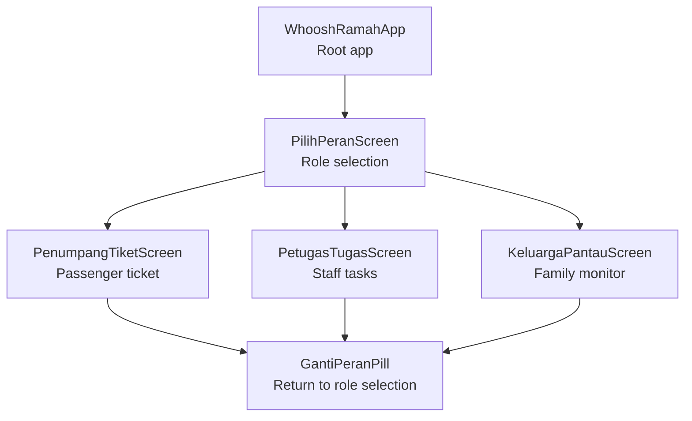
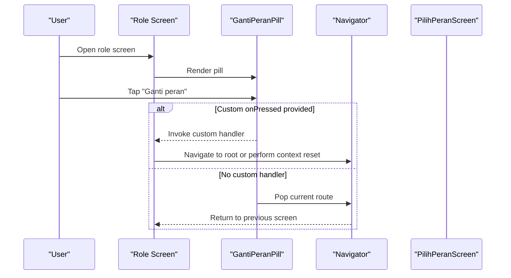
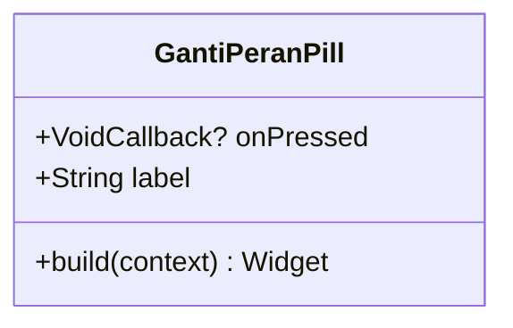
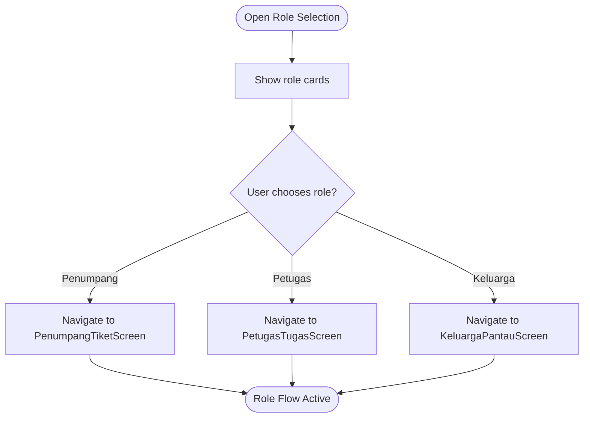
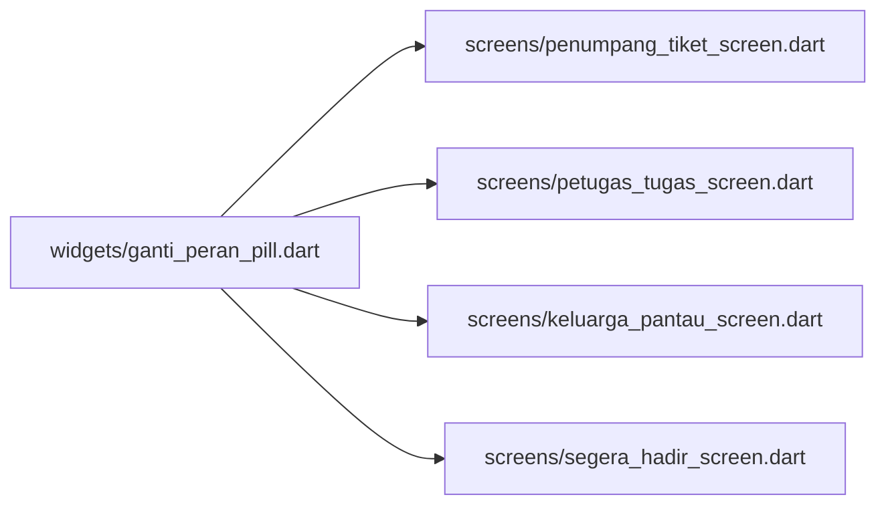

# Utility Components

<cite>
**Referenced Files in This Document**
- [ganti_peran_pill.dart](file://whoosh_ramah/lib/widgets/ganti_peran_pill.dart)
- [pilih_peran_screen.dart](file://whoosh_ramah/lib/screens/pilih_peran_screen.dart)
- [penumpang_tiket_screen.dart](file://whoosh_ramah/lib/screens/penumpang_tiket_screen.dart)
- [petugas_tugas_screen.dart](file://whoosh_ramah/lib/screens/petugas_tugas_screen.dart)
- [keluarga_pantau_screen.dart](file://whoosh_ramah/lib/screens/keluarga_pantau_screen.dart)
- [segera_hadir_screen.dart](file://whoosh_ramah/lib/screens/segera_hadir_screen.dart)
- [main.dart](file://whoosh_ramah/lib/main.dart)
</cite>

## Table of Contents
1. [Introduction](#introduction)
2. [Project Structure](#project-structure)
3. [Core Components](#core-components)
4. [Architecture Overview](#architecture-overview)
5. [Detailed Component Analysis](#detailed-component-analysis)
6. [Dependency Analysis](#dependency-analysis)
7. [Performance Considerations](#performance-considerations)
8. [Troubleshooting Guide](#troubleshooting-guide)
9. [Security and Role Switching Best Practices](#security-and-role-switching-best-practices)
10. [Conclusion](#conclusion)

## Introduction
This document explains the utility components that support role switching in the application, with a focus on the `GantiPeranPill` widget. The pill allows users to return from any role screen (passenger, staff, family) to the root role selection screen. It is intentionally simple: it renders a small pill-shaped button and delegates navigation behavior to the caller or defaults to popping the current route.

The documentation covers:
- Widget props, interaction handlers, and accessibility behavior
- How screens integrate the pill for role switching
- State management patterns used by role screens
- Security implications of role switching and recommended best practices

## Project Structure
The role switching flow centers around:
- A root role selection screen
- Three role-specific screens
- A reusable pill widget used across role screens

**Diagram sources**
- [main.dart:20-33](file://whoosh_ramah/lib/main.dart#L20-L33)
- [pilih_peran_screen.dart:14-147](file://whoosh_ramah/lib/screens/pilih_peran_screen.dart#L14-L147)
- [penumpang_tiket_screen.dart:18-264](file://whoosh_ramah/lib/screens/penumpang_tiket_screen.dart#L18-L264)
- [petugas_tugas_screen.dart:28-133](file://whoosh_ramah/lib/screens/petugas_tugas_screen.dart#L28-L133)
- [keluarga_pantau_screen.dart:19-133](file://whoosh_ramah/lib/screens/keluarga_pantau_screen.dart#L19-L133)
- [ganti_peran_pill.dart:10-48](file://whoosh_ramah/lib/widgets/ganti_peran_pill.dart#L10-L48)

**Section sources**
- [main.dart:8-33](file://whoosh_ramah/lib/main.dart#L8-L33)
- [pilih_peran_screen.dart:14-147](file://whoosh_ramah/lib/screens/pilih_peran_screen.dart#L14-L147)

## Core Components
The primary component for role switching is `GantiPeranPill`. It is a stateless widget that renders an accessible pill button. Its default behavior navigates back using the Flutter Navigator; callers can override this behavior via a callback.

Key responsibilities:
- Render a compact pill UI with an arrow icon and label
- Provide accessibility semantics for assistive technologies
- Default to safe navigation back when no custom handler is provided
- Allow customization of the action through a callback and label

Props and behavior:
- `onPressed`: Optional callback invoked when the pill is tapped. If not provided, the widget calls the navigator’s pop method.
- `label`: Customizable text displayed next to the arrow icon. Defaults to “Ganti peran”.

Accessibility:
- The entire pill is exposed as a semantic button.
- The arrow icon is decorative; the label text provides the accessible name.
- The hit area is designed to be comfortably tappable.

**Section sources**
- [ganti_peran_pill.dart:5-48](file://whoosh_ramah/lib/widgets/ganti_peran_pill.dart#L5-L48)

## Architecture Overview
The application starts at the root app and opens the role selection screen. From there, users choose one of three roles. Each role screen includes the `GantiPeranPill`, enabling quick return to the role selection screen.

**Diagram sources**
- [ganti_peran_pill.dart:10-48](file://whoosh_ramah/lib/widgets/ganti_peran_pill.dart#L10-L48)
- [penumpang_tiket_screen.dart:18-264](file://whoosh_ramah/lib/screens/penumpang_tiket_screen.dart#L18-L264)
- [petugas_tugas_screen.dart:160-170](file://whoosh_ramah/lib/screens/petugas_tugas_screen.dart#L160-L170)
- [keluarga_pantau_screen.dart:135-174](file://whoosh_ramah/lib/screens/keluarga_pantau_screen.dart#L135-L174)

## Detailed Component Analysis

### GantiPeranPill Widget
`GantiPeranPill` is a small, reusable UI element placed in the hero area of role screens. It visually indicates how to return to the role selection screen.

Implementation highlights:
- Stateless widget with optional `onPressed` and `label`
- Uses semantic widgets to ensure accessibility
- Provides a default navigation fallback if no handler is supplied
- Styled as a pill with rounded corners and a semi-transparent background

**Diagram sources**
- [ganti_peran_pill.dart:10-48](file://whoosh_ramah/lib/widgets/ganti_peran_pill.dart#L10-L48)

Usage examples:
- Default usage: place the pill inside a hero header without providing `onPressed`; tapping pops the current route.
- Custom usage: provide `onPressed` to navigate to the root screen or reset application context before navigating.

Integration points:
- Passenger ticket screen uses the pill in its hero header.
- Staff tasks screen uses the pill with a custom handler that navigates to the root screen.
- Family monitor screen uses the pill with a custom handler that navigates to the root screen.

**Section sources**
- [penumpang_tiket_screen.dart:33-41](file://whoosh_ramah/lib/screens/penumpang_tiket_screen.dart#L33-L41)
- [petugas_tugas_screen.dart:160-170](file://whoosh_ramah/lib/screens/petugas_tugas_screen.dart#L160-L170)
- [keluarga_pantau_screen.dart:135-174](file://whoosh_ramah/lib/screens/keluarga_pantau_screen.dart#L135-L174)

### Role Selection Screen
The role selection screen presents three roles: passenger, staff, and family. Selecting a role navigates to the corresponding screen.

Behavior:
- Displays role cards with titles, subtitles, icons, and colors
- Navigates to role-specific screens upon card tap
- Serves as the root entry point for role-based flows

**Diagram sources**
- [pilih_peran_screen.dart:14-147](file://whoosh_ramah/lib/screens/pilih_peran_screen.dart#L14-L147)

**Section sources**
- [pilih_peran_screen.dart:14-147](file://whoosh_ramah/lib/screens/pilih_peran_screen.dart#L14-L147)

### Passenger Ticket Screen
The passenger screen shows ticket details and includes the pill for returning to role selection.

Behavior:
- Renders hero header with the pill
- Displays ticket information and actions
- Uses bottom navigation for additional features

Integration:
- Uses the pill without a custom handler; default pop behavior returns to the previous screen.

**Section sources**
- [penumpang_tiket_screen.dart:18-264](file://whoosh_ramah/lib/screens/penumpang_tiket_screen.dart#L18-L264)

### Staff Tasks Screen
The staff screen manages task lists and includes the pill for returning to role selection.

Behavior:
- Streams task data and updates UI accordingly
- Highlights new tasks and announces changes
- Uses the pill with a custom handler to navigate to the root screen

Integration:
- Provides `onPressed` that navigates to the first route (root), ensuring consistent role switching.

**Section sources**
- [petugas_tugas_screen.dart:28-133](file://whoosh_ramah/lib/screens/petugas_tugas_screen.dart#L28-L133)
- [petugas_tugas_screen.dart:160-170](file://whoosh_ramah/lib/screens/petugas_tugas_screen.dart#L160-L170)

### Family Monitor Screen
The family screen monitors a passenger’s journey and includes the pill for returning to role selection.

Behavior:
- Streams latest request status for a passenger
- Announces status changes to accessibility services
- Uses the pill with a custom handler to navigate to the root screen

Integration:
- Provides `onPressed` that navigates to the first route (root).

**Section sources**
- [keluarga_pantau_screen.dart:19-133](file://whoosh_ramah/lib/screens/keluarga_pantau_screen.dart#L19-L133)
- [keluarga_pantau_screen.dart:135-174](file://whoosh_ramah/lib/screens/keluarga_pantau_screen.dart#L135-L174)

### Placeholder Screen
The placeholder screen demonstrates a common pattern where the pill is used to return to the root screen from temporary demo screens.

Behavior:
- Shows a title and placeholder message
- Uses the pill with a custom handler to navigate to the root screen

**Section sources**
- [segera_hadir_screen.dart:11-48](file://whoosh_ramah/lib/screens/segera_hadir_screen.dart#L11-L48)

## Dependency Analysis
The following diagram maps dependencies between the pill widget and the screens that use it.

**Diagram sources**
- [ganti_peran_pill.dart:1-48](file://whoosh_ramah/lib/widgets/ganti_peran_pill.dart#L1-L48)
- [penumpang_tiket_screen.dart:1-12](file://whoosh_ramah/lib/screens/penumpang_tiket_screen.dart#L1-L12)
- [petugas_tugas_screen.dart:1-14](file://whoosh_ramah/lib/screens/petugas_tugas_screen.dart#L1-L14)
- [keluarga_pantau_screen.dart:1-11](file://whoosh_ramah/lib/screens/keluarga_pantau_screen.dart#L1-L11)
- [segera_hadir_screen.dart:1-11](file://whoosh_ramah/lib/screens/segera_hadir_screen.dart#L1-L11)

**Section sources**
- [ganti_peran_pill.dart:1-48](file://whoosh_ramah/lib/widgets/ganti_peran_pill.dart#L1-L48)
- [penumpang_tiket_screen.dart:1-12](file://whoosh_ramah/lib/screens/penumpang_tiket_screen.dart#L1-L12)
- [petugas_tugas_screen.dart:1-14](file://whoosh_ramah/lib/screens/petugas_tugas_screen.dart#L1-L14)
- [keluarga_pantau_screen.dart:1-11](file://whoosh_ramah/lib/screens/keluarga_pantau_screen.dart#L1-L11)
- [segera_hadir_screen.dart:1-11](file://whoosh_ramah/lib/screens/segera_hadir_screen.dart#L1-L11)

## Performance Considerations
- The pill is a lightweight stateless widget; rendering cost is minimal.
- Avoid heavy work inside `onPressed`; keep navigation and context resets synchronous or offload long-running tasks to background services.
- When resetting user context, prefer idempotent operations to avoid redundant network calls or expensive computations.

[No sources needed since this section provides general guidance]

## Troubleshooting Guide
Common issues and resolutions:
- Pill does nothing when tapped: Ensure `onPressed` is either provided or left absent so the default pop behavior applies.
- Navigation goes to unexpected screen: Verify whether `onPressed` is provided. If provided, confirm it navigates to the intended route (e.g., root screen).
- Accessibility label missing: Confirm the pill’s label is set appropriately; the default label is “Ganti peran”.

**Section sources**
- [ganti_peran_pill.dart:10-48](file://whoosh_ramah/lib/widgets/ganti_peran_pill.dart#L10-L48)

## Security and Role Switching Best Practices
Role switching affects user context and permissions. Follow these guidelines:

- Treat role switching as a privileged operation:
  - Validate the user’s identity and session before allowing role changes.
  - Re-authenticate or re-authorize when switching to sensitive roles (e.g., staff).
- Reset scoped state and caches:
  - Clear role-specific caches, streams subscriptions, and temporary UI state when switching roles.
  - Ensure no residual data from the previous role leaks into the new role’s view.
- Enforce least privilege:
  - Load only the data required for the selected role.
  - Restrict access to sensitive endpoints based on the active role.
- Audit and log role changes:
  - Record role switches for security monitoring and compliance.
  - Include timestamps, source screen, and outcome.
- Handle errors gracefully:
  - If role validation fails, show a clear error and remain on the current role.
  - Do not silently downgrade or elevate privileges.
- Update UI consistently:
  - After switching roles, rebuild the UI to reflect the new permissions and available actions.
  - Use the pill to guide users back to the role selection screen when necessary.

[No sources needed since this section provides general guidance]

## Conclusion
The `GantiPeranPill` widget provides a simple, accessible way to return from role-specific screens to the role selection screen. Integration varies by screen: some rely on default pop behavior, while others provide custom handlers to navigate to the root screen or reset application context. For robust role switching, combine clear UI cues with secure context management, permission checks, and consistent UI updates.

[No sources needed since this section summarizes without analyzing specific files]