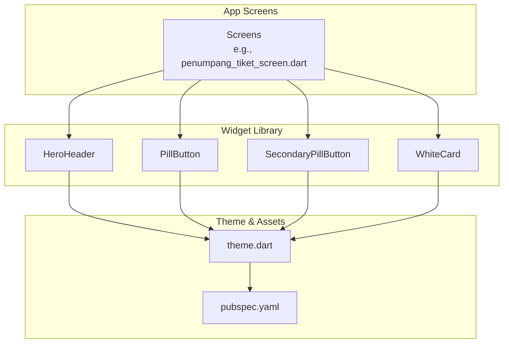
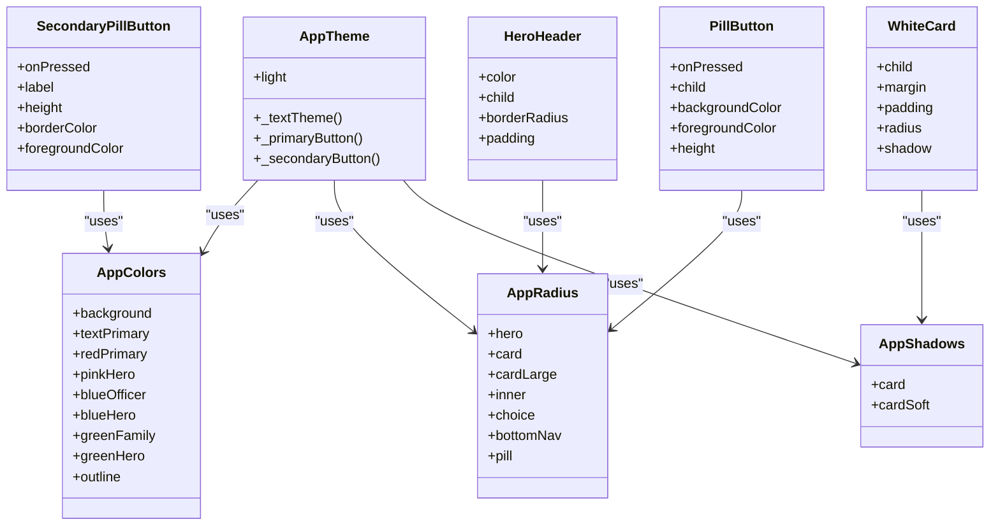
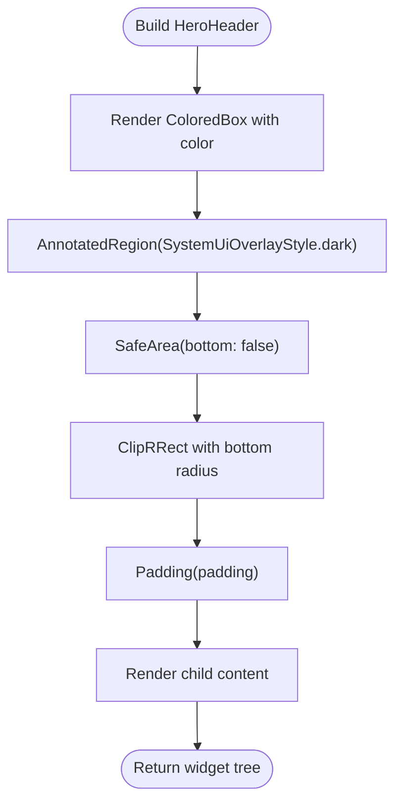
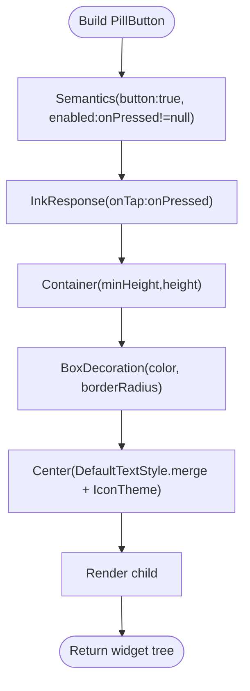
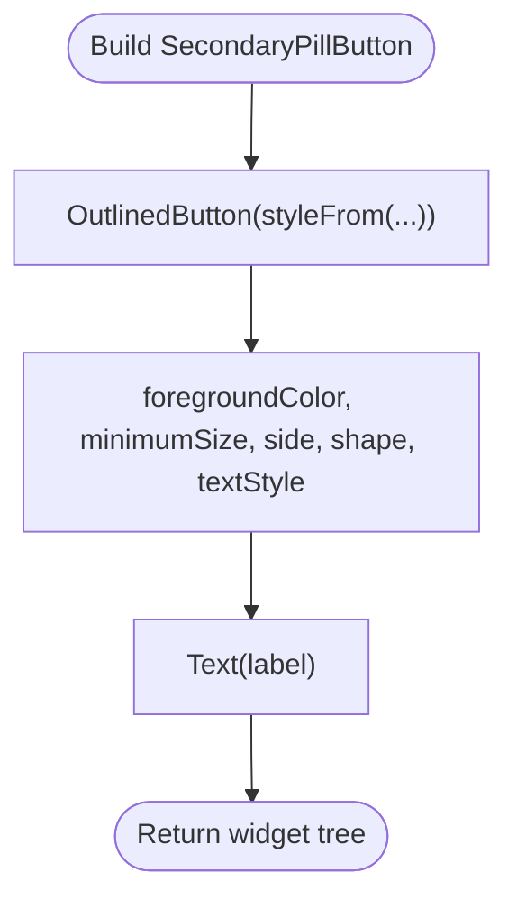
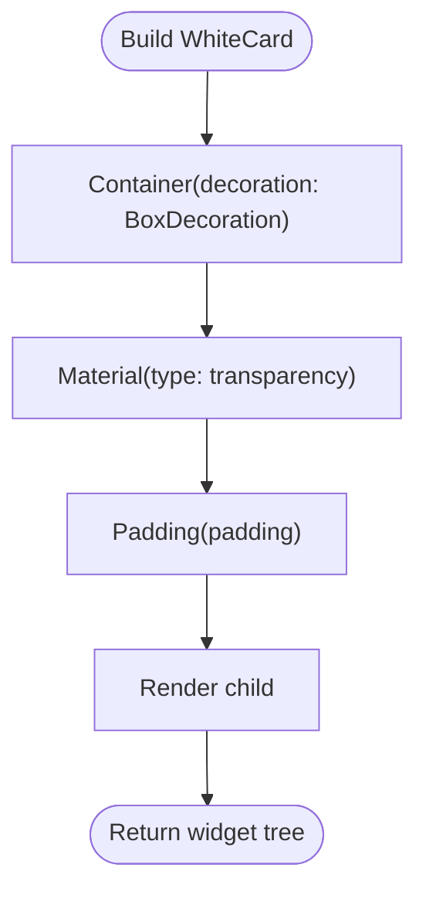
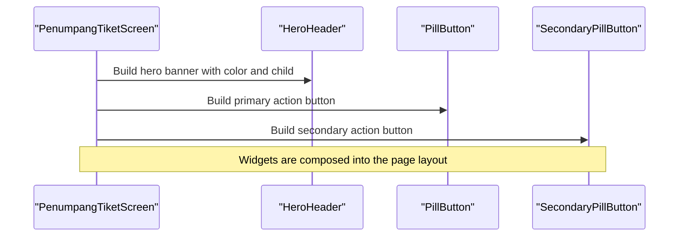
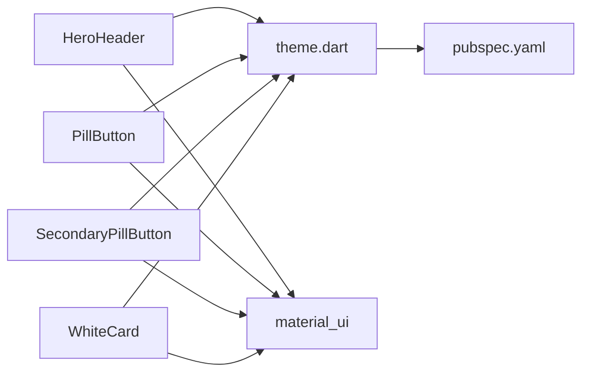

# Widget Library

<cite>
**Referenced Files in This Document**
- [hero_header.dart](file://whoosh_ramah/lib/widgets/hero_header.dart)
- [pill_button.dart](file://whoosh_ramah/lib/widgets/pill_button.dart)
- [secondary_pill_button.dart](file://whoosh_ramah/lib/widgets/secondary_pill_button.dart)
- [white_card.dart](file://whoosh_ramah/lib/widgets/white_card.dart)
- [theme.dart](file://whoosh_ramah/lib/theme.dart)
- [pubspec.yaml](file://whoosh_ramah/pubspec.yaml)
- [penumpang_tiket_screen.dart](file://whoosh_ramah/lib/screens/penumpang_tiket_screen.dart)
</cite>

## Table of Contents
1. [Introduction](#introduction)
2. [Project Structure](#project-structure)
3. [Core Components](#core-components)
4. [Architecture Overview](#architecture-overview)
5. [Detailed Component Analysis](#detailed-component-analysis)
6. [Dependency Analysis](#dependency-analysis)
7. [Performance Considerations](#performance-considerations)
8. [Troubleshooting Guide](#troubleshooting-guide)
9. [Conclusion](#conclusion)
10. [Appendices](#appendices)

## Introduction
This document describes the reusable widget library for the Whoosh Ramah Flutter application. It focuses on:
- Hero header component with customization options, styling variants, and responsive behavior.
- Pill button components including primary and secondary variants, accessibility features, and interaction states.
- Component composition patterns, prop interfaces, and styling customization options.
- Theming integration using the shared theme configuration.
- Design system principles, consistency guidelines, and extension patterns for new custom components.
- Testing strategies for UI components and performance optimization techniques.

The widgets are built on Material 3 via the material_ui package and follow a consistent design language defined in the shared theme.

## Project Structure
The widget library lives under `lib/widgets` and is consumed by screens under `lib/screens`. The shared design tokens (colors, radii, shadows, typography, and button styles) live in `lib/theme.dart`, while fonts are bundled through `pubspec.yaml`.

**Diagram sources**
- [hero_header.dart:1-44](file://whoosh_ramah/lib/widgets/hero_header.dart#L1-L44)
- [pill_button.dart:1-59](file://whoosh_ramah/lib/widgets/pill_button.dart#L1-L59)
- [secondary_pill_button.dart:1-40](file://whoosh_ramah/lib/widgets/secondary_pill_button.dart#L1-L40)
- [white_card.dart:1-45](file://whoosh_ramah/lib/widgets/white_card.dart#L1-L45)
- [theme.dart:1-164](file://whoosh_ramah/lib/theme.dart#L1-L164)
- [pubspec.yaml:57-76](file://whoosh_ramah/pubspec.yaml#L57-L76)

**Section sources**
- [hero_header.dart:1-44](file://whoosh_ramah/lib/widgets/hero_header.dart#L1-L44)
- [pill_button.dart:1-59](file://whoosh_ramah/lib/widgets/pill_button.dart#L1-L59)
- [secondary_pill_button.dart:1-40](file://whoosh_ramah/lib/widgets/secondary_pill_button.dart#L1-L40)
- [white_card.dart:1-45](file://whoosh_ramah/lib/widgets/white_card.dart#L1-L45)
- [theme.dart:1-164](file://whoosh_ramah/lib/theme.dart#L1-L164)
- [pubspec.yaml:57-76](file://whoosh_ramah/pubspec.yaml#L57-L76)

## Core Components
This section summarizes the key reusable widgets and their responsibilities.

- HeroHeader: A colored hero banner with rounded bottom corners, safe area handling, and status bar overlay control.
- PillButton: A primary pill-shaped button with high contrast text, semantic merging, and disabled state styling.
- SecondaryPillButton: An outlined pill-shaped button using OutlinedButton for built-in accessibility and styling.
- WhiteCard: A white card with configurable radius and shadow, designed to overlap the hero header when used with negative translation at the screen level.

These components share theming from `theme.dart` and are composed in screens such as `penumpang_tiket_screen.dart`.

**Section sources**
- [hero_header.dart:1-44](file://whoosh_ramah/lib/widgets/hero_header.dart#L1-L44)
- [pill_button.dart:1-59](file://whoosh_ramah/lib/widgets/pill_button.dart#L1-L59)
- [secondary_pill_button.dart:1-40](file://whoosh_ramah/lib/widgets/secondary_pill_button.dart#L1-L40)
- [white_card.dart:1-45](file://whoosh_ramah/lib/widgets/white_card.dart#L1-L45)
- [penumpang_tiket_screen.dart:170-220](file://whoosh_ramah/lib/screens/penumpang_tiket_screen.dart#L170-L220)

## Architecture Overview
The widget library follows a layered approach:
- Theme layer defines colors, radii, shadows, typography, and default button styles.
- Widget layer provides reusable UI primitives that consume theme tokens.
- Screen layer composes widgets into full pages and handles navigation and business logic.

**Diagram sources**
- [theme.dart:7-164](file://whoosh_ramah/lib/theme.dart#L7-L164)
- [hero_header.dart:1-44](file://whoosh_ramah/lib/widgets/hero_header.dart#L1-L44)
- [pill_button.dart:1-59](file://whoosh_ramah/lib/widgets/pill_button.dart#L1-L59)
- [secondary_pill_button.dart:1-40](file://whoosh_ramah/lib/widgets/secondary_pill_button.dart#L1-L40)
- [white_card.dart:1-45](file://whoosh_ramah/lib/widgets/white_card.dart#L1-L45)

## Detailed Component Analysis

### HeroHeader
HeroHeader renders a colored banner with rounded bottom corners and ensures content respects safe areas. It also sets dark status bar icons for light backgrounds.

Key behaviors:
- Extends to the status bar area; background color fills behind the status bar.
- Uses SafeArea to protect content from system insets.
- Applies a vertical bottom border radius for a smooth transition to the page content.
- Sets SystemUiOverlayStyle to dark for readability over light hero colors.

Customization options:
- color: Background color for the hero region.
- child: Content placed inside the hero.
- borderRadius: Bottom corner radius (default aligns with design guidance).
- padding: Internal spacing around the child content.

Responsive behavior:
- SafeArea adapts to device notches and system bars.
- Padding and radius remain consistent across devices; content should be flexible to fit varying widths.

Accessibility considerations:
- Status bar visibility is improved by setting dark overlay style for light backgrounds.
- Ensure child content remains readable against the chosen color.

Usage pattern:
- Typically paired with a WhiteCard below it, often overlapping via negative translation at the screen level.

**Diagram sources**
- [hero_header.dart:27-42](file://whoosh_ramah/lib/widgets/hero_header.dart#L27-L42)

Prop interface summary:
- color: Color
- child: Widget
- borderRadius: double (default value set in constructor)
- padding: EdgeInsetsGeometry (default value set in constructor)

Styling notes:
- Uses AppRadius.pill indirectly via design guidance comments; actual radius is controlled by borderRadius parameter.
- Status bar icon color is forced to dark for light backgrounds.

**Section sources**
- [hero_header.dart:1-44](file://whoosh_ramah/lib/widgets/hero_header.dart#L1-L44)

### PillButton
PillButton is the primary action button with a pill shape, bold text, and semantic merging for accessibility.

Key behaviors:
- Wraps content in MergeSemantics and Semantics(button: true) so the entire hit area is announced as a single button.
- Provides InkResponse for ripple feedback.
- Disables interaction visually and functionally when onPressed is null.
- Ensures minimum height for comfortable touch targets.

Customization options:
- onPressed: VoidCallback? (required)
- child: Widget (required), typically Text or Row with icon+text
- backgroundColor: Color (default uses theme red)
- foregroundColor: Color (default white)
- height: double (default aligns with design guidance)

Accessibility features:
- Semantics marking makes the whole button accessible.
- Disabled state reduces opacity to indicate non-interactivity.
- Icon and text inherit foreground color for consistent contrast.

Interaction states:
- Enabled: Full color and interactive.
- Disabled: Reduced opacity background; no tap response.

**Diagram sources**
- [pill_button.dart:27-56](file://whoosh_ramah/lib/widgets/pill_button.dart#L27-L56)

Prop interface summary:
- onPressed: VoidCallback?
- child: Widget
- backgroundColor: Color (default theme red)
- foregroundColor: Color (default white)
- height: double (default aligns with design guidance)

Styling notes:
- Uses AppRadius.pill for pill shape.
- Default text size and weight match design guidance.
- Icon size is explicitly set to maintain visual balance.

**Section sources**
- [pill_button.dart:1-59](file://whoosh_ramah/lib/widgets/pill_button.dart#L1-L59)

### SecondaryPillButton
SecondaryPillButton is an outlined pill-shaped button leveraging OutlinedButton for built-in accessibility and styling.

Key behaviors:
- Uses OutlinedButton.styleFrom to define appearance.
- Enforces stadium shape and consistent text style.
- Minimum height ensures adequate touch target size.

Customization options:
- onPressed: VoidCallback? (required)
- label: String (required)
- height: double (default aligns with design guidance)
- borderColor: Color (default outline color from theme)
- foregroundColor: Color (default textPrimary from theme)

Accessibility features:
- Built-in semantics from OutlinedButton provide label and enabled/disabled states automatically.

Interaction states:
- Enabled: Interactive with visible outline and text.
- Disabled: Automatically handled by OutlinedButton.

**Diagram sources**
- [secondary_pill_button.dart:26-37](file://whoosh_ramah/lib/widgets/secondary_pill_button.dart#L26-L37)

Prop interface summary:
- onPressed: VoidCallback?
- label: String
- height: double
- borderColor: Color
- foregroundColor: Color

Styling notes:
- Uses StadiumBorder for pill shape.
- Border width and color come from theme.
- Text style matches design guidance.

**Section sources**
- [secondary_pill_button.dart:1-40](file://whoosh_ramah/lib/widgets/secondary_pill_button.dart#L1-L40)

### WhiteCard
WhiteCard provides a white container with configurable radius and shadow, intended to overlap the hero header when used with negative translation at the screen level.

Key behaviors:
- Renders a white background with rounded corners and shadow.
- Wraps content in Material with transparency to support ink effects without overriding container decoration.

Customization options:
- child: Widget (required)
- margin: EdgeInsetsGeometry? (optional)
- padding: EdgeInsetsGeometry (default internal spacing)
- radius: double (default large card radius)
- shadow: List<BoxShadow> (default card shadow from theme)

Composition pattern:
- Place below HeroHeader and shift upward using Transform.translate at the screen level to achieve negative margin effect.

**Diagram sources**
- [white_card.dart:28-42](file://whoosh_ramah/lib/widgets/white_card.dart#L28-L42)

Prop interface summary:
- child: Widget
- margin: EdgeInsetsGeometry?
- padding: EdgeInsetsGeometry
- radius: double
- shadow: List<BoxShadow>

Styling notes:
- Uses AppShadows.card by default.
- Radius defaults to AppRadius.cardLarge.

**Section sources**
- [white_card.dart:1-45](file://whoosh_ramah/lib/widgets/white_card.dart#L1-L45)

### Usage Examples in Screens
Screens compose these widgets to build user-facing pages. For example, the ticket screen uses HeroHeader for the top banner and both PillButton and SecondaryPillButton for actions.

**Diagram sources**
- [penumpang_tiket_screen.dart:170-220](file://whoosh_ramah/lib/screens/penumpang_tiket_screen.dart#L170-L220)
- [hero_header.dart:1-44](file://whoosh_ramah/lib/widgets/hero_header.dart#L1-L44)
- [pill_button.dart:1-59](file://whoosh_ramah/lib/widgets/pill_button.dart#L1-L59)
- [secondary_pill_button.dart:1-40](file://whoosh_ramah/lib/widgets/secondary_pill_button.dart#L1-L40)

**Section sources**
- [penumpang_tiket_screen.dart:170-220](file://whoosh_ramah/lib/screens/penumpang_tiket_screen.dart#L170-L220)

## Dependency Analysis
The widget library depends on:
- material_ui for Material 3 components and utilities.
- theme.dart for design tokens and default styles.
- pubspec.yaml for font assets and dependencies.

**Diagram sources**
- [hero_header.dart:1-44](file://whoosh_ramah/lib/widgets/hero_header.dart#L1-L44)
- [pill_button.dart:1-59](file://whoosh_ramah/lib/widgets/pill_button.dart#L1-L59)
- [secondary_pill_button.dart:1-40](file://whoosh_ramah/lib/widgets/secondary_pill_button.dart#L1-L40)
- [white_card.dart:1-45](file://whoosh_ramah/lib/widgets/white_card.dart#L1-L45)
- [theme.dart:1-164](file://whoosh_ramah/lib/theme.dart#L1-L164)
- [pubspec.yaml:30-34](file://whoosh_ramah/pubspec.yaml#L30-L34)

**Section sources**
- [theme.dart:1-164](file://whoosh_ramah/lib/theme.dart#L1-L164)
- [pubspec.yaml:30-34](file://whoosh_ramah/pubspec.yaml#L30-L34)

## Performance Considerations
- Prefer const constructors where possible to reduce rebuild overhead.
- Avoid heavy computations inside build methods; lift logic to higher layers or use state management.
- Use efficient layouts: constrain heights and avoid unnecessary nested containers.
- Keep semantic trees minimal; only add semantics where necessary for accessibility.
- Reuse theme tokens instead of hardcoding colors and sizes to prevent redundant style calculations.

[No sources needed since this section provides general guidance]

## Troubleshooting Guide
Common issues and resolutions:
- Hero header overlaps status bar incorrectly:
  - Ensure SafeArea is used and AnnotatedRegion sets appropriate SystemUiOverlayStyle for light backgrounds.
- Button not responding to taps:
  - Verify onPressed is provided and not null; check disabled state styling.
- Accessibility labels missing:
  - For PillButton, ensure MergeSemantics wraps content so the entire button is announced.
  - For SecondaryPillButton, rely on OutlinedButton’s built-in semantics.
- Card does not overlap hero as expected:
  - Apply negative translation at the screen level rather than negative margins inside the card.

**Section sources**
- [hero_header.dart:27-42](file://whoosh_ramah/lib/widgets/hero_header.dart#L27-L42)
- [pill_button.dart:27-56](file://whoosh_ramah/lib/widgets/pill_button.dart#L27-L56)
- [secondary_pill_button.dart:26-37](file://whoosh_ramah/lib/widgets/secondary_pill_button.dart#L26-L37)
- [white_card.dart:28-42](file://whoosh_ramah/lib/widgets/white_card.dart#L28-L42)

## Conclusion
The widget library provides a cohesive set of reusable components aligned with the app’s design system. HeroHeader establishes strong visual hierarchy, while PillButton and SecondaryPillButton offer clear, accessible actions. WhiteCard supports layered compositions with the hero. By centralizing design tokens in theme.dart and following consistent composition patterns, developers can extend the library with new components that integrate seamlessly.

[No sources needed since this section summarizes without analyzing specific files]

## Appendices

### Design System Principles
- Colors: Role-based naming (e.g., redPrimary for passenger, blueOfficer for officer, greenFamily for family/success).
- Radii: Consistent rounding for headers, cards, and buttons.
- Shadows: Soft elevation for cards to create depth.
- Typography: Nunito font family with specified weights and sizes for headings, body, and labels.
- Buttons: Primary and secondary styles with pill shapes and accessible touch targets.

**Section sources**
- [theme.dart:7-164](file://whoosh_ramah/lib/theme.dart#L7-L164)
- [pubspec.yaml:57-76](file://whoosh_ramah/pubspec.yaml#L57-L76)

### Extension Patterns for New Custom Components
- Define props with clear required and optional parameters.
- Consume theme tokens (colors, radii, shadows, typography) instead of hardcoding values.
- Provide accessibility semantics for interactive elements.
- Compose existing widgets (HeroHeader, PillButton, SecondaryPillButton, WhiteCard) to maintain consistency.
- Add unit tests for rendering and interactions.

[No sources needed since this section provides general guidance]

### Testing Strategies for UI Components
- Render tests: Assert presence of key widgets and correct styling.
- Interaction tests: Simulate taps and verify callbacks or state changes.
- Accessibility tests: Validate semantics labels and enabled/disabled states.
- Visual regression: Compare screenshots across platforms if needed.

[No sources needed since this section provides general guidance]