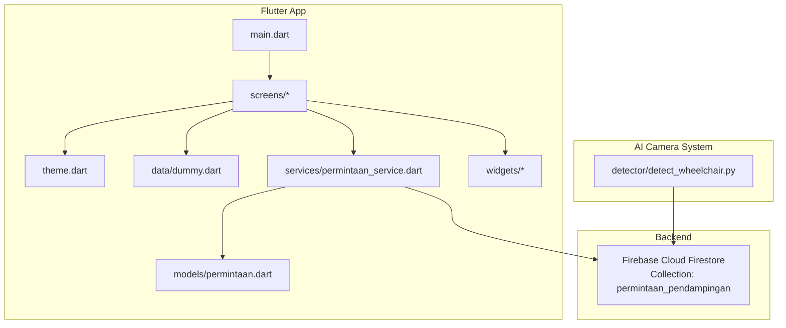
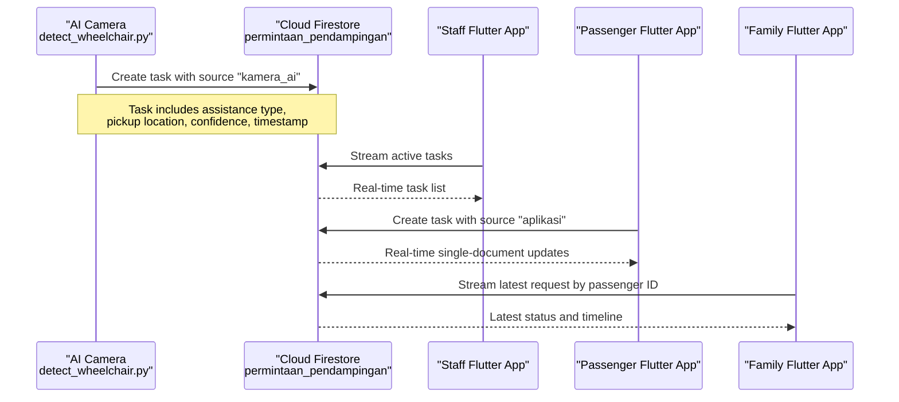
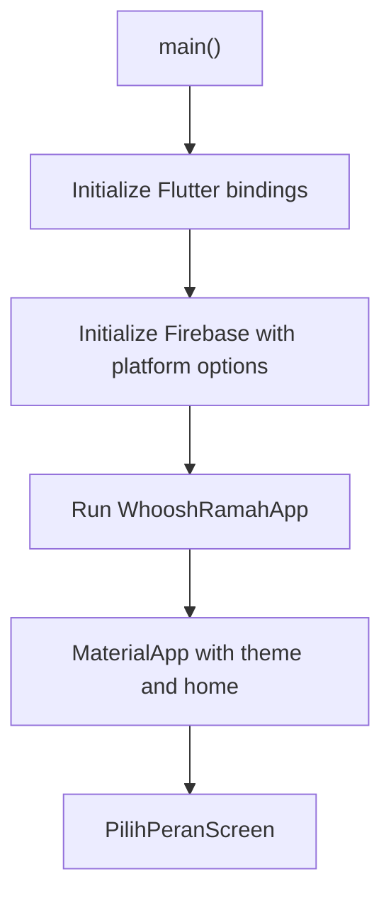
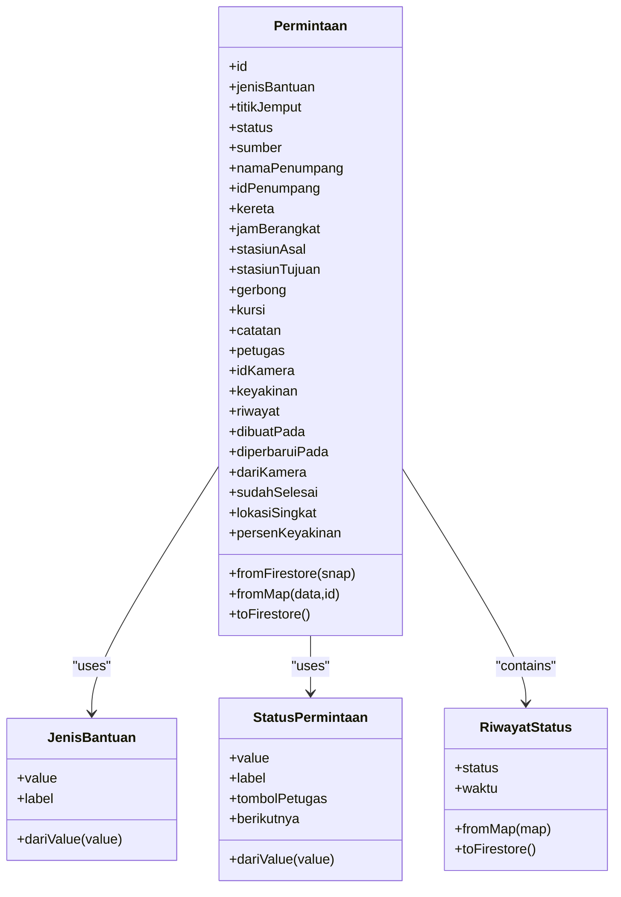
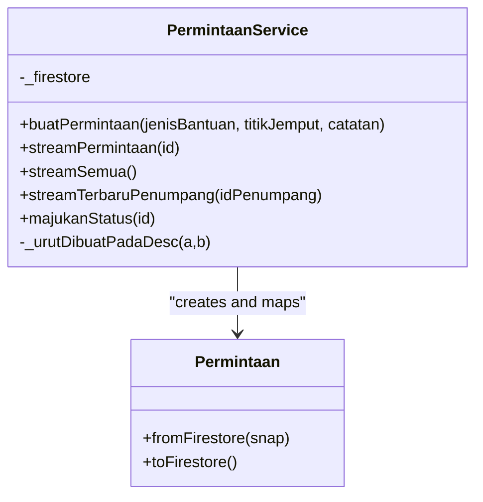
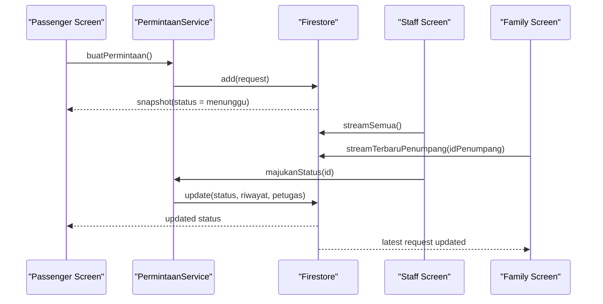
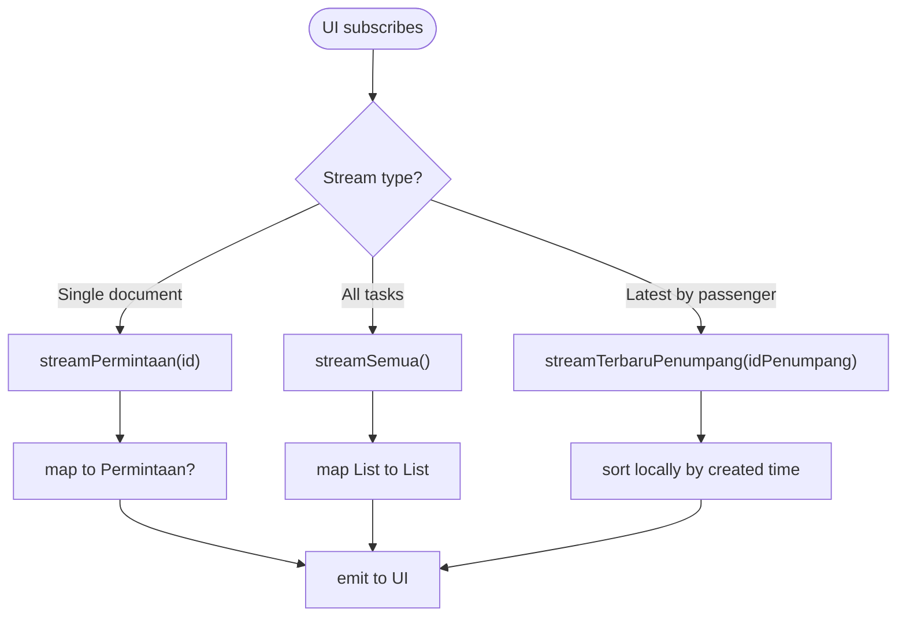
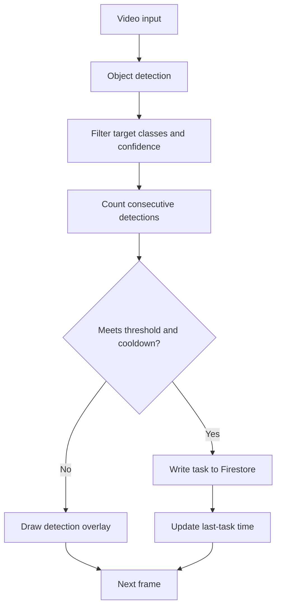
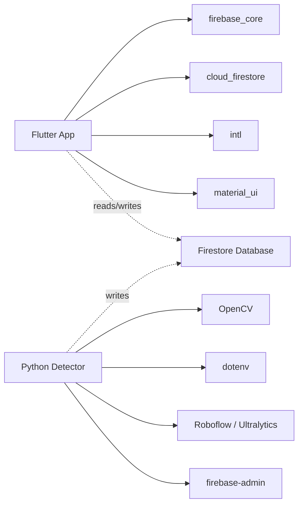

# System Architecture

<cite>
**Referenced Files in This Document**
- [PROJECT.md](file://PROJECT.md)
- [whoosh_ramah/README.md](file://whoosh_ramah/README.md)
- [detector/README.md](file://detector/README.md)
- [whoosh_ramah/lib/main.dart](file://whoosh_ramah/lib/main.dart)
- [whoosh_ramah/lib/theme.dart](file://whoosh_ramah/lib/theme.dart)
- [whoosh_ramah/lib/data/dummy.dart](file://whoosh_ramah/lib/data/dummy.dart)
- [whoosh_ramah/lib/models/permintaan.dart](file://whoosh_ramah/lib/models/permintaan.dart)
- [whoosh_ramah/lib/services/permintaan_service.dart](file://whoosh_ramah/lib/services/permintaan_service.dart)
- [whoosh_ramah/lib/screens/pilih_peran_screen.dart](file://whoosh_ramah/lib/screens/pilih_peran_screen.dart)
- [whoosh_ramah/lib/screens/penumpang_tiket_screen.dart](file://whoosh_ramah/lib/screens/penumpang_tiket_screen.dart)
- [whoosh_ramah/lib/screens/penumpang_pesan_screen.dart](file://whoosh_ramah/lib/screens/penumpang_pesan_screen.dart)
- [whoosh_ramah/lib/screens/penumpang_status_screen.dart](file://whoosh_ramah/lib/screens/penumpang_status_screen.dart)
- [whoosh_ramah/lib/screens/petugas_tugas_screen.dart](file://whoosh_ramah/lib/screens/petugas_tugas_screen.dart)
- [whoosh_ramah/lib/screens/petugas_detail_screen.dart](file://whoosh_ramah/lib/screens/petugas_detail_screen.dart)
- [whoosh_ramah/lib/screens/keluarga_pantau_screen.dart](file://whoosh_ramah/lib/screens/keluarga_pantau_screen.dart)
- [whoosh_ramah/lib/widgets/bottom_nav.dart](file://whoosh_ramah/lib/widgets/bottom_nav.dart)
- [whoosh_ramah/lib/widgets/ganti_peran_pill.dart](file://whoosh_ramah/lib/widgets/ganti_peran_pill.dart)
- [whoosh_ramah/lib/widgets/hero_back_button.dart](file://whoosh_ramah/lib/widgets/hero_back_button.dart)
- [whoosh_ramah/lib/widgets/hero_header.dart](file://whoosh_ramah/lib/widgets/hero_header.dart)
- [whoosh_ramah/lib/widgets/pill_button.dart](file://whoosh_ramah/lib/widgets/pill_button.dart)
- [whoosh_ramah/lib/widgets/secondary_pill_button.dart](file://whoosh_ramah/lib/widgets/secondary_pill_button.dart)
- [whoosh_ramah/pubspec.yaml](file://whoosh_ramah/pubspec.yaml)
- [detector/detect_wheelchair.py](file://detector/detect_wheelchair.py)
</cite>

## Table of Contents
1. [Introduction](#introduction)
2. [Project Structure](#project-structure)
3. [Core Components](#core-components)
4. [Architecture Overview](#architecture-overview)
5. [Detailed Component Analysis](#detailed-component-analysis)
6. [Dependency Analysis](#dependency-analysis)
7. [Performance Considerations](#performance-considerations)
8. [Troubleshooting Guide](#troubleshooting-guide)
9. [Conclusion](#conclusion)
10. [Appendices](#appendices)

## Introduction
Whoosh Ramah is a hackathon prototype that helps priority passengers on the Whoosh high-speed train receive assistance from station staff, coordinates handover to destination stations, and allows family members to monitor progress. The system combines:
- A Flutter mobile application for passengers, staff, and family monitoring.
- Firebase Cloud Firestore as the real-time backend.
- A Python-based AI camera system that automatically detects wheelchair users and creates assistance tasks.

The project’s business goal is to replace manual assistance requests with a digital, real-time workflow while keeping the demo simple enough to run on a few phones and one laptop.

**Section sources**
- [PROJECT.md:8-20](file://PROJECT.md#L8-L20)

## Project Structure
The repository has three main areas:
- `whoosh_ramah/`: Flutter application containing screens, models, services, widgets, theme, and app entry point.
- `detector/`: Python computer vision script that reads video input, runs object detection, and writes tasks to Firestore.
- `design/`: HTML/CSS design references used to guide the visual layout of each screen.

**Diagram sources**
- [whoosh_ramah/lib/main.dart:8-33](file://whoosh_ramah/lib/main.dart#L8-L33)
- [whoosh_ramah/lib/services/permintaan_service.dart:6-21](file://whoosh_ramah/lib/services/permintaan_service.dart#L6-L21)
- [whoosh_ramah/lib/models/permintaan.dart:77-124](file://whoosh_ramah/lib/models/permintaan.dart#L77-L124)
- [detector/detect_wheelchair.py:164-192](file://detector/detect_wheelchair.py#L164-L192)

**Section sources**
- [PROJECT.md:24-37](file://PROJECT.md#L24-L37)
- [PROJECT.md:179-203](file://PROJECT.md#L179-L203)
- [whoosh_ramah/README.md:1-18](file://whoosh_ramah/README.md#L1-L18)

## Core Components
The system is composed of four core layers:

| Layer | Responsibility | Key Files |
|---|---|---|
| Application entry and UI shell | Initializes Firebase, sets theme, and shows role selection | [main.dart](file://whoosh_ramah/lib/main.dart), [theme.dart](file://whoosh_ramah/lib/theme.dart) |
| Domain model | Defines assistance type, status flow, history entries, and the request document model | [permintaan.dart](file://whoosh_ramah/lib/models/permintaan.dart) |
| Data access layer | Encapsulates Firestore operations: create, stream, sort, and advance status | [permintaan_service.dart](file://whoosh_ramah/lib/services/permintaan_service.dart) |
| User roles | Passenger, staff, and family screens consume the service and display real-time data | [penumpang_*_screen.dart](file://whoosh_ramah/lib/screens/penumpang_status_screen.dart), [petugas_*_screen.dart](file://whoosh_ramah/lib/screens/petugas_detail_screen.dart), [keluarga_pantau_screen.dart](file://whoosh_ramah/lib/screens/keluarga_pantau_screen.dart) |

The data model enforces the required Firestore schema, including enums for assistance type and status, null-safe handling for AI-generated documents, and serialization helpers. The service centralizes all Firestore interactions so screens stay focused on presentation logic.

**Section sources**
- [whoosh_ramah/lib/main.dart:8-33](file://whoosh_ramah/lib/main.dart#L8-L33)
- [whoosh_ramah/lib/models/permintaan.dart:7-57](file://whoosh_ramah/lib/models/permintaan.dart#L7-L57)
- [whoosh_ramah/lib/models/permintaan.dart:77-213](file://whoosh_ramah/lib/models/permintaan.dart#L77-L213)
- [whoosh_ramah/lib/services/permintaan_service.dart:6-135](file://whoosh_ramah/lib/services/permintaan_service.dart#L6-L135)

## Architecture Overview
At a high level, Whoosh Ramah follows a client-backend architecture where mobile clients and an external detector both write to or read from Firestore. There is no custom server; Firestore provides real-time streams that keep passenger, staff, and family devices synchronized.

**Diagram sources**
- [detector/detect_wheelchair.py:179-192](file://detector/detect_wheelchair.py#L179-L192)
- [whoosh_ramah/lib/services/permintaan_service.dart:23-60](file://whoosh_ramah/lib/services/permintaan_service.dart#L23-L60)
- [whoosh_ramah/lib/services/permintaan_service.dart:63-90](file://whoosh_ramah/lib/services/permintaan_service.dart#L63-L90)
- [PROJECT.md:24-37](file://PROJECT.md#L24-L37)

### System Boundaries
- **In scope**: Flutter app, Firestore database, Python detector, design references, dummy data, and hackathon deployment topology.
- **Out of scope**: Real authentication, KCIC ticket integration, payment, automatic staff scheduling, push notifications, and facial photo storage.

**Section sources**
- [PROJECT.md:18-20](file://PROJECT.md#L18-L20)
- [PROJECT.md:97-108](file://PROJECT.md#L97-L108)

### Technology Stack Decisions
- **Flutter**: Cross-platform mobile UI for Android and iOS, enabling one codebase for passengers, staff, and family roles.
- **Firebase Cloud Firestore**: Real-time, serverless backend suitable for hackathon demos without managing infrastructure.
- **Python + YOLO / Roboflow**: Computer vision pipeline for detecting wheelchair users and writing tasks directly to Firestore.

**Section sources**
- [PROJECT.md:24-37](file://PROJECT.md#L24-L37)
- [whoosh_ramah/pubspec.yaml:30-40](file://whoosh_ramah/pubspec.yaml#L30-L40)
- [detector/README.md:10-61](file://detector/README.md#L10-L61)

## Detailed Component Analysis

### Flutter Application Entry Point
The app initializes Flutter bindings, configures Firebase using generated platform options, applies the light theme, and starts with the role-selection screen. This keeps setup separate from routing and presentation logic.

**Diagram sources**
- [whoosh_ramah/lib/main.dart:8-33](file://whoosh_ramah/lib/main.dart#L8-L33)

**Section sources**
- [whoosh_ramah/lib/main.dart:8-33](file://whoosh_ramah/lib/main.dart#L8-L33)

### Domain Model: Assistance Request
The domain model defines:
- `JenisBantuan`: assistance types stored as Firestore strings but exposed as typed Dart enums.
- `StatusPermintaan`: the mandatory five-step workflow from waiting through completion.
- `RiwayatStatus`: history entries tracking status changes and timestamps.
- `Permintaan`: the full request document, including nullable fields for AI-generated tasks and passenger-provided details.

**Diagram sources**
- [whoosh_ramah/lib/models/permintaan.dart:7-57](file://whoosh_ramah/lib/models/permintaan.dart#L7-L57)
- [whoosh_ramah/lib/models/permintaan.dart:59-75](file://whoosh_ramah/lib/models/permintaan.dart#L59-L75)
- [whoosh_ramah/lib/models/permintaan.dart:77-213](file://whoosh_ramah/lib/models/permintaan.dart#L77-L213)

**Section sources**
- [whoosh_ramah/lib/models/permintaan.dart:7-213](file://whoosh_ramah/lib/models/permintaan.dart#L7-L213)

### Repository Pattern in Service Layer
`PermintaanService` acts as the repository for the `permintaan_pendampingan` collection. It encapsulates:
- Creating new requests from passenger input.
- Streaming a single request for passenger status.
- Streaming all active tasks for staff.
- Streaming the latest request per passenger for family monitoring.
- Advancing the status with history tracking and staff assignment.

**Diagram sources**
- [whoosh_ramah/lib/services/permintaan_service.dart:6-135](file://whoosh_ramah/lib/services/permintaan_service.dart#L6-L135)
- [whoosh_ramah/lib/models/permintaan.dart:77-213](file://whoosh_ramah/lib/models/permintaan.dart#L77-L213)

**Section sources**
- [whoosh_ramah/lib/services/permintaan_service.dart:6-135](file://whoosh_ramah/lib/services/permintaan_service.dart#L6-L135)

### Real-Time Data Flow Between Roles
The real-time behavior is driven by Firestore streams:
- **Passenger device**: Creates a request and listens to its own document for live status updates.
- **Staff device**: Streams all active tasks, sorted by creation time, and advances status through a detail screen.
- **Family device**: Streams the latest request associated with a specific passenger ID.

**Diagram sources**
- [whoosh_ramah/lib/services/permintaan_service.dart:23-60](file://whoosh_ramah/lib/services/permintaan_service.dart#L23-L60)
- [whoosh_ramah/lib/services/permintaan_service.dart:63-119](file://whoosh_ramah/lib/services/permintaan_service.dart#L63-L119)

**Section sources**
- [PROJECT.md:121-135](file://PROJECT.md#L121-L135)
- [whoosh_ramah/lib/services/permintaan_service.dart:63-119](file://whoosh_ramah/lib/services/permintaan_service.dart#L63-L119)

### MVVM Pattern Implementation in Flutter
Although the current codebase uses Flutter widgets rather than explicit ViewModel classes, the separation of concerns aligns with MVVM principles:
- **Model**: `Permintaan`, `JenisBantuan`, `StatusPermintaan`, `RiwayatStatus`.
- **View**: Screen files such as `penumpang_status_screen.dart`, `petugas_tugas_screen.dart`, and `keluarga_pantau_screen.dart`.
- **ViewModel-like layer**: `PermintaanService` holds state-independent data access and exposes streams and commands.

This approach keeps UI components focused on rendering and user interaction while delegating data synchronization to the service.

**Section sources**
- [whoosh_ramah/lib/models/permintaan.dart:77-213](file://whoosh_ramah/lib/models/permintaan.dart#L77-L213)
- [whoosh_ramah/lib/services/permintaan_service.dart:6-135](file://whoosh_ramah/lib/services/permintaan_service.dart#L6-L135)
- [whoosh_ramah/lib/screens/penumpang_status_screen.dart](file://whoosh_ramah/lib/screens/penumpang_status_screen.dart)
- [whoosh_ramah/lib/screens/petugas_tugas_screen.dart](file://whoosh_ramah/lib/screens/petugas_tugas_screen.dart)
- [whoosh_ramah/lib/screens/keluarga_pantau_screen.dart](file://whoosh_ramah/lib/screens/keluarga_pantau_screen.dart)

### Stream-Based Architecture for Real-Time Updates
The service uses Firestore snapshots to provide reactive updates:
- Single-document stream for passenger status.
- Collection stream for staff task lists.
- Filtered stream by passenger ID for family monitoring.

**Diagram sources**
- [whoosh_ramah/lib/services/permintaan_service.dart:63-90](file://whoosh_ramah/lib/services/permintaan_service.dart#L63-L90)
- [whoosh_ramah/lib/services/permintaan_service.dart:121-134](file://whoosh_ramah/lib/services/permintaan_service.dart#L121-L134)

**Section sources**
- [whoosh_ramah/lib/services/permintaan_service.dart:63-135](file://whoosh_ramah/lib/services/permintaan_service.dart#L63-L135)

### AI Camera Detection and Firestore Integration
The Python detector:
- Reads video input from webcam, file, or RTSP.
- Supports multiple model backends: Roboflow cloud model, local YOLO model, and YOLO-World.
- Applies confidence thresholds, consecutive-frame validation, and cooldowns to avoid duplicate tasks.
- Writes tasks to Firestore with `sumber = "kamera_ai"` and minimal passenger information.

**Diagram sources**
- [detector/detect_wheelchair.py:214-291](file://detector/detect_wheelchair.py#L214-L291)
- [detector/detect_wheelchair.py:164-192](file://detector/detect_wheelchair.py#L164-L192)

**Section sources**
- [detector/README.md:1-61](file://detector/README.md#L1-L61)
- [detector/detect_wheelchair.py:30-68](file://detector/detect_wheelchair.py#L30-L68)
- [detector/detect_wheelchair.py:73-158](file://detector/detect_wheelchair.py#L73-L158)
- [detector/detect_wheelchair.py:164-291](file://detector/detect_wheelchair.py#L164-L291)

### UI Screens and Widgets
Screens implement role-specific flows:
- Role selection: chooses between passenger, staff, and family modes.
- Passenger ticket and request screens: show dummy ticket data and submit assistance requests.
- Passenger status screen: displays real-time status timeline.
- Staff task list and detail screens: manage active tasks and advance status.
- Family monitoring screen: tracks the latest request for a known passenger.

Widgets provide reusable UI primitives such as hero headers, pill buttons, bottom navigation, and role-switching controls.

**Section sources**
- [whoosh_ramah/lib/screens/pilih_peran_screen.dart](file://whoosh_ramah/lib/screens/pilih_peran_screen.dart)
- [whoosh_ramah/lib/screens/penumpang_tiket_screen.dart](file://whoosh_ramah/lib/screens/penumpang_tiket_screen.dart)
- [whoosh_ramah/lib/screens/penumpang_pesan_screen.dart](file://whoosh_ramah/lib/screens/penumpang_pesan_screen.dart)
- [whoosh_ramah/lib/screens/penumpang_status_screen.dart](file://whoosh_ramah/lib/screens/penumpang_status_screen.dart)
- [whoosh_ramah/lib/screens/petugas_tugas_screen.dart](file://whoosh_ramah/lib/screens/petugas_tugas_screen.dart)
- [whoosh_ramah/lib/screens/petugas_detail_screen.dart](file://whoosh_ramah/lib/screens/petugas_detail_screen.dart)
- [whoosh_ramah/lib/screens/keluarga_pantau_screen.dart](file://whoosh_ramah/lib/screens/keluarga_pantau_screen.dart)
- [whoosh_ramah/lib/widgets/bottom_nav.dart](file://whoosh_ramah/lib/widgets/bottom_nav.dart)
- [whoosh_ramah/lib/widgets/ganti_peran_pill.dart](file://whoosh_ramah/lib/widgets/ganti_peran_pill.dart)
- [whoosh_ramah/lib/widgets/hero_back_button.dart](file://whoosh_ramah/lib/widgets/hero_back_button.dart)
- [whoosh_ramah/lib/widgets/hero_header.dart](file://whoosh_ramah/lib/widgets/hero_header.dart)
- [whoosh_ramah/lib/widgets/pill_button.dart](file://whoosh_ramah/lib/widgets/pill_button.dart)
- [whoosh_ramah/lib/widgets/secondary_pill_button.dart](file://whoosh_ramah/lib/widgets/secondary_pill_button.dart)

## Dependency Analysis
The Flutter app depends on Firebase packages for initialization and real-time data access. The detector depends on OpenCV, environment configuration, and either Roboflow or Ultralytics depending on the selected model mode.

**Diagram sources**
- [whoosh_ramah/pubspec.yaml:30-40](file://whoosh_ramah/pubspec.yaml#L30-L40)
- [detector/detect_wheelchair.py:21-28](file://detector/detect_wheelchair.py#L21-L28)
- [detector/detect_wheelchair.py:73-158](file://detector/detect_wheelchair.py#L73-L158)
- [detector/detect_wheelchair.py:164-177](file://detector/detect_wheelchair.py#L164-L177)

**Section sources**
- [whoosh_ramah/pubspec.yaml:30-40](file://whoosh_ramah/pubspec.yaml#L30-L40)
- [detector/detect_wheelchair.py:21-68](file://detector/detect_wheelchair.py#L21-L68)

## Performance Considerations
- **Firestore query simplicity**: The service avoids composite indexes by ordering only on `dibuatPada` and sorting locally when needed. This reduces backend complexity at the cost of client-side sorting.
- **Stream limits**: The staff task stream limits results to 100 documents, which is reasonable for a hackathon demo but may need pagination or partitioning under higher load.
- **AI detection throttling**: The detector uses frame-count thresholds, confidence thresholds, and cooldown intervals to prevent spamming Firestore with duplicate tasks.
- **Network dependency**: Both the Flutter app and the detector depend on internet connectivity for Firestore and optional cloud model inference.

[No sources needed since this section provides general guidance]

## Troubleshooting Guide
Common issues and their likely causes:

| Symptom | Likely Cause | Resolution |
|---|---|---|
| Tasks from AI camera do not appear in staff app | Detector cannot write to Firestore or uses wrong collection name | Verify Firebase service account, collection name, and network connectivity |
| Passenger status does not update | Wrong document ID or stream subscription issue | Confirm the document ID passed to `streamPermintaan` matches the created request |
| Family screen shows no data | Missing or incorrect passenger ID filter | Ensure `idPenumpang` matches the dummy passenger and request was created with that ID |
| AI detector raises missing key error | `.env` or Firebase key file not configured | Set required environment variables and place `firebase-key.json` in the detector folder |
| AI detector reports too many false positives | Confidence threshold too low or model mismatch | Increase `AMBANG_KEYAKINAN`, adjust `FRAME_BERTURUT`, or switch model mode |

**Section sources**
- [PROJECT.md:97-108](file://PROJECT.md#L97-L108)
- [detector/README.md:39-61](file://detector/README.md#L39-L61)
- [detector/detect_wheelchair.py:164-192](file://detector/detect_wheelchair.py#L164-L192)
- [whoosh_ramah/lib/services/permintaan_service.dart:23-119](file://whoosh_ramah/lib/services/permintaan_service.dart#L23-L119)

## Conclusion
Whoosh Ramah demonstrates a practical hackathon architecture: a Flutter mobile app, a serverless real-time database, and an external AI detection system working together through a shared Firestore schema. The design emphasizes clear boundaries, stream-based synchronization, and a repository-style service layer. For production, the system would benefit from stronger authentication, robust indexing, offline support, and scalable deployment patterns for both the mobile app and the AI detection pipeline.

[No sources needed since this section summarizes without analyzing specific files]

## Appendices

### Firestore Schema Summary
The `permintaan_pendampingan` collection stores assistance requests with consistent fields across applications and AI detectors.

| Field | Type | Source | Notes |
|---|---|---|---|
| `jenisBantuan` | string enum | Passenger or AI | Must match detector output |
| `titikJemput` | string | Passenger or AI | Pickup location |
| `status` | string enum | All roles | Mandatory workflow order |
| `sumber` | string | Passenger or AI | `"aplikasi"` or `"kamera_ai"` |
| `namaPenumpang` | string or null | Passenger | Null for AI-generated tasks |
| `idPenumpang` | string or null | Passenger | Used by family monitoring |
| `kereta`, `jamBerangkat`, `stasiunAsal`, `stasiunTujuan`, `gerbong`, `kursi`, `catatan` | string or null | Passenger | Ticket and notes |
| `petugas` | string or null | Staff | Filled when assigned |
| `idKamera`, `keyakinan` | string or number, nullable | AI | Camera identity and confidence |
| `riwayat` | array of maps | All roles | Status change history |
| `dibuatPada`, `diperbaruiPada` | Timestamp | Server | Creation and update times |

**Section sources**
- [PROJECT.md:54-95](file://PROJECT.md#L54-L95)
- [whoosh_ramah/lib/models/permintaan.dart:77-213](file://whoosh_ramah/lib/models/permintaan.dart#L77-L213)
- [detector/detect_wheelchair.py:179-192](file://detector/detect_wheelchair.py#L179-L192)

### Hackathon Deployment Topology
For the demo:
- One laptop runs the Python detector with a webcam or video file.
- Two or three phones run the Flutter app in different roles.
- All devices connect to the same Firebase project and Firestore database.
- Demo rules allow open read/write for simplicity during evaluation.

**Section sources**
- [PROJECT.md:18-20](file://PROJECT.md#L18-L20)
- [PROJECT.md:97-108](file://PROJECT.md#L97-L108)
- [detector/README.md:86-93](file://detector/README.md#L86-L93)