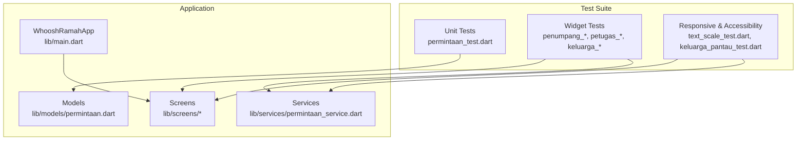
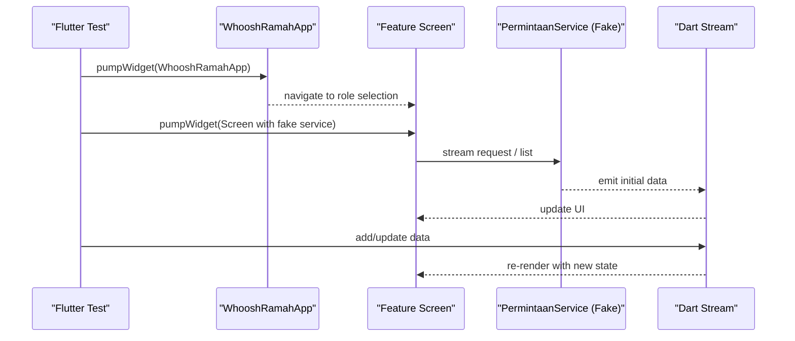
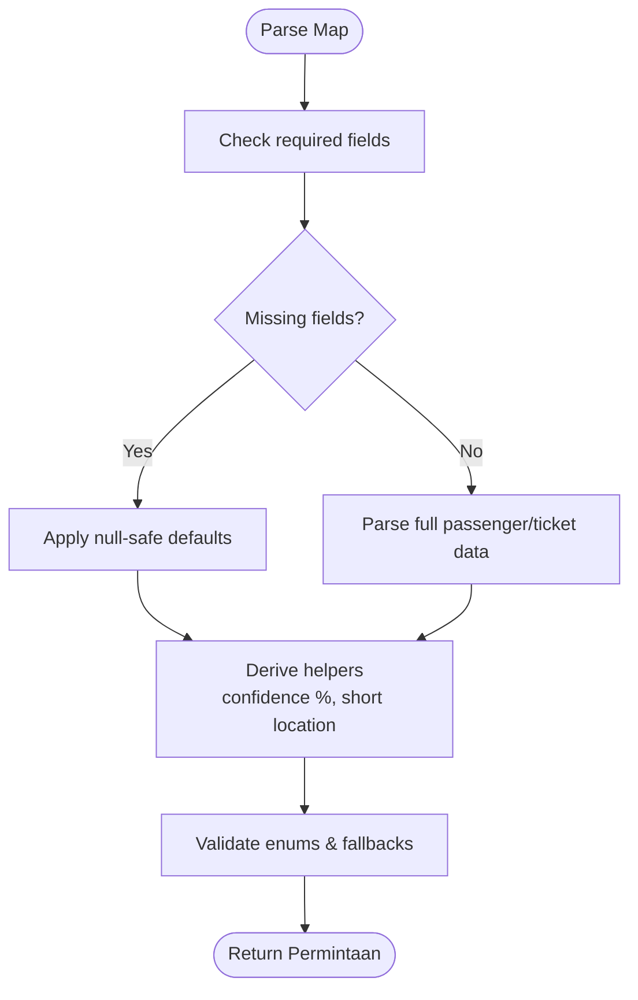
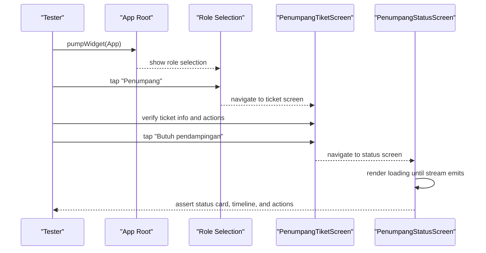
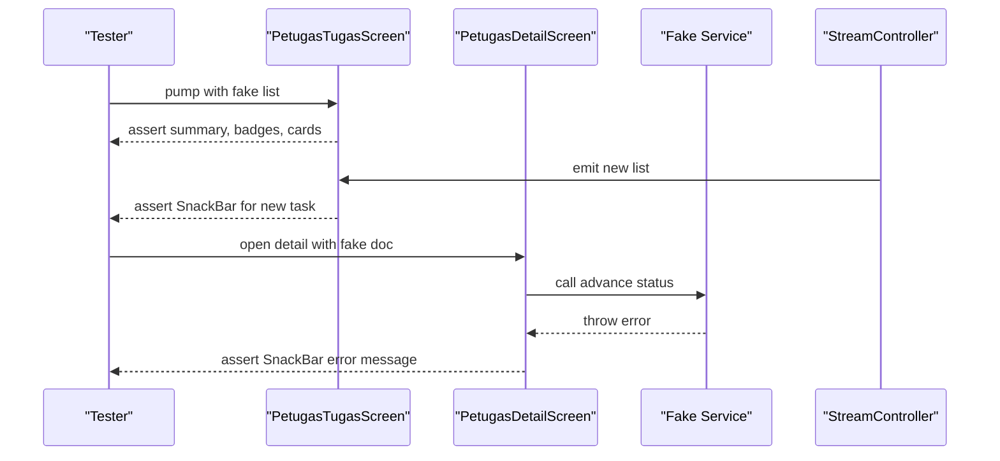
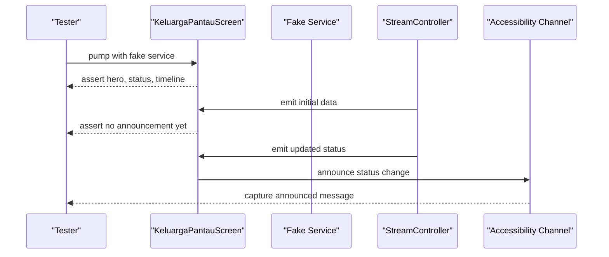
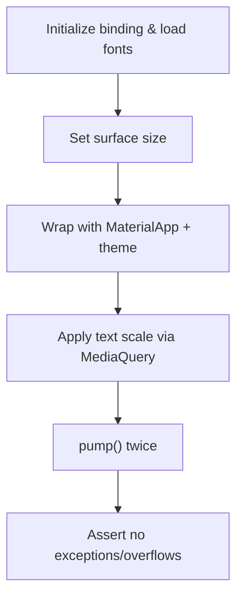
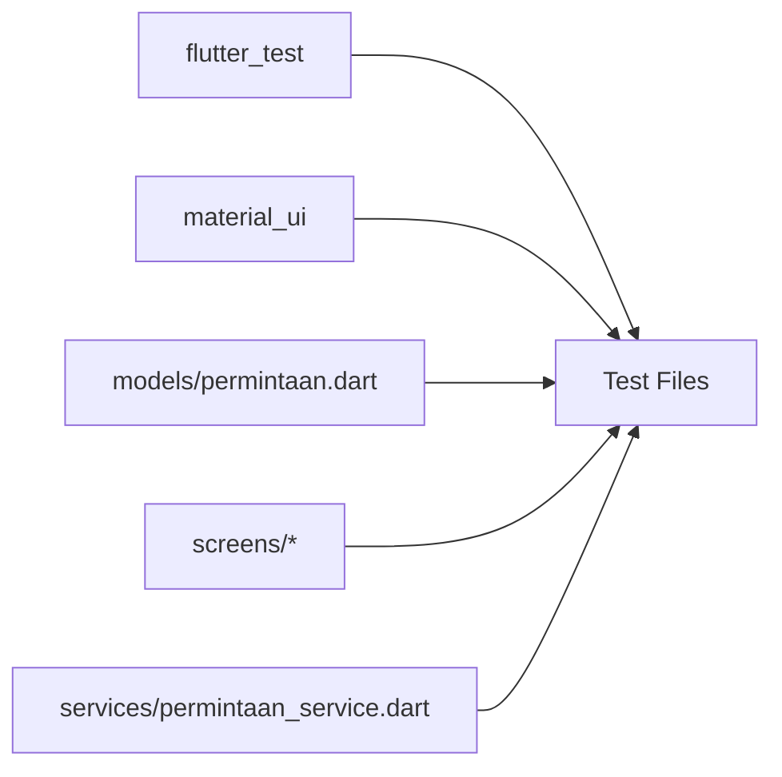

# Testing Strategy

<cite>
**Referenced Files in This Document**
- [pubspec.yaml](file://whoosh_ramah/pubspec.yaml)
- [main.dart](file://whoosh_ramah/lib/main.dart)
- [permintaan_test.dart](file://whoosh_ramah/test/permintaan_test.dart)
- [widget_test.dart](file://whoosh_ramah/test/widget_test.dart)
- [penumpang_tiket_test.dart](file://whoosh_ramah/test/penumpang_tiket_test.dart)
- [penumpang_status_test.dart](file://whoosh_ramah/test/penumpang_status_test.dart)
- [petugas_detail_test.dart](file://whoosh_ramah/test/petugas_detail_test.dart)
- [petugas_tugas_test.dart](file://whoosh_ramah/test/petugas_tugas_test.dart)
- [keluarga_pantau_test.dart](file://whoosh_ramah/test/keluarga_pantau_test.dart)
- [text_scale_test.dart](file://whoosh_ramah/test/text_scale_test.dart)
</cite>

## Table of Contents
1. [Introduction](#introduction)
2. [Project Structure](#project-structure)
3. [Core Components](#core-components)
4. [Architecture Overview](#architecture-overview)
5. [Detailed Component Analysis](#detailed-component-analysis)
6. [Dependency Analysis](#dependency-analysis)
7. [Performance Considerations](#performance-considerations)
8. [Troubleshooting Guide](#troubleshooting-guide)
9. [Conclusion](#conclusion)

## Introduction
This document explains the testing strategy for the Whoosh Ramah Flutter application. It covers unit tests for data models, widget tests for user interfaces, and integration-style tests that exercise real-time data streams while isolating Firebase through service abstractions. The suite uses Flutter’s built-in testing utilities, avoids live network calls during tests, and includes accessibility and responsive layout checks to ensure inclusive and robust behavior across devices and text scales.

## Project Structure
The test suite lives under `whoosh_ramah/test` and mirrors the feature structure of the app:
- Model-level unit tests validate parsing and enum logic.
- Screen-level widget tests verify UI content, navigation, and user interactions.
- Stream-based tests simulate Firestore-like updates using Dart streams.
- Accessibility and text-scale tests ensure screen reader announcements and responsive layouts.

**Diagram sources**
- [main.dart:8-33](file://whoosh_ramah/lib/main.dart#L8-L33)
- [permintaan_test.dart:10-149](file://whoosh_ramah/test/permintaan_test.dart#L10-L149)
- [penumpang_status_test.dart:29-115](file://whoosh_ramah/test/penumpang_status_test.dart#L29-L115)
- [petugas_detail_test.dart:60-161](file://whoosh_ramah/test/petugas_detail_test.dart#L60-L161)
- [petugas_tugas_test.dart:58-135](file://whoosh_ramah/test/petugas_tugas_test.dart#L58-L135)
- [keluarga_pantau_test.dart:48-148](file://whoosh_ramah/test/keluarga_pantau_test.dart#L48-L148)
- [text_scale_test.dart:67-127](file://whoosh_ramah/test/text_scale_test.dart#L67-L127)

**Section sources**
- [pubspec.yaml:42-51](file://whoosh_ramah/pubspec.yaml#L42-L51)
- [main.dart:8-33](file://whoosh_ramah/lib/main.dart#L8-L33)

## Core Components
The testing strategy is organized around three layers:

- Unit tests for models
  - Validate safe parsing from Firestore-like maps.
  - Verify enum conversions, fallbacks, and derived fields.
  - Ensure null safety and deterministic outputs.

- Widget tests for screens
  - Render screens with controlled services.
  - Assert visible labels, cards, timelines, and buttons.
  - Simulate navigation flows between role selection and feature screens.

- Integration-style stream tests
  - Replace Firestore-backed services with fake implementations.
  - Emit static or dynamic streams to drive UI state transitions.
  - Verify loading states, empty states, error feedback, and real-time updates.

Key testing patterns used:
- Fake services implementing the same interface as production services.
- `tester.binding.setSurfaceSize` to emulate device dimensions.
- `MaterialApp` with a stable theme to avoid font/layout drift.
- `StreamController` to simulate Firestore snapshots.
- System channel mocking for accessibility announcements.

**Section sources**
- [permintaan_test.dart:10-149](file://whoosh_ramah/test/permintaan_test.dart#L10-L149)
- [penumpang_status_test.dart:10-40](file://whoosh_ramah/test/penumpang_status_test.dart#L10-L40)
- [petugas_detail_test.dart:8-25](file://whoosh_ramah/test/petugas_detail_test.dart#L8-L25)
- [petugas_tugas_test.dart:10-24](file://whoosh_ramah/test/petugas_tugas_test.dart#L10-L24)
- [keluarga_pantau_test.dart:11-19](file://whoosh_ramah/test/keluarga_pantau_test.dart#L11-L19)

## Architecture Overview
The application initializes Firebase and renders a root app that starts on the role-selection screen. Tests bypass live Firebase by injecting fake services into screens that depend on real-time data.

**Diagram sources**
- [main.dart:8-33](file://whoosh_ramah/lib/main.dart#L8-L33)
- [penumpang_status_test.dart:29-40](file://whoosh_ramah/test/penumpang_status_test.dart#L29-L40)
- [petugas_tugas_test.dart:58-69](file://whoosh_ramah/test/petugas_tugas_test.dart#L58-L69)
- [keluarga_pantau_test.dart:48-62](file://whoosh_ramah/test/keluarga_pantau_test.dart#L48-L62)

## Detailed Component Analysis

### Unit Tests for Models
Model tests focus on `Permintaan.fromMap`, enum conversions, and helper getters. They assert:
- Safe handling of partial detector documents.
- Null-safe defaults for missing fields.
- Correct conversion of Firestore timestamps to `DateTime`.
- Derived values such as confidence percentage and short location strings.
- Enum fallbacks and value/label consistency with the backend schema.

**Diagram sources**
- [permintaan_test.dart:10-71](file://whoosh_ramah/test/permintaan_test.dart#L10-L71)
- [permintaan_test.dart:73-149](file://whoosh_ramah/test/permintaan_test.dart#L73-L149)

**Section sources**
- [permintaan_test.dart:10-149](file://whoosh_ramah/test/permintaan_test.dart#L10-L149)

### Widget Tests for Passenger Screens
Passenger ticket and status screens are tested for:
- Correct display of ticket details and bottom navigation.
- Navigation flow from role selection to passenger features.
- Loading, empty, and success states for real-time status updates.
- Status-driven UI changes such as showing staff cards and timeline highlights.

**Diagram sources**
- [widget_test.dart:4-13](file://whoosh_ramah/test/widget_test.dart#L4-L13)
- [penumpang_tiket_test.dart:8-73](file://whoosh_ramah/test/penumpang_tiket_test.dart#L8-L73)
- [penumpang_status_test.dart:29-115](file://whoosh_ramah/test/penumpang_status_test.dart#L29-L115)

**Section sources**
- [widget_test.dart:4-13](file://whoosh_ramah/test/widget_test.dart#L4-L13)
- [penumpang_tiket_test.dart:8-73](file://whoosh_ramah/test/penumpang_tiket_test.dart#L8-L73)
- [penumpang_status_test.dart:29-115](file://whoosh_ramah/test/penumpang_status_test.dart#L29-L115)

### Widget Tests for Staff Screens
Staff task list and detail screens are validated for:
- Summary counts and source badges.
- Cards for camera-detected and app-created requests.
- Real-time notifications when new tasks arrive.
- Action button behavior and error feedback when advancing status fails.

**Diagram sources**
- [petugas_tugas_test.dart:58-135](file://whoosh_ramah/test/petugas_tugas_test.dart#L58-L135)
- [petugas_detail_test.dart:60-161](file://whoosh_ramah/test/petugas_detail_test.dart#L60-L161)

**Section sources**
- [petugas_tugas_test.dart:58-135](file://whoosh_ramah/test/petugas_tugas_test.dart#L58-L135)
- [petugas_detail_test.dart:60-161](file://whoosh_ramah/test/petugas_detail_test.dart#L60-L161)

### Family Monitoring and Accessibility
Family monitoring tests cover:
- Hero section, current status card, journey progress, and timeline ordering.
- Empty state when no assistance request exists.
- Accessibility announcements via `SemanticsService` when status changes.

**Diagram sources**
- [keluarga_pantau_test.dart:48-148](file://whoosh_ramah/test/keluarga_pantau_test.dart#L48-L148)

**Section sources**
- [keluarga_pantau_test.dart:48-148](file://whoosh_ramah/test/keluarga_pantau_test.dart#L48-L148)

### Responsive Layout and Text Scale Tests
Responsive tests ensure screens render without overflow at different text scales and device sizes:
- Surface size is set to phone dimensions.
- `TextScaler.linear` simulates large text settings.
- Fonts are loaded from local assets to stabilize measurements.
- Multiple screens are rendered at multiple scales to catch layout regressions.

**Diagram sources**
- [text_scale_test.dart:67-99](file://whoosh_ramah/test/text_scale_test.dart#L67-L99)
- [text_scale_test.dart:101-127](file://whoosh_ramah/test/text_scale_test.dart#L101-L127)

**Section sources**
- [text_scale_test.dart:67-127](file://whoosh_ramah/test/text_scale_test.dart#L67-L127)

## Dependency Analysis
The test suite depends on:
- Flutter testing SDK (`flutter_test`).
- Material UI components for assertions and widgets.
- Application models and screens under test.
- Fake service implementations that mirror the production service interface.

**Diagram sources**
- [pubspec.yaml:42-51](file://whoosh_ramah/pubspec.yaml#L42-L51)
- [permintaan_test.dart:6-8](file://whoosh_ramah/test/permintaan_test.dart#L6-L8)
- [penumpang_status_test.dart:3-8](file://whoosh_ramah/test/penumpang_status_test.dart#L3-L8)
- [petugas_detail_test.dart:1-6](file://whoosh_ramah/test/petugas_detail_test.dart#L1-L6)
- [petugas_tugas_test.dart:1-8](file://whoosh_ramah/test/petugas_tugas_test.dart#L1-L8)
- [keluarga_pantau_test.dart:1-9](file://whoosh_ramah/test/keluarga_pantau_test.dart#L1-L9)
- [text_scale_test.dart:1-13](file://whoosh_ramah/test/text_scale_test.dart#L1-L13)

**Section sources**
- [pubspec.yaml:42-51](file://whoosh_ramah/pubspec.yaml#L42-L51)

## Performance Considerations
- Prefer `pump()` for animations like spinners; use `pumpAndSettle()` only when all timers and animations have settled.
- Use static streams for fast setup and teardown; reserve `StreamController` for tests that require dynamic updates.
- Avoid heavy initialization in `setUpAll`; load fonts once and reuse fixtures.
- Keep test surfaces realistic but minimal (e.g., phone-sized widths) to reduce rendering overhead.

[No sources needed since this section provides general guidance]

## Troubleshooting Guide
Common issues and resolutions observed in the test suite:

- Spinner never settles
  - Cause: Using `pumpAndSettle()` on an animating spinner.
  - Resolution: Use one or two `pump()` calls instead.

- Font measurement instability
  - Cause: Missing bundled fonts in tests.
  - Resolution: Load local fonts via `FontLoader` before rendering.

- Accessibility announcements not captured
  - Cause: Not intercepting the accessibility system channel.
  - Resolution: Mock `SystemChannels.accessibility` and inspect messages.

- Stream-based UI stuck in loading
  - Cause: Stream never emits.
  - Resolution: Provide a fake service that emits initial data or use a controller to push values.

- Network errors not surfaced
  - Cause: Fake service does not throw.
  - Resolution: Configure fake service to throw and assert SnackBar feedback.

**Section sources**
- [penumpang_status_test.dart:42-55](file://whoosh_ramah/test/penumpang_status_test.dart#L42-L55)
- [text_scale_test.dart:91-99](file://whoosh_ramah/test/text_scale_test.dart#L91-L99)
- [keluarga_pantau_test.dart:114-147](file://whoosh_ramah/test/keluarga_pantau_test.dart#L114-L147)
- [petugas_detail_test.dart:148-160](file://whoosh_ramah/test/petugas_detail_test.dart#L148-L160)

## Conclusion
The Whoosh Ramah test suite combines model unit tests, widget tests, and stream-based integration tests to ensure correctness, responsiveness, and accessibility. By replacing Firebase with fake services and leveraging Flutter’s testing utilities, the suite remains fast, reliable, and independent of external infrastructure. The patterns demonstrated here—fake services, controlled streams, accessibility mocking, and responsive layout checks—provide a solid foundation for maintaining high-quality tests as the application evolves.

[No sources needed since this section summarizes without analyzing specific files]