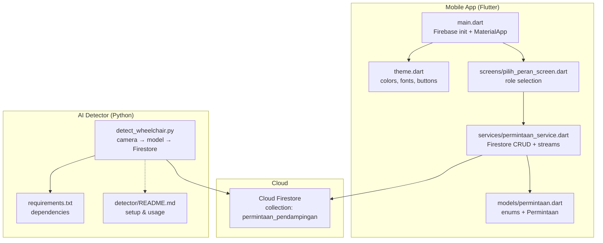
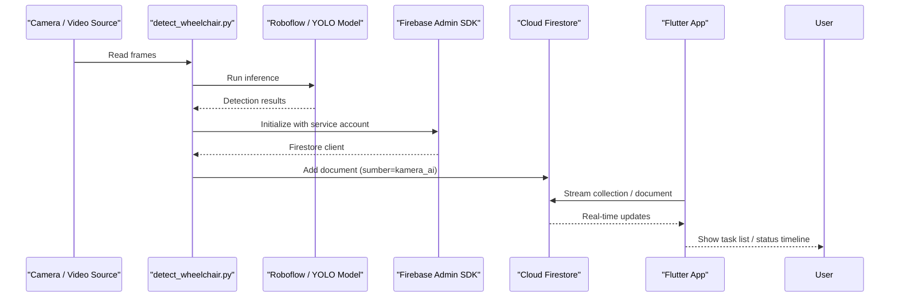
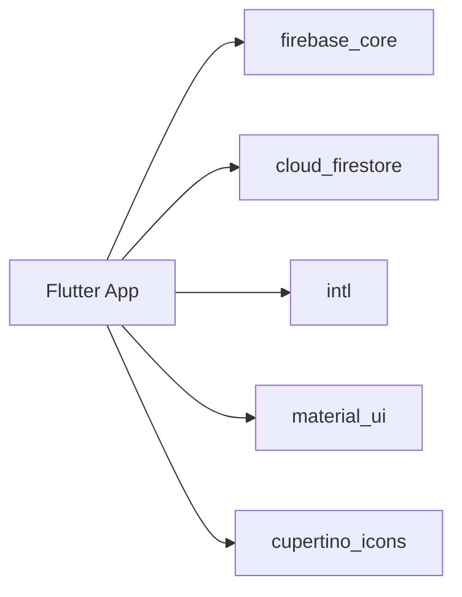

# Troubleshooting & FAQ

<cite>
**Referenced Files in This Document**
- [PROJECT.md](file://PROJECT.md)
- [whoosh_ramah/README.md](file://whoosh_ramah/README.md)
- [whoosh_ramah/pubspec.yaml](file://whoosh_ramah/pubspec.yaml)
- [whoosh_ramah/lib/main.dart](file://whoosh_ramah/lib/main.dart)
- [whoosh_ramah/lib/firebase_options.dart](file://whoosh_ramah/lib/firebase_options.dart)
- [whoosh_ramah/android/app/google-services.json](file://whoosh_ramah/android/app/google-services.json)
- [whoosh_ramah/lib/models/permintaan.dart](file://whoosh_ramah/lib/models/permintaan.dart)
- [whoosh_ramah/lib/services/permintaan_service.dart](file://whoosh_ramah/lib/services/permintaan_service.dart)
- [whoosh_ramah/lib/screens/pilih_peran_screen.dart](file://whoosh_ramah/lib/screens/pilih_peran_screen.dart)
- [whoosh_ramah/lib/theme.dart](file://whoosh_ramah/lib/theme.dart)
- [detector/README.md](file://detector/README.md)
- [detector/detect_wheelchair.py](file://detector/detect_wheelchair.py)
- [detector/requirements.txt](file://detector/requirements.txt)
</cite>

## Table of Contents
1. [Introduction](#introduction)
2. [Project Structure](#project-structure)
3. [Core Components](#core-components)
4. [Architecture Overview](#architecture-overview)
5. [Detailed Component Analysis](#detailed-component-analysis)
6. [Dependency Analysis](#dependency-analysis)
7. [Performance Considerations](#performance-considerations)
8. [Troubleshooting Guide](#troubleshooting-guide)
9. [Conclusion](#conclusion)
10. [Appendices](#appendices)

## Introduction
This document provides comprehensive troubleshooting guidance for the Whoosh Ramah prototype, covering Flutter build and runtime issues, Firebase initialization and Firestore access problems, AI detection pipeline failures (camera, model loading, network), real-time synchronization gaps, accessibility testing challenges, debugging techniques, performance profiling tips, and frequently asked questions about hackathon constraints and demo limitations.

The system consists of:
- A Flutter mobile app that reads and updates Firestore documents representing assistance requests.
- A Python-based AI detector that writes new tasks to Firestore when a wheelchair is detected.
- Real-time data flow between devices via Cloud Firestore.

**Section sources**
- [PROJECT.md:24-37](file://PROJECT.md#L24-L37)

## Project Structure
At a high level:
- The Flutter app initializes Firebase and renders role selection screens.
- The service layer encapsulates all Firestore operations.
- The model layer defines enums and data structures aligned with Firestore schema.
- The detector runs on a laptop and writes tasks into Firestore.

**Diagram sources**
- [whoosh_ramah/lib/main.dart:8-14](file://whoosh_ramah/lib/main.dart#L8-L14)
- [whoosh_ramah/lib/theme.dart:67-113](file://whoosh_ramah/lib/theme.dart#L67-L113)
- [whoosh_ramah/lib/models/permintaan.dart:7-57](file://whoosh_ramah/lib/models/permintaan.dart#L7-L57)
- [whoosh_ramah/lib/services/permintaan_service.dart:10-21](file://whoosh_ramah/lib/services/permintaan_service.dart#L10-L21)
- [whoosh_ramah/lib/screens/pilih_peran_screen.dart:14-16](file://whoosh_ramah/lib/screens/pilih_peran_screen.dart#L14-L16)
- [detector/detect_wheelchair.py:214-234](file://detector/detect_wheelchair.py#L214-L234)
- [detector/requirements.txt:1-7](file://detector/requirements.txt#L1-L7)
- [detector/README.md:10-18](file://detector/README.md#L10-L18)

**Section sources**
- [PROJECT.md:179-203](file://PROJECT.md#L179-L203)
- [whoosh_ramah/lib/main.dart:8-14](file://whoosh_ramah/lib/main.dart#L8-L14)
- [whoosh_ramah/lib/theme.dart:67-113](file://whoosh_ramah/lib/theme.dart#L67-L113)
- [whoosh_ramah/lib/models/permintaan.dart:7-57](file://whoosh_ramah/lib/models/permintaan.dart#L7-L57)
- [whoosh_ramah/lib/services/permintaan_service.dart:10-21](file://whoosh_ramah/lib/services/permintaan_service.dart#L10-L21)
- [whoosh_ramah/lib/screens/pilih_peran_screen.dart:14-16](file://whoosh_ramah/lib/screens/pilih_peran_screen.dart#L14-L16)
- [detector/detect_wheelchair.py:214-234](file://detector/detect_wheelchair.py#L214-L234)
- [detector/requirements.txt:1-7](file://detector/requirements.txt#L1-L7)
- [detector/README.md:10-18](file://detector/README.md#L10-L18)

## Core Components
- Firebase initialization and app entry point.
- Theme and UI styling.
- Data model and enums for request types and statuses.
- Firestore service for creating, streaming, and updating requests.
- Role selection screen as the app’s home.
- Python detector for camera-based wheelchair detection and Firestore writes.

Key responsibilities:
- main.dart initializes Firebase and starts the app.
- theme.dart centralizes colors, typography, and button styles.
- models/permintaan.dart defines enums and the Permintaan model with null-safe parsing.
- services/permintaan_service.dart implements create, stream, sort, and status progression logic.
- screens/pilih_peran_screen.dart routes to passenger, officer, and family flows.
- detector/detect_wheelchair.py handles camera input, model inference, and Firestore task creation.

**Section sources**
- [whoosh_ramah/lib/main.dart:8-14](file://whoosh_ramah/lib/main.dart#L8-L14)
- [whoosh_ramah/lib/theme.dart:67-113](file://whoosh_ramah/lib/theme.dart#L67-L113)
- [whoosh_ramah/lib/models/permintaan.dart:7-57](file://whoosh_ramah/lib/models/permintaan.dart#L7-L57)
- [whoosh_ramah/lib/services/permintaan_service.dart:23-61](file://whoosh_ramah/lib/services/permintaan_service.dart#L23-L61)
- [whoosh_ramah/lib/screens/pilih_peran_screen.dart:14-16](file://whoosh_ramah/lib/screens/pilih_peran_screen.dart#L14-L16)
- [detector/detect_wheelchair.py:164-192](file://detector/detect_wheelchair.py#L164-L192)

## Architecture Overview
End-to-end flow from camera detection to device UI updates:

**Diagram sources**
- [detector/detect_wheelchair.py:214-234](file://detector/detect_wheelchair.py#L214-L234)
- [detector/detect_wheelchair.py:164-192](file://detector/detect_wheelchair.py#L164-L192)
- [whoosh_ramah/lib/services/permintaan_service.dart:63-90](file://whoosh_ramah/lib/services/permintaan_service.dart#L63-L90)

## Detailed Component Analysis

### Flutter App Initialization and Configuration
Symptoms:
- App crashes at startup due to missing or misconfigured Firebase options.
- Android-specific errors related to google-services.json mismatch.

Checks:
- Ensure DefaultFirebaseOptions are generated for Android and match google-services.json.
- Verify project ID and API key consistency across firebase_options.dart and google-services.json.

Resolution steps:
- Re-run FlutterFire configuration tool to regenerate platform options.
- Confirm package name matches google-services.json.

**Section sources**
- [whoosh_ramah/lib/main.dart:8-14](file://whoosh_ramah/lib/main.dart#L8-L14)
- [whoosh_ramah/lib/firebase_options.dart:17-61](file://whoosh_ramah/lib/firebase_options.dart#L17-L61)
- [whoosh_ramah/android/app/google-services.json:1-29](file://whoosh_ramah/android/app/google-services.json#L1-L29)

### Theme and Accessibility Styling
Symptoms:
- Buttons too small for assistive navigation.
- Inconsistent font sizes or missing Nunito font.

Checks:
- Verify theme uses minimum button heights and tap targets.
- Confirm bundled fonts are declared and present.

Resolution steps:
- Use provided AppTheme and AppRadius constants.
- Ensure assets/fonts include required Nunito weights.

**Section sources**
- [whoosh_ramah/lib/theme.dart:67-113](file://whoosh_ramah/lib/theme.dart#L67-L113)
- [whoosh_ramah/lib/theme.dart:138-162](file://whoosh_ramah/lib/theme.dart#L138-L162)
- [whoosh_ramah/pubspec.yaml:64-76](file://whoosh_ramah/pubspec.yaml#L64-L76)

### Data Model and Enums
Symptoms:
- Incorrect enum mapping causing UI labels to be wrong.
- Null fields from detector not handled, leading to crashes.

Checks:
- Validate JenisBantuan and StatusPermintaan values match Firestore strings.
- Ensure Permintaan.fromMap handles nulls gracefully.

Resolution steps:
- Align enum value strings with PROJECT.md schema.
- Keep null-safe parsing in Permintaan.fromMap.

**Section sources**
- [whoosh_ramah/lib/models/permintaan.dart:7-57](file://whoosh_ramah/lib/models/permintaan.dart#L7-L57)
- [whoosh_ramah/lib/models/permintaan.dart:150-189](file://whoosh_ramah/lib/models/permintaan.dart#L150-L189)
- [PROJECT.md:56-95](file://PROJECT.md#L56-L95)

### Firestore Service Layer
Symptoms:
- Tasks not appearing in officer list.
- Family screen shows no latest request.
- Status advancement fails or duplicates history entries.

Checks:
- Collection name and field names must match detector output.
- Streams should avoid composite index requirements by sorting locally where needed.
- Status progression must append riwayat and set petugas on ditugaskan.

Resolution steps:
- Use streamSemua() for officer list; filter active vs completed in UI.
- Use streamTerbaruPenumpang() for family view; sort by created time locally.
- Call majukanStatus() only once per user action; ensure it checks current status.

**Section sources**
- [whoosh_ramah/lib/services/permintaan_service.dart:23-61](file://whoosh_ramah/lib/services/permintaan_service.dart#L23-L61)
- [whoosh_ramah/lib/services/permintaan_service.dart:63-90](file://whoosh_ramah/lib/services/permintaan_service.dart#L63-L90)
- [whoosh_ramah/lib/services/permintaan_service.dart:92-119](file://whoosh_ramah/lib/services/permintaan_service.dart#L92-L119)
- [PROJECT.md:56-95](file://PROJECT.md#L56-L95)

### Role Selection Screen
Symptoms:
- Navigation to roles does not work.
- Missing semantics or tooltips reduce accessibility.

Checks:
- Ensure each role card navigates to correct screen.
- Verify Semantics and MergeSemantics usage for screen readers.

Resolution steps:
- Update route calls to existing screens.
- Wrap interactive cards with MergeSemantics and Semantics(button: true).

**Section sources**
- [whoosh_ramah/lib/screens/pilih_peran_screen.dart:14-16](file://whoosh_ramah/lib/screens/pilih_peran_screen.dart#L14-L16)
- [whoosh_ramah/lib/screens/pilih_peran_screen.dart:169-228](file://whoosh_ramah/lib/screens/pilih_peran_screen.dart#L169-L228)

### AI Detector Pipeline
Symptoms:
- Camera cannot open.
- Model loading fails (local file missing or Roboflow API key missing).
- No tasks appear in Firestore.
- Too many false positives or missed detections.

Checks:
- Validate .env variables and service account file presence.
- Test detection without Firebase first.
- Adjust confidence threshold and frame continuity settings.

Resolution steps:
- Set ROBOFLOW_API_KEY or use local model path.
- Place firebase-key.json in detector folder.
- Run with --tanpa-firebase to isolate camera/model issues.
- Tune AMBANG_KEYAKINAN, FRAME_BERTURUT, JEDA_ANTAR_TUGAS_DETIK.

**Section sources**
- [detector/detect_wheelchair.py:214-234](file://detector/detect_wheelchair.py#L214-L234)
- [detector/detect_wheelchair.py:73-99](file://detector/detect_wheelchair.py#L73-L99)
- [detector/detect_wheelchair.py:102-123](file://detector/detect_wheelchair.py#L102-L123)
- [detector/detect_wheelchair.py:164-192](file://detector/detect_wheelchair.py#L164-L192)
- [detector/README.md:21-48](file://detector/README.md#L21-L48)
- [detector/README.md:77-85](file://detector/README.md#L77-L85)

## Dependency Analysis
Flutter dependencies relevant to this project:
- Firebase core and Firestore for real-time data.
- intl for time formatting.
- Material UI and Cupertino icons for UI components.

Potential conflicts:
- Version mismatches between firebase_core and cloud_firestore.
- Missing or incompatible platform plugins if FlutterFire CLI was not run.

Resolution steps:
- Pin compatible versions as specified in pubspec.yaml.
- Run flutter pub get and rebuild after changes.

**Diagram sources**
- [whoosh_ramah/pubspec.yaml:30-41](file://whoosh_ramah/pubspec.yaml#L30-L41)

**Section sources**
- [whoosh_ramah/pubspec.yaml:30-41](file://whoosh_ramah/pubspec.yaml#L30-L41)

## Performance Considerations
- Avoid heavy computations on the UI thread; keep Firestore streams lightweight.
- Limit Firestore queries to necessary fields and limit result sets.
- For AI detection:
  - Reduce detection frequency (DETEKSI_TIAP_DETIK) to save bandwidth.
  - Increase FRAME_BERTURUT to reduce false triggers.
  - Use local models when offline to avoid network latency.

[No sources needed since this section provides general guidance]

## Troubleshooting Guide

### Flutter Build Failures
Common causes:
- Outdated Flutter SDK or incompatible dependency versions.
- Missing platform configuration files.

Steps:
- Upgrade Flutter and run flutter clean.
- Regenerate Firebase platform options using FlutterFire CLI.
- Ensure android/app/google-services.json exists and matches project settings.

**Section sources**
- [whoosh_ramah/pubspec.yaml:21-23](file://whoosh_ramah/pubspec.yaml#L21-L23)
- [whoosh_ramah/android/app/google-services.json:1-29](file://whoosh_ramah/android/app/google-services.json#L1-L29)

### Dependency Conflicts
Symptoms:
- Compilation errors referencing firebase_core or cloud_firestore versions.

Steps:
- Align versions in pubspec.yaml with recommended ranges.
- Remove lock-incompatible artifacts and re-resolve dependencies.

**Section sources**
- [whoosh_ramah/pubspec.yaml:30-41](file://whoosh_ramah/pubspec.yaml#L30-L41)

### Firebase Initialization Errors
Symptoms:
- App throws UnsupportedError for unconfigured platforms.
- Android app fails to initialize Firebase.

Steps:
- Run flutterfire configure to generate DefaultFirebaseOptions for Android.
- Verify project_id and api_key in firebase_options.dart and google-services.json.

**Section sources**
- [whoosh_ramah/lib/firebase_options.dart:17-61](file://whoosh_ramah/lib/firebase_options.dart#L17-L61)
- [whoosh_ramah/android/app/google-services.json:1-29](file://whoosh_ramah/android/app/google-services.json#L1-L29)

### Firestore Permission Errors
Symptoms:
- Reads/writes fail due to security rules.

Steps:
- For demo purposes, allow read/write on permintaan_pendampingan.
- Do not deploy these rules to production.

**Section sources**
- [PROJECT.md:97-108](file://PROJECT.md#L97-L108)

### Network Connectivity Issues
Symptoms:
- AI detector cannot reach Roboflow API.
- Flutter app cannot sync with Firestore.

Steps:
- Check internet connectivity and firewall rules.
- Switch detector to local model mode if offline.
- Retry Firestore operations with appropriate error handling.

**Section sources**
- [detector/detect_wheelchair.py:73-99](file://detector/detect_wheelchair.py#L73-L99)
- [detector/README.md:21-48](file://detector/README.md#L21-L48)

### Real-Time Data Synchronization Problems
Symptoms:
- Officer list not updating.
- Family screen not showing latest request.

Steps:
- Ensure streams are listening to the correct collection and filters.
- Sort results locally by created timestamp when avoiding composite indexes.

**Section sources**
- [whoosh_ramah/lib/services/permintaan_service.dart:63-90](file://whoosh_ramah/lib/services/permintaan_service.dart#L63-L90)
- [whoosh_ramah/lib/services/permintaan_service.dart:121-134](file://whoosh_ramah/lib/services/permintaan_service.dart#L121-L134)

### Camera Access Problems (AI Detector)
Symptoms:
- Cannot open video source.
- Frames not captured.

Steps:
- Validate camera index or video path.
- Test with sample video file.
- Ensure OpenCV is installed correctly.

**Section sources**
- [detector/detect_wheelchair.py:214-234](file://detector/detect_wheelchair.py#L214-L234)
- [detector/requirements.txt:1-2](file://detector/requirements.txt#L1-L2)

### Model Loading Failures (AI Detector)
Symptoms:
- Local model file not found.
- Roboflow API key missing.

Steps:
- Provide valid ROBOFLOW_API_KEY or place local model file at expected path.
- Train custom model if using local mode.

**Section sources**
- [detector/detect_wheelchair.py:73-99](file://detector/detect_wheelchair.py#L73-L99)
- [detector/detect_wheelchair.py:102-123](file://detector/detect_wheelchair.py#L102-L123)
- [detector/README.md:63-76](file://detector/README.md#L63-L76)

### Performance Bottlenecks (AI Detector)
Symptoms:
- High CPU usage or slow frame processing.
- Excessive API calls.

Steps:
- Increase DETEKSI_TIAP_DETIK interval.
- Raise AMBANG_KEYAKINAN to reduce false positives.
- Use FRAME_BERTURUT to require multiple consecutive detections.

**Section sources**
- [detector/detect_wheelchair.py:248-274](file://detector/detect_wheelchair.py#L248-L274)
- [detector/README.md:77-85](file://detector/README.md#L77-L85)

### Accessibility Testing Challenges
Symptoms:
- Screen readers do not announce interactive elements.
- Layout breaks at large text scaling.

Steps:
- Add Semantics and MergeSemantics to interactive widgets.
- Ensure minimum touch target sizes and scalable text.
- Test with TalkBack (Android) and VoiceOver (iOS).

**Section sources**
- [whoosh_ramah/lib/screens/pilih_peran_screen.dart:169-228](file://whoosh_ramah/lib/screens/pilih_peran_screen.dart#L169-L228)
- [PROJECT.md:169-176](file://PROJECT.md#L169-L176)

### Debugging Techniques for Mobile and AI Components
- Flutter:
  - Use debug logs around Firestore operations and UI state changes.
  - Inspect stream emissions to verify real-time updates.
- AI Detector:
  - Run with --tanpa-firebase to validate camera and model independently.
  - Log detection results and confidence scores.

**Section sources**
- [detector/detect_wheelchair.py:214-234](file://detector/detect_wheelchair.py#L214-L234)
- [whoosh_ramah/lib/services/permintaan_service.dart:23-61](file://whoosh_ramah/lib/services/permintaan_service.dart#L23-L61)

### Log Analysis Strategies
- Monitor detector console output for warnings and detection events.
- Track Firestore write success and stream snapshot counts in Flutter.
- Correlate timestamps between detector logs and Firestore serverTimestamp fields.

**Section sources**
- [detector/detect_wheelchair.py:248-274](file://detector/detect_wheelchair.py#L248-L274)
- [whoosh_ramah/lib/models/permintaan.dart:191-212](file://whoosh_ramah/lib/models/permintaan.dart#L191-L212)

### Performance Profiling Tools
- Flutter:
  - Use DevTools to profile widget rebuilds and memory usage.
- AI Detector:
  - Profile CPU usage during inference; consider reducing resolution or frame rate.

[No sources needed since this section provides general guidance]

## Conclusion
This guide consolidates common issues and resolutions across the Flutter app, Firestore integration, and AI detector pipeline. By following the structured checks and solutions here, you can quickly diagnose and fix build, runtime, synchronization, and accessibility problems while maintaining a smooth demo experience.

[No sources needed since this section summarizes without analyzing specific files]

## Appendices

### Frequently Asked Questions

- What is the hackathon scope?
  - Prototype demonstrating assistance ordering, assignment, destination handover, and family monitoring, plus an AI camera that auto-creates tasks.

- What is explicitly out of scope?
  - Real login/accounts, KCIC ticket system integration, payment, automatic scheduling, push notifications, and face photo storage.

- Can I extend beyond the prototype?
  - Yes, but those features are outside the hackathon specification. Keep demo constraints in mind.

- Why does the family screen show only one request?
  - It listens for the latest request for a specific passenger ID and sorts locally by created time.

- How do I test without internet?
  - Use local YOLO model mode in the detector and prepare a backup video for demonstrations.

**Section sources**
- [PROJECT.md:18-21](file://PROJECT.md#L18-L21)
- [PROJECT.md:121-135](file://PROJECT.md#L121-L135)
- [detector/README.md:63-76](file://detector/README.md#L63-L76)
- [detector/README.md:86-92](file://detector/README.md#L86-L92)