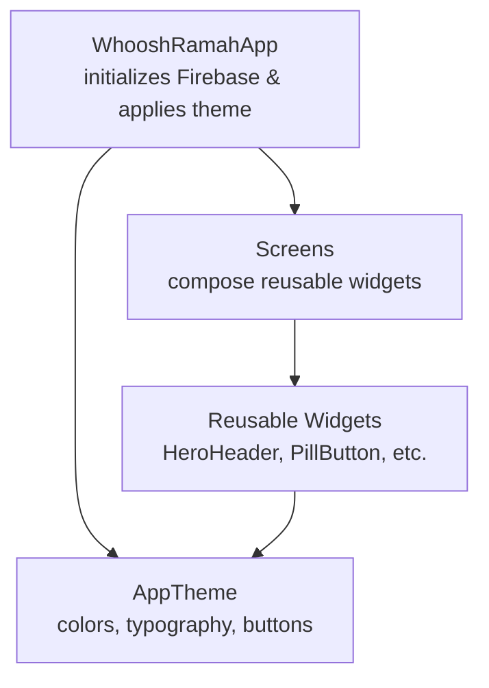
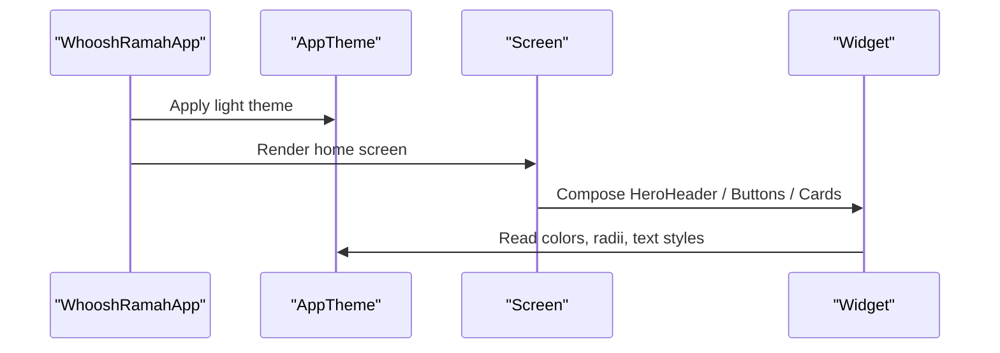
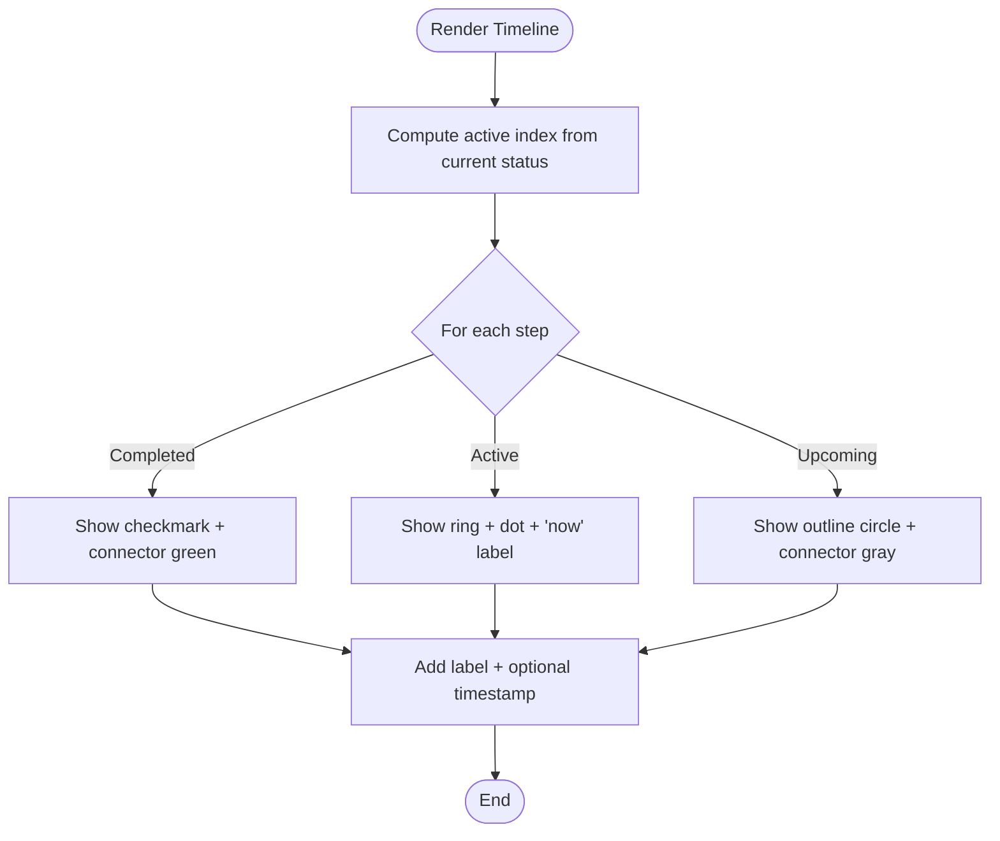
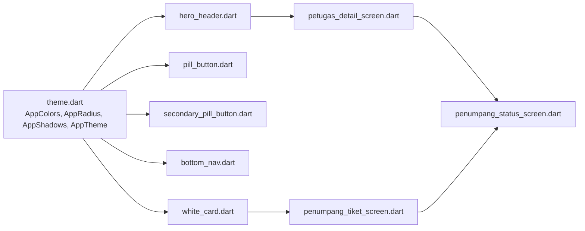

# UI Components & Design System

<cite>
**Referenced Files in This Document**
- [main.dart](file://whoosh_ramah/lib/main.dart)
- [theme.dart](file://whoosh_ramah/lib/theme.dart)
- [hero_header.dart](file://whoosh_ramah/lib/widgets/hero_header.dart)
- [pill_button.dart](file://whoosh_ramah/lib/widgets/pill_button.dart)
- [secondary_pill_button.dart](file://whoosh_ramah/lib/widgets/secondary_pill_button.dart)
- [bottom_nav.dart](file://whoosh_ramah/lib/widgets/bottom_nav.dart)
- [white_card.dart](file://whoosh_ramah/lib/widgets/white_card.dart)
- [penumpang_status_screen.dart](file://whoosh_ramah/lib/screens/penumpang_status_screen.dart)
- [petugas_detail_screen.dart](file://whoosh_ramah/lib/screens/petugas_detail_screen.dart)
- [penumpang_tiket_screen.dart](file://whoosh_ramah/lib/screens/penumpang_tiket_screen.dart)
- [PROJECT.md](file://PROJECT.md)
</cite>

## Table of Contents
1. [Introduction](#introduction)
2. [Project Structure](#project-structure)
3. [Core Components](#core-components)
4. [Architecture Overview](#architecture-overview)
5. [Detailed Component Analysis](#detailed-component-analysis)
6. [Dependency Analysis](#dependency-analysis)
7. [Performance Considerations](#performance-considerations)
8. [Troubleshooting Guide](#troubleshooting-guide)
9. [Conclusion](#conclusion)
10. [Appendices](#appendices)

## Introduction
This document describes the reusable UI components and design system for Whoosh Ramah, focusing on the “Cerah & ramah” (bright & friendly) style guide. It documents the HeroHeader, PillButton, SecondaryPillButton, BottomNav, StatusTimeline, and InfoCard patterns, including props, events, customization options, accessibility, responsive behavior, and cross-platform considerations across Android and iOS. The guidance is grounded in the project’s theme definitions, widget implementations, screen usage, and the official project specification.

## Project Structure
The UI layer is organized into:
- Theme and design tokens in a centralized theme file.
- Reusable widgets under lib/widgets.
- Screen-level composition that combines these widgets to build user flows.
- A single app entry point initializing Firebase and applying the theme.

**Diagram sources**
- [main.dart:8-33](file://whoosh_ramah/lib/main.dart#L8-L33)
- [theme.dart:67-113](file://whoosh_ramah/lib/theme.dart#L67-L113)

**Section sources**
- [main.dart:8-33](file://whoosh_ramah/lib/main.dart#L8-L33)
- [PROJECT.md:179-203](file://PROJECT.md#L179-L203)

## Core Components
This section summarizes the core reusable components and their responsibilities.

- HeroHeader: Colored hero banner with rounded bottom corners, safe area handling, and status bar annotation.
- PillButton: Primary pill-shaped button with accessible semantics and consistent sizing.
- SecondaryPillButton: Outlined pill-shaped button using Material OutlinedButton.
- BottomNav: Floating bottom navigation with active state styling and semantic labels.
- WhiteCard: Base white card with configurable radius, padding, and shadow; used as InfoCard foundation.
- StatusTimeline: Step-based timeline showing progress through request statuses.

Design tokens driving consistency:
- Colors: role-based palette for passenger (red), officer (blue), family/success (green), plus neutral tones.
- Typography: Nunito font family with strict size and weight ranges.
- Spacing and radii: standardized radii for cards, pills, and navigation.
- Shadows: soft shadows for depth without heavy elevation.

**Section sources**
- [theme.dart:7-35](file://whoosh_ramah/lib/theme.dart#L7-L35)
- [theme.dart:67-113](file://whoosh_ramah/lib/theme.dart#L67-L113)
- [theme.dart:118-163](file://whoosh_ramah/lib/theme.dart#L118-L163)
- [PROJECT.md:138-176](file://PROJECT.md#L138-L176)

## Architecture Overview
The application uses a simple layered architecture:
- Entry point initializes Firebase and sets up MaterialApp with the custom theme.
- Screens compose reusable widgets to implement user flows.
- Widgets rely on shared design tokens from the theme for visual consistency.

**Diagram sources**
- [main.dart:8-33](file://whoosh_ramah/lib/main.dart#L8-L33)
- [theme.dart:67-113](file://whoosh_ramah/lib/theme.dart#L67-L113)

## Detailed Component Analysis

### HeroHeader
Purpose:
- Provides a colored header with rounded bottom corners and safe area support.
- Ensures status bar icons are visible by annotating overlay style.

Props:
- color: Background color for the hero (role-specific).
- child: Content inside the hero.
- borderRadius: Rounded corner radius for the bottom edge.
- padding: Internal spacing around content.

Events:
- None directly; typically used as a container for titles, actions, or badges.

Customization:
- Use role-specific colors from AppColors.
- Adjust borderRadius within the design range.
- Keep SafeArea enabled to avoid notches and dynamic islands.

Accessibility:
- Uses AnnotatedRegion for status bar contrast.
- Ensure child content remains readable against the chosen background.

Responsive:
- SafeArea adapts to device insets.
- Padding scales naturally with content.

Cross-platform:
- Works consistently on Android and iOS due to SafeArea and standard Flutter primitives.

Usage example path:
- See how screens combine HeroHeader with overlapping cards via Transform.translate.

**Section sources**
- [hero_header.dart:4-43](file://whoosh_ramah/lib/widgets/hero_header.dart#L4-L43)
- [petugas_detail_screen.dart:99-111](file://whoosh_ramah/lib/screens/petugas_detail_screen.dart#L99-L111)

### PillButton
Purpose:
- Primary action button with pill shape, high visibility, and strong accessibility.

Props:
- onPressed: Callback invoked on tap.
- child: Text or icon+text content.
- backgroundColor: Default primary red; can be customized.
- foregroundColor: Text/icon color.
- height: Button height (default aligns with design).

Events:
- onTap triggers onPressed.

Customization:
- Maintain minimum height for touch targets.
- Use foreground/background colors that meet contrast requirements.

Accessibility:
- Wraps content in Semantics and MergeSemantics so the entire button is announced as one control.
- Disabled state reduces opacity and disables interaction.

Responsive:
- Centered content scales with available width.
- Icon size and text style follow theme conventions.

Cross-platform:
- InkResponse provides consistent ripple feedback on both platforms.

Usage example path:
- Used as primary call-to-action in passenger flows.

**Section sources**
- [pill_button.dart:5-58](file://whoosh_ramah/lib/widgets/pill_button.dart#L5-L58)

### SecondaryPillButton
Purpose:
- Outlined secondary action button with pill shape.

Props:
- onPressed: Callback invoked on tap.
- label: Button text.
- height: Button height (default aligns with design).
- borderColor: Border color (default outline tone).
- foregroundColor: Text/icon color.

Events:
- onTap triggers onPressed.

Customization:
- Follow outlined button style guidelines: 2px border, pill shape.
- Keep height within recommended range.

Accessibility:
- Built on OutlinedButton which provides built-in semantics and disabled handling.
- Minimum touch target enforced by Material defaults.

Responsive:
- Label wraps and centers appropriately.

Cross-platform:
- Material OutlinedButton ensures consistent behavior across Android and iOS.

Usage example path:
- Used for secondary actions like sharing or switching roles.

**Section sources**
- [secondary_pill_button.dart:5-39](file://whoosh_ramah/lib/widgets/secondary_pill_button.dart#L5-L39)

### BottomNav
Purpose:
- Floating bottom navigation with active state highlighting per role.

Props:
- items: List of BottomNavItem entries (label, icon, active flag, optional onTap).
- activeColor: Color for active item text/icons.
- activeBackground: Light background color for active item.

Events:
- Each item can define its own onTap handler.

Customization:
- Active item uses role-appropriate light background.
- Container has floating appearance with rounded corners and soft shadow.

Accessibility:
- Each item is wrapped in Semantics(button: true) and MergeSemantics to announce label and selected state.

Responsive:
- Expanded layout distributes items evenly.
- Minimum item height ensures adequate touch targets.

Cross-platform:
- Material ink and constraints behave consistently across platforms.

Usage example path:
- Appears at the bottom of detail screens to switch between key sections.

**Section sources**
- [bottom_nav.dart:5-105](file://whoosh_ramah/lib/widgets/bottom_nav.dart#L5-L105)

### WhiteCard (InfoCard Foundation)
Purpose:
- Base white card with configurable radius, padding, and shadow.
- Serves as the foundation for InfoCard-like layouts throughout the app.

Props:
- child: Card content.
- margin: Outer spacing (non-negative).
- padding: Inner spacing (default generous).
- radius: Corner radius (defaults to large card radius).
- shadow: Shadow list (defaults to card shadow token).

Events:
- None directly; purely presentational.

Customization:
- Override radius and shadow to match specific card variants.
- Use non-negative margins; for overlapping hero effects, use Transform.translate in the parent screen.

Accessibility:
- Transparent Material child allows proper text rendering and ink interactions.

Responsive:
- Padding and radius scale well with content density.

Cross-platform:
- Standard Container + Material implementation works uniformly.

Usage example path:
- Used in ticket and detail screens to group information blocks.

**Section sources**
- [white_card.dart:5-44](file://whoosh_ramah/lib/widgets/white_card.dart#L5-L44)
- [penumpang_tiket_screen.dart:84-112](file://whoosh_ramah/lib/screens/penumpang_tiket_screen.dart#L84-L112)

### StatusTimeline
Purpose:
- Visualizes the progression of a request through defined statuses.
- Shows completed steps, current step, upcoming steps, and timestamps for past steps.

Props (internal):
- Steps: Derived from status enum values.
- Current status: Determines active step index.
- Completed flag: Changes rendering when finished.
- Timestamps: Optional time labels for completed steps.

Events:
- None directly; driven by data changes from Firestore streams.

Customization:
- Step states map to distinct visuals: completed (checkmark), active (ring + dot), upcoming (outline).
- Connector lines differentiate completed vs. pending segments.

Accessibility:
- Status pills and steps include semantic labels where applicable.
- Avoid relying solely on color; always provide text indicators.

Responsive:
- Labels wrap and truncate gracefully.
- Timeline adapts to varying text lengths.

Cross-platform:
- Pure Flutter widgets ensure consistent rendering.

Usage example path:
- Implemented within the passenger status screen to reflect real-time updates.

**Diagram sources**
- [penumpang_status_screen.dart:451-481](file://whoosh_ramah/lib/screens/penumpang_status_screen.dart#L451-L481)
- [penumpang_status_screen.dart:590-730](file://whoosh_ramah/lib/screens/penumpang_status_screen.dart#L590-L730)

**Section sources**
- [penumpang_status_screen.dart:451-481](file://whoosh_ramah/lib/screens/penumpang_status_screen.dart#L451-L481)
- [penumpang_status_screen.dart:590-730](file://whoosh_ramah/lib/screens/penumpang_status_screen.dart#L590-L730)

## Dependency Analysis
The following diagram shows how components depend on the theme and how screens compose them.

**Diagram sources**
- [theme.dart:7-35](file://whoosh_ramah/lib/theme.dart#L7-L35)
- [theme.dart:67-113](file://whoosh_ramah/lib/theme.dart#L67-L113)
- [hero_header.dart:4-43](file://whoosh_ramah/lib/widgets/hero_header.dart#L4-L43)
- [pill_button.dart:5-58](file://whoosh_ramah/lib/widgets/pill_button.dart#L5-L58)
- [secondary_pill_button.dart:5-39](file://whoosh_ramah/lib/widgets/secondary_pill_button.dart#L5-L39)
- [bottom_nav.dart:5-105](file://whoosh_ramah/lib/widgets/bottom_nav.dart#L5-L105)
- [white_card.dart:5-44](file://whoosh_ramah/lib/widgets/white_card.dart#L5-L44)
- [petugas_detail_screen.dart:99-111](file://whoosh_ramah/lib/screens/petugas_detail_screen.dart#L99-L111)
- [penumpang_tiket_screen.dart:84-112](file://whoosh_ramah/lib/screens/penumpang_tiket_screen.dart#L84-L112)
- [penumpang_status_screen.dart:451-481](file://whoosh_ramah/lib/screens/penumpang_status_screen.dart#L451-L481)

**Section sources**
- [theme.dart:7-35](file://whoosh_ramah/lib/theme.dart#L7-L35)
- [theme.dart:67-113](file://whoosh_ramah/lib/theme.dart#L67-L113)

## Performance Considerations
- Prefer lightweight widgets: HeroHeader, WhiteCard, and BottomNav use simple containers and Material primitives, minimizing rebuild overhead.
- Avoid excessive nesting: Keep compositions shallow; reuse WhiteCard instead of duplicating decoration logic.
- Minimize unnecessary recompositions: Pass stable data to BottomNav items and avoid rebuilding timelines unless status changes.
- Use semantic wrappers sparingly: Only add Semantics/MergeSemantics where needed for accessibility.

[No sources needed since this section provides general guidance]

## Troubleshooting Guide
Common issues and resolutions:
- Touch target too small: Ensure buttons and nav items meet minimum sizes; PillButton and SecondaryPillButton enforce heights; BottomNav items set minHeight.
- Inconsistent radii: Use AppRadius constants to keep pill and card shapes uniform.
- Contrast problems: Verify text colors against backgrounds using AppColors; avoid low-contrast combinations.
- Overlapping cards: Use Transform.translate in screens rather than negative margins; see how detail screens lift cards over the hero.
- Accessibility failures: Add Semantics labels to icon-only controls; test with TalkBack/VoiceOver.

**Section sources**
- [pill_button.dart:27-58](file://whoosh_ramah/lib/widgets/pill_button.dart#L27-L58)
- [secondary_pill_button.dart:25-39](file://whoosh_ramah/lib/widgets/secondary_pill_button.dart#L25-L39)
- [bottom_nav.dart:64-105](file://whoosh_ramah/lib/widgets/bottom_nav.dart#L64-L105)
- [petugas_detail_screen.dart:99-111](file://whoosh_ramah/lib/screens/petugas_detail_screen.dart#L99-L111)

## Conclusion
The Whoosh Ramah design system enforces a bright, friendly aesthetic through a cohesive set of tokens and reusable components. HeroHeader, PillButton, SecondaryPillButton, BottomNav, WhiteCard, and StatusTimeline provide consistent visual language, strong accessibility, and predictable behavior across Android and iOS. By centralizing design tokens and composing screens from these components, the app maintains consistency, readability, and usability while supporting dynamic text scaling and role-based color schemes.

[No sources needed since this section summarizes without analyzing specific files]

## Appendices

### Design Principles: “Cerah & ramah” (Bright & Friendly)
- Color palette: Role-based colors for passengers (red), officers (blue), family/success (green), plus neutral backgrounds and outlines.
- Typography hierarchy: Nunito font family with strict size and weight ranges; minimum 13, body 15–17, headings 25–30.
- Spacing system: Consistent radii for cards, pills, and navigation; soft shadows for depth.
- Composition patterns: Colored hero headers with rounded bottoms; white cards overlapping heroes; pill-shaped buttons; floating bottom navigation.

**Section sources**
- [PROJECT.md:138-176](file://PROJECT.md#L138-L176)
- [theme.dart:7-35](file://whoosh_ramah/lib/theme.dart#L7-L35)
- [theme.dart:118-163](file://whoosh_ramah/lib/theme.dart#L118-L163)

### Accessibility Implementation
- Semantic labels: Buttons and interactive elements expose labels via Semantics and MergeSemantics.
- Touch targets: Enforced minimum heights and padded tap areas.
- Screen readers: Tested with TalkBack and VoiceOver; all critical flows navigable without sight.
- Dynamic text scaling: Do not lock textScaler; layouts must remain intact at larger text sizes.
- Non-color cues: Statuses include text labels beyond color alone.

**Section sources**
- [pill_button.dart:27-58](file://whoosh_ramah/lib/widgets/pill_button.dart#L27-L58)
- [bottom_nav.dart:64-105](file://whoosh_ramah/lib/widgets/bottom_nav.dart#L64-L105)
- [PROJECT.md:169-176](file://PROJECT.md#L169-L176)

### Responsive Design and Cross-Platform Compatibility
- Responsive: SafeArea handles platform insets; flexible layouts adapt to text scaling and narrow screens.
- Cross-platform: Material components and standard Flutter widgets ensure consistent behavior on Android and iOS.
- Hero overlap pattern: Use Transform.translate to achieve overlapping cards over colored headers without negative margins.

**Section sources**
- [hero_header.dart:27-43](file://whoosh_ramah/lib/widgets/hero_header.dart#L27-L43)
- [petugas_detail_screen.dart:99-111](file://whoosh_ramah/lib/screens/petugas_detail_screen.dart#L99-L111)