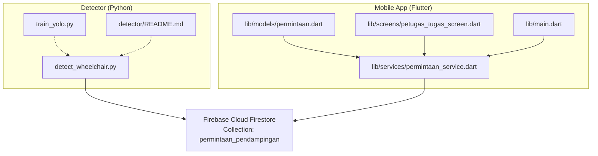
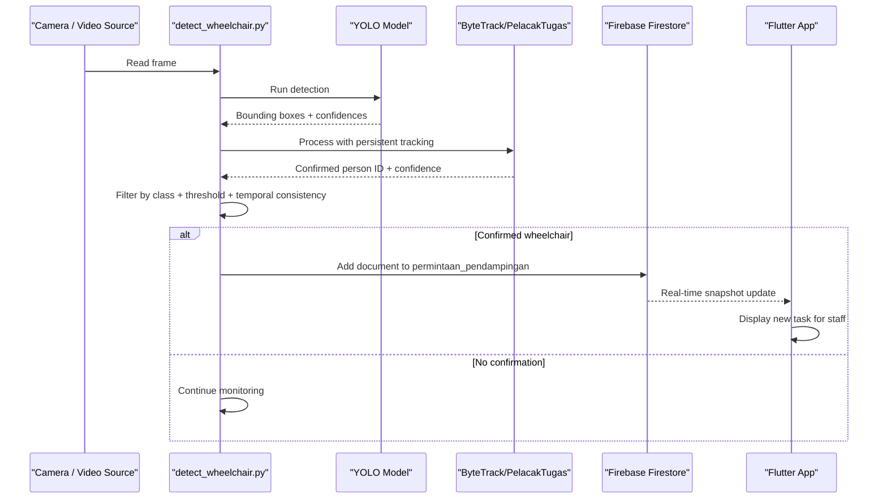
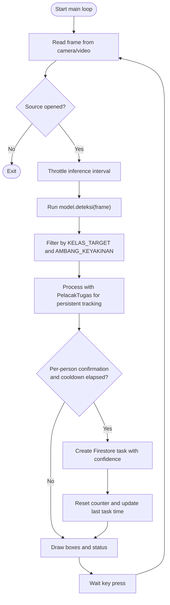
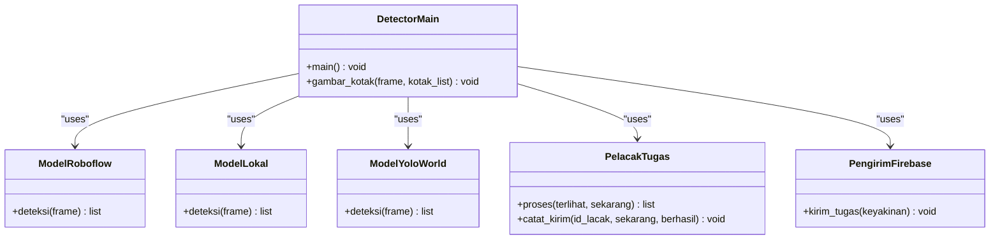
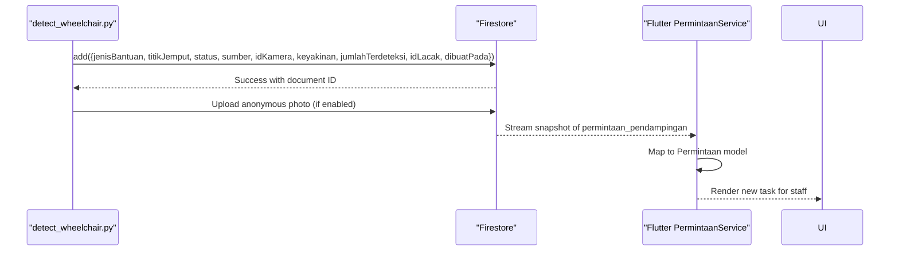
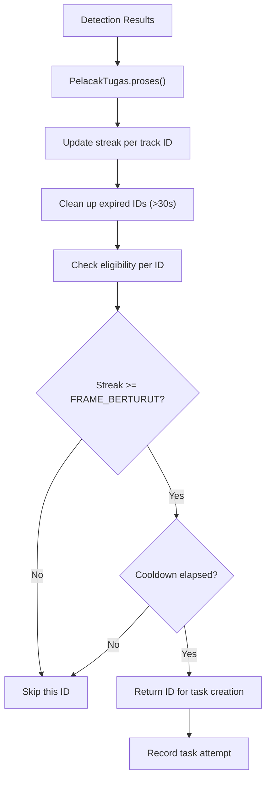
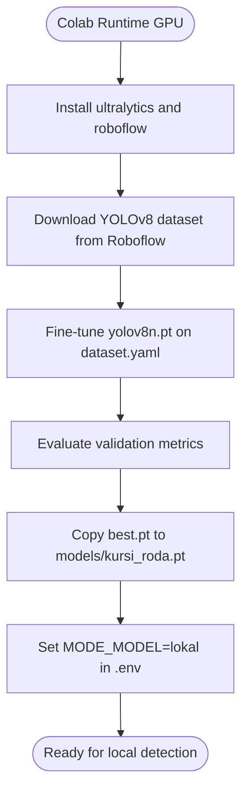
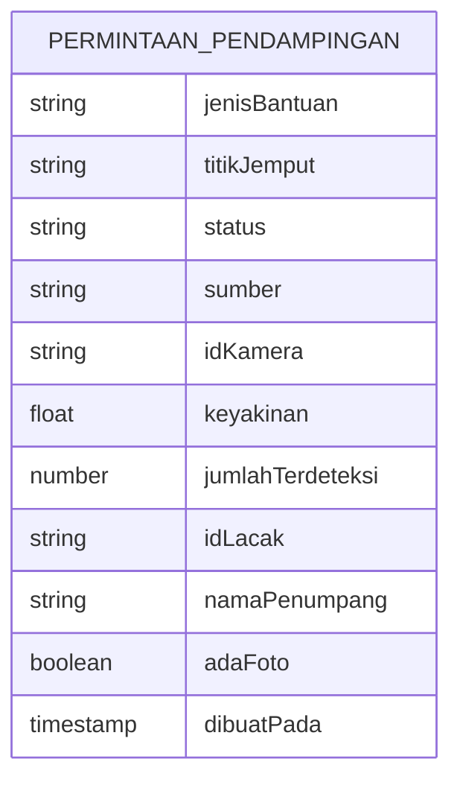
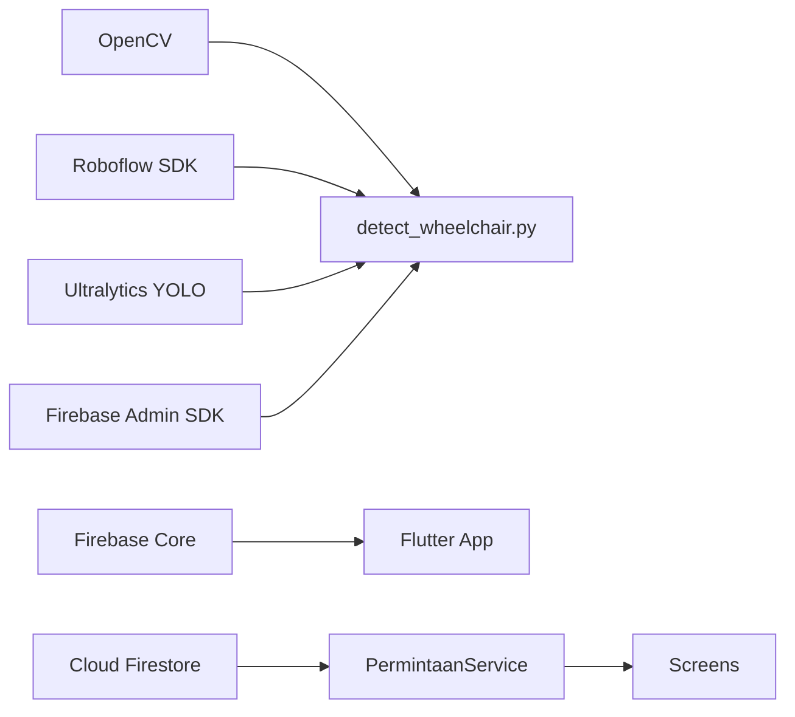

# AI Detection System

<cite>
**Referenced Files in This Document**
- [detect_wheelchair.py](file://detector/detect_wheelchair.py)
- [train_yolo.py](file://detector/train_yolo.py)
- [README.md](file://detector/README.md)
- [permintaan_service.dart](file://whoosh_ramah/lib/services/permintaan_service.dart)
- [permintaan.dart](file://whoosh_ramah/lib/models/permintaan.dart)
- [petugas_tugas_screen.dart](file://whoosh_ramah/lib/screens/petugas_tugas_screen.dart)
- [main.dart](file://whoosh_ramah/lib/main.dart)
- [PROJECT.md](file://PROJECT.md)
</cite>

## Update Summary
**Changes Made**
- Enhanced three-mode architecture documentation with ByteTrack integration details
- Added PelacakTugas class documentation for per-person task management
- Updated Firebase integration section with retry logic and exponential backoff
- Added anonymous photo verification system documentation
- Enhanced performance optimization techniques with tracking-specific optimizations
- Updated troubleshooting guide with new features

## Table of Contents
1. [Introduction](#introduction)
2. [Project Structure](#project-structure)
3. [Core Components](#core-components)
4. [Architecture Overview](#architecture-overview)
5. [Detailed Component Analysis](#detailed-component-analysis)
6. [Dependency Analysis](#dependency-analysis)
7. [Performance Considerations](#performance-considerations)
8. [Troubleshooting Guide](#troubleshooting-guide)
9. [Conclusion](#conclusion)
10. [Appendices](#appendices)

## Introduction
This document explains the Python-based wheelchair detection system and its integration with a Flutter mobile application. The detector reads camera or video input, preprocesses frames, runs YOLO-based object detection, applies confidence filtering and temporal consistency checks, and writes automatic assistance tasks to Firebase Firestore when wheelchairs are detected. The Flutter app listens to Firestore and displays new tasks for staff, while passengers and families can view request status.

The system supports three model modes:
- Roboflow serverless inference using a pre-trained model via API.
- Local YOLOv8 model trained on a custom dataset.
- YOLO-World zero-shot mode where detection classes are specified as text.

**Updated** The system now includes advanced tracking capabilities with ByteTrack integration for persistent person identification, per-person task management through the PelacakTugas class, and an anonymous photo verification system for privacy-preserving verification.

The documentation covers camera handling, preprocessing, detection logic, confidence scoring, Firestore task creation, training procedures, deployment options, performance tuning, and the data contract used by the mobile app.

## Project Structure
At a high level, the repository contains:
- A Python detector under `detector/` that performs real-time detection and writes to Firestore.
- A Flutter application under `whoosh_ramah/` that consumes Firestore data for passenger, staff, and family workflows.
- Design diagrams and project notes describing the overall architecture and roles.

**Diagram sources**
- [detect_wheelchair.py:1-708](file://detector/detect_wheelchair.py#L1-L708)
- [train_yolo.py:1-64](file://detector/train_yolo.py#L1-L64)
- [README.md:1-96](file://detector/README.md#L1-L96)
- [permintaan_service.dart:1-228](file://whoosh_ramah/lib/services/permintaan_service.dart#L1-L228)
- [permintaan.dart:1-255](file://whoosh_ramah/lib/models/permintaan.dart#L1-L255)
- [petugas_tugas_screen.dart:1-748](file://whoosh_ramah/lib/screens/petugas_tugas_screen.dart#L1-L748)
- [main.dart:1-48](file://whoosh_ramah/lib/main.dart#L1-L48)

**Section sources**
- [PROJECT.md:24-36](file://PROJECT.md#L24-L36)

## Core Components
- Camera and video source handling: OpenCV `VideoCapture` supports webcam index, file paths, and RTSP URLs.
- Model abstraction: Three strategies share a common interface for detection, returning normalized bounding boxes and confidence scores.
- **Enhanced** Persistent tracking with ByteTrack: Maintains track IDs across frames for consistent person identification.
- **New** Per-person task management: PelacakTugas class manages individual person tracking, preventing duplicate tasks per person.
- Confidence and temporal gating: Only detections matching target classes above a threshold and observed across consecutive frames trigger task creation. Anti-spacing prevents duplicate tasks from the same camera within a time window.
- **Enhanced** Firebase integration: Improved error handling with retry logic and exponential backoff for reliable task creation.
- **New** Anonymous photo verification: Privacy-preserving crop extraction with face blurring and pixelation for verification purposes.
- Firestore integration: When a valid detection is confirmed, a new document is added to the `permintaan_pendampingan` collection with fields such as assistance type, pickup location, status, source, confidence, and timestamps.
- Mobile app integration: The Flutter service reads and streams the same Firestore collection, mapping documents to domain models and exposing streams for UI components.

Key responsibilities:
- `detect_wheelchair.py`: orchestrates frame reading, model inference, visualization, and Firestore writes.
- `train_yolo.py`: downloads a YOLOv8 dataset from Roboflow, fine-tunes a base model, evaluates metrics, and saves the best weights for local inference.
- `permintaan_service.dart`: provides Firestore read/write operations and stream APIs consumed by screens.
- `permintaan.dart`: defines the assistance type enum and document model mapping.
- `petugas_tugas_screen.dart`: listens to all requests and highlights new tasks, including those created by the AI camera.

**Section sources**
- [detect_wheelchair.py:48-92](file://detector/detect_wheelchair.py#L48-L92)
- [detect_wheelchair.py:97-180](file://detector/detect_wheelchair.py#L97-L180)
- [detect_wheelchair.py:460-533](file://detector/detect_wheelchair.py#L460-L533)
- [detect_wheelchair.py:362-452](file://detector/detect_wheelchair.py#L362-L452)
- [detect_wheelchair.py:207-295](file://detector/detect_wheelchair.py#L207-L295)
- [detect_wheelchair.py:164-192](file://detector/detect_wheelchair.py#L164-L192)
- [detect_wheelchair.py:198-286](file://detector/detect_wheelchair.py#L198-L286)
- [train_yolo.py:34-58](file://detector/train_yolo.py#L34-L58)
- [permintaan_service.dart:10-21](file://whoosh_ramah/lib/services/permintaan_service.dart#L10-L21)
- [permintaan_service.dart:23-78](file://whoosh_ramah/lib/services/permintaan_service.dart#L23-L78)
- [permintaan.dart:7-25](file://whoosh_ramah/lib/models/permintaan.dart#L7-L25)
- [petugas_tugas_screen.dart:38-75](file://whoosh_ramah/lib/screens/petugas_tugas_screen.dart#L38-L75)

## Architecture Overview
The system follows a simple producer-consumer pattern:
- Producer: Python detector processes video frames and publishes assistance requests to Firestore.
- Consumer: Flutter app subscribes to Firestore and updates UI in real time.

**Diagram sources**
- [detect_wheelchair.py:214-286](file://detector/detect_wheelchair.py#L214-L286)
- [detect_wheelchair.py:460-533](file://detector/detect_wheelchair.py#L460-L533)
- [permintaan_service.dart:70-78](file://whoosh_ramah/lib/services/permintaan_service.dart#L70-L78)

## Detailed Component Analysis

### Wheelchair Detection Pipeline
The pipeline reads frames, optionally throttles inference calls, filters results by target classes and confidence, enforces temporal consistency, and creates Firestore tasks when conditions are met.

**Diagram sources**
- [detect_wheelchair.py:214-286](file://detector/detect_wheelchair.py#L214-L286)
- [detect_wheelchair.py:460-533](file://detector/detect_wheelchair.py#L460-L533)

**Section sources**
- [detect_wheelchair.py:214-286](file://detector/detect_wheelchair.py#L214-L286)

### Camera Feed Handling and Preprocessing
- Input sources: webcam index, file path, or RTSP URL.
- Frame acquisition: OpenCV `VideoCapture.read()` returns success flag and frame; loop breaks on failure.
- Visualization: bounding boxes and labels are drawn directly on frames; status text shows current camera location and detection state.
- Preprocessing: frames are passed directly to models without explicit resizing or normalization; model-specific inputs handle scaling internally.

Operational notes:
- If the source cannot be opened, the program exits with an error message.
- The loop prints informational messages when the video ends or camera disconnects.

**Section sources**
- [detect_wheelchair.py:214-231](file://detector/detect_wheelchair.py#L214-L231)
- [detect_wheelchair.py:242-286](file://detector/detect_wheelchair.py#L242-L286)

### Object Detection Algorithms and Confidence Scoring
Three model strategies implement a shared detection interface:

- Roboflow serverless:
  - Uses InferenceHTTPClient with API key and model ID.
  - Converts center-point predictions to bounding boxes.
  - Returns tuples of class name, confidence, and box coordinates.

- Local YOLOv8:
  - Loads a `.pt` model file.
  - Iterates over boxes, maps class indices to names, and extracts coordinates.
  - **Enhanced** Uses ByteTrack with `persist=True` for persistent person tracking.

- YOLO-World zero-shot:
  - Downloads a world model once and sets detection classes via text.
  - Predictions use a low default confidence; filtering is applied downstream.
  - **Enhanced** Uses ByteTrack with `persist=True` for persistent person tracking.

Confidence scoring and target class filtering:
- Target classes are configured via environment variables and normalized to lowercase.
- A global confidence threshold (`AMBANG_KEYAKINAN`) determines whether a detection is considered valid.
- Temporal consistency requires repeated detection across consecutive frames (`FRAME_BERTURUT`).
- Anti-spam cooldown (`JEDA_ANTAR_TUGAS_DETIK`) prevents multiple tasks from the same camera within a time window.

**Diagram sources**
- [detect_wheelchair.py:97-180](file://detector/detect_wheelchair.py#L97-L180)
- [detect_wheelchair.py:460-533](file://detector/detect_wheelchair.py#L460-L533)
- [detect_wheelchair.py:198-286](file://detector/detect_wheelchair.py#L198-L286)

**Section sources**
- [detect_wheelchair.py:97-180](file://detector/detect_wheelchair.py#L97-L180)
- [detect_wheelchair.py:198-286](file://detector/detect_wheelchair.py#L198-L286)

### Firebase Firestore Integration and Task Creation
When a wheelchair is confirmed:
- A new document is added to the `permintaan_pendampingan` collection.
- Fields include:
  - `jenisBantuan`: assistance type (e.g., "kursi_roda").
  - `titikJemput`: pickup location string.
  - `status`: initial status "menunggu".
  - `sumber`: source "kamera_ai".
  - `idKamera`: camera identifier.
  - `keyakinan`: rounded confidence score.
  - `jumlahTerdeteksi`: number of detected wheelchairs.
  - `idLacak`: ByteTrack person ID (for tracking-enabled modes).
  - `namaPenumpang`: null for AI-created tasks.
  - `dibuatPada`: server timestamp.

**Enhanced** The Firebase integration now includes robust retry logic with exponential backoff:
- Multiple retry attempts with increasing delays between tries.
- Graceful error handling that doesn't stop the detection loop.
- Anonymous photo verification system with privacy-preserving processing.

The Flutter app uses the same collection name and field conventions to display tasks.

**Diagram sources**
- [detect_wheelchair.py:381-423](file://detector/detect_wheelchair.py#L381-L423)
- [permintaan_service.dart:70-78](file://whoosh_ramah/lib/services/permintaan_service.dart#L70-L78)

**Section sources**
- [detect_wheelchair.py:381-423](file://detector/detect_wheelchair.py#L381-L423)
- [permintaan_service.dart:70-78](file://whoosh_ramah/lib/services/permintaan_service.dart#L70-L78)

### Per-Person Task Management with PelacakTugas
**New** The PelacakTugas class provides sophisticated per-person task management for tracking-enabled modes (yoloworld/lokal):

- **Persistent tracking**: Maintains streak counts per track ID across frames.
- **Duplicate prevention**: Tracks which IDs have already had tasks created.
- **Per-person cooldown**: Each person has their own cooldown timer, not global.
- **Automatic cleanup**: Removes IDs that haven't been seen for over 30 seconds.
- **Smart reset**: Resets streak counters when a person disappears and reappears.

Key features:
- `proses()`: Processes detected objects and returns IDs eligible for new tasks.
- `catat_kirim()`: Records successful task creation and resets streak counters.
- Configurable thresholds for consecutive detection requirements and cooldown periods.

**Diagram sources**
- [detect_wheelchair.py:460-533](file://detector/detect_wheelchair.py#L460-L533)

**Section sources**
- [detect_wheelchair.py:460-533](file://detector/detect_wheelchair.py#L460-L533)

### Anonymous Photo Verification System
**New** Privacy-preserving photo verification system for staff verification:

- **Face blurring**: Uses Haar cascade classifiers to detect and blur faces automatically.
- **Pixelation effect**: Reduces image resolution then upscales with nearest-neighbor interpolation for privacy.
- **Size constraints**: Limits maximum dimensions to prevent large file uploads.
- **Background processing**: Asynchronous deletion of photos after TTL expiration.
- **Error resilience**: Photo processing failures don't prevent task creation.

Technical implementation:
- JPEG compression at quality 60 for optimal size/quality balance.
- Automatic cleanup thread with priority queue for scheduled deletions.
- Base64 encoding for efficient Firestore storage.
- Configurable TTL (default 600 seconds) for automatic photo removal.

**Section sources**
- [detect_wheelchair.py:207-295](file://detector/detect_wheelchair.py#L207-L295)
- [detect_wheelchair.py:298-357](file://detector/detect_wheelchair.py#L298-L357)

### Model Training Procedures Using Roboflow SDK
Training workflow:
- Download a YOLOv8-formatted dataset from Roboflow Universe using workspace, project, and version identifiers.
- Fine-tune a base YOLOv8 nano model on the dataset.
- Evaluate validation metrics (mAP50 and mAP).
- Save the best model weights to `models/kursi_roda.pt`.
- Configure the detector to use the local model by setting `MODE_MODEL=lokal` and ensuring target class names match `KELAS_TARGET`.

**Diagram sources**
- [train_yolo.py:34-58](file://detector/train_yolo.py#L34-L58)
- [README.md:63-75](file://detector/README.md#L63-L75)

**Section sources**
- [train_yolo.py:34-58](file://detector/train_yolo.py#L34-L58)
- [README.md:63-75](file://detector/README.md#L63-L75)

### Deployment Options
- Laptop or edge device:
  - Use Roboflow serverless mode with internet access.
  - Use local YOLOv8 model for offline inference after training.
  - Use YOLO-World zero-shot mode for flexible class specification.
- Environment configuration:
  - Set model mode, thresholds, frame consistency, cooldown, detection frequency, camera location, and Firebase credentials via environment variables.
- Running modes:
  - Webcam or video file/URL.
  - Optional Firebase integration disabled for testing.

**Enhanced** New deployment considerations:
- ByteTrack integration requires sufficient memory for maintaining track states.
- Anonymous photo verification adds storage overhead but improves verification quality.
- Per-person tracking reduces false positives significantly compared to global tracking.

**Section sources**
- [detect_wheelchair.py:33-68](file://detector/detect_wheelchair.py#L33-L68)
- [detect_wheelchair.py:214-231](file://detector/detect_wheelchair.py#L214-L231)
- [README.md:10-37](file://detector/README.md#L10-L37)
- [README.md:77-85](file://detector/README.md#L77-L85)

### Performance Optimization Techniques
- Throttled inference:
  - `DETEKSI_TIAP_DETIK` controls how often the model runs per second to reduce compute and API usage.
- Temporal consistency:
  - `FRAME_BERTURUT` reduces false positives by requiring repeated detections.
- Anti-spam cooldown:
  - `JEDA_ANTAR_TUGAS_DETIK` prevents duplicate tasks from the same camera.
- Confidence thresholding:
  - `AMBANG_KEYAKINAN` filters low-confidence detections.
- Model selection:
  - Prefer smaller models (e.g., YOLOv8 nano) for edge devices.
  - Use YOLO-World only when needed due to larger model size.
- Efficient Firestore queries:
  - Flutter streams order by a single field to avoid composite indexes.

**Enhanced** New performance optimizations:
- **ByteTrack persistence**: Reduces redundant tracking computations across frames.
- **Per-person cooldown**: More granular than global cooldown, allowing multiple people simultaneously.
- **Asynchronous photo processing**: Background threads handle photo operations without blocking detection loop.
- **Memory management**: Automatic cleanup of expired track IDs and photo records.
- **Efficient Firestore operations**: Batch operations and optimized query patterns.

**Section sources**
- [detect_wheelchair.py:58-68](file://detector/detect_wheelchair.py#L58-L68)
- [detect_wheelchair.py:248-274](file://detector/detect_wheelchair.py#L248-L274)
- [detect_wheelchair.py:460-533](file://detector/detect_wheelchair.py#L460-L533)
- [permintaan_service.dart:70-78](file://whoosh_ramah/lib/services/permintaan_service.dart#L70-L78)

### API Endpoints and Data Formats for Mobile Communication
There are no HTTP endpoints exposed by the detector. Communication between the detector and the mobile app happens through Firestore:

- Collection: `permintaan_pendampingan`
- Fields written by detector:
  - `jenisBantuan`: string (e.g., "kursi_roda")
  - `titikJemput`: string (camera location)
  - `status`: string ("menunggu", then transitions handled by app)
  - `sumber`: string ("kamera_ai")
  - `idKamera`: string (camera identifier)
  - `keyakinan`: number (rounded confidence)
  - `jumlahTerdeteksi`: number (total detected wheelchairs)
  - `idLacak`: string (ByteTrack person ID for tracking-enabled modes)
  - `namaPenumpang`: nullable string (null for AI tasks)
  - `adaFoto`: boolean (true if anonymous verification photo uploaded)
  - `dibuatPada`: server timestamp

- Flutter service methods:
  - `streamSemua()`: streams all requests ordered by newest first, limited to 100.
  - `streamPermintaan(id)`: streams a single request document.
  - `streamTerbaruPenumpang(idPenumpang)`: streams the latest request for a passenger.
  - `majukanStatus(id)`: advances status and records history.

**Diagram sources**
- [detect_wheelchair.py:392-403](file://detector/detect_wheelchair.py#L392-L403)
- [permintaan_service.dart:70-78](file://whoosh_ramah/lib/services/permintaan_service.dart#L70-L78)

**Section sources**
- [detect_wheelchair.py:392-403](file://detector/detect_wheelchair.py#L392-L403)
- [permintaan_service.dart:70-78](file://whoosh_ramah/lib/services/permintaan_service.dart#L70-L78)
- [permintaan.dart:7-25](file://whoosh_ramah/lib/models/permintaan.dart#L7-L25)

## Dependency Analysis
The detector depends on:
- OpenCV for video I/O and drawing.
- Roboflow SDK for serverless inference.
- Ultralytics YOLO for local and YOLO-World inference.
- Firebase Admin SDK for Firestore writes.

The Flutter app depends on:
- Firebase Core initialization.
- Cloud Firestore for real-time streams and writes.
- Domain models and services for mapping and UI consumption.

**Diagram sources**
- [detect_wheelchair.py:21-28](file://detector/detect_wheelchair.py#L21-L28)
- [detect_wheelchair.py:97-180](file://detector/detect_wheelchair.py#L97-L180)
- [detect_wheelchair.py:362-375](file://detector/detect_wheelchair.py#L362-L375)
- [main.dart:1-13](file://whoosh_ramah/lib/main.dart#L1-L13)
- [permintaan_service.dart:1-4](file://whoosh_ramah/lib/services/permintaan_service.dart#L1-L4)

**Section sources**
- [detect_wheelchair.py:21-28](file://detector/detect_wheelchair.py#L21-L28)
- [detect_wheelchair.py:97-180](file://detector/detect_wheelchair.py#L97-L180)
- [detect_wheelchair.py:362-375](file://detector/detect_wheelchair.py#L362-L375)
- [main.dart:1-13](file://whoosh_ramah/lib/main.dart#L1-L13)
- [permintaan_service.dart:1-4](file://whoosh_ramah/lib/services/permintaan_service.dart#L1-L4)

## Performance Considerations
- Reduce inference frequency with `DETEKSI_TIAP_DETIK`.
- Increase `FRAME_BERTURUT` to reduce false positives at the cost of latency.
- Tune `AMBANG_KEYAKINAN` based on precision/recall trade-offs.
- Use lightweight models (nano/small) for edge devices.
- Prefer local models when internet is unreliable.
- Avoid unnecessary image preprocessing; let models handle scaling.
- Limit Firestore query complexity; order by one field to avoid composite indexes.

**Enhanced** New performance considerations:
- **ByteTrack memory usage**: Monitor RAM consumption when tracking multiple persons simultaneously.
- **Photo processing overhead**: Disable anonymous photo verification on resource-constrained devices.
- **Per-person tracking efficiency**: More accurate than global tracking but requires more computational resources.
- **Background thread management**: Ensure proper cleanup of photo deletion threads to prevent memory leaks.
- **Database query optimization**: Use appropriate indexing strategies for Firestore collections.

[No sources needed since this section provides general guidance]

## Troubleshooting Guide
Common issues and resolutions:
- Missing Roboflow API key:
  - Ensure `ROBOFLOW_API_KEY` is set in `.env`; otherwise, the detector exits with an error.
- Missing local model file:
  - Train and place `models/kursi_roda.pt`, or switch to Roboflow mode.
- Missing Firebase key file:
  - Place `firebase-key.json` in the detector folder or run without Firebase for testing.
- Camera/video source not opening:
  - Verify index/path/URL; the program exits with an error if the source cannot be opened.
- Too many false positives:
  - Increase `AMBANG_KEYAKINAN` or `FRAME_BERTURUT`.
- Duplicate tasks:
  - Increase `JEDA_ANTAR_TUGAS_DETIK` to enforce cooldown between tasks.
- High API usage:
  - Increase `DETEKSI_TIAP_DETIK` to call the model less frequently.

**Enhanced** New troubleshooting scenarios:
- **Tracking issues**:
  - Ensure ByteTrack is properly initialized with `persist=True`.
  - Check memory allocation for track state management.
  - Verify that track IDs are being assigned consistently across frames.
- **Photo verification problems**:
  - Check Haar cascade availability for face detection.
  - Verify sufficient disk space for temporary photo processing.
  - Ensure proper permissions for Firestore photo collection.
- **Per-person task conflicts**:
  - Review PelacakTugas configuration for appropriate cooldown periods.
  - Check for track ID collisions in crowded scenes.
  - Monitor memory usage for long-running detection sessions.
- **Firebase connection issues**:
  - Check network connectivity and Firebase service status.
  - Review retry logs for exponential backoff behavior.
  - Verify Firestore security rules allow write operations.

**Section sources**
- [detect_wheelchair.py:79-86](file://detector/detect_wheelchair.py#L79-L86)
- [detect_wheelchair.py:108-113](file://detector/detect_wheelchair.py#L108-L113)
- [detect_wheelchair.py:169-176](file://detector/detect_wheelchair.py#L169-L176)
- [detect_wheelchair.py:228-231](file://detector/detect_wheelchair.py#L228-L231)
- [detect_wheelchair.py:248-274](file://detector/detect_wheelchair.py#L248-L274)
- [detect_wheelchair.py:404-423](file://detector/detect_wheelchair.py#L404-L423)

## Conclusion
The Whoosh Ramah AI detection system integrates real-time computer vision with cloud-backed workflows to automate assistance requests for wheelchair users. The Python detector handles camera input, YOLO-based detection, confidence and temporal gating, and Firestore task creation. The Flutter app consumes these tasks via Firestore streams, enabling staff to respond promptly. With configurable model modes, robust performance tuning, and clear data contracts, the system is deployable on laptops and edge devices while maintaining accuracy and reliability.

**Enhanced** Recent improvements include advanced persistent tracking with ByteTrack, sophisticated per-person task management through PelacakTugas, privacy-preserving anonymous photo verification, and resilient Firebase integration with retry logic. These enhancements significantly improve detection accuracy, reduce false positives, and provide better user experience for both automated detection and manual verification workflows.

[No sources needed since this section summarizes without analyzing specific files]

## Appendices

### Configuration Reference
Important environment variables:
- `MODE_MODEL`: model strategy ("roboflow", "yoloworld", "lokal").
- `ROBOFLOW_API_KEY`: Roboflow serverless API key.
- `ROBOFLOW_MODEL_ID`: Roboflow model identifier.
- `MODEL_LOKAL`: path to local YOLO model file.
- `YOLOWORLD_MODEL`: YOLO-World model name.
- `KELAS_YOLOWORLD`: comma-separated classes for YOLO-World.
- `KELAS_TARGET`: comma-separated target class names for filtering.
- `AMBANG_KEYAKINAN`: confidence threshold.
- `FRAME_BERTURUT`: required consecutive detections.
- `JEDA_ANTAR_TUGAS_DETIK`: cooldown between tasks.
- `DETEKSI_TIAP_DETIK`: inference frequency.
- `JEDA_COBA_LAGI_DETIK`: retry delay for Firebase operations.
- `PERCOBAAN_KIRIM`: number of Firebase send attempts.
- `LOKASI_KAMERA`: camera location string.
- `ID_KAMERA`: camera identifier.
- `FIREBASE_KEY`: path to Firebase service account key.
- `KOLEKSI_FIRESTORE`: Firestore collection name.

**Enhanced** New configuration options:
- `FOTO_AKTIF`: enable/disable anonymous photo verification ("true"/"false").
- `FOTO_TTL_DETIK`: photo retention time in seconds (default 600).
- `FOTO_MAKS_PIKSEL`: maximum photo dimension for privacy preservation.

**Section sources**
- [detect_wheelchair.py:48-92](file://detector/detect_wheelchair.py#L48-L92)
- [README.md:77-85](file://detector/README.md#L77-L85)