# Anonymous Photo Verification System

<cite>
**Referenced Files in This Document**
- [PROJECT.md](file://PROJECT.md)
- [detect_wheelchair.py](file://detector/detect_wheelchair.py)
- [README.md (detector)](file://detector/README.md)
- [main.dart](file://whoosh_ramah/lib/main.dart)
- [permintaan.dart](file://whoosh_ramah/lib/models/permintaan.dart)
- [foto_permintaan.dart](file://whoosh_ramah/lib/models/foto_permintaan.dart)
- [permintaan_service.dart](file://whoosh_ramah/lib/services/permintaan_service.dart)
- [foto_cuplikan.dart](file://whoosh_ramah/lib/widgets/foto_cuplikan.dart)
- [petugas_tugas_screen.dart](file://whoosh_ramah/lib/screens/petugas_tugas_screen.dart)
- [petugas_detail_screen.dart](file://whoosh_ramah/lib/screens/petugas_detail_screen.dart)
- [dummy.dart](file://whoosh_ramah/lib/data/dummy.dart)
- [theme.dart](file://whoosh_ramah/lib/theme.dart)
- [pilih_peran_screen.dart](file://whoosh_ramah/lib/screens/pilih_peran_screen.dart)
- [mise.toml](file://mise.toml)
</cite>

## Update Summary
**Changes Made**
- Added comprehensive documentation for dual-mode photo verification system with FOTO_ANONIM environment variable
- Updated anonymous photo pipeline section to explain demo vs production modes
- Enhanced configuration documentation with FOTO_ANONIM mode switching behavior
- Updated troubleshooting guide with new mode-specific considerations
- Added detailed explanation of face blurring and pixelation processes

## Table of Contents
1. [Introduction](#introduction)
2. [Project Structure](#project-structure)
3. [Core Components](#core-components)
4. [Architecture Overview](#architecture-overview)
5. [Detailed Component Analysis](#detailed-component-analysis)
6. [Dependency Analysis](#dependency-analysis)
7. [Performance Considerations](#performance-considerations)
8. [Troubleshooting Guide](#troubleshooting-guide)
9. [Conclusion](#conclusion)

## Introduction
This document explains the Anonymous Photo Verification System used by the Whoosh Ramah hackathon prototype. The system has two parts:
- A Python camera detector that detects wheelchair users and writes assistance tasks to Cloud Firestore.
- A Flutter application where passengers, station staff, and family members read and update those tasks in real time.

The verification photo feature is central: when a wheelchair user is detected, the detector creates an anonymous, blurred, pixelated JPEG snippet and stores it as base64 in a separate Firestore collection. Staff can view this snippet for verification, then accept or reject the task. Rejection does not change the task status; it only marks the task as rejected so it leaves the active list.

**Updated**: The system now supports **dual-mode operation** controlled by the `FOTO_ANONIM` environment variable:
- **Demo Mode** (`FOTO_ANONIM=false`): Original photos up to 480px with JPEG quality 80, for consenting participants
- **Production Mode** (`FOTO_ANONIM=true`): Anonymous processing with face blurring using Haar cascade and pixelation, maximum 160px with JPEG quality 60

The project is intentionally scoped for a demo: no real login, no KCIC ticket integration, no push notifications, and no face-photo storage beyond the temporary anonymous snippet.

**Section sources**
- [PROJECT.md:8-20](file://PROJECT.md#L8-L20)
- [PROJECT.md:24-37](file://PROJECT.md#L24-L37)
- [PROJECT.md:102-114](file://PROJECT.md#L102-L114)
- [README.md (detector):1-8](file://detector/README.md#L1-L8)

## Project Structure
The repository contains three main areas:
- `detector/`: Python wheel-chair detector with Firebase integration and anonymous photo handling.
- `whoosh_ramah/`: Flutter app implementing passenger, staff, and family roles.
- `design/` and documentation files describing screens, data schema, and behavior.

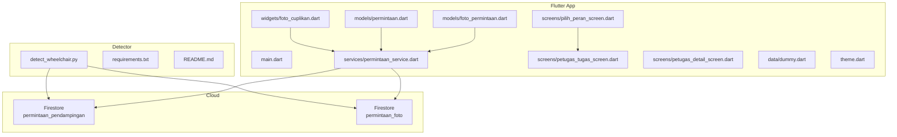

**Diagram sources**
- [detect_wheelchair.py:381-451](file://detector/detect_wheelchair.py#L381-L451)
- [permintaan_service.dart:32-136](file://whoosh_ramah/lib/services/permintaan_service.dart#L32-L136)
- [permintaan.dart:77-150](file://whoosh_ramah/lib/models/permintaan.dart#L77-L150)
- [foto_permintaan.dart:6-31](file://whoosh_ramah/lib/models/foto_permintaan.dart#L6-L31)
- [foto_cuplikan.dart:22-41](file://whoosh_ramah/lib/widgets/foto_cuplikan.dart#L22-L41)

**Section sources**
- [PROJECT.md:24-37](file://PROJECT.md#L24-L37)
- [PROJECT.md:201-225](file://PROJECT.md#L201-L225)
- [README.md (detector):10-18](file://detector/README.md#L10-L18)

## Core Components
The system revolves around five core components:

| Component | Responsibility | Key Behavior |
|---|---|---|
| Wheelchair Detector | Reads video, detects wheelchair users, writes tasks to Firestore | Supports Roboflow, YOLO-World, and local YOLO models; optional anonymous photo upload with dual-mode support |
| Task Model | Represents one assistance request | Null-safe mapping from Firestore; enums for help type and status |
| Service Layer | Encapsulates Firestore reads/writes | Streams, transactional status updates, rejection handling, arrival marking, centralized queuing |
| Photo Model | Represents verification snippet | Base64 JPEG decoding, TTL expiration check, null-safe UI state |
| FotoCuplikan Widget | Displays anonymous verification photos | Three-state display: valid image, expired placeholder, loading state |

The detector writes tasks with `sumber = kamera_ai`, while passenger requests write `sumber = aplikasi`. Staff lists both, but treats them differently through badges, titles, and verification photos.

**Section sources**
- [detect_wheelchair.py:46-91](file://detector/detect_wheelchair.py#L46-L91)
- [permintaan.dart:7-57](file://whoosh_ramah/lib/models/permintaan.dart#L7-L57)
- [permintaan_service.dart:18-33](file://whoosh_ramah/lib/services/permintaan_service.dart#L18-L33)
- [foto_permintaan.dart:6-31](file://whoosh_ramah/lib/models/foto_permintaan.dart#L6-L31)
- [foto_cuplikan.dart:22-41](file://whoosh_ramah/lib/widgets/foto_cuplikan.dart#L22-L41)

## Architecture Overview
At a high level, the system uses Firestore as the single source of truth. The detector writes tasks and optional verification photos. The Flutter app streams tasks and renders role-specific views.

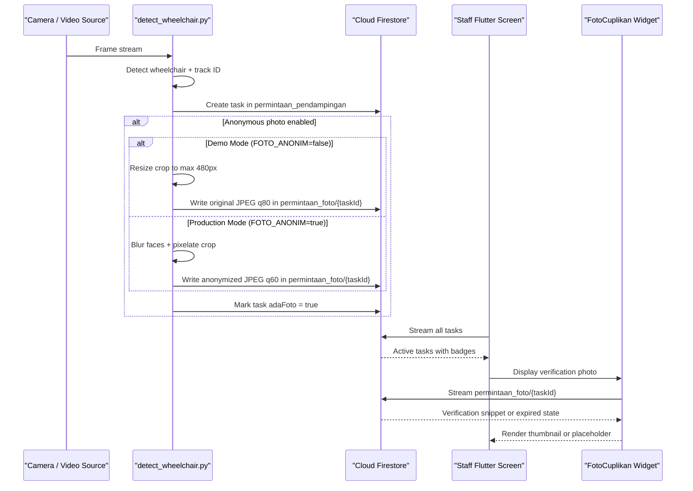

**Diagram sources**
- [detect_wheelchair.py:573-707](file://detector/detect_wheelchair.py#L573-L707)
- [detect_wheelchair.py:381-451](file://detector/detect_wheelchair.py#L381-L451)
- [permintaan_service.dart:109-136](file://whoosh_ramah/lib/services/permintaan_service.dart#L109-L136)
- [foto_cuplikan.dart:43-62](file://whoosh_ramah/lib/widgets/foto_cuplikan.dart#L43-L62)
- [petugas_tugas_screen.dart:24-28](file://whoosh_ramah/lib/screens/petugas_tugas_screen.dart#L24-L28)

## Detailed Component Analysis

### Dual-Mode Photo Processing Pipeline
**Updated** The photo processing pipeline now supports two distinct modes controlled by the `FOTO_ANONIM` environment variable, providing flexibility between demo and production environments.

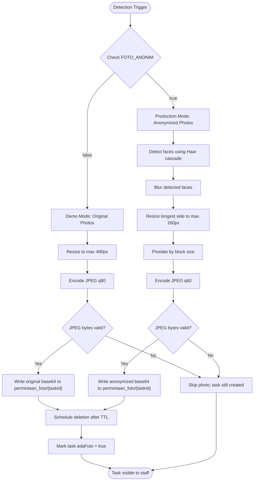

**Diagram sources**
- [detect_wheelchair.py:230-279](file://detector/detect_wheelchair.py#L230-L279)
- [detect_wheelchair.py:296-344](file://detector/detect_wheelchair.py#L296-L344)
- [detect_wheelchair.py:336-344](file://detector/detect_wheelchair.py#L336-L344)
- [detect_wheelchair.py:425-451](file://detector/detect_wheelchair.py#L425-L451)

Key behaviors:
- **Demo Mode** (`FOTO_ANONIM=false`): Uses original photos resized to maximum 480px with JPEG quality 80, suitable for hackathon demos with consenting participants
- **Production Mode** (`FOTO_ANONIM=true`): Applies face blurring using OpenCV's Haar cascade followed by pixelation, limiting output to maximum 160px with JPEG quality 60
- **Automatic Mode Switching**: The `siapkan_foto()` function automatically selects the appropriate processing path based on the `FOTO_ANONIM` environment variable
- **Fallback Safety**: If any processing step fails, the task is still created without a photo to maintain system reliability

**Section sources**
- [detect_wheelchair.py:207-279](file://detector/detect_wheelchair.py#L207-L279)
- [detect_wheelchair.py:296-344](file://detector/detect_wheelchair.py#L296-L344)
- [detect_wheelchair.py:425-451](file://detector/detect_wheelchair.py#L425-L451)

### Configuration and Environment Variables
**New** The system provides comprehensive configuration options through environment variables, with special emphasis on the dual-mode photo processing capability.

| Variable | Default | Description |
|---|---:|---|
| `FOTO_AKTIF` | `true` | Enable/disable verification photo functionality |
| `FOTO_ANONIM` | `false` | **Critical**: Controls photo processing mode - false for demo (original), true for production (anonymized) |
| `FOTO_TTL_DETIK` | `600` | Time-to-live for verification photos in seconds (10 minutes) |
| `FOTO_MAKS_PIKSEL` | `480` | Maximum pixel dimension for original photos in demo mode |

**Updated** Mode-specific behavior:
- **Demo Mode** (`FOTO_ANONIM=false`): Original photos up to 480px, JPEG quality 80, no face blurring or pixelation
- **Production Mode** (`FOTO_ANONIM=true`): Automatic face blurring with Haar cascade detection, pixelation, maximum 160px, JPEG quality 60

**Section sources**
- [detect_wheelchair.py:89-97](file://detector/detect_wheelchair.py#L89-L97)
- [detect_wheelchair.py:207-214](file://detector/detect_wheelchair.py#L207-L214)
- [detect_wheelchair.py:336-344](file://detector/detect_wheelchair.py#L336-L344)
- [README.md (detector):85-88](file://detector/README.md#L85-L88)

### New FotoCuplikan Widget
**Updated** Third phase implementation introduces a dedicated FotoCuplikan widget for displaying anonymous verification photos with three distinct states, enhanced to handle both demo and production photo formats seamlessly.

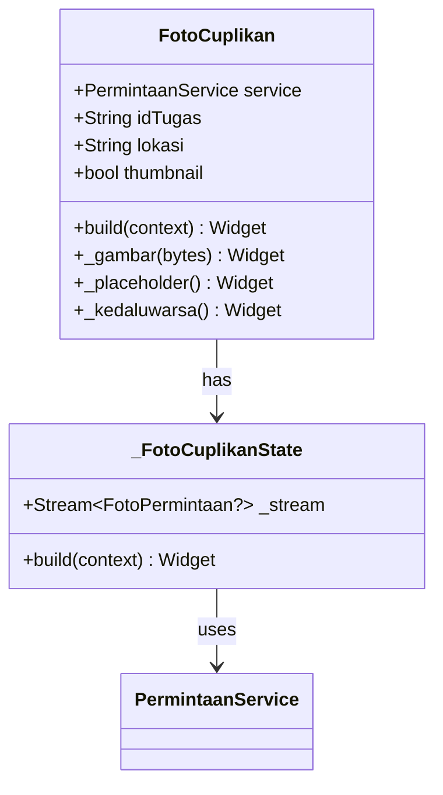

**Diagram sources**
- [foto_cuplikan.dart:22-41](file://whoosh_ramah/lib/widgets/foto_cuplikan.dart#L22-L41)
- [foto_cuplikan.dart:43-62](file://whoosh_ramah/lib/widgets/foto_cuplikan.dart#L43-L62)

Key features:
- **Three-state display**: Shows valid images, expired placeholders, or loading states
- **Memory-only rendering**: Uses Image.memory to avoid disk writes
- **Accessibility support**: Proper Semantics labels for screen readers
- **Responsive sizing**: Thumbnail mode (56x56) vs full-size display
- **Stream-based updates**: Real-time photo updates via PermintaanService.streamFoto
- **Dual-mode compatibility**: Handles both original and anonymized photo formats transparently

**Section sources**
- [foto_cuplikan.dart:22-152](file://whoosh_ramah/lib/widgets/foto_cuplikan.dart#L22-L152)

### Enhanced Service Layer with Centralized Queuing
**Updated** The PermintaanService now includes a centralized queuing mechanism (_antrePerId) and comprehensive rejection workflow.

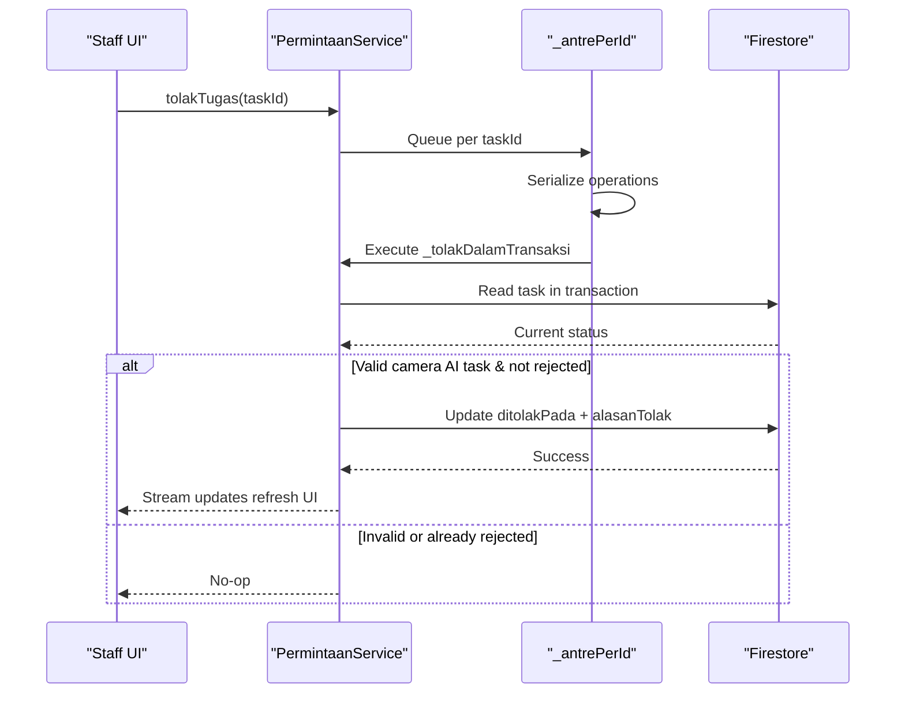

**Diagram sources**
- [permintaan_service.dart:138-156](file://whoosh_ramah/lib/services/permintaan_service.dart#L138-L156)
- [permintaan_service.dart:224-243](file://whoosh_ramah/lib/services/permintaan_service.dart#L224-L243)

Enhanced capabilities:
- **Centralized queuing**: `_antrePerId` prevents race conditions across all service methods
- **Comprehensive rejection**: `tolakTugas` method handles false-positive camera detections
- **Transaction safety**: All status changes run in Firestore transactions
- **Idempotent operations**: Multiple rapid clicks don't cause duplicate writes
- **StreamFoto method**: Dedicated stream for verification photo updates

**Section sources**
- [permintaan_service.dart:138-156](file://whoosh_ramah/lib/services/permintaan_service.dart#L138-L156)
- [permintaan_service.dart:215-243](file://whoosh_ramah/lib/services/permintaan_service.dart#L215-L243)

### Task Data Model
The task model maps Firestore documents into a null-safe Dart object. It includes enums for help type and status, plus derived properties for UI logic such as whether the task came from the camera, whether it is finished, and whether it can be rejected.

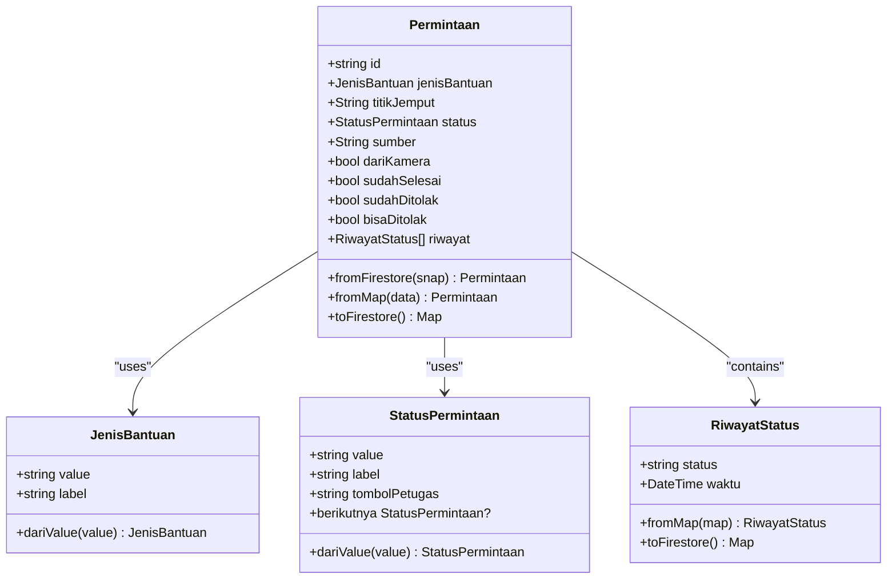

**Diagram sources**
- [permintaan.dart:7-57](file://whoosh_ramah/lib/models/permintaan.dart#L7-L57)
- [permintaan.dart:59-75](file://whoosh_ramah/lib/models/permintaan.dart#L59-L75)
- [permintaan.dart:77-163](file://whoosh_ramah/lib/models/permintaan.dart#L77-L163)
- [permintaan.dart:183-253](file://whoosh_ramah/lib/models/permintaan.dart#L183-L253)

Important constraints:
- Enum values must match exactly between the detector and the Flutter app.
- Documents from the detector may lack fields like `riwayat`, `idPenumpang`, or `petugas`; the model handles missing fields safely.
- Rejection sets `ditolakPada` but does not change the status enum.

**Section sources**
- [PROJECT.md:54-100](file://PROJECT.md#L54-L100)
- [permintaan.dart:77-163](file://whoosh_ramah/lib/models/permintaan.dart#L77-L163)
- [permintaan.dart:183-253](file://whoosh_ramah/lib/models/permintaan.dart#L183-L253)

### Verification Photo Model
The verification photo model represents the anonymous snippet stored separately from the task. It decodes base64 JPEG data and exposes expiration logic.

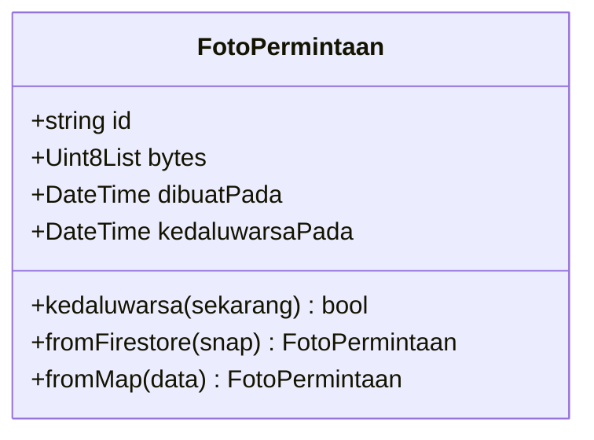

**Diagram sources**
- [foto_permintaan.dart:6-31](file://whoosh_ramah/lib/models/foto_permintaan.dart#L6-L31)
- [foto_permintaan.dart:39-62](file://whoosh_ramah/lib/models/foto_permintaan.dart#L39-L62)

Behavior highlights:
- `bytes` is null when the snapshot is missing, the field is empty, or base64 decoding fails.
- UI should show "snippet expired" rather than erroring when `bytes` is null.
- Expiration is computed from `kedaluwarsaPada`, which the detector sets to creation time plus TTL.

**Section sources**
- [foto_permintaan.dart:6-31](file://whoosh_ramah/lib/models/foto_permintaan.dart#L6-L31)
- [foto_permintaan.dart:39-62](file://whoosh_ramah/lib/models/foto_permintaan.dart#L39-L62)

### Staff Task List and Verification Thumbnail
**Updated** Enhanced staff task screen now integrates the FotoCuplikan widget for AI camera-detected tasks with improved rejection workflow.

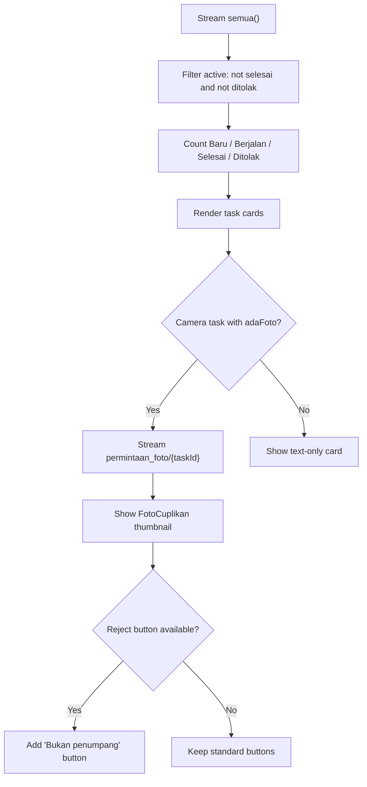

**Diagram sources**
- [petugas_tugas_screen.dart:24-28](file://whoosh_ramah/lib/screens/petugas_tugas_screen.dart#L24-L28)
- [petugas_tugas_screen.dart:155-179](file://whoosh_ramah/lib/screens/petugas_tugas_screen.dart#L155-L179)
- [petugas_tugas_screen.dart:613-618](file://whoosh_ramah/lib/screens/petugas_tugas_screen.dart#L613-L618)
- [permintaan_service.dart:127-136](file://whoosh_ramah/lib/services/permintaan_service.dart#L127-L136)

Enhanced features:
- **FotoCuplikan integration**: Seamless embedding of verification photos in task cards
- **Improved rejection workflow**: Comprehensive "Bukan penumpang / tolak" functionality
- **Better accessibility**: Proper semantics labels for screen readers
- **Real-time updates**: Live photo updates as they become available

**Section sources**
- [petugas_tugas_screen.dart:29-36](file://whoosh_ramah/lib/screens/petugas_tugas_screen.dart#L29-L36)
- [petugas_tugas_screen.dart:493-549](file://whoosh_ramah/lib/screens/petugas_tugas_screen.dart#L493-L549)
- [petugas_tugas_screen.dart:613-618](file://whoosh_ramah/lib/screens/petugas_tugas_screen.dart#L613-L618)

### Staff Detail Screen with Rejection Workflow
**Updated** The staff detail screen now includes comprehensive rejection workflow integration.

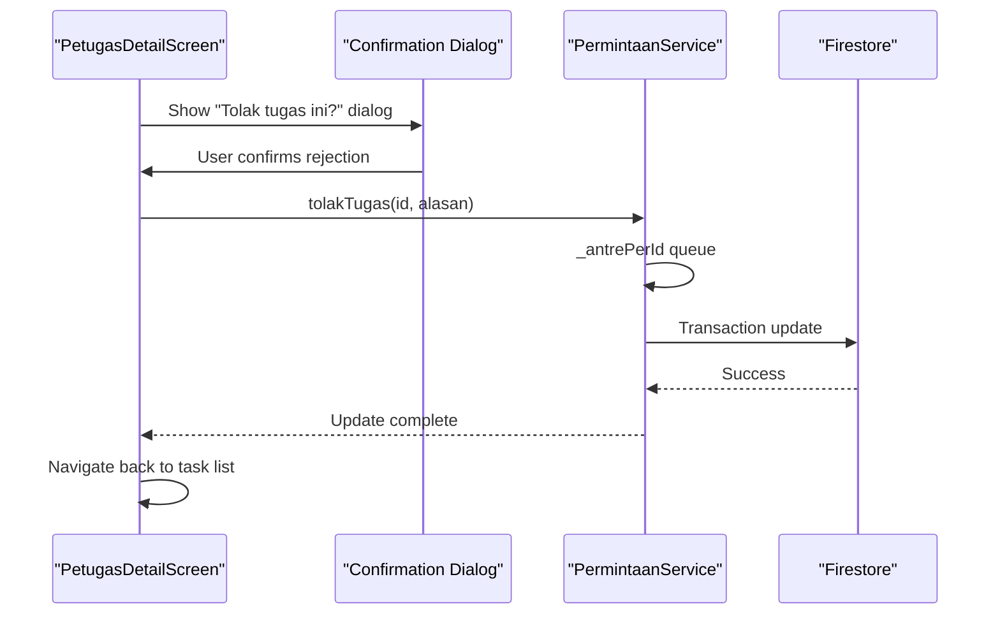

**Diagram sources**
- [petugas_detail_screen.dart:65-117](file://whoosh_ramah/lib/screens/petugas_detail_screen.dart#L65-L117)
- [permintaan_service.dart:224-243](file://whoosh_ramah/lib/services/permintaan_service.dart#L224-L243)

New capabilities:
- **Confirmation dialog**: Clear user confirmation before rejection
- **Error handling**: Proper error messages and retry mechanisms
- **Navigation flow**: Automatic return to task list after successful rejection
- **Visual feedback**: Loading states and success/error notifications

**Section sources**
- [petugas_detail_screen.dart:65-117](file://whoosh_ramah/lib/screens/petugas_detail_screen.dart#L65-L117)
- [petugas_detail_screen.dart:391-436](file://whoosh_ramah/lib/screens/petugas_detail_screen.dart#L391-L436)

### Role Selection and App Entry
The app starts by initializing Firebase and showing the role selection screen. From there, users choose Passenger, Staff, or Family.

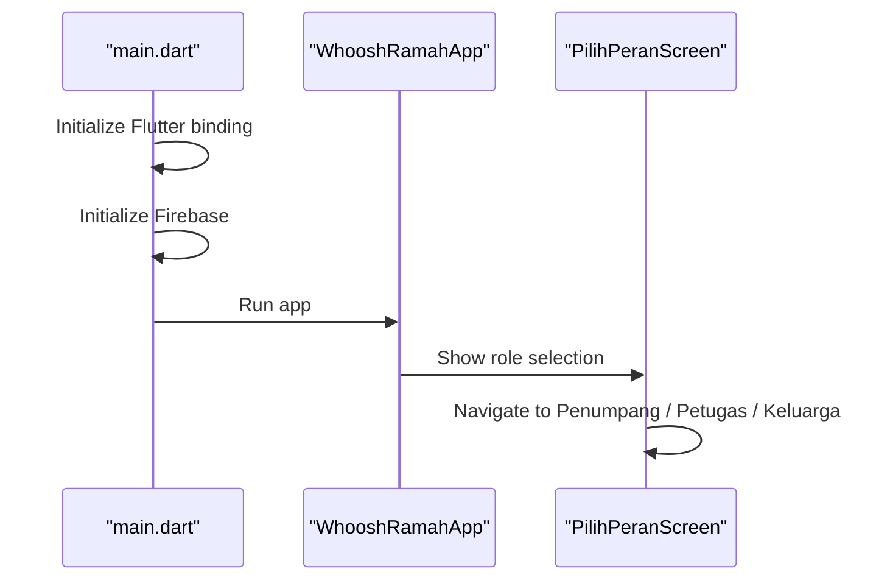

**Diagram sources**
- [main.dart:9-28](file://whoosh_ramah/lib/main.dart#L9-L28)
- [main.dart:34-47](file://whoosh_ramah/lib/main.dart#L34-L47)
- [pilih_peran_screen.dart:16-158](file://whoosh_ramah/lib/screens/pilih_peran_screen.dart#L16-L158)

**Section sources**
- [main.dart:9-47](file://whoosh_ramah/lib/main.dart#L9-L47)
- [pilih_peran_screen.dart:10-16](file://whoosh_ramah/lib/screens/pilih_peran_screen.dart#L10-L16)
- [pilih_peran_screen.dart:16-158](file://whoosh_ramah/lib/screens/pilih_peran_screen.dart#L16-L158)

### Dummy Data and Theme
Dummy data provides hard-coded passenger, staff, ticket, and pickup location information for the demo. The theme defines colors, typography, radius, shadows, and button styles following the Brightline design system.

**Section sources**
- [dummy.dart:1-141](file://whoosh_ramah/lib/data/dummy.dart#L1-L141)
- [theme.dart:3-52](file://whoosh_ramah/lib/theme.dart#L3-L52)
- [theme.dart:81-182](file://whoosh_ramah/lib/theme.dart#L81-L182)

## Dependency Analysis
The detector depends on OpenCV, Firebase Admin, and optionally Roboflow or Ultralytics depending on the selected model. The Flutter app depends on Firebase Core, Cloud Firestore, and Material UI components.

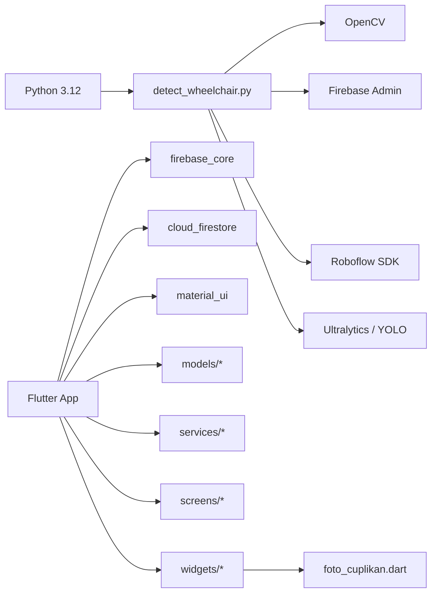

**Diagram sources**
- [detect_wheelchair.py:40-43](file://detector/detect_wheelchair.py#L40-L43)
- [detect_wheelchair.py:97-190](file://detector/detect_wheelchair.py#L97-L190)
- [detect_wheelchair.py:362-379](file://detector/detect_wheelchair.py#L362-L379)
- [main.dart:1-7](file://whoosh_ramah/lib/main.dart#L1-L7)
- [permintaan_service.dart:1-5](file://whoosh_ramah/lib/services/permintaan_service.dart#L1-L5)
- [foto_cuplikan.dart:1-7](file://whoosh_ramah/lib/widgets/foto_cuplikan.dart#L1-L7)
- [mise.toml:1-3](file://mise.toml#L1-L3)

**Section sources**
- [detect_wheelchair.py:40-91](file://detector/detect_wheelchair.py#L40-L91)
- [main.dart:1-7](file://whoosh_ramah/lib/main.dart#L1-L7)
- [permintaan_service.dart:1-5](file://whoosh_ramah/lib/services/permintaan_service.dart#L1-L5)
- [foto_cuplikan.dart:1-7](file://whoosh_ramah/lib/widgets/foto_cuplikan.dart#L1-L7)
- [mise.toml:1-3](file://mise.toml#L1-L3)

## Performance Considerations
- Detection frequency is controlled by `DETEKSI_TIAP_DETIK` to limit API calls and CPU usage.
- Tracking mode reduces duplicate tasks per person by tracking IDs instead of relying only on global streaks.
- **Updated**: Dual-mode photo processing optimizes performance based on deployment context:
  - **Demo Mode**: Larger photos (480px) with higher quality (q80) for better visual clarity in testing
  - **Production Mode**: Smaller photos (160px) with lower quality (q60) and face blurring for privacy and efficiency
- Background deletion avoids keeping expired snippets indefinitely.
- Firestore queries avoid composite indexes by doing simple `where`/`orderBy` and filtering locally.
- Transactional status updates prevent duplicate history entries and inconsistent state under concurrent edits.
- **New**: Centralized queuing mechanism (_antrePerId) prevents race conditions across all service operations.
- **New**: Memory-only image rendering in FotoCuplikan widget avoids disk I/O overhead.

[No sources needed since this section provides general guidance]

## Troubleshooting Guide
Common issues and their likely causes:

| Symptom | Likely Cause | Resolution |
|---|---|---|
| Detector exits with missing Firebase key | `firebase-key.json` not found | Place the service account key in `detector/firebase-key.json` and keep it out of version control |
| Detector cannot open camera or video source | Invalid source path or webcam unavailable | Use a valid webcam index, video file, or RTSP URL |
| No tasks appear in staff list | Firestore rules, network issue, or wrong collection name | Verify Firestore rules, internet connection, and collection name |
| Verification photo never appears | Photo writing failed, TTL expired, or `adaFoto` not set | Check detector logs, TTL settings, and whether the photo document was deleted |
| Status jumps or duplicates | Concurrent edits or double taps | Rely on transactional `majukanStatus` and per-id queue; test with multiple devices |
| Duplicate passenger requests | Multiple rapid submissions before first completes | Service blocks new requests while an active request exists |
| **New**: Wrong photo mode in production | `FOTO_ANONIM` environment variable not set correctly | Set `FOTO_ANONIM=true` for production deployments requiring face blurring |
| **New**: Poor photo quality in demo | `FOTO_MAKS_PIKSEL` too low or JPEG quality insufficient | Adjust `FOTO_MAKS_PIKSEL=480` and verify JPEG quality settings |
| **New**: Face blurring not working | Haar cascade not available or faces not detected | Ensure OpenCV Haar cascade is properly installed and faces are visible in crops |
| **New**: Rejection doesn't work properly | Queuing conflicts or transaction failures | Verify _antrePerId is working and check Firestore transaction logs |

**Section sources**
- [detect_wheelchair.py:362-379](file://detector/detect_wheelchair.py#L362-L379)
- [detect_wheelchair.py:573-604](file://detector/detect_wheelchair.py#L573-L604)
- [detect_wheelchair.py:404-423](file://detector/detect_wheelchair.py#L404-L423)
- [permintaan_service.dart:35-82](file://whoosh_ramah/lib/services/permintaan_service.dart#L35-L82)
- [permintaan_service.dart:158-213](file://whoosh_ramah/lib/services/permintaan_service.dart#L158-L213)
- [permintaan_service.dart:138-156](file://whoosh_ramah/lib/services/permintaan_service.dart#L138-L156)
- [foto_cuplikan.dart:43-62](file://whoosh_ramah/lib/widgets/foto_cuplikan.dart#L43-L62)

## Conclusion
The Anonymous Photo Verification System combines a privacy-preserving camera detector with a real-time Flutter interface. The detector creates tasks and optional anonymous verification snippets, while the app lets passengers request help, staff manage tasks, and family monitor progress. 

**Enhanced Dual-Mode Capability**: The latest implementation introduces sophisticated dual-mode photo processing controlled by the `FOTO_ANONIM` environment variable. **Demo Mode** provides original photos up to 480px for hackathon demonstrations with consenting participants, while **Production Mode** ensures privacy compliance through automatic face blurring and pixelation. This flexible approach allows the same codebase to serve both development and production environments effectively.

Additional enhancements include a dedicated FotoCuplikan widget for displaying verification photos, enhanced PermintaanService with centralized queuing (_antrePerId), comprehensive rejection workflow (tolakTugas), and improved staff UI integration for AI camera-detected tasks. These improvements provide better performance, reliability, and user experience while maintaining the system's focus on privacy and accessibility.

The design emphasizes safety, accessibility, and clear state transitions, with Firestore serving as the shared backbone. For production use, security rules, authentication, and storage policies would need strengthening beyond the demo configuration, along with proper configuration of the `FOTO_ANONIM=true` setting for privacy compliance.

[No sources needed since this section summarizes without analyzing specific files]