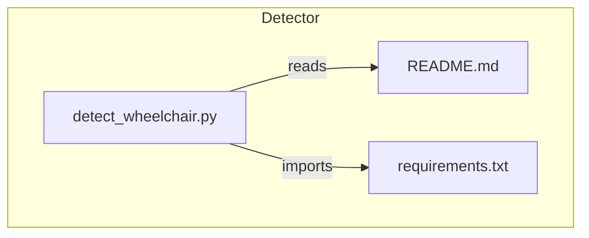
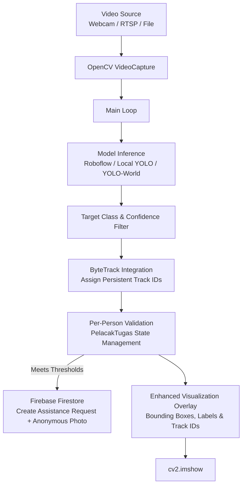
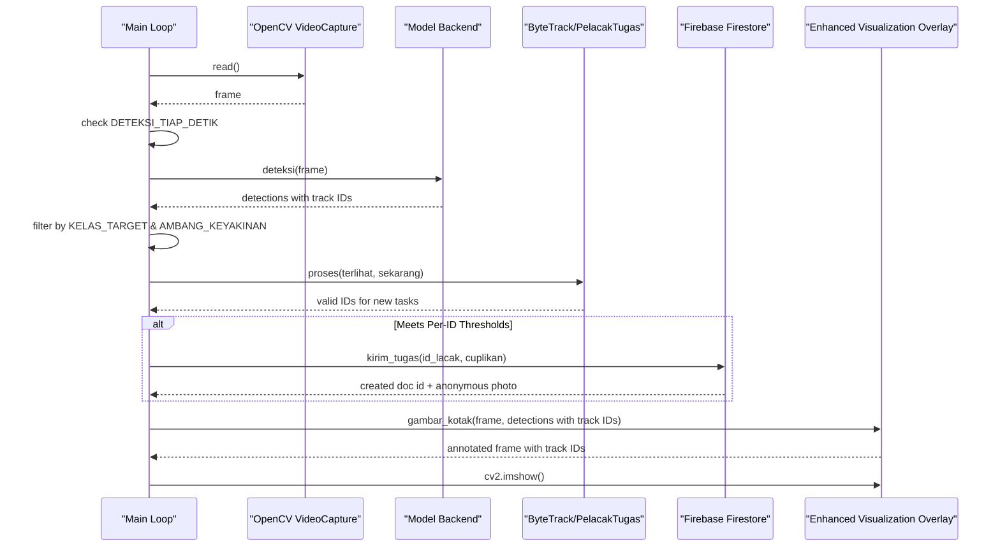
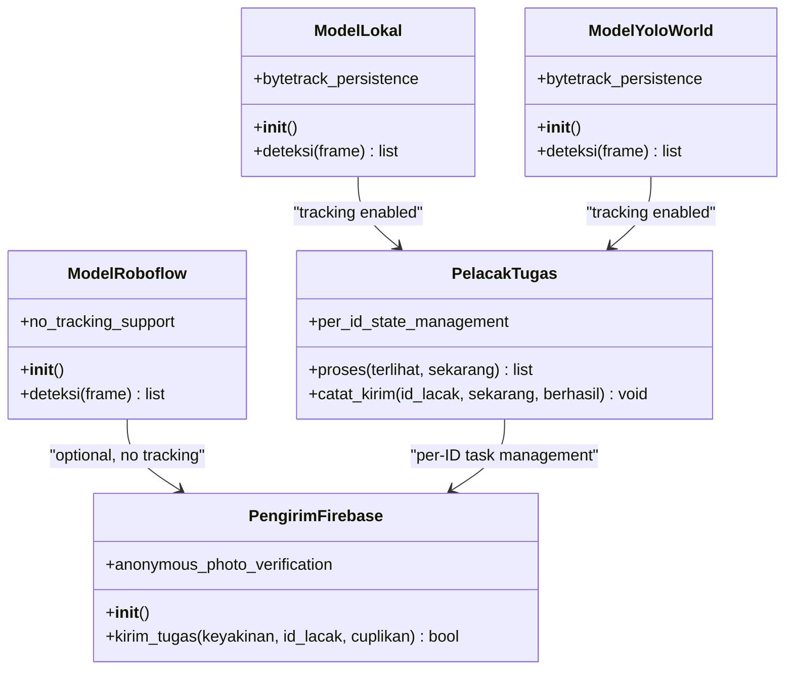
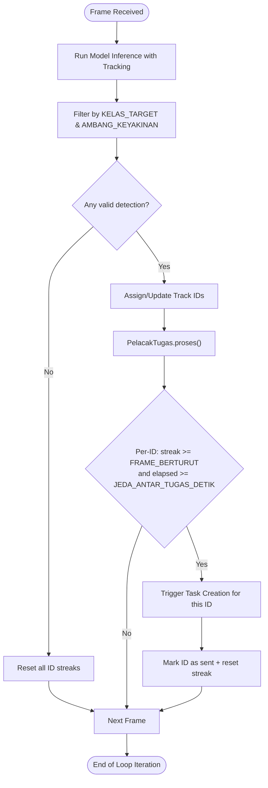
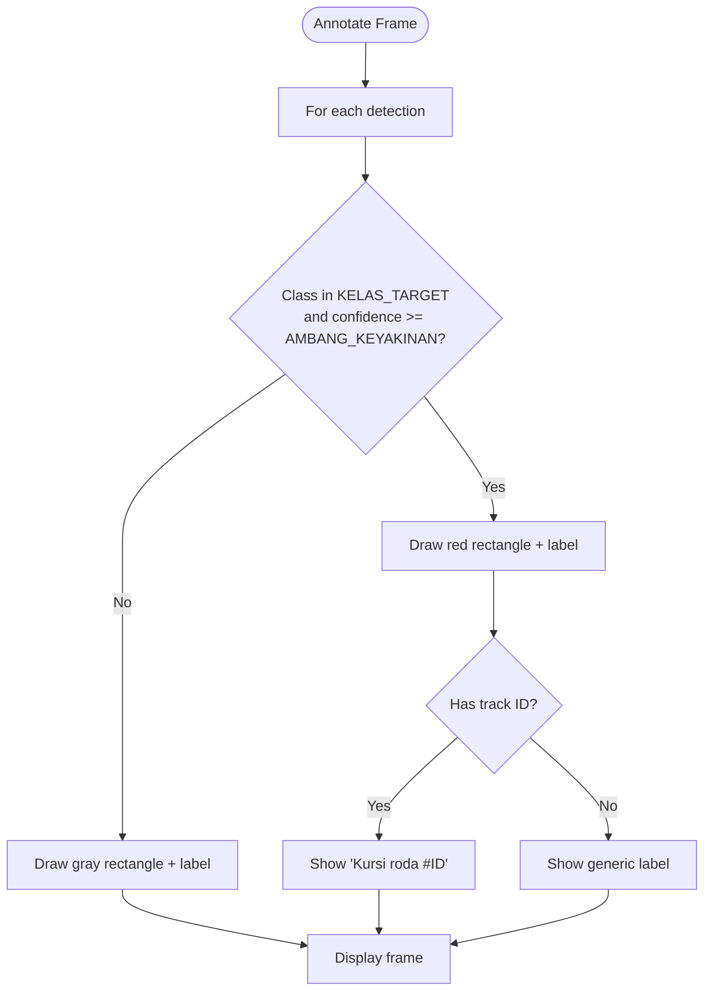
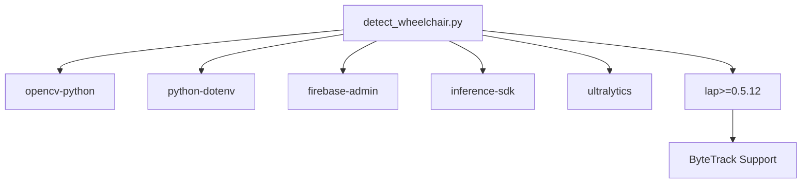

# Detection Pipeline

<cite>
**Referenced Files in This Document**
- [detect_wheelchair.py](file://detector/detect_wheelchair.py)
- [README.md](file://detector/README.md)
- [requirements.txt](file://detector/requirements.txt)
</cite>

## Update Summary
**Changes Made**
- Added comprehensive tracking system with ByteTrack integration for persistent track IDs
- Enhanced error handling to prevent detection loop crashes during model inference failures
- Implemented sophisticated per-person task tracking with `PelacakTugas` class
- Added anonymous photo verification system (O1) with face blurring and pixelation
- Updated visualization system to show track IDs for detected objects
- Improved anti-spam mechanisms with per-ID cooldown instead of global cooldown

## Table of Contents
1. [Introduction](#introduction)
2. [Project Structure](#project-structure)
3. [Core Components](#core-components)
4. [Architecture Overview](#architecture-overview)
5. [Detailed Component Analysis](#detailed-component-analysis)
6. [Dependency Analysis](#dependency-analysis)
7. [Performance Considerations](#performance-considerations)
8. [Troubleshooting Guide](#troubleshooting-guide)
9. [Conclusion](#conclusion)
10. [Appendices](#appendices)

## Introduction
This document explains the enhanced wheelchair detection pipeline implemented for Whoosh Ramah. The system reads real-time video from a webcam, CCTV stream, or video file using OpenCV, runs object detection through one of three model strategies, implements sophisticated tracking with persistent track IDs, filters and validates detections across consecutive frames, and optionally creates assistance requests in Firebase Firestore with anonymous verification photos. It also documents the enhanced visualization overlay used to show detected objects, their confidence scores, and track IDs.

The pipeline supports:
- Roboflow cloud API inference (legacy mode without tracking)
- Local YOLO models trained with Ultralytics (with ByteTrack persistence)
- YOLO-World zero-shot detection (with ByteTrack persistence)

Key enhancements include:
- **Persistent Track ID System**: Each detected wheelchair maintains a unique ID across frames
- **Per-Person Task Tracking**: One task per person, not per detection interval
- **Advanced Error Handling**: Detection loop continues even when model inference fails
- **Anonymous Photo Verification**: Automatic face blurring and pixelation for privacy
- **Sophisticated Anti-Spam**: Per-ID cooldown mechanism instead of global cooldown

## Project Structure
The detector is contained under the `detector` directory:
- `detect_wheelchair.py`: Main script implementing the full enhanced pipeline
- `README.md`: Setup instructions, usage examples, and configuration guidance
- `requirements.txt`: Python dependencies including ByteTrack support

**Diagram sources**
- [detect_wheelchair.py:21-28](file://detector/detect_wheelchair.py#L21-L28)
- [requirements.txt:1-9](file://detector/requirements.txt#L1-L9)

**Section sources**
- [detect_wheelchair.py:1-708](file://detector/detect_wheelchair.py#L1-L708)
- [README.md:1-96](file://detector/README.md#L1-L96)
- [requirements.txt:1-9](file://detector/requirements.txt#L1-L9)

## Core Components
The enhanced pipeline consists of several core components:
- Input handling via OpenCV's VideoCapture for webcam, RTSP streams, and video files
- Model abstraction supporting three backends: Roboflow, local YOLO, and YOLO-World
- **ByteTrack Integration**: Persistent track ID assignment for each detected wheelchair
- **PelacakTugas Class**: Sophisticated per-person task tracking with streak validation
- Confidence scoring and target class filtering
- Consecutive frame validation to reduce false positives
- **Per-ID Anti-Spam Mechanism**: Prevents duplicate tasks for the same person within time windows
- Optional Firebase integration to create assistance requests with anonymous verification photos
- Enhanced visualization overlay showing bounding boxes, labels, and track IDs

Key responsibilities:
- Real-time frame acquisition and display
- Frame preprocessing (none beyond color space conversion handled by OpenCV)
- Object detection via selected model backend with tracking support
- Filtering detections by target classes and confidence threshold
- Temporal validation across frames with per-ID state management
- Anonymous photo capture with face blurring and pixelation
- Alerting and logging with improved error handling
- Rendering overlays on the video feed with track ID visualization

**Section sources**
- [detect_wheelchair.py:97-180](file://detector/detect_wheelchair.py#L97-L180)
- [detect_wheelchair.py:460-533](file://detector/detect_wheelchair.py#L460-L533)
- [detect_wheelchair.py:573-708](file://detector/detect_wheelchair.py#L573-L708)

## Architecture Overview
The enhanced high-level architecture integrates input capture, detection with tracking, validation, optional alerting with photo verification, and visualization.

**Diagram sources**
- [detect_wheelchair.py:573-708](file://detector/detect_wheelchair.py#L573-L708)
- [detect_wheelchair.py:97-180](file://detector/detect_wheelchair.py#L97-L180)
- [detect_wheelchair.py:460-533](file://detector/detect_wheelchair.py#L460-L533)

## Detailed Component Analysis

### Enhanced Real-Time Video Processing Workflow
The main loop reads frames from an OpenCV VideoCapture source, performs detection at a configured interval with tracking support, filters results, applies per-person temporal validation, optionally sends alerts with anonymous photos to Firebase, and renders enhanced overlays.

**Diagram sources**
- [detect_wheelchair.py:573-708](file://detector/detect_wheelchair.py#L573-L708)
- [detect_wheelchair.py:460-533](file://detector/detect_wheelchair.py#L460-L533)

**Section sources**
- [detect_wheelchair.py:573-708](file://detector/detect_wheelchair.py#L573-L708)

### Enhanced Model Integration Approaches
Three model backends are supported with different tracking capabilities:

- **Roboflow Cloud API** (Legacy Mode)
  - Uses InferenceHTTPClient to call serverless inference
  - Converts center-point predictions to bounding boxes
  - **No tracking support** - uses legacy streak-based validation
  - Requires ROBOFLOW_API_KEY and ROBOFLOW_MODEL_ID

- **Local YOLO Models** (With ByteTrack)
  - Loads a .pt model via Ultralytics YOLO
  - Returns class names, confidence, bounding boxes, and **persistent track IDs**
  - Uses `model.track()` with `persist=True` and `tracker="bytetrack.yaml"`
  - Each detected wheelchair maintains consistent ID across frames

- **YOLO-World Zero-Shot Detection** (With ByteTrack)
  - Uses YOLOWorld with configurable class names
  - Downloads model weights once; can run offline after download
  - Sets target classes via set_classes
  - **Track ID persistence** enabled with ByteTrack integration

**Diagram sources**
- [detect_wheelchair.py:97-180](file://detector/detect_wheelchair.py#L97-L180)
- [detect_wheelchair.py:460-533](file://detector/detect_wheelchair.py#L460-L533)
- [detect_wheelchair.py:362-452](file://detector/detect_wheelchair.py#L362-L452)

**Section sources**
- [detect_wheelchair.py:97-180](file://detector/detect_wheelchair.py#L97-L180)

### Enhanced Confidence Scoring, Target Class Filtering, and Sophisticated Per-Person Validation
Confidence scoring and filtering remains the same, but validation is now per-track-ID:

- Detections are filtered by target class names (case-insensitive) and a minimum confidence threshold
- Only detections meeting both criteria contribute to the per-ID consecutive counter
- **Track ID Assignment**: ByteTrack assigns persistent IDs to each detected wheelchair across frames

**Enhanced Per-Person Validation with PelacakTugas:**
- **Per-ID Streak Tracking**: Each track ID maintains its own consecutive detection counter
- **ID Persistence Management**: Track IDs are tracked across frames with visibility monitoring
- **Automatic ID Cleanup**: IDs not seen for >30 seconds are removed, allowing re-detection
- **Per-ID Cooldown**: Each ID has its own cooldown period instead of global cooldown
- **Streak Reset Logic**: When an ID disappears, its streak resets to 0

**Diagram sources**
- [detect_wheelchair.py:460-533](file://detector/detect_wheelchair.py#L460-L533)
- [detect_wheelchair.py:634-683](file://detector/detect_wheelchair.py#L634-L683)

**Section sources**
- [detect_wheelchair.py:460-533](file://detector/detect_wheelchair.py#L460-L533)

### Enhanced Configuration Parameters
Configuration is loaded from environment variables with sensible defaults, including new parameters for tracking and photo verification:

- MODE_MODEL: Selects backend ("roboflow", "yoloworld", "lokal")
- ROBOFLOW_API_KEY / ROBOFLOW_MODEL_ID: Roboflow credentials and model ID
- MODEL_LOKAL: Path to local YOLO .pt model
- YOLOWORLD_MODEL: YOLO-World model name
- KELAS_YOLOWORLD: Zero-shot class names for YOLO-World
- KELAS_TARGET: Target class names for filtering
- AMBANG_KEYAKINAN: Minimum confidence threshold
- FRAME_BERTURUT: Required consecutive detections before alert (now per-ID)
- JEDA_ANTAR_TUGAS_DETIK: Anti-spam delay between tasks (now per-ID)
- DETEKSI_TIAP_DETIK: Detection frequency control
- LOKASI_KAMERA / ID_KAMERA: Camera metadata for alerts
- FIREBASE_KEY / KOLEKSI_FIRESTORE: Firebase service account path and collection name
- **FOTO_AKTIF**: Enable anonymous photo verification (default: true)
- **FOTO_TTL_DETIK**: Photo TTL expiration time (default: 600 seconds)
- **FOTO_MAKS_PIKSEL**: Maximum photo dimensions (default: 160px)

These parameters allow tuning detection sensitivity, performance, tracking behavior, and privacy features.

**Section sources**
- [detect_wheelchair.py:48-92](file://detector/detect_wheelchair.py#L48-L92)
- [README.md:77-88](file://detector/README.md#L77-L88)

### Enhanced Running the Detector with Different Input Sources
Supported inputs remain the same, but with enhanced tracking capabilities:
- Webcam: default device index (e.g., "0")
- Video file: path to MP4 or other supported formats
- CCTV stream: RTSP URL

Usage examples:
- Webcam with default settings: python detect_wheelchair.py
- Video file without Firebase: python detect_wheelchair.py --sumber video.mp4 --tanpa-firebase
- RTSP stream without Firebase: python detect_wheelchair.py --sumber rtsp://... --tanpa-firebase

The script opens the specified source via OpenCV's VideoCapture and raises an error if it cannot open the source.

**Section sources**
- [detect_wheelchair.py:573-590](file://detector/detect_wheelchair.py#L573-L590)
- [README.md:21-37](file://detector/README.md#L21-L37)

### Enhanced Visualization Overlay System
The enhanced visualization system draws:
- Bounding rectangles around all detections
- Labels with class name, confidence percentage, and **track ID** for tracked objects
- Color coding: red for target-class detections meeting the confidence threshold, gray otherwise
- **Track ID Display**: Shows "Kursi roda #ID" for tracked objects vs generic labels for untracked
- Status text indicating whether wheelchairs are currently being tracked across frames
- Camera location and status overlay at the top-left corner
- **Detection Count**: Shows current number of detected wheelchairs

**Diagram sources**
- [detect_wheelchair.py:538-556](file://detector/detect_wheelchair.py#L538-L556)
- [detect_wheelchair.py:685-697](file://detector/detect_wheelchair.py#L685-L697)

**Section sources**
- [detect_wheelchair.py:538-556](file://detector/detect_wheelchair.py#L538-L556)
- [detect_wheelchair.py:685-697](file://detector/detect_wheelchair.py#L685-L697)

### Enhanced Error Handling and Robustness
The pipeline now includes comprehensive error handling to prevent detection loop crashes:

- **Model Inference Errors**: Caught and logged; the pipeline continues with empty detections
- **Firebase Initialization Errors**: Cause early exit with clear messages
- **Video Source Failures**: Raise explicit errors to aid debugging
- **Per-ID Task Sending Errors**: Individual task sending failures don't crash the detection loop
- **Photo Processing Errors**: Anonymous photo processing failures don't prevent task creation
- **Background Thread Safety**: Photo cleanup thread handles errors gracefully with retry logic

**Section sources**
- [detect_wheelchair.py:623-627](file://detector/detect_wheelchair.py#L623-L627)
- [detect_wheelchair.py:652-663](file://detector/detect_wheelchair.py#L652-L663)
- [detect_wheelchair.py:425-452](file://detector/detect_wheelchair.py#L425-L452)

### Anonymous Photo Verification System (O1)
New feature for privacy-preserving verification photos:

- **Automatic Face Blurring**: Uses Haar cascade to detect and blur faces in cropped images
- **Pixelation Effect**: Applies block pixelation for additional privacy protection
- **Base64 Storage**: Photos stored as base64 in Firestore collection `permintaan_foto/{idTugas}`
- **Automatic Expiration**: Photos automatically deleted after TTL (default 600 seconds)
- **Background Cleanup**: Dedicated thread handles photo deletion with retry logic
- **Privacy First**: No personal data stored; only anonymized verification images

**Section sources**
- [detect_wheelchair.py:207-280](file://detector/detect_wheelchair.py#L207-L280)
- [detect_wheelchair.py:298-357](file://detector/detect_wheelchair.py#L298-L357)
- [detect_wheelchair.py:425-452](file://detector/detect_wheelchair.py#L425-L452)

## Dependency Analysis
External dependencies have been enhanced with ByteTrack support:
- opencv-python: Video I/O and visualization
- python-dotenv: Environment variable loading
- firebase-admin: Firestore integration
- inference-sdk: Roboflow client
- ultralytics: Local YOLO and YOLO-World support
- **lap>=0.5.12**: ByteTrack dependency for optimal linear assignment problem solving

**Diagram sources**
- [detect_wheelchair.py:21-28](file://detector/detect_wheelchair.py#L21-L28)
- [requirements.txt:1-9](file://detector/requirements.txt#L1-L9)

**Section sources**
- [requirements.txt:1-9](file://detector/requirements.txt#L1-L9)
- [detect_wheelchair.py:21-28](file://detector/detect_wheelchair.py#L21-L28)

## Performance Considerations
Enhanced performance considerations:
- Detection frequency control via DETEKSI_TIAP_DETIK reduces API calls and computational load
- **Per-ID tracking reduces redundant task creation** compared to global cooldown
- Using local YOLO models eliminates network latency and dependency on internet connectivity
- YOLO-World downloads model weights once; subsequent runs are faster and can operate offline
- Adjust AMBANG_KEYAKINAN to balance precision and recall based on deployment conditions
- For RTSP streams, ensure sufficient bandwidth and decoding performance
- **ByteTrack adds minimal overhead** while providing significant accuracy improvements
- **Background photo cleanup thread** operates independently without affecting detection performance

## Troubleshooting Guide
Enhanced troubleshooting guide with new issues:
- Missing Roboflow API key: Ensure ROBOFLOW_API_KEY is set in .env
- Missing local model file: Train and place the .pt model at MODEL_LOKAL path or use Roboflow mode
- Missing Firebase credentials: Place firebase-key.json in the detector directory or run with --tanpa-firebase
- Cannot open video source: Verify the source path or RTSP URL and permissions
- Frequent false positives: Increase AMBANG_KEYAKINAN or adjust KELAS_TARGET
- Too many alerts: Increase JEDA_ANTAR_TUGAS_DETIK or FRAME_BERTURUT
- **Track IDs not appearing**: Ensure using yoloworld or lokal mode (not roboflow)
- **Task duplicates still occurring**: Check per-ID cooldown settings and track ID persistence
- **Anonymous photos not working**: Verify FOTO_AKTIF=true and Haar cascade availability
- **Memory leaks with tracking**: Check BATAS_HILANG_DETIK setting for proper ID cleanup

Error handling improvements:
- Model inference errors are caught and logged; the pipeline continues with empty detections
- Firebase initialization errors cause early exit with clear messages
- Video source failures raise explicit errors to aid debugging
- **Individual task sending failures don't crash the detection loop**
- **Background photo cleanup thread handles errors gracefully with retry logic**

**Section sources**
- [detect_wheelchair.py:103-107](file://detector/detect_wheelchair.py#L103-L107)
- [detect_wheelchair.py:132-137](file://detector/detect_wheelchair.py#L132-L137)
- [detect_wheelchair.py:367-372](file://detector/detect_wheelchair.py#L367-L372)
- [detect_wheelchair.py:588-590](file://detector/detect_wheelchair.py#L588-L590)
- [detect_wheelchair.py:623-627](file://detector/detect_wheelchair.py#L623-L627)
- [detect_wheelchair.py:652-663](file://detector/detect_wheelchair.py#L652-L663)

## Conclusion
The enhanced wheelchair detection pipeline provides a robust, privacy-preserving system for real-time detection using OpenCV and multiple model backends. The addition of ByteTrack integration enables persistent track ID assignment, while the PelacakTugas class provides sophisticated per-person task management. Enhanced error handling ensures the detection loop continues operating even when individual components fail. The anonymous photo verification system adds privacy-preserving verification capabilities with automatic face blurring and pixelation. Operators can tune parameters to suit different environments and requirements while benefiting from improved reliability and reduced false positives.

## Appendices

### Example Commands
- Run with webcam and no Firebase: python detect_wheelchair.py --tanpa-firebase
- Run with video file: python detect_wheelchair.py --sumber video.mp4 --tanpa-firebase
- Run with RTSP stream: python detect_wheelchair.py --sumber rtsp://stream-url --tanpa-firebase

**Section sources**
- [README.md:21-37](file://detector/README.md#L21-L37)