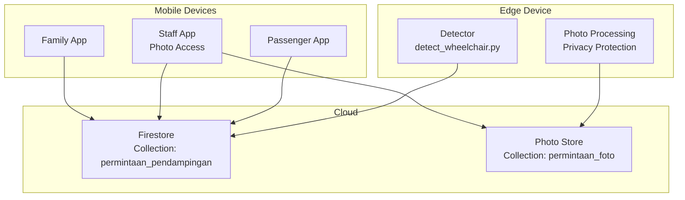
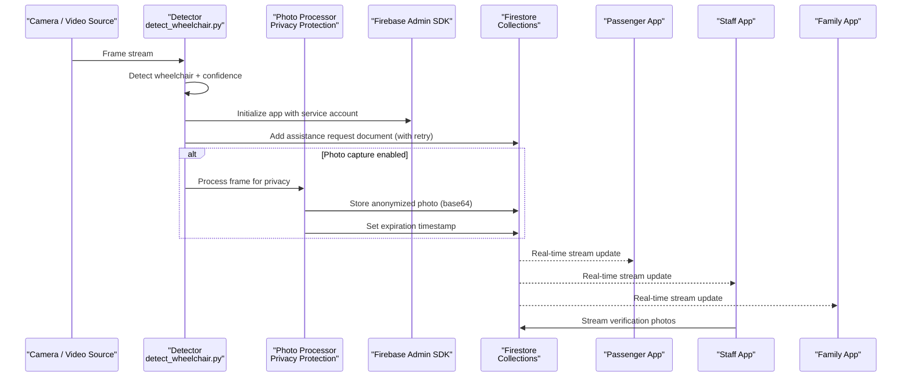
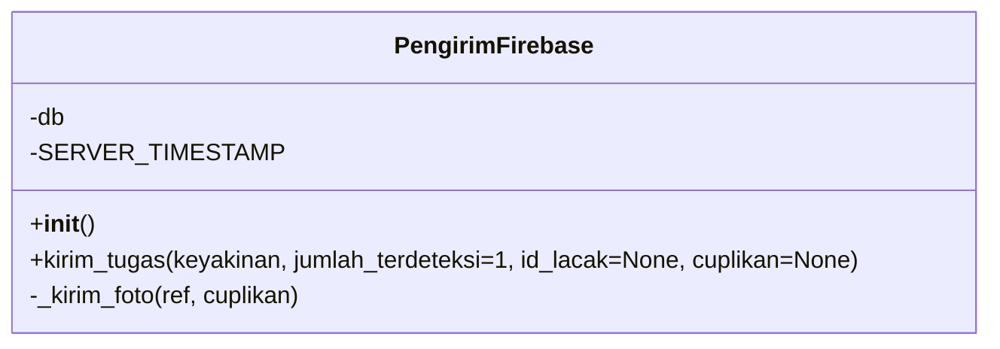
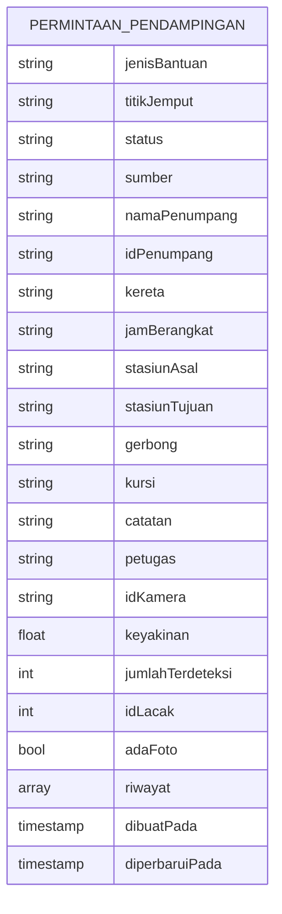
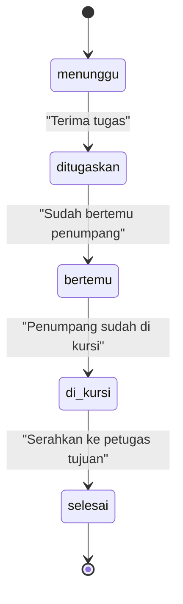
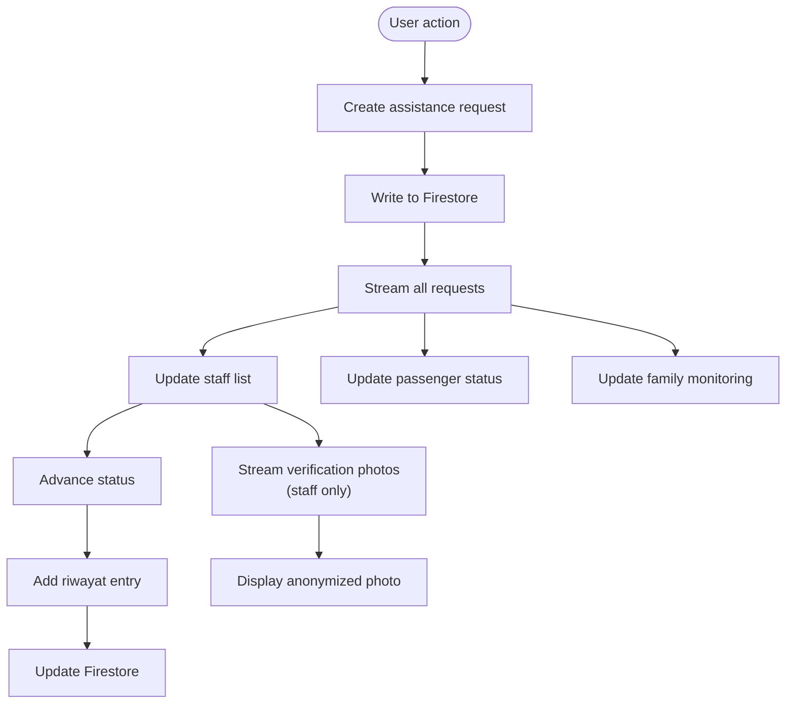
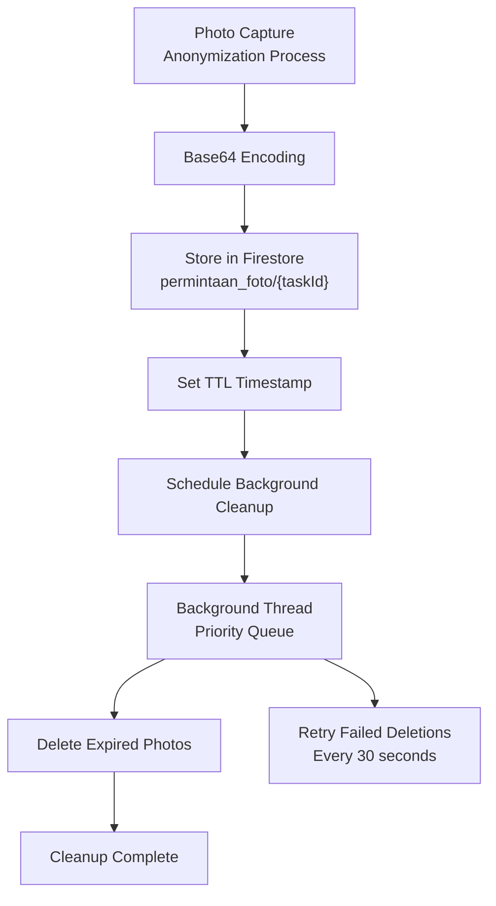
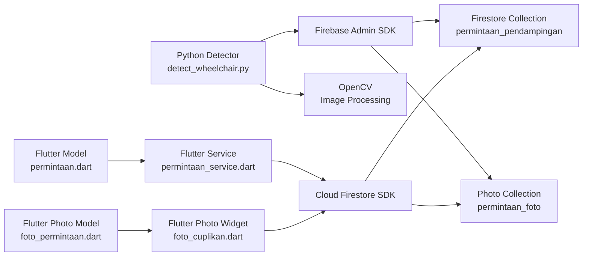

# Firebase Integration

<cite>
**Referenced Files in This Document**
- [detect_wheelchair.py](file://detector/detect_wheelchair.py)
- [foto_permintaan.dart](file://whoosh_ramah/lib/models/foto_permintaan.dart)
- [permintaan_service.dart](file://whoosh_ramah/lib/services/permintaan_service.dart)
- [foto_cuplikan.dart](file://whoosh_ramah/lib/widgets/foto_cuplikan.dart)
- [PROJECT.md](file://PROJECT.md)
</cite>

## Update Summary
**Changes Made**
- Added comprehensive photo storage capabilities with base64-encoded JPEG data in `permintaan_foto` collection
- Implemented new environment variables `FOTO_AKTIF`, `FOTO_TTL_DETIK`, and `FOTO_MAKS_PIKSEL` for photo configuration
- Enhanced privacy protection with automatic face blurring and pixelation using Haar cascade detection
- Added TTL-based automatic cleanup system for photo documents with background thread processing
- Integrated Flutter model and UI components for displaying verification photos with expiration handling
- Updated security rules to support the new photo collection alongside existing assistance requests

## Table of Contents
1. [Introduction](#introduction)
2. [Project Structure](#project-structure)
3. [Core Components](#core-components)
4. [Architecture Overview](#architecture-overview)
5. [Detailed Component Analysis](#detailed-component-analysis)
6. [Photo Storage System](#photo-storage-system)
7. [Dependency Analysis](#dependency-analysis)
8. [Performance Considerations](#performance-considerations)
9. [Troubleshooting Guide](#troubleshooting-guide)
10. [Conclusion](#conclusion)

## Introduction
This document explains how the AI detection system integrates with Firebase Firestore to automatically create assistance tasks when wheelchair users are detected by the camera detector. The system now includes enhanced photo storage capabilities that capture anonymized verification images for staff review, complete with automatic expiration and privacy protection. It covers:

- The Python `PengirimFirebase` class that writes new assistance requests into Firestore with enhanced retry logic and exponential backoff.
- The new photo storage system that captures, processes, and stores anonymized JPEG images as base64 data in the `permintaan_foto` collection.
- The Firestore data schema for assistance requests, including fields such as `jenisBantuan`, `titikJemput`, status progression, metadata, and new fields like `jumlahTerdeteksi` and `idLacak`.
- Firebase authentication using a service account key file.
- Security rules configuration for both assistance requests and photo storage.
- Example Firestore document structure created by the detector.
- How the Flutter mobile application consumes these documents through real-time streams, including photo display with expiration handling.
- Error handling, retry mechanisms with exponential backoff, and monitoring of detection-to-task conversion rates.

## Project Structure
The integration spans two main parts with enhanced photo capabilities:

- **Detector (Python):** Runs on a laptop or edge device, reads video from a webcam or CCTV, detects wheelchair users, processes verification photos with privacy protection, and writes assistance requests and photos to Firestore with enhanced reliability.
- **Mobile App (Flutter):** Reads and updates assistance requests in real time for passengers, staff, and family members, with specialized photo viewing capabilities for staff members only.

**Diagram sources**
- [detect_wheelchair.py:362-452](file://detector/detect_wheelchair.py#L362-L452)
- [PROJECT.md:24-36](file://PROJECT.md#L24-L36)

**Section sources**
- [PROJECT.md:24-36](file://PROJECT.md#L24-L36)

## Core Components
The Firebase integration relies on four core components with enhanced photo capabilities:

1. **`PengirimFirebase` (Python)**  
   Initializes Firebase Admin SDK with a service account key and creates new assistance request documents in Firestore when wheelchairs are detected, featuring enhanced retry logic with exponential backoff and integrated photo processing.

2. **`FotoPermintaan` model (Flutter)**  
   Defines the photo document schema for the `permintaan_foto` collection, including base64 image decoding, timestamp handling, and expiration checking for privacy compliance.

3. **`PermintaanService` (Flutter)**  
   Encapsulates all Firestore operations: creating requests, streaming single documents, streaming lists, filtering by passenger, advancing status with history tracking, and streaming verification photos.

4. **`FotoCuplikan` widget (Flutter)**  
   Provides specialized UI for displaying verification photos with three states: valid photo display, loading placeholder, and expired photo indication with accessibility support.

**Section sources**
- [detect_wheelchair.py:362-452](file://detector/detect_wheelchair.py#L362-L452)
- [foto_permintaan.dart:1-63](file://whoosh_ramah/lib/models/foto_permintaan.dart#L1-L63)
- [permintaan_service.dart:1-278](file://whoosh_ramah/lib/services/permintaan_service.dart#L1-L278)
- [foto_cuplikan.dart:1-152](file://whoosh_ramah/lib/widgets/foto_cuplikan.dart#L1-L152)

## Architecture Overview
The end-to-end flow now includes photo processing and storage:

1. The detector runs continuously, sampling frames at a controlled rate.
2. When a wheelchair is detected with sufficient confidence for consecutive frames, it calls `PengirimFirebase.kirim_tugas`.
3. `PengirimFirebase` initializes Firebase Admin SDK using a service account JSON file and writes a new document to the `permintaan_pendampingan` collection with enhanced retry logic.
4. If photo capture is enabled (`FOTO_AKTIF=true`), the system processes the detection frame to create an anonymized JPEG image with face blurring and pixelation.
5. The processed photo is stored as base64 data in the `permintaan_foto/{taskId}` collection with automatic expiration.
6. Flutter apps subscribe to Firestore streams and update UIs in real time, with staff apps able to view verification photos.

**Diagram sources**
- [detect_wheelchair.py:573-708](file://detector/detect_wheelchair.py#L573-L708)
- [detect_wheelchair.py:362-452](file://detector/detect_wheelchair.py#L362-L452)
- [permintaan_service.dart:127-136](file://whoosh_ramah/lib/services/permintaan_service.dart#L127-L136)

## Detailed Component Analysis

### PengirimFirebase Class
`PengirimFirebase` is responsible for:

- Validating the presence of the Firebase service account key file.
- Initializing the Firebase Admin SDK with the certificate.
- Creating Firestore client references.
- Writing new assistance request documents with required fields and enhanced retry logic.
- Managing photo capture and processing when enabled.

Key behaviors:

- Constructor checks for the service account file path configured via environment variables.
- On initialization, it sets up Firebase Admin SDK and Firestore client.
- `kirim_tugas` builds a document payload containing:
  - `jenisBantuan`: always set to wheelchair assistance for this detector.
  - `titikJemput`: camera location string.
  - `status`: starts as `menunggu`.
  - `sumber`: marks the task as created by AI camera.
  - `idKamera`: camera identifier.
  - `keyakinan`: rounded confidence score.
  - `jumlahTerdeteksi`: count of wheelchairs detected in the frame.
  - `idLacak`: track ID from ByteTrack for person tracking.
  - `namaPenumpang`: null because the passenger did not book through the app.
  - `dibuatPada`: server timestamp.
- **Enhanced Retry Logic**: Implements exponential backoff with configurable retry attempts.
- **Photo Integration**: Automatically processes and stores verification photos when enabled.

**Updated** Enhanced with photo processing capabilities and privacy protection

**Diagram sources**
- [detect_wheelchair.py:362-452](file://detector/detect_wheelchair.py#L362-L452)

**Section sources**
- [detect_wheelchair.py:362-452](file://detector/detect_wheelchair.py#L362-L452)

### Firestore Data Schema
The assistance request document lives in the `permintaan_pendampingan` collection. The schema is defined in the Flutter model and documented in the project specification.

Important fields:

| Field | Type | Meaning | Set By |
|---|---|---|---|
| `jenisBantuan` | String enum | Type of assistance requested | Passenger or detector |
| `titikJemput` | String | Pickup location | Passenger or detector |
| `status` | String enum | Workflow state | All actors |
| `sumber` | String | Source of the request (`aplikasi` or `kamera_ai`) | Automatic |
| `namaPenumpang` | String or null | Passenger name | Passenger; null for detector |
| `idPenumpang` | String or null | Passenger ID | Passenger |
| `kereta` | String or null | Train number | Passenger |
| `jamBerangkat` | String or null | Departure time | Passenger |
| `stasiunAsal` | String or null | Origin station | Passenger |
| `stasiunTujuan` | String or null | Destination station | Passenger |
| `gerbong` | String or null | Carriage number | Passenger |
| `kursi` | String or null | Seat number | Passenger |
| `catatan` | String or null | Notes | Passenger |
| `petugas` | String or null | Assigned staff member | Staff workflow |
| `idKamera` | String or null | Camera ID | Detector |
| `keyakinan` | Number or null | Detection confidence | Detector |
| `jumlahTerdeteksi` | Integer | Count of wheelchairs detected in frame | Detector |
| `idLacak` | Integer or null | Track ID from ByteTrack | Detector |
| `adaFoto` | Boolean | Has verification photo available | Detector |
| `riwayat` | Array of maps | Status change history | All actors |
| `dibuatPada` | Timestamp | Creation time | Automatic |
| `diperbaruiPada` | Timestamp | Last update time | Automatic |

**Updated** Added new field `adaFoto` for photo availability tracking

Enums:

- `jenisBantuan`: includes wheelchair, visually impaired, deaf, elderly, pregnant, porter.
- `status`: mandatory progression from `menunggu` to `selesai`.

**Updated** Added new field `adaFoto` to the entity relationship diagram

**Diagram sources**
- [permintaan.dart:77-255](file://whoosh_ramah/lib/models/permintaan.dart#L77-L255)
- [PROJECT.md:54-95](file://PROJECT.md#L54-L95)

**Section sources**
- [permintaan.dart:77-255](file://whoosh_ramah/lib/models/permintaan.dart#L77-L255)
- [PROJECT.md:54-95](file://PROJECT.md#L54-L95)

### Status Progression and History
Status progression follows a strict order:

1. `menunggu`
2. `ditugaskan`
3. `bertemu`
4. `di_kursi`
5. `selesai`

Each status change:

- Updates the `status` field.
- Updates `diperbaruiPada` with a server timestamp.
- Adds an entry to the `riwayat` array with the new status and a local timestamp.
- Sets `petugas` to a demo staff value when moving to `ditugaskan`.

**Diagram sources**
- [permintaan.dart:27-57](file://whoosh_ramah/lib/models/permintaan.dart#L27-L57)
- [permintaan_service.dart:144-193](file://whoosh_ramah/lib/services/permintaan_service.dart#L144-L193)

**Section sources**
- [permintaan.dart:27-57](file://whoosh_ramah/lib/models/permintaan.dart#L27-L57)
- [permintaan_service.dart:144-193](file://whoosh_ramah/lib/services/permintaan_service.dart#L144-L193)

### Mobile Application Real-Time Integration
The Flutter side uses `PermintaanService` to interact with Firestore:

- `buatPermintaan`: Creates a new assistance request from the passenger app.
- `streamPermintaan(id)`: Streams a single request document.
- `streamSemua()`: Streams all requests, ordered by creation time, limited to 100.
- `streamTerbaruPenumpang(idPenumpang)`: Streams the latest request for a specific passenger.
- `majukanStatus(id)`: Advances the status according to the allowed workflow.
- `streamFoto(idTugas)`: Streams verification photos for staff members only.

**Diagram sources**
- [permintaan_service.dart:44-81](file://whoosh_ramah/lib/services/permintaan_service.dart#L44-L81)
- [permintaan_service.dart:127-136](file://whoosh_ramah/lib/services/permintaan_service.dart#L127-L136)
- [permintaan_service.dart:144-193](file://whoosh_ramah/lib/services/permintaan_service.dart#L144-L193)

**Section sources**
- [permintaan_service.dart:44-193](file://whoosh_ramah/lib/services/permintaan_service.dart#L44-L193)

### Example Firestore Document Created by the Detector
When the detector identifies a wheelchair user, it creates a document similar to the following structure:

- `jenisBantuan`: `"kursi_roda"`
- `titikJemput`: camera location string
- `status`: `"menunggu"`
- `sumber`: `"kamera_ai"`
- `idKamera`: camera identifier
- `keyakinan`: rounded confidence value
- `jumlahTerdeteksi`: count of wheelchairs detected in the frame
- `idLacak`: track ID from ByteTrack (for person tracking)
- `adaFoto`: boolean indicating if verification photo was successfully stored
- `namaPenumpang`: `null`
- `dibuatPada`: server timestamp

**Updated** Enhanced document structure with photo availability tracking

This document appears immediately in the staff app's real-time list and can be advanced through the status workflow.

**Section sources**
- [detect_wheelchair.py:381-423](file://detector/detect_wheelchair.py#L381-L423)
- [PROJECT.md:60-80](file://PROJECT.md#L60-L80)

## Photo Storage System

### Privacy Protection Pipeline
The photo storage system implements comprehensive privacy protection:

1. **Face Detection**: Uses OpenCV's Haar cascade classifier to detect faces in the captured frame.
2. **Face Blurring**: Applies Gaussian blur to detected face regions with 20% expansion to ensure complete anonymity.
3. **Pixelation**: Reduces image resolution by 8x then upscales with nearest-neighbor interpolation for additional privacy.
4. **Size Limiting**: Constrains the longest side to maximum 160 pixels (configurable via `FOTO_MAKS_PIKSEL`).
5. **JPEG Compression**: Encodes as JPEG with quality setting of 60 for optimal storage efficiency.
6. **Base64 Encoding**: Converts the processed image to base64 string format for Firestore storage.

### Environment Configuration
The photo system is controlled by three environment variables:

| Variable | Default | Description |
|---|---:|---|
| `FOTO_AKTIF` | `true` | Enables/disables photo capture functionality |
| `FOTO_TTL_DETIK` | `600` | Time-to-live in seconds (default 10 minutes) |
| `FOTO_MAKS_PIKSEL` | `160` | Maximum pixel dimension for processed images |

### TTL-Based Cleanup System
The system includes an automated cleanup mechanism:

- **Background Thread**: A dedicated daemon thread processes photo expiration.
- **Priority Queue**: Manages deletion tasks with timestamps for efficient processing.
- **Retry Logic**: Failed deletions are retried every 30 seconds until successful.
- **Startup Cleanup**: Scans for expired photos from previous process runs.
- **Graceful Degradation**: Cleanup failures don't affect the main detection loop.

**Diagram sources**
- [detect_wheelchair.py:298-357](file://detector/detect_wheelchair.py#L298-L357)
- [detect_wheelchair.py:425-452](file://detector/detect_wheelchair.py#L425-L452)

### Flutter Integration
The Flutter side provides comprehensive photo handling:

- **Model Layer**: `FotoPermintaan` class handles base64 decoding, timestamp parsing, and expiration checking.
- **Service Layer**: `PermintaanService.streamFoto()` provides real-time photo streaming for staff applications.
- **UI Layer**: `FotoCuplikan` widget displays photos with three distinct states:
  - Valid photo display with memory-efficient rendering
  - Loading placeholder while waiting for first snapshot
  - Expired photo indication with accessible messaging

**Section sources**
- [detect_wheelchair.py:207-280](file://detector/detect_wheelchair.py#L207-L280)
- [detect_wheelchair.py:298-357](file://detector/detect_wheelchair.py#L298-L357)
- [foto_permintaan.dart:1-63](file://whoosh_ramah/lib/models/foto_permintaan.dart#L1-L63)
- [foto_cuplikan.dart:1-152](file://whoosh_ramah/lib/widgets/foto_cuplikan.dart#L1-L152)

## Dependency Analysis
The integration has clear boundaries between Python and Flutter with enhanced photo capabilities:

- Python detector depends on Firebase Admin SDK, OpenCV for image processing, and environment configuration.
- Flutter app depends on Cloud Firestore SDK, the `Permintaan` model, and the new `FotoPermintaan` model.
- Both sides must agree on collection names, field values, and photo data format.

**Diagram sources**
- [detect_wheelchair.py:362-452](file://detector/detect_wheelchair.py#L362-L452)
- [permintaan.dart:1-255](file://whoosh_ramah/lib/models/permintaan.dart#L1-L255)
- [permintaan_service.dart:1-278](file://whoosh_ramah/lib/services/permintaan_service.dart#L1-L278)
- [foto_permintaan.dart:1-63](file://whoosh_ramah/lib/models/foto_permintaan.dart#L1-L63)
- [foto_cuplikan.dart:1-152](file://whoosh_ramah/lib/widgets/foto_cuplikan.dart#L1-L152)

**Section sources**
- [detect_wheelchair.py:362-452](file://detector/detect_wheelchair.py#L362-L452)
- [permintaan.dart:1-255](file://whoosh_ramah/lib/models/permintaan.dart#L1-L255)
- [permintaan_service.dart:1-278](file://whoosh_ramah/lib/services/permintaan_service.dart#L1-L278)
- [foto_permintaan.dart:1-63](file://whoosh_ramah/lib/models/foto_permintaan.dart#L1-L63)
- [foto_cuplikan.dart:1-152](file://whoosh_ramah/lib/widgets/foto_cuplikan.dart#L1-L152)

## Performance Considerations
- **Detection throttling:** The detector limits detection calls per second to reduce API/model load.
- **Anti-spam delay:** A configurable delay prevents duplicate tasks for the same detection event.
- **Consecutive frame requirement:** A wheelchair must be detected multiple times consecutively before creating a task.
- **Firestore query design:** The Flutter service avoids composite indexes by ordering only on one field and sorting locally where needed.
- **Real-time streams:** Streams are used efficiently for passive UI updates rather than polling.
- **Retry mechanism:** Exponential backoff prevents overwhelming the network during transient failures.
- **Photo processing optimization:** Image processing uses efficient OpenCV operations with minimal memory footprint.
- **Background cleanup:** Photo expiration handling runs in a separate thread to avoid blocking the main detection loop.
- **Memory management:** Photos are rendered directly from memory without disk persistence for security.

## Troubleshooting Guide

### Missing Firebase Service Account Key
If the service account key file is missing, the detector exits early with a clear message. Ensure the Firebase service account JSON file exists at the configured path.

**Section sources**
- [detect_wheelchair.py:367-372](file://detector/detect_wheelchair.py#L367-L372)

### Network Failures During Detection
Detection failures are caught and logged without stopping the detector loop. The detector continues running and retries subsequent frames.

**Section sources**
- [detect_wheelchair.py:623-627](file://detector/detect_wheelchair.py#L623-L627)

### Photo Processing Issues
Common photo-related issues and solutions:

- **Face detection unavailable**: The system gracefully falls back to full-frame pixelation if Haar cascade classifiers are not available.
- **Memory constraints**: Large images are automatically resized and compressed to minimize memory usage.
- **Base64 encoding errors**: Invalid or corrupted base64 data is handled gracefully, showing "expired" state instead of crashing.
- **TTL cleanup failures**: Background cleanup retries failed deletions every 30 seconds and performs startup cleanup for orphaned photos.

### Retry Mechanisms
The implementation now includes robust retry logic with exponential backoff:

- **Configurable retry attempts:** Controlled by `PERCOBAAN_KIRIM` environment variable (default: 3).
- **Exponential backoff:** Each retry attempt waits longer than the previous one using `JEDA_COBA_LAGI_DETIK * percobaan`.
- **Graceful degradation:** Failed Firestore writes don't stop the detection loop.
- **Logging:** All retry attempts are logged with attempt numbers and error details.

Configuration parameters:
- `PERCOBAAN_KIRIM`: Number of retry attempts (default: 3)
- `JEDA_COBA_LAGI_DETIK`: Base delay between retries in seconds (default: 2.0)

**Updated** Enhanced retry mechanism with exponential backoff

### Monitoring Detection-to-Task Conversion Rates
To monitor conversion quality:

- Track the number of successful detections per camera.
- Track the number of Firestore documents created per camera.
- Compare `keyakinan` distribution across created tasks.
- Use `idKamera` and `dibuatPada` to compute hourly/daily conversion metrics.
- Monitor `jumlahTerdeteksi` to understand detection density.
- Alert when conversion drops below expected thresholds.
- Track photo capture success rates and expiration patterns.

**Updated** Added monitoring for new tracking fields and photo processing metrics

### Security Rules Configuration
For demo purposes, the security rules allow unrestricted read and write access to both collections. This is explicitly marked as demo-only and should not be used in production.

**Section sources**
- [PROJECT.md:116-130](file://PROJECT.md#L116-L130)

## Conclusion
The Firebase integration connects the AI wheelchair detector with the Whoosh Ramah mobile application through Firestore, now enhanced with comprehensive photo storage capabilities. The Python `PengirimFirebase` class writes structured assistance requests with enhanced reliability through retry logic and exponential backoff, while also processing and storing anonymized verification photos with strong privacy protection. The Flutter `Permintaan` model, `FotoPermintaan` model, and `PermintaanService` provide type-safe, real-time access to both assistance requests and verification photos. The schema enforces consistent field naming, enum-based types, and a strict status workflow. New fields like `jumlahTerdeteksi`, `idLacak`, and `adaFoto` provide enhanced tracking capabilities and photo availability indicators. For production readiness, add robust retry mechanisms, secure Firestore rules, monitoring dashboards for detection-to-task conversion metrics, and comprehensive privacy compliance measures for photo handling.

**Updated** Enhanced with improved reliability, tracking capabilities, and comprehensive photo storage with privacy protection