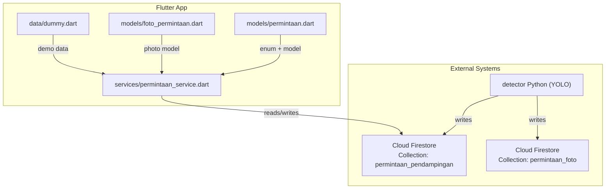
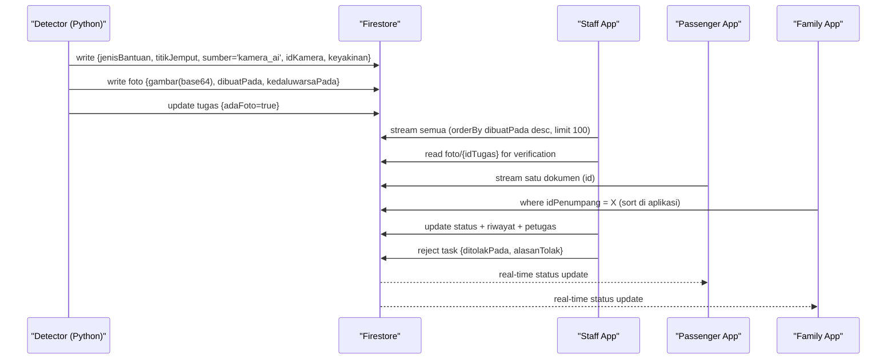
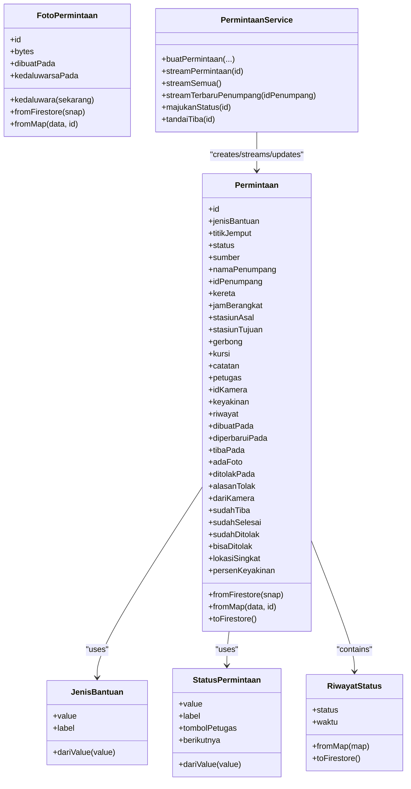

Based on my analysis of the codebase, I can now update the documentation to reflect the new FotoPermintaan model, enhanced Permintaan model fields, and null-safe handling for photos. Here's the updated documentation:

# Data Models & Schema

<cite>
**Referenced Files in This Document**
- [PROJECT.md](file://PROJECT.md)
- [permintaan.dart](file://whoosh_ramah/lib/models/permintaan.dart)
- [foto_permintaan.dart](file://whoosh_ramah/lib/models/foto_permintaan.dart)
- [permintaan_service.dart](file://whoosh_ramah/lib/services/permintaan_service.dart)
- [dummy.dart](file://whoosh_ramah/lib/data/dummy.dart)
- [permintaan_test.dart](file://whoosh_ramah/test/permintaan_test.dart)
- [foto_permintaan_test.dart](file://whoosh_ramah/test/foto_permintaan_test.dart)
</cite>

## Update Summary
**Changes Made**
- Added new `FotoPermintaan` model for anonymized JPEG snapshots stored as base64
- Enhanced `Permintaan` model with additional fields (`adaFoto`, `ditolakPada`, `alasanTolak`)
- Updated Firestore schema documentation to include photo collection structure
- Added null-safe handling for expired or missing photos
- Updated workflow documentation to include rejection functionality

## Table of Contents
1. [Introduction](#introduction)
2. [Project Structure](#project-structure)
3. [Core Components](#core-components)
4. [Architecture Overview](#architecture-overview)
5. [Detailed Component Analysis](#detailed-component-analysis)
6. [Dependency Analysis](#dependency-analysis)
7. [Performance Considerations](#performance-considerations)
8. [Troubleshooting Guide](#troubleshooting-guide)
9. [Conclusion](#conclusion)
10. [Appendices](#appendices)

## Introduction
This document describes the data model and Firestore schema for the Whoosh Ramah system, focusing on the `permintaan_pendampingan` collection and the new `permintaan_foto` collection for verification snapshots. It explains the field definitions, enum values, workflow transitions, null safety behavior for AI-detected tasks, audit history structure, serialization logic, query patterns, security considerations, privacy requirements, and retention guidance. The goal is to provide a single source of truth for developers, testers, and reviewers working with the data layer.

## Project Structure
The data model lives in the Flutter application under `lib/models`, while Firestore access is encapsulated in `lib/services`. Dummy passenger, ticket, and staff data used by the demo are defined in `lib/data`. The project specification defines the Firestore schema and rules.



**Diagram sources**
- [permintaan.dart:1-255](file://whoosh_ramah/lib/models/permintaan.dart#L1-L255)
- [foto_permintaan.dart:1-63](file://whoosh_ramah/lib/models/foto_permintaan.dart#L1-L63)
- [permintaan_service.dart:1-228](file://whoosh_ramah/lib/services/permintaan_service.dart#L1-L228)
- [dummy.dart:1-90](file://whoosh_ramah/lib/data/dummy.dart#L1-L90)
- [PROJECT.md:54-130](file://PROJECT.md#L54-L130)

**Section sources**
- [PROJECT.md:54-130](file://PROJECT.md#L54-L130)
- [permintaan.dart:1-255](file://whoosh_ramah/lib/models/permintaan.dart#L1-L255)
- [foto_permintaan.dart:1-63](file://whoosh_ramah/lib/models/foto_permintaan.dart#L1-L63)
- [permintaan_service.dart:1-228](file://whoosh_ramah/lib/services/permintaan_service.dart#L1-L228)
- [dummy.dart:1-90](file://whoosh_ramah/lib/data/dummy.dart#L1-L90)

## Core Components
- Enum `JenisBantuan`: assistance types stored as strings in Firestore.
- Enum `StatusPermintaan`: workflow states with display labels and next-state transition helper.
- Model `Permintaan`: one Firestore document representing a companion request with enhanced photo and rejection tracking.
- Model `FotoPermintaan`: one Firestore document representing an anonymized JPEG snapshot stored as base64.
- Model `RiwayatStatus`: one audit trail entry per status change.
- Service `PermintaanService`: Firestore operations for creating, streaming, and advancing requests.

Key responsibilities:
- Enforce consistent enum values between UI, service, and detector.
- Provide null-safe parsing for documents created by the AI camera.
- Maintain an append-only `riwayat` array for auditability.
- Handle photo verification workflow with TTL-based expiration.
- Support task rejection without changing workflow status.
- Use server timestamps for creation and update times.

**Section sources**
- [permintaan.dart:7-57](file://whoosh_ramah/lib/models/permintaan.dart#L7-L57)
- [permintaan.dart:59-75](file://whoosh_ramah/lib/models/permintaan.dart#L59-L75)
- [permintaan.dart:77-254](file://whoosh_ramah/lib/models/permintaan.dart#L77-L254)
- [foto_permintaan.dart:14-63](file://whoosh_ramah/lib/models/foto_permintaan.dart#L14-L63)
- [permintaan_service.dart:6-228](file://whoosh_ramah/lib/services/permintaan_service.dart#L6-L228)

## Architecture Overview
The system has four main data actors:
- Passenger app: creates requests with full passenger/ticket context.
- Staff app: reads active requests and advances workflow state.
- Family app: observes the latest request for a specific passenger ID.
- Detector (Python): writes minimal AI-detected requests directly to Firestore and stores verification photos.



**Diagram sources**
- [permintaan_service.dart:63-90](file://whoosh_ramah/lib/services/permintaan_service.dart#L63-L90)
- [permintaan_service.dart:92-119](file://whoosh_ramah/lib/services/permintaan_service.dart#L92-L119)
- [PROJECT.md:24-36](file://PROJECT.md#L24-L36)

## Detailed Component Analysis

### Firestore Collection: `permintaan_pendampingan`
Each document represents one companion request. Fields are strongly aligned with the model and tests.

| Field | Type | Required? | Default / Behavior | Notes |
|---|---|---:|---|---|
| `jenisBantuan` | string | Yes | One of enum values | Stored value must match detector and model. |
| `titikJemput` | string | Yes | Free text | Displayed location; may include station prefix. |
| `status` | string | Yes | One of enum values | Workflow state; transitions enforced by service. |
| `sumber` | string | Yes | `'aplikasi'` or `'kamera_ai'` | Indicates origin. |
| `namaPenumpang` | string \| null | No | Null for AI-detected docs | PII; only present when user submits via app. |
| `idPenumpang` | string \| null | No | Null for AI-detected docs | Used by family screen to filter latest request. |
| `kereta` | string \| null | No | Null for AI-detected docs | Train number from dummy ticket. |
| `jamBerangkat` | string \| null | No | Null for AI-detected docs | Departure time string. |
| `stasiunAsal` | string \| null | No | Null for AI-detected docs | Origin station. |
| `stasiunTujuan` | string \| null | No | Null for AI-detected docs | Destination station. |
| `gerbong` | string \| null | No | Null for AI-detected docs | Carriage number. |
| `kursi` | string \| null | No | Null for AI-detected docs | Seat identifier. |
| `catatan` | string \| null | No | Null if not provided | Optional notes. |
| `petugas` | string \| null | No | Set when advanced to `ditugaskan` | Staff name; demo uses fixed value. |
| `idKamera` | string \| null | No | Present for AI-detected docs | Camera identifier. |
| `keyakinan` | number \| null | No | Confidence score from detector | Range typically 0–1; displayed as percentage. |
| `adaFoto` | bool | No | `false` | True when anonymized photo was successfully stored. |
| `ditolakPada` | Timestamp \| null | No | Set when staff rejects task | Does NOT change workflow status. |
| `alasanTolak` | string \| null | No | Reason for rejection | Free text explanation. |
| `riwayat` | array of maps | No | Empty list if missing | Append-only audit trail. |
| `dibuatPada` | Timestamp | Yes (server) | Server timestamp | Creation time. |
| `diperbaruiPada` | Timestamp | No (server) | Server timestamp on updates | Last update time. |
| `tibaPada` | Timestamp \| null | No | Set when passenger arrives | Time passenger confirms arrival. |

Validation rules:
- `jenisBantuan` must be one of the allowed enum values. Unknown values fall back to default in model parsing.
- `status` must be one of the allowed enum values. Unknown values fall back to default in model parsing.
- `sumber` must be either `'aplikasi'` or `'kamera_ai'`.
- `riwayat` entries must contain at least `status`; `waktu` is optional but recommended.
- For AI-detected documents, many fields are intentionally absent or null; all parsing must handle this safely.
- Photo-related fields (`adaFoto`, `ditolakPada`, `alasanTolak`) are null-safe and don't affect core workflow.

**Updated** Added photo verification fields and rejection tracking capabilities.

**Section sources**
- [PROJECT.md:56-100](file://PROJECT.md#L56-L100)
- [permintaan.dart:77-254](file://whoosh_ramah/lib/models/permintaan.dart#L77-L254)
- [permintaan_test.dart:11-71](file://whoosh_ramah/test/permintaan_test.dart#L11-L71)
- [permintaan_test.dart:168-235](file://whoosh_ramah/test/permintaan_test.dart#L168-L235)

### New Firestore Collection: `permintaan_foto`
Each document represents one anonymized JPEG snapshot stored as base64.

| Field | Type | Required? | Default / Behavior | Notes |
|---|---|---:|---|---|
| `gambar` | string (base64) | Yes | Base64-encoded JPEG | Anonymized image (max 160px, pixelated, face-blurred). |
| `dibuatPada` | Timestamp | Yes (server) | Server timestamp | When photo was written. |
| `kedaluwarsaPada` | Timestamp | Yes | `dibuatPada` + TTL | Expiration time (default 10 minutes). |

Key behaviors:
- Documents are stored separately from task documents for security.
- Base64 encoding allows direct storage in Firestore without Cloud Storage.
- TTL-based expiration automatically removes old verification photos.
- Read-only from application perspective; detector manages lifecycle.

**New Section** Documentation for the new photo verification collection.

**Section sources**
- [PROJECT.md:102-115](file://PROJECT.md#L102-L115)
- [foto_permintaan.dart:6-13](file://whoosh_ramah/lib/models/foto_permintaan.dart#L6-L13)

### Model: `FotoPermintaan` (Verification Snapshot)
Responsibilities:
- Represent one Firestore document containing an anonymized JPEG snapshot.
- Decode base64 image data to bytes for display.
- Handle null-safe parsing for expired or missing photos.
- Calculate expiration status based on TTL.

Important behaviors:
- `bytes` is null when photo is missing, corrupted, or expired.
- `kedaluwarsa()` method determines if photo has exceeded its TTL.
- Constructor accepts both valid base64 strings and null values gracefully.
- Designed as read-only model; detector manages write/delete operations.

**New Section** Documentation for the new photo verification model.

**Section sources**
- [foto_permintaan.dart:14-63](file://whoosh_ramah/lib/models/foto_permintaan.dart#L14-L63)
- [foto_permintaan_test.dart:1-63](file://whoosh_ramah/test/foto_permintaan_test.dart#L1-63)

### Enhanced Model: `Permintaan`
Responsibilities:
- Represent one Firestore document with enhanced photo and rejection tracking.
- Provide null-safe parsing for both app-created and AI-detected documents.
- Expose helpers such as `dariKamera`, `sudahSelesai`, `lokasiSingkat`, and `persenKeyakinan`.
- Serialize to/from Firestore maps using consistent field names.
- Track photo availability and task rejection status.

Important behaviors:
- `dariKamera` is true when `sumber == 'kamera_ai'`.
- `adaFoto` indicates whether anonymized photo was successfully stored.
- `sudahDitolak` checks if task was rejected by staff.
- `bisaDitolak` determines if rejection button should be shown (AI tasks only).
- `tolokasiSingkat` extracts the part after `" - "` in `titikJemput`, useful for AI-detected locations like `"Stasiun Halim - Pintu Masuk Utara"`.
- `persenKeyakinan` converts `keyakinan` to a percentage integer; returns null when not available.
- `riwayat` is parsed defensively; non-list or non-map entries are ignored.

**Updated** Enhanced with photo verification and rejection tracking fields.

**Section sources**
- [permintaan.dart:77-254](file://whoosh_ramah/lib/models/permintaan.dart#L77-L254)
- [permintaan_test.dart:168-235](file://whoosh_ramah/test/permintaan_test.dart#L168-L235)

### Model: `RiwayatStatus` (Audit Trail Entry)
Structure:
- `status`: string value of the status at that point.
- `waktu`: optional timestamp when the status changed.

Rules:
- Each status change appends a new entry to `riwayat`.
- The first entry is created when the request is made.
- Subsequent entries are appended atomically using array union.

**Section sources**
- [permintaan.dart:59-75](file://whoosh_ramah/lib/models/permintaan.dart#L59-L75)
- [permintaan_service.dart:49-58](file://whoosh_ramah/lib/services/permintaan_service.dart#L49-L58)
- [permintaan_service.dart:108-114](file://whoosh_ramah/lib/services/permintaan_service.dart#L108-L114)

### Service: `PermintaanService`
Operations:
- Create a new request with full passenger/ticket context from dummy data.
- Stream a single document by ID.
- Stream all requests ordered by creation time descending, limited to 100.
- Stream the latest request for a given passenger ID, sorting client-side.
- Advance the workflow state, updating status, timestamp, and appending to `riwayat`.
- Mark passenger arrival with `tibaPada` timestamp.

Query characteristics:
- Single-field ordering (`dibuatPada`) avoids composite index requirements.
- Filtering by `idPenumpang` without ordering avoids composite index requirements; sorting is done in the app.

**Updated** Added support for tracking passenger arrival timestamps.

**Section sources**
- [permintaan_service.dart:6-228](file://whoosh_ramah/lib/services/permintaan_service.dart#L6-L228)

### Dummy Data
Used to populate demo requests and staff information:
- Passenger: name and ID.
- Ticket: train, stations, times, carriage, seat, class, and label.
- Staff: name, role, and station.
- Pickup points: predefined list of locations.

These values are copied into Firestore documents when a passenger submits a request.

**Section sources**
- [dummy.dart:1-90](file://whoosh_ramah/lib/data/dummy.dart#L1-L90)
- [permintaan_service.dart:23-61](file://whoosh_ramah/lib/services/permintaan_service.dart#L23-L61)

## Dependency Analysis


**Diagram sources**
- [permintaan.dart:7-254](file://whoosh_ramah/lib/models/permintaan.dart#L7-L254)
- [foto_permintaan.dart:14-63](file://whoosh_ramah/lib/models/foto_permintaan.dart#L14-L63)
- [permintaan_service.dart:10-228](file://whoosh_ramah/lib/services/permintaan_service.dart#L10-L228)

**Section sources**
- [permintaan.dart:7-254](file://whoosh_ramah/lib/models/permintaan.dart#L7-L254)
- [foto_permintaan.dart:14-63](file://whoosh_ramah/lib/models/foto_permintaan.dart#L14-L63)
- [permintaan_service.dart:10-228](file://whoosh_ramah/lib/services/permintaan_service.dart#L10-L228)

## Performance Considerations
- Ordering by a single field (`dibuatPada`) avoids composite indexes and keeps queries efficient.
- Limiting streams to 100 documents prevents unbounded growth in memory usage.
- Client-side sorting for passenger-specific streams avoids additional indexes; acceptable for small datasets typical of the demo.
- Using server timestamps ensures consistent ordering across devices.
- Base64-encoded photos add payload size but eliminate need for separate storage services.
- TTL-based photo expiration reduces long-term storage costs.

[No sources needed since this section provides general guidance]

## Troubleshooting Guide
Common issues and resolutions:
- Unknown enum values: model parsing falls back to defaults (`kursiRoda` for assistance type, `menunggu` for status). Verify that detector and app use identical string values.
- Missing fields in AI-detected documents: ensure all code handles nulls for passenger/ticket fields and empty `riwayat`.
- Status not advancing: check that current status is not already `selesai` and that the next state exists.
- Sorting anomalies: when `dibuatPada` is not yet populated, client-side comparator treats it as older than populated timestamps.
- Photo verification issues: check if `adaFoto` is true before attempting to load photo documents.
- Expired photos: handle null `bytes` gracefully by showing "Cuplikan sudah kedaluwarsa" state.
- Task rejection: verify that `bisaDitolak` returns true before allowing rejection actions.

Relevant validation and fallback logic:
- Enum fallbacks and next-state computation.
- Defensive parsing of `riwayat`.
- Null-safe construction from Firestore snapshots.
- Base64 decoding error handling for corrupted photo data.
- TTL expiration calculation for verification photos.

**Updated** Added troubleshooting for photo verification and task rejection scenarios.

**Section sources**
- [permintaan.dart:20-24](file://whoosh_ramah/lib/models/permintaan.dart#L20-L24)
- [permintaan.dart:45-56](file://whoosh_ramah/lib/models/permintaan.dart#L45-L56)
- [permintaan.dart:182-189](file://whoosh_ramah/lib/models/permintaan.dart#L182-L189)
- [permintaan.dart:213-215](file://whoosh_ramah/lib/models/permintaan.dart#L213-L215)
- [foto_permintaan.dart:55-62](file://whoosh_ramah/lib/models/foto_permintaan.dart#L55-L62)
- [permintaan_service.dart:121-134](file://whoosh_ramah/lib/services/permintaan_service.dart#L121-L134)
- [permintaan_test.dart:128-148](file://whoosh_ramah/test/permintaan_test.dart#L128-L148)
- [permintaan_test.dart:168-235](file://whoosh_ramah/test/permintaan_test.dart#L168-L235)

## Conclusion
The Whoosh Ramah data model centers on two Firestore collections with clear enums, null-safe parsing, and comprehensive audit trails. The enhanced `Permintaan` model now supports photo verification workflows and task rejection without disrupting the core workflow. The new `FotoPermintaan` model provides secure, TTL-managed storage for anonymized verification snapshots. The service layer enforces workflow transitions and maintains consistency between the passenger app, staff app, family app, and AI detector. By adhering to the documented field contracts, enum values, and query patterns, the system remains simple, testable, and suitable for hackathon demonstrations while providing a solid foundation for future production hardening.

[No sources needed since this section summarizes without analyzing specific files]

## Appendices

### A. Firestore Security Rules (Demo)
For demonstration purposes, read/write access to the collections is open. Do not deploy these rules in production.

```
rules_version = '2';
service cloud.firestore {
  match /databases/{database}/documents {
    match /permintaan_pendampingan/{doc} {
      allow read, write: if true;   // Demo only
    }
    match /permintaan_foto/{doc} {
      allow read, write: if true;   // Demo only
    }
  }
}
```

**Section sources**
- [PROJECT.md:116-130](file://PROJECT.md#L116-L130)

### B. Privacy and Retention Guidance
Privacy:
- The detector does not send photos or faces; only assistance type, location, confidence, and timestamps are stored.
- Verification photos are anonymized (pixelated, face-blurred) and stored as base64 in Firestore.
- Passenger names and ticket details are demo data and should be treated as sensitive in production.
- Only staff screens can access verification photos; passengers and families never receive them.

Retention:
- Verification photos have automatic TTL expiration (default 10 minutes) managed by the detector.
- The repository does not define explicit retention policies for task documents. Implement lifecycle rules to archive or delete completed requests after a defined period.
- Avoid retaining unnecessary PII beyond operational needs.

**Updated** Added guidance for verification photo privacy and TTL-based retention.

**Section sources**
- [PROJECT.md:102-115](file://PROJECT.md#L102-L115)
- [PROJECT.md:245-249](file://PROJECT.md#L245-L249)

### C. Query Patterns Summary
- All active requests: order by `dibuatPada` descending, limit 100.
- Latest request per passenger: filter by `idPenumpang`, sort client-side by `dibuatPada`.
- Single request stream: listen to document by ID.
- Verification photos: read from `permintaan_foto/{idTugas}` when `adaFoto` is true.

**Updated** Added query pattern for verification photos.

**Section sources**
- [permintaan_service.dart:63-90](file://whoosh_ramah/lib/services/permintaan_service.dart#L63-L90)

### D. Sample Data Structures
Below are conceptual examples of what appears in Firestore. These are not code snippets; they illustrate the shape of documents.

AI-detected request with photo:
- `jenisBantuan`: one of enum values
- `titikJemput`: e.g., `"Stasiun Halim - Pintu Masuk Utara"`
- `status`: `"menunggu"`
- `sumber`: `"kamera_ai"`
- `idKamera`: camera identifier
- `keyakinan`: confidence score
- `adaFoto`: `true`
- `namaPenumpang`: null
- `dibuatPada`: server timestamp
- Other fields: absent or null

App-submitted request:
- Includes all passenger and ticket fields
- `sumber`: `"aplikasi"`
- `riwayat`: initial entry with status and timestamp
- `dibuatPada` and `diperbaruiPada`: server timestamps

Verification photo document:
- `gambar`: base64-encoded JPEG string
- `dibuatPada`: server timestamp
- `kedaluwarsaPada`: expiration timestamp

Rejected task example:
- All standard fields plus:
- `ditolakPada`: timestamp when rejected
- `alasanTolak`: reason text
- `status`: unchanged (workflow continues normally)

**Updated** Added examples for verification photos and rejected tasks.

**Section sources**
- [permintaan_test.dart:11-71](file://whoosh_ramah/test/permintaan_test.dart#L11-L71)
- [permintaan_test.dart:73-126](file://whoosh_ramah/test/permintaan_test.dart#L73-L126)
- [permintaan_test.dart:168-235](file://whoosh_ramah/test/permintaan_test.dart#L168-L235)
- [foto_permintaan_test.dart:1-63](file://whoosh_ramah/test/foto_permintaan_test.dart#L1-L63)