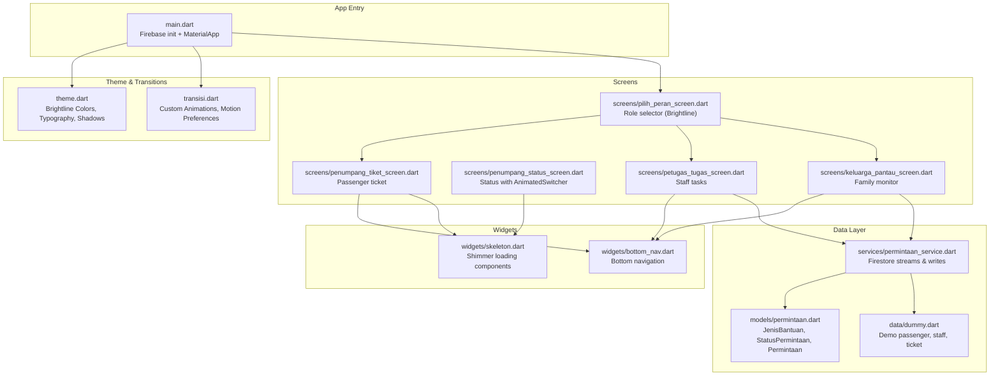
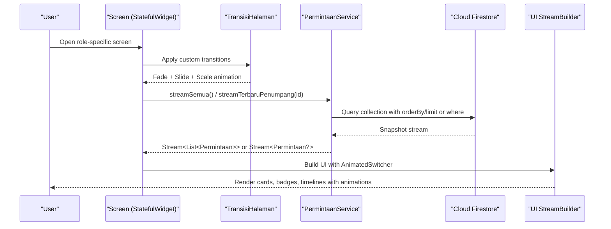
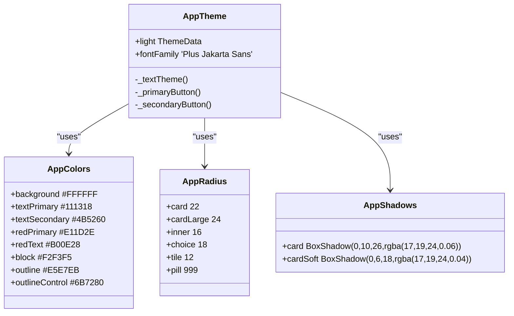
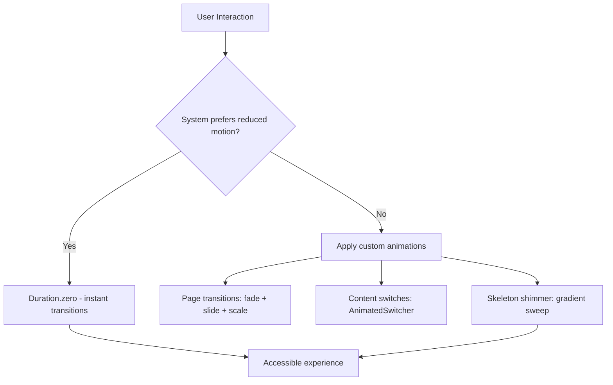
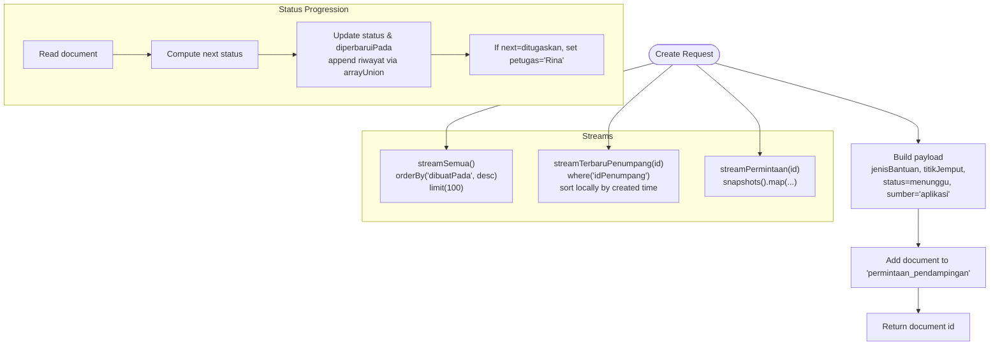
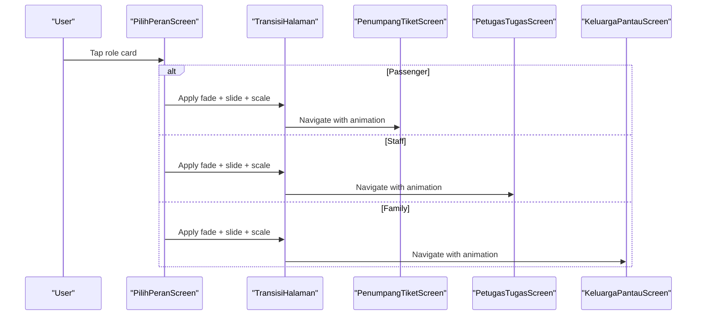
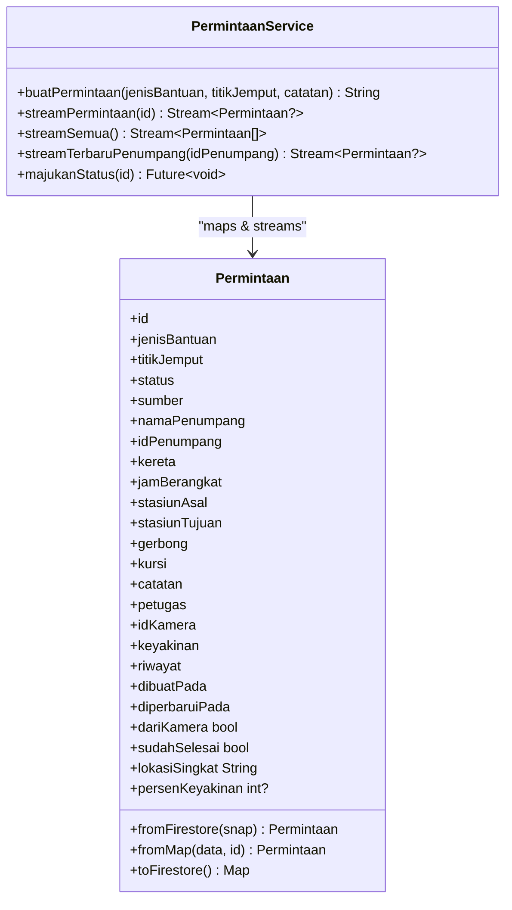
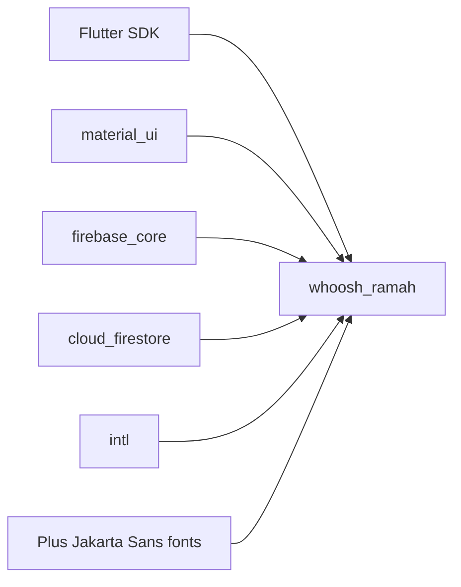
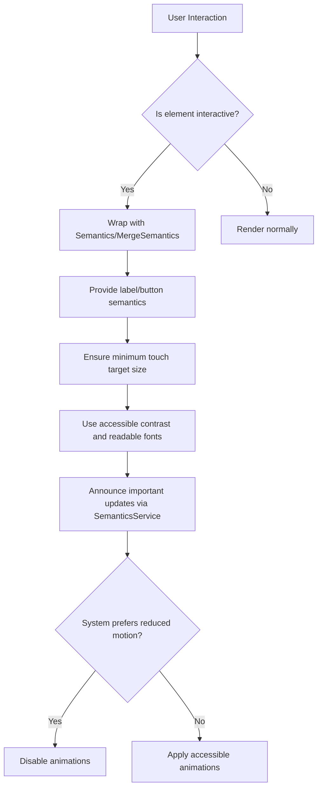

# Mobile Application

<cite>
**Referenced Files in This Document**
- [main.dart](file://whoosh_ramah/lib/main.dart)
- [theme.dart](file://whoosh_ramah/lib/theme.dart)
- [transisi.dart](file://whoosh_ramah/lib/transisi.dart)
- [pubspec.yaml](file://whoosh_ramah/pubspec.yaml)
- [permintaan.dart](file://whoosh_ramah/lib/models/permintaan.dart)
- [permintaan_service.dart](file://whoosh_ramah/lib/services/permintaan_service.dart)
- [pilih_peran_screen.dart](file://whoosh_ramah/lib/screens/pilih_peran_screen.dart)
- [penumpang_tiket_screen.dart](file://whoosh_ramah/lib/screens/penumpang_tiket_screen.dart)
- [penumpang_status_screen.dart](file://whoosh_ramah/lib/screens/penumpang_status_screen.dart)
- [petugas_tugas_screen.dart](file://whoosh_ramah/lib/screens/petugas_tugas_screen.dart)
- [keluarga_pantau_screen.dart](file://whoosh_ramah/lib/screens/keluarga_pantau_screen.dart)
- [bottom_nav.dart](file://whoosh_ramah/lib/widgets/bottom_nav.dart)
- [skeleton.dart](file://whoosh_ramah/lib/widgets/skeleton.dart)
- [dummy.dart](file://whoosh_ramah/lib/data/dummy.dart)
</cite>

## Update Summary
**Changes Made**
- Updated theme system to implement Brightline design principles with Plus Jakarta Sans typography
- Added comprehensive skeleton loading components with shimmer effects
- Enhanced animations throughout the app using AnimatedSwitcher and custom transitions
- Implemented accessibility-focused design tokens with WCAG compliance
- Updated navigation system with smooth fade, slide, and scale transitions
- Redesigned role selection interface following Brightline design guidelines

## Table of Contents
1. [Introduction](#introduction)
2. [Project Structure](#project-structure)
3. [Core Components](#core-components)
4. [Architecture Overview](#architecture-overview)
5. [Detailed Component Analysis](#detailed-component-analysis)
6. [Dependency Analysis](#dependency-analysis)
7. [Performance Considerations](#performance-considerations)
8. [Accessibility and WCAG Compliance](#accessibility-and-wcag-compliance)
9. [Troubleshooting Guide](#troubleshooting-guide)
10. [Conclusion](#conclusion)

## Introduction
This Flutter mobile application provides a real-time assistance workflow for train passengers, station staff, and family members. The application has undergone a major UI/UX overhaul implementing Brightline design principles, featuring a clean white canvas with a single red brand accent, enhanced animations, and comprehensive accessibility support. It uses Firebase Firestore streams to synchronize assistance requests across roles, while keeping the UI organized by screens, models, services, and reusable widgets. The app follows an MVVM-inspired structure:
- Models represent domain data and persistence contracts.
- Services encapsulate Firestore operations and business rules.
- Screens manage user-facing state and orchestrate service calls.
- Widgets provide reusable UI building blocks including skeleton loaders and animated components.

The theme system is built around accessible design tokens, including color palettes per role, Plus Jakarta Sans typography, spacing, radii, shadows, and button styles. Navigation starts with a role selection screen that routes passengers, staff, and family members into their respective flows with smooth transitions.

## Project Structure
The Flutter code lives under `whoosh_ramah/lib` and is organized by feature layers:
- `lib/main.dart`: App entry point, Firebase initialization, and root widget.
- `lib/theme.dart`: Brightline design tokens, colors, Plus Jakarta Sans typography, and Material theme configuration.
- `lib/transisi.dart`: Custom transition animations and motion preferences handling.
- `lib/models/`: Domain models such as assistance requests and status history.
- `lib/services/`: Data layer using Cloud Firestore streams and writes.
- `lib/screens/`: Role-based screens for passengers, staff, and family monitoring.
- `lib/widgets/`: Shared UI components like bottom navigation, skeleton loaders, and hero headers.
- `lib/data/`: Demo and dummy data used during development and testing.

**Diagram sources**
- [main.dart:8-33](file://whoosh_ramah/lib/main.dart#L8-L33)
- [theme.dart:3-182](file://whoosh_ramah/lib/theme.dart#L3-L182)
- [transisi.dart:1-67](file://whoosh_ramah/lib/transisi.dart#L1-L67)
- [permintaan.dart:7-213](file://whoosh_ramah/lib/models/permintaan.dart#L7-L213)
- [permintaan_service.dart:10-135](file://whoosh_ramah/lib/services/permintaan_service.dart#L10-L135)
- [pilih_peran_screen.dart:10-248](file://whoosh_ramah/lib/screens/pilih_peran_screen.dart#L10-L248)
- [penumpang_tiket_screen.dart:18-200](file://whoosh_ramah/lib/screens/penumpang_tiket_screen.dart#L18-L200)
- [penumpang_status_screen.dart:18-308](file://whoosh_ramah/lib/screens/penumpang_status_screen.dart#L18-L308)
- [petugas_tugas_screen.dart:28-133](file://whoosh_ramah/lib/screens/petugas_tugas_screen.dart#L28-L133)
- [keluarga_pantau_screen.dart:19-133](file://whoosh_ramah/lib/screens/keluarga_pantau_screen.dart#L19-L133)
- [bottom_nav.dart:22-54](file://whoosh_ramah/lib/widgets/bottom_nav.dart#L22-L54)
- [skeleton.dart:1-236](file://whoosh_ramah/lib/widgets/skeleton.dart#L1-L236)
- [dummy.dart:56-89](file://whoosh_ramah/lib/data/dummy.dart#L56-L89)

**Section sources**
- [main.dart:8-33](file://whoosh_ramah/lib/main.dart#L8-L33)
- [pubspec.yaml:30-40](file://whoosh_ramah/pubspec.yaml#L30-L40)

## Core Components
- App entry and theme:
  - The app initializes Firebase and sets up a light theme with Brightline design principles, Plus Jakarta Sans typography, and custom colors.
  - The root screen is the role selection screen with modern card-based layout.
- Models:
  - Assistance request model includes type of help, pickup location, source (app or AI camera), status, timestamps, and status history.
  - Enums define supported assistance types and a strict status progression.
- Services:
  - Firestore collection access for creating requests, streaming all tasks, streaming the latest request for a passenger, and advancing status.
- Screens:
  - Role selector routes to passenger ticket, staff task list, and family monitoring with smooth transitions.
  - Passenger ticket shows trip details and invites assistance requests.
  - Status screen features AnimatedSwitcher for smooth status transitions and skeleton loading states.
  - Staff task list listens to Firestore and highlights new tasks with haptic feedback and announcements.
  - Family monitor displays current status, journey progress, and timeline, announcing changes to assistive technologies.
- Widgets:
  - Bottom navigation provides role-themed active states and accessible labels.
  - Skeleton loading components with shimmer effects for better UX during data loading.

**Section sources**
- [main.dart:8-33](file://whoosh_ramah/lib/main.dart#L8-L33)
- [permintaan.dart:7-213](file://whoosh_ramah/lib/models/permintaan.dart#L7-L213)
- [permintaan_service.dart:10-135](file://whoosh_ramah/lib/services/permintaan_service.dart#L10-L135)
- [pilih_peran_screen.dart:10-248](file://whoosh_ramah/lib/screens/pilih_peran_screen.dart#L10-L248)
- [penumpang_tiket_screen.dart:18-200](file://whoosh_ramah/lib/screens/penumpang_tiket_screen.dart#L18-L200)
- [penumpang_status_screen.dart:18-308](file://whoosh_ramah/lib/screens/penumpang_status_screen.dart#L18-L308)
- [petugas_tugas_screen.dart:28-133](file://whoosh_ramah/lib/screens/petugas_tugas_screen.dart#L28-L133)
- [keluarga_pantau_screen.dart:19-133](file://whoosh_ramah/lib/screens/keluarga_pantau_screen.dart#L19-L133)
- [bottom_nav.dart:22-54](file://whoosh_ramah/lib/widgets/bottom_nav.dart#L22-L54)
- [skeleton.dart:1-236](file://whoosh_ramah/lib/widgets/skeleton.dart#L1-L236)

## Architecture Overview
The application follows a layered architecture with enhanced animation support:
- Presentation layer: Screens and widgets render UI with smooth transitions and handle user interactions.
- State management: Streams from Firestore drive reactive UI updates; local state tracks notifications and highlights.
- Animation layer: Custom transitions and AnimatedSwitcher provide smooth content changes.
- Data layer: Service abstracts Firestore queries and mutations; models map documents to typed objects.
- Theme layer: Centralized Brightline design tokens ensure consistent styling and accessibility.

**Diagram sources**
- [transisi.dart:15-67](file://whoosh_ramah/lib/transisi.dart#L15-L67)
- [penumpang_status_screen.dart:288-303](file://whoosh_ramah/lib/screens/penumpang_status_screen.dart#L288-L303)
- [petugas_tugas_screen.dart:38-133](file://whoosh_ramah/lib/screens/petugas_tugas_screen.dart#L38-L133)
- [keluarga_pantau_screen.dart:32-133](file://whoosh_ramah/lib/screens/keluarga_pantau_screen.dart#L32-L133)
- [permintaan_service.dart:63-90](file://whoosh_ramah/lib/services/permintaan_service.dart#L63-L90)

## Detailed Component Analysis

### Brightline Design System and Accessibility-Focused Tokens
The theme implements Brightline design principles with:
- Color palette:
  - White canvas background for all screens
  - Single red brand accent (#E11D2E) for primary actions
  - Near-black text (#111318) for maximum contrast
  - Neutral grays for secondary elements and skeleton loading
  - Supporting colors for notes, outlines, connectors, and hero backgrounds
- Typography:
  - Plus Jakarta Sans font family with sizes and weights aligned to accessibility guidelines
  - Display sizes: 42px for headlines, 32px for subheadlines, 26px for section titles
  - Body text: 17px for primary content, 15px for secondary text, 13px for captions
  - Eyebrow text: 12px with wide letter-spacing for labels
- Radii:
  - Consistent rounded corners: 22px for cards, 16px for inner boxes, 12px for tiles
  - Pill-shaped buttons and badges with 999px radius
- Shadows:
  - Soft card shadows following Brightline specifications (0 10px 26px rgba tinta 6%)
  - Subtle elevation without heavy visual weight
- Buttons:
  - Primary buttons: Red pill-shaped with 56px height and 17px bold text
  - Secondary buttons: White with 2px borders and 52px height
  - Minimum touch targets and accessible tap target sizing

**Diagram sources**
- [theme.dart:3-182](file://whoosh_ramah/lib/theme.dart#L3-L182)

**Section sources**
- [theme.dart:3-182](file://whoosh_ramah/lib/theme.dart#L3-L182)
- [pubspec.yaml:75-87](file://whoosh_ramah/pubspec.yaml#L75-L87)

### Enhanced Animation System with Custom Transitions
The application features a comprehensive animation system:
- Custom page transitions with fade, slide, and scale effects
- Respect for system "reduce motion" preferences
- Smooth content transitions using AnimatedSwitcher
- Skeleton loading animations with shimmer effects
- Consistent timing curves and durations throughout the app

Key animation features:
- Page transitions: 300ms forward, 240ms backward with easeOutCubic curves
- Content switches: Fade + scale transitions for status pills and timeline items
- Skeleton shimmer: 1500ms gradient sweep animation for loading states
- Motion preferences: Automatic disabling when system reduces motion is enabled

**Diagram sources**
- [transisi.dart:3-13](file://whoosh_ramah/lib/transisi.dart#L3-L13)
- [transisi.dart:38-67](file://whoosh_ramah/lib/transisi.dart#L38-L67)
- [skeleton.dart:40-94](file://whoosh_ramah/lib/widgets/skeleton.dart#L40-L94)

**Section sources**
- [transisi.dart:1-67](file://whoosh_ramah/lib/transisi.dart#L1-L67)
- [penumpang_status_screen.dart:288-303](file://whoosh_ramah/lib/screens/penumpang_status_screen.dart#L288-L303)

### Skeleton Loading Components
New skeleton loading system provides:
- Shimmer effect with gradient sweep animation
- Accessible loading announcements for screen readers
- Respects system motion preferences
- Multiple component types: boxes, lines, cards, and detail layouts
- Mimics actual screen layout for better UX during loading

Components include:
- `Skeleton`: Main container with shimmer animation
- `SkeletonBox`: Basic rectangular or circular placeholder
- `SkeletonLine`: Text line placeholder
- `SkeletonCard`: Card container with shadow
- `SkeletonRincian`: Detail card layout with avatar and info rows

**Section sources**
- [skeleton.dart:1-236](file://whoosh_ramah/lib/widgets/skeleton.dart#L1-L236)

### Data Layer: Firestore Streams and Real-Time Sync
The data layer centers on:
- `Permintaan` model mapping Firestore documents to strongly-typed Dart objects.
- `PermintaanService` providing:
  - Creating assistance requests with initial status and timestamps.
  - Streaming all tasks ordered by creation time.
  - Streaming the latest request for a specific passenger.
  - Advancing status through a strict sequence and recording history.

**Diagram sources**
- [permintaan_service.dart:23-61](file://whoosh_ramah/lib/services/permintaan_service.dart#L23-L61)
- [permintaan_service.dart:63-90](file://whoosh_ramah/lib/services/permintaan_service.dart#L63-L90)
- [permintaan_service.dart:92-119](file://whoosh_ramah/lib/services/permintaan_service.dart#L92-L119)

**Section sources**
- [permintaan.dart:7-213](file://whoosh_ramah/lib/models/permintaan.dart#L7-L213)
- [permintaan_service.dart:10-135](file://whoosh_ramah/lib/services/permintaan_service.dart#L10-L135)

### Role-Based Navigation System
The app supports three user types with enhanced navigation:
- Passengers: View ticket details and initiate assistance requests.
- Staff: Receive and manage tasks, advance statuses, and view summaries.
- Family members: Monitor the latest assistance request for a passenger and receive status updates.

Navigation flow with animations:
- Root screen presents role cards with Brightline design
- Each card navigates to a dedicated screen with custom transitions
- Screens use shared bottom navigation and hero headers
- All transitions respect system motion preferences

**Diagram sources**
- [pilih_peran_screen.dart:10-248](file://whoosh_ramah/lib/screens/pilih_peran_screen.dart#L10-L248)
- [transisi.dart:38-67](file://whoosh_ramah/lib/transisi.dart#L38-L67)
- [penumpang_tiket_screen.dart:18-200](file://whoosh_ramah/lib/screens/penumpang_tiket_screen.dart#L18-L200)
- [petugas_tugas_screen.dart:28-133](file://whoosh_ramah/lib/screens/petugas_tugas_screen.dart#L28-L133)
- [keluarga_pantau_screen.dart:19-133](file://whoosh_ramah/lib/screens/keluarga_pantau_screen.dart#L19-L133)

**Section sources**
- [pilih_peran_screen.dart:10-248](file://whoosh_ramah/lib/screens/pilih_peran_screen.dart#L10-L248)

### Common Patterns: State Management, Firebase Integration, UI Components
- State management:
  - Screens use `StreamBuilder` to reactively update UI based on Firestore snapshots.
  - Local state tracks known IDs, highlighted cards, timers, and last announced status.
  - AnimatedSwitcher handles smooth transitions between different UI states.
- Firebase integration:
  - Service methods encapsulate reads and writes; streams return typed model lists or single objects.
  - Server timestamps are used for creation/update times; client timestamps are used for history entries.
- UI components:
  - Hero headers, white cards, bottom navigation, and pill buttons are reused across screens.
  - Skeleton loading components provide consistent loading experiences.
  - Semantics and MergeSemantics enhance accessibility for screen readers.

**Diagram sources**
- [permintaan_service.dart:10-135](file://whoosh_ramah/lib/services/permintaan_service.dart#L10-L135)
- [permintaan.dart:81-213](file://whoosh_ramah/lib/models/permintaan.dart#L81-L213)

**Section sources**
- [penumpang_status_screen.dart:288-303](file://whoosh_ramah/lib/screens/penumpang_status_screen.dart#L288-L303)
- [petugas_tugas_screen.dart:38-133](file://whoosh_ramah/lib/screens/petugas_tugas_screen.dart#L38-L133)
- [keluarga_pantau_screen.dart:32-133](file://whoosh_ramah/lib/screens/keluarga_pantau_screen.dart#L32-L133)
- [bottom_nav.dart:22-54](file://whoosh_ramah/lib/widgets/bottom_nav.dart#L22-L54)

## Dependency Analysis
The main dependencies include:
- Flutter SDK and Material UI package for UI components.
- Firebase Core and Cloud Firestore for backend integration.
- Internationalization library for date formatting.
- Custom fonts bundled via pubspec (Plus Jakarta Sans).

**Diagram sources**
- [pubspec.yaml:30-40](file://whoosh_ramah/pubspec.yaml#L30-L40)
- [pubspec.yaml:75-87](file://whoosh_ramah/pubspec.yaml#L75-L87)

**Section sources**
- [pubspec.yaml:30-40](file://whoosh_ramah/pubspec.yaml#L30-L40)
- [pubspec.yaml:75-87](file://whoosh_ramah/pubspec.yaml#L75-L87)

## Performance Considerations
- Firestore queries:
  - Use single-field ordering (`dibuatPada`) to avoid composite index requirements.
  - Limit results to recent documents to reduce bandwidth and processing.
- Client-side sorting:
  - For queries requiring additional filters, sort locally to avoid composite indexes.
- Stream handling:
  - Avoid redundant rebuilds by minimizing state changes and using efficient builders.
- Animation performance:
  - Respect system motion preferences to improve performance on devices with reduced motion settings.
  - Use efficient animation techniques like AnimatedSwitcher for content transitions.
- UI rendering:
  - Reuse widgets and avoid deep nested layouts where possible.
  - Use semantic wrappers sparingly to balance accessibility and performance.
- Skeleton loading:
  - Efficient shimmer animation using ShaderMask for better performance than multiple animated containers.

[No sources needed since this section provides general guidance]

## Accessibility and WCAG Compliance
The app implements comprehensive accessibility practices following WCAG guidelines:
- Semantic labeling:
  - Interactive cards and buttons wrap content in `Semantics` and `MergeSemantics` to provide clear labels and roles.
- Screen reader announcements:
  - New tasks and status changes trigger `SemanticsService.sendAnnouncement` to inform assistive technology users.
  - Skeleton loading provides accessible loading announcements.
- Touch targets:
  - Button styles enforce minimum heights and padded tap targets to meet WCAG guidelines.
- Contrast and typography:
  - Text colors follow WCAG AA standards with ratios exceeding 4.5:1 for normal text and 3:1 for large text.
  - Plus Jakarta Sans font provides excellent readability across all sizes.
- Visual cues:
  - Status badges and progress bars use both color and text labels to convey meaning beyond color alone.
- Motion preferences:
  - All animations respect system "reduce motion" preferences, automatically disabling animations when requested.
- Skeleton loading accessibility:
  - Loading states announce themselves to screen readers with descriptive labels.
  - Static skeleton display when animations are disabled ensures loading information remains accessible.

**Diagram sources**
- [pilih_peran_screen.dart:168-228](file://whoosh_ramah/lib/screens/pilih_peran_screen.dart#L168-L228)
- [penumpang_status_screen.dart:194-208](file://whoosh_ramah/lib/screens/penumpang_status_screen.dart#L194-L208)
- [petugas_tugas_screen.dart:62-90](file://whoosh_ramah/lib/screens/petugas_tugas_screen.dart#L62-L90)
- [keluarga_pantau_screen.dart:46-77](file://whoosh_ramah/lib/screens/keluarga_pantau_screen.dart#L46-L77)
- [theme.dart:138-182](file://whoosh_ramah/lib/theme.dart#L138-L182)
- [skeleton.dart:15-20](file://whoosh_ramah/lib/widgets/skeleton.dart#L15-L20)

**Section sources**
- [pilih_peran_screen.dart:168-228](file://whoosh_ramah/lib/screens/pilih_peran_screen.dart#L168-L228)
- [penumpang_status_screen.dart:194-208](file://whoosh_ramah/lib/screens/penumpang_status_screen.dart#L194-L208)
- [petugas_tugas_screen.dart:62-90](file://whoosh_ramah/lib/screens/petugas_tugas_screen.dart#L62-L90)
- [keluarga_pantau_screen.dart:46-77](file://whoosh_ramah/lib/screens/keluarga_pantau_screen.dart#L46-L77)
- [theme.dart:138-182](file://whoosh_ramah/lib/theme.dart#L138-L182)
- [skeleton.dart:15-20](file://whoosh_ramah/lib/widgets/skeleton.dart#L15-L20)

## Troubleshooting Guide
Common issues and resolutions:
- Firestore query errors:
  - Ensure queries use single-field ordering; add composite indexes if required by more complex filters.
- Missing data:
  - Verify that dummy data fields match Firestore field names when creating requests.
- Status not updating:
  - Confirm that status progression logic computes the next valid status and updates history correctly.
- Accessibility not working:
  - Check that interactive elements have proper semantics and labels; verify announcements are triggered on state changes.
- Animation issues:
  - Verify that system motion preferences are properly detected and respected.
  - Ensure AnimatedSwitcher keys change appropriately to trigger transitions.
- Skeleton loading problems:
  - Confirm skeleton components are properly wrapped with accessibility labels.
  - Check that shimmer animations respect motion preferences.

**Section sources**
- [permintaan_service.dart:70-90](file://whoosh_ramah/lib/services/permintaan_service.dart#L70-L90)
- [permintaan_service.dart:92-119](file://whoosh_ramah/lib/services/permintaan_service.dart#L92-L119)
- [petugas_tugas_screen.dart:62-90](file://whoosh_ramah/lib/screens/petugas_tugas_screen.dart#L62-L90)
- [transisi.dart:3-13](file://whoosh_ramah/lib/transisi.dart#L3-L13)
- [skeleton.dart:46-54](file://whoosh_ramah/lib/widgets/skeleton.dart#L46-L54)

## Conclusion
This application provides a robust, accessible, and real-time assistance workflow for train travel with a modern Brightline design system. The major UI/UX overhaul introduces enhanced animations, skeleton loading components, and comprehensive accessibility support while maintaining the core functionality. Its layered architecture separates concerns clearly, while its Brightline theme system ensures consistent and inclusive design. Firestore streams enable live synchronization across roles, and the role-based navigation guides passengers, staff, and family members through tailored experiences with smooth transitions. By adhering to accessibility best practices, respecting motion preferences, and maintaining clean data modeling, the app offers a solid foundation for further enhancements and scalability. The addition of skeleton loading components improves user experience during data loading, while the enhanced animation system provides delightful interactions that respect user preferences.