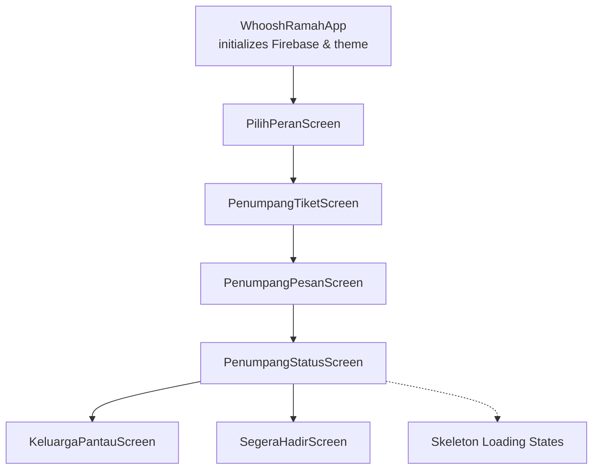
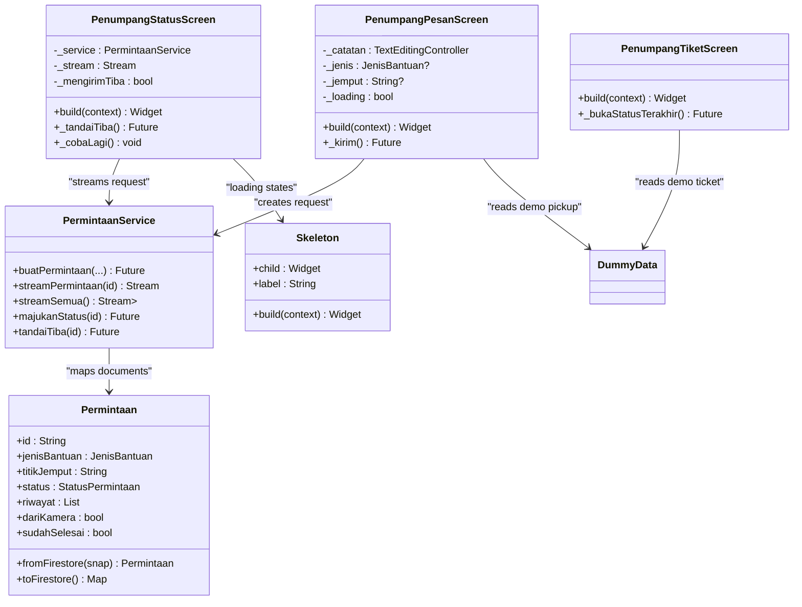
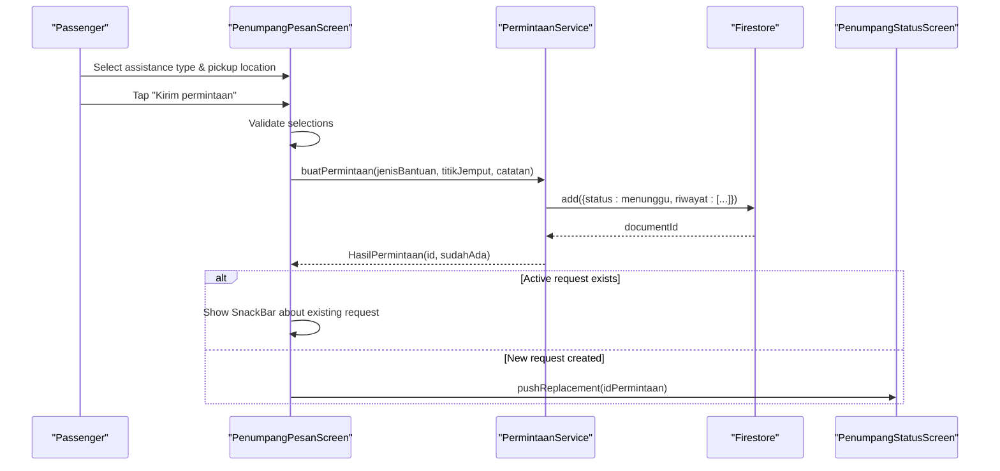
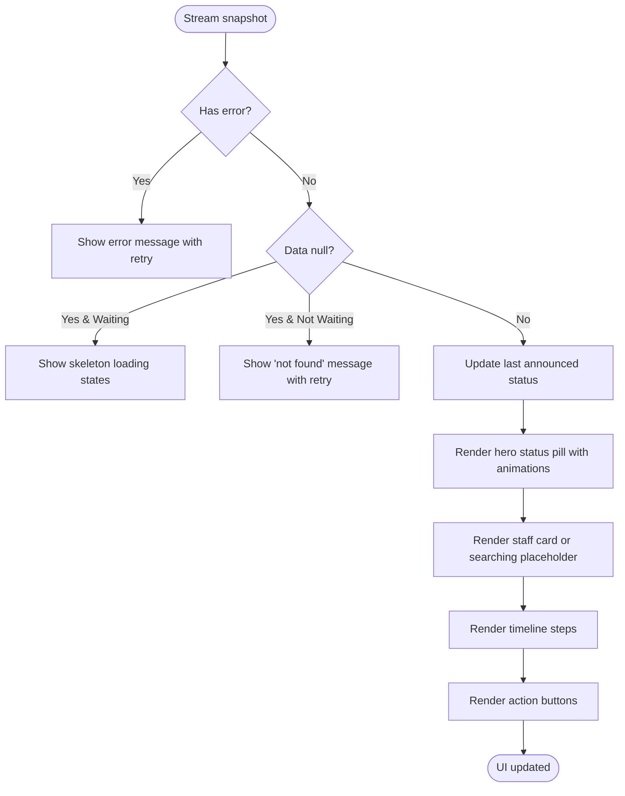
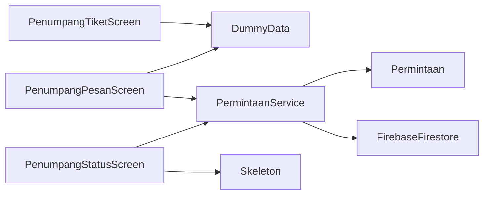

# Passenger Interface

<cite>
**Referenced Files in This Document**
- [main.dart](file://whoosh_ramah/lib/main.dart)
- [penumpang_tiket_screen.dart](file://whoosh_ramah/lib/screens/penumpang_tiket_screen.dart)
- [penumpang_pesan_screen.dart](file://whoosh_ramah/lib/screens/penumpang_pesan_screen.dart)
- [penumpang_status_screen.dart](file://whoosh_ramah/lib/screens/penumpang_status_screen.dart)
- [permintaan_service.dart](file://whoosh_ramah/lib/services/permintaan_service.dart)
- [permintaan.dart](file://whoosh_ramah/lib/models/permintaan.dart)
- [dummy.dart](file://whoosh_ramah/lib/data/dummy.dart)
- [theme.dart](file://whoosh_ramah/lib/theme.dart)
- [skeleton.dart](file://whoosh_ramah/lib/widgets/skeleton.dart)
</cite>

## Update Summary
**Changes Made**
- Enhanced arrival confirmation functionality with improved UI feedback and accessibility
- Added comprehensive skeleton loading states for better user experience during data loading
- Improved error handling with robust retry mechanisms across all screens
- Updated visual design with enhanced accessibility features and modern UI patterns
- Enhanced real-time status tracking with animated transitions and better state management

## Table of Contents
1. [Introduction](#introduction)
2. [Project Structure](#project-structure)
3. [Core Components](#core-components)
4. [Architecture Overview](#architecture-overview)
5. [Detailed Component Analysis](#detailed-component-analysis)
6. [Dependency Analysis](#dependency-analysis)
7. [Performance Considerations](#performance-considerations)
8. [Troubleshooting Guide](#troubleshooting-guide)
9. [Conclusion](#conclusion)

## Introduction
This document explains the passenger-facing interface components that support assistance requests for train passengers. It covers:
- The ticket display screen showing active assistance context and navigation to request assistance.
- The assistance request form, including validation rules, input handling, and submission workflow.
- The status tracking interface with real-time progress visualization and timeline history.
- Data binding to Firestore streams, form state management, and UI responsiveness.
- Accessibility features such as screen reader support, high contrast considerations, and assistive technology compatibility.
- User interaction patterns and error handling strategies.

The implementation is a Flutter application using Material 3, Firebase Firestore for real-time data, and a consistent design system defined in the theme layer. Recent enhancements include improved arrival confirmation, skeleton loading states, and better error handling mechanisms.

## Project Structure
The passenger journey spans three main screens:
- Ticket detail screen: shows the active ticket and provides entry points to request assistance.
- Assistance request screen: collects assistance type, pickup location, and optional notes, then submits the request.
- Status tracking screen: listens to real-time updates and visualizes the assistance lifecycle with enhanced loading states.

**Diagram sources**
- [main.dart:8-33](file://whoosh_ramah/lib/main.dart#L8-L33)
- [penumpang_tiket_screen.dart:30-363](file://whoosh_ramah/lib/screens/penumpang_tiket_screen.dart#L30-L363)
- [penumpang_pesan_screen.dart:23-192](file://whoosh_ramah/lib/screens/penumpang_pesan_screen.dart#L23-L192)
- [penumpang_status_screen.dart:27-255](file://whoosh_ramah/lib/screens/penumpang_status_screen.dart#L27-L255)
- [skeleton.dart:21-95](file://whoosh_ramah/lib/widgets/skeleton.dart#L21-L95)

**Section sources**
- [main.dart:8-33](file://whoosh_ramah/lib/main.dart#L8-L33)
- [penumpang_tiket_screen.dart:30-363](file://whoosh_ramah/lib/screens/penumpang_tiket_screen.dart#L30-L363)
- [penumpang_pesan_screen.dart:23-192](file://whoosh_ramah/lib/screens/penumpang_pesan_screen.dart#L23-L192)
- [penumpang_status_screen.dart:27-255](file://whoosh_ramah/lib/screens/penumpang_status_screen.dart#L27-L255)

## Core Components
- PenumpangTiketScreen: Displays the active ticket, highlights key trip details, and exposes actions to request assistance or view other tickets.
- PenumpangPesanScreen: Presents a guided form to select assistance type and pickup point, validates inputs, and submits the request to Firestore.
- PenumpangStatusScreen: Subscribes to a single Firestore document stream, renders a hero status pill, staff card, five-step timeline, and action buttons with enhanced loading states.
- PermintaanService: Encapsulates Firestore operations: create request, stream single document, stream all documents, and advance status.
- Permintaan model: Defines enums for assistance type and status, plus a robust document mapper with history tracking.
- DummyData: Provides demo passenger, staff, ticket, and pickup locations used by screens and service during development.
- Theme: Centralized color palette, typography, radius, shadows, and button styles aligned with the design system.
- Skeleton: Advanced loading component with shimmer effects and accessibility support for better user experience during data loading.

**Section sources**
- [penumpang_tiket_screen.dart:30-363](file://whoosh_ramah/lib/screens/penumpang_tiket_screen.dart#L30-L363)
- [penumpang_pesan_screen.dart:23-192](file://whoosh_ramah/lib/screens/penumpang_pesan_screen.dart#L23-L192)
- [penumpang_status_screen.dart:27-255](file://whoosh_ramah/lib/screens/penumpang_status_screen.dart#L27-L255)
- [permintaan_service.dart:21-228](file://whoosh_ramah/lib/services/permintaan_service.dart#L21-L228)
- [permintaan.dart:83-255](file://whoosh_ramah/lib/models/permintaan.dart#L83-L255)
- [dummy.dart:64-141](file://whoosh_ramah/lib/data/dummy.dart#L64-L141)
- [theme.dart:9-182](file://whoosh_ramah/lib/theme.dart#L9-L182)
- [skeleton.dart:21-236](file://whoosh_ramah/lib/widgets/skeleton.dart#L21-L236)

## Architecture Overview
The passenger flow uses a layered approach:
- UI Layer: Screens compose reusable widgets and handle user interactions with enhanced loading states.
- Service Layer: PermintaanService abstracts Firestore queries and mutations with improved error handling.
- Model Layer: Permintaan and related enums map Firestore documents to strongly typed Dart objects.
- Data Layer: DummyData supplies demo values; Firestore provides live data.
- Widget Layer: Skeleton components provide consistent loading experiences across the application.

**Diagram sources**
- [penumpang_tiket_screen.dart:30-363](file://whoosh_ramah/lib/screens/penumpang_tiket_screen.dart#L30-L363)
- [penumpang_pesan_screen.dart:23-192](file://whoosh_ramah/lib/screens/penumpang_pesan_screen.dart#L23-L192)
- [penumpang_status_screen.dart:27-255](file://whoosh_ramah/lib/screens/penumpang_status_screen.dart#L27-L255)
- [permintaan_service.dart:21-228](file://whoosh_ramah/lib/services/permintaan_service.dart#L21-L228)
- [permintaan.dart:83-255](file://whoosh_ramah/lib/models/permintaan.dart#L83-L255)
- [skeleton.dart:21-95](file://whoosh_ramah/lib/widgets/skeleton.dart#L21-L95)

## Detailed Component Analysis

### Ticket Display Screen (Active Assistance Context)
Purpose:
- Show the active ticket details and provide clear entry points to request assistance.
- Maintain accessibility semantics for headers and interactive elements.
- Provide enhanced navigation to view last assistance status with improved error handling.

Key behaviors:
- Hero header displays greeting and illustration.
- White card stacks over the hero to show ticket label, class, departure/arrival time points, and core fields (train, date, carriage, seat).
- Primary action "Butuh pendampingan" navigates to the assistance request screen.
- Secondary action allows viewing other tickets.
- Bottom navigation includes "Bantuan" which also opens the request screen.
- Enhanced "View assistance status" button with loading state and timeout handling.

Accessibility:
- Header text wrapped with semantic header marking.
- Interactive buttons are exposed via standard Material controls.
- Improved semantic labeling for better screen reader support.

User interaction pattern:
- Tap "Butuh pendampingan" → navigate to PenumpangPesanScreen.
- Tap bottom nav "Bantuan" → same navigation.
- Tap "View assistance status" → navigate to last active request with error handling.

Error handling:
- Network timeout handling for status retrieval (8-second timeout).
- Graceful error messages when no active requests exist.
- Connection error notifications with user-friendly messaging.

Performance:
- Static dummy data avoids unnecessary rebuilds.
- Lazy service initialization to avoid Firebase initialization overhead.

Code snippet paths:
- Enhanced status retrieval with timeout: [penumpang_tiket_screen.dart:55-96](file://whoosh_ramah/lib/screens/penumpang_tiket_screen.dart#L55-L96)
- Ticket card layout and info columns: [penumpang_tiket_screen.dart:217-291](file://whoosh_ramah/lib/screens/penumpang_tiket_screen.dart#L217-L291)
- Action buttons and navigation: [penumpang_tiket_screen.dart:293-354](file://whoosh_ramah/lib/screens/penumpang_tiket_screen.dart#L293-L354)
- Bottom navigation Bantuan item: [penumpang_tiket_screen.dart:132-155](file://whoosh_ramah/lib/screens/penumpang_tiket_screen.dart#L132-L155)

**Section sources**
- [penumpang_tiket_screen.dart:30-363](file://whoosh_ramah/lib/screens/penumpang_tiket_screen.dart#L30-L363)

### Assistance Request Form (Validation, Input Handling, Submission)
Purpose:
- Collect assistance type, pickup location, and optional notes.
- Validate required fields before enabling submission.
- Submit to Firestore and navigate to the status screen with improved error handling.

Form state management:
- State variables track selected assistance type, selected pickup location, and loading flag.
- Notes field uses a TextEditingController with min/max lines and disabled state during submission.

Validation rules:
- Assistance type must be selected from the grid.
- Pickup location must be selected from the grid.
- Notes are optional; empty strings are normalized to null when submitting.

Submission workflow:
- On submit, set loading state, call PermintaanService.buatPermintaan with selected options and trimmed notes.
- Handle duplicate request detection with user feedback.
- On success, replace current route with PenumpangStatusScreen passing the new request id.
- On failure, reset loading and show a floating SnackBar instructing the user to retry.

UI responsiveness:
- Grid layouts adapt to available width using LayoutBuilder and Wrap.
- Submit button visually indicates enabled/disabled state and shows a circular progress indicator while loading.
- Improved visual feedback with proper contrast ratios for accessibility.

Accessibility:
- Submit button uses Semantics with button, enabled, label, and onTap.
- Choice boxes use Semantics with selected state and explicit labels for TalkBack.
- Section headings are marked as semantic headers.
- Proper touch target sizing for better accessibility compliance.

Code snippet paths:
- Form state and submission method: [penumpang_pesan_screen.dart:67-108](file://whoosh_ramah/lib/screens/penumpang_pesan_screen.dart#L67-L108)
- Duplicate request handling: [penumpang_pesan_screen.dart:81-97](file://whoosh_ramah/lib/screens/penumpang_pesan_screen.dart#L81-L97)
- Assistance type grid: [penumpang_pesan_screen.dart:195-225](file://whoosh_ramah/lib/screens/penumpang_pesan_screen.dart#L195-L225)
- Pickup location grid: [penumpang_pesan_screen.dart:228-258](file://whoosh_ramah/lib/screens/penumpang_pesan_screen.dart#L228-L258)
- Notes TextField: [penumpang_pesan_screen.dart:260-280](file://whoosh_ramah/lib/screens/penumpang_pesan_screen.dart#L260-L280)
- Submit button with Semantics and loading state: [penumpang_pesan_screen.dart:287-336](file://whoosh_ramah/lib/screens/penumpang_pesan_screen.dart#L287-L336)
- Choice box component with accessibility: [penumpang_pesan_screen.dart:362-476](file://whoosh_ramah/lib/screens/penumpang_pesan_screen.dart#L362-L476)

**Diagram sources**
- [penumpang_pesan_screen.dart:67-108](file://whoosh_ramah/lib/screens/penumpang_pesan_screen.dart#L67-L108)
- [permintaan_service.dart:44-81](file://whoosh_ramah/lib/services/permintaan_service.dart#L44-L81)

**Section sources**
- [penumpang_pesan_screen.dart:23-192](file://whoosh_ramah/lib/screens/penumpang_pesan_screen.dart#L23-L192)
- [penumpang_pesan_screen.dart:287-336](file://whoosh_ramah/lib/screens/penumpang_pesan_screen.dart#L287-L336)
- [permintaan_service.dart:44-81](file://whoosh_ramah/lib/services/permintaan_service.dart#L44-L81)

### Status Tracking Interface (Real-Time Progress, Timeline, and Enhanced Loading)
Purpose:
- Provide real-time visibility into the assistance lifecycle with enhanced loading states.
- Show a hero status pill, staff card, five-step timeline, and contextual actions.
- Implement improved arrival confirmation functionality with better user feedback.

Real-time data binding:
- Uses StreamBuilder bound to PermintaanService.streamPermintaan(id).
- Handles waiting, data present, and error states with skeleton loading states.
- Announces status changes to screen readers via SemanticsService.
- Implements retry mechanism for failed connections.

Progress visualization:
- Hero pill summarizes current status with label, color, and icon.
- Staff card appears after assignment; otherwise shows "Mencari petugas…" with smooth animations.
- Timeline renders five steps with states: completed, active, next. Completed steps show timestamps from history; active step shows "sekarang"; next steps are grayed out.
- Enhanced skeleton loading states during initial data loading.

Timeline logic:
- Active index derived from current status enum position.
- Labels per step are computed based on status and request data (e.g., carriage and seat for seated status).
- Timestamps are formatted using intl DateFormat.

Accessibility:
- Status announcements are sent through SemanticsService.sendAnnouncement when status changes.
- Hero title and status pill use Semantics for proper labeling.
- Buttons use MergeSemantics and Semantics with button attributes.
- Skeleton loading states provide proper accessibility announcements.

Error handling:
- If stream has an error, show a message advising to check connection with retry button.
- If no document exists, show "not found" message with retry option.
- While waiting for initial data, show skeleton loading states instead of basic progress indicators.
- Enhanced arrival confirmation with proper error handling and user feedback.

Code snippet paths:
- Enhanced stream subscription with retry: [penumpang_status_screen.dart:44-61](file://whoosh_ramah/lib/screens/penumpang_status_screen.dart#L44-L61)
- Arrival confirmation with improved feedback: [penumpang_status_screen.dart:66-93](file://whoosh_ramah/lib/screens/penumpang_status_screen.dart#L66-L93)
- Stream builder with skeleton loading: [penumpang_status_screen.dart:216-255](file://whoosh_ramah/lib/screens/penumpang_status_screen.dart#L216-L255)
- Skeleton loading states implementation: [penumpang_status_screen.dart:312-361](file://whoosh_ramah/lib/screens/penumpang_status_screen.dart#L312-L361)
- Status announcement helper: [penumpang_status_screen.dart:194-208](file://whoosh_ramah/lib/screens/penumpang_status_screen.dart#L194-L208)
- Hero status pill with animations: [penumpang_status_screen.dart:258-308](file://whoosh_ramah/lib/screens/penumpang_status_screen.dart#L258-L308)
- Staff card and placeholder with animations: [penumpang_status_screen.dart:364-446](file://whoosh_ramah/lib/screens/penumpang_status_screen.dart#L364-L446)
- Timeline rendering and step states: [penumpang_status_screen.dart:563-594](file://whoosh_ramah/lib/screens/penumpang_status_screen.dart#L563-L594)
- Actions and sharing with improved UI: [penumpang_status_screen.dart:596-636](file://whoosh_ramah/lib/screens/penumpang_status_screen.dart#L596-L636)

**Diagram sources**
- [penumpang_status_screen.dart:216-255](file://whoosh_ramah/lib/screens/penumpang_status_screen.dart#L216-L255)
- [penumpang_status_screen.dart:312-361](file://whoosh_ramah/lib/screens/penumpang_status_screen.dart#L312-L361)

**Section sources**
- [penumpang_status_screen.dart:27-255](file://whoosh_ramah/lib/screens/penumpang_status_screen.dart#L27-L255)
- [penumpang_status_screen.dart:258-636](file://whoosh_ramah/lib/screens/penumpang_status_screen.dart#L258-L636)

### Enhanced Skeleton Loading States
Purpose:
- Provide sophisticated loading experiences that mimic actual content layout.
- Improve user experience during data fetching with shimmer effects.
- Ensure accessibility compliance for loading states.

Key features:
- Shimmer animation with gradient overlay for visual appeal.
- Content-mimicking skeleton structure that matches actual UI layout.
- Automatic animation control based on system preferences.
- Comprehensive accessibility support with proper announcements.

Implementation details:
- Skeleton component wraps child widgets with animated shimmer effect.
- SkeletonBox provides basic rectangular/circular skeleton shapes.
- SkeletonLine creates text-like skeleton elements.
- SkeletonCard provides card-shaped skeleton containers.
- SkeletonRincian offers pre-built detailed skeleton layouts.

Accessibility:
- Single semantic announcement for entire skeleton container.
- Animation respect for users who prefer reduced motion.
- Proper exclusion of skeleton elements from screen reader navigation.

Code snippet paths:
- Main Skeleton component: [skeleton.dart:21-95](file://whoosh_ramah/lib/widgets/skeleton.dart#L21-L95)
- SkeletonBox implementation: [skeleton.dart:100-135](file://whoosh_ramah/lib/widgets/skeleton.dart#L100-L135)
- SkeletonLine component: [skeleton.dart:138-148](file://whoosh_ramah/lib/widgets/skeleton.dart#L138-L148)
- SkeletonCard wrapper: [skeleton.dart:151-179](file://whoosh_ramah/lib/widgets/skeleton.dart#L151-L179)
- SkeletonRincian detailed layout: [skeleton.dart:187-236](file://whoosh_ramah/lib/widgets/skeleton.dart#L187-L236)

**Section sources**
- [skeleton.dart:21-236](file://whoosh_ramah/lib/widgets/skeleton.dart#L21-L236)

### Data Binding to Firestore Streams
- Single-document stream: PermintaanService.streamPermintaan returns a stream of Permintaan? for a given document id.
- Collection stream: PermintaanService.streamSemua returns a stream of lists ordered by creation time, limited to 100 items.
- Latest-by-passenger stream: PermintaanService.streamTerbaruPenumpang filters by passenger id and sorts client-side by creation timestamp.
- Enhanced error handling with retry mechanisms and timeout support.

Model mapping:
- Permintaan.fromFirestore safely maps Firestore snapshots to domain models, handling nullable fields and converting timestamps.
- RiwayatStatus maps history entries with status and time.
- Improved null safety and error handling in data transformation.

Code snippet paths:
- Stream methods with enhanced error handling: [permintaan_service.dart:97-124](file://whoosh_ramah/lib/services/permintaan_service.dart#L97-L124)
- Model mapping and history: [permintaan.dart:183-226](file://whoosh_ramah/lib/models/permintaan.dart#L183-L226)

**Section sources**
- [permintaan_service.dart:97-124](file://whoosh_ramah/lib/services/permintaan_service.dart#L97-L124)
- [permintaan.dart:183-226](file://whoosh_ramah/lib/models/permintaan.dart#L183-L226)

### Form State Management and UI Responsiveness
- State variables: _jenis, _jemput, _loading, and TextEditingController for notes.
- Validation: Submit enabled only when both assistance type and pickup location are selected and not loading.
- Responsive grids: LayoutBuilder computes column widths; Wrap arranges items with spacing.
- Visual feedback: Disabled submit button uses reduced opacity; loading spinner replaces text during submission.
- Improved accessibility with proper contrast ratios and touch targets.

Code snippet paths:
- State initialization and disposal: [penumpang_pesan_screen.dart:34-65](file://whoosh_ramah/lib/screens/penumpang_pesan_screen.dart#L34-L65)
- Submit enablement logic: [penumpang_pesan_screen.dart:287-290](file://whoosh_ramah/lib/screens/penumpang_pesan_screen.dart#L287-L290)
- Grid builders: [penumpang_pesan_screen.dart:195-258](file://whoosh_ramah/lib/screens/penumpang_pesan_screen.dart#L195-L258)

**Section sources**
- [penumpang_pesan_screen.dart:34-65](file://whoosh_ramah/lib/screens/penumpang_pesan_screen.dart#L34-L65)
- [penumpang_pesan_screen.dart:195-258](file://whoosh_ramah/lib/screens/penumpang_pesan_screen.dart#L195-L258)
- [penumpang_pesan_screen.dart:287-336](file://whoosh_ramah/lib/screens/penumpang_pesan_screen.dart#L287-L336)

### Accessibility Features
- Screen reader support:
  - Semantic headers for section titles and hero titles.
  - Semantics.button and Semantics.selected for choice boxes and submit button.
  - SemanticsService.sendAnnouncement for status change announcements.
  - Enhanced skeleton loading announcements for better accessibility.
- High contrast modes:
  - Colors are defined centrally with proper contrast ratios.
  - Selected states use both color and border/badge indicators to avoid relying solely on color.
  - Improved disabled states with better contrast compliance.
- Assistive technology compatibility:
  - Touch targets meet minimum size guidelines via Material tap target sizing.
  - Text scales appropriately due to font sizes and weights defined in theme.
  - Proper semantic labeling throughout the interface.

Code snippet paths:
- Semantic headers and labels: [penumpang_pesan_screen.dart:340-355](file://whoosh_ramah/lib/screens/penumpang_pesan_screen.dart#L340-L355), [penumpang_pesan_screen.dart:446-476](file://whoosh_ramah/lib/screens/penumpang_pesan_screen.dart#L446-L476)
- Status announcements: [penumpang_status_screen.dart:194-208](file://whoosh_ramah/lib/screens/penumpang_status_screen.dart#L194-L208)
- Button semantics and tap targets: [penumpang_status_screen.dart:863-915](file://whoosh_ramah/lib/screens/penumpang_status_screen.dart#L863-L915), [theme.dart:154-181](file://whoosh_ramah/lib/theme.dart#L154-L181)
- Skeleton accessibility: [skeleton.dart:64-93](file://whoosh_ramah/lib/widgets/skeleton.dart#L64-L93)

**Section sources**
- [penumpang_pesan_screen.dart:340-355](file://whoosh_ramah/lib/screens/penumpang_pesan_screen.dart#L340-L355)
- [penumpang_pesan_screen.dart:446-476](file://whoosh_ramah/lib/screens/penumpang_pesan_screen.dart#L446-L476)
- [penumpang_status_screen.dart:194-208](file://whoosh_ramah/lib/screens/penumpang_status_screen.dart#L194-L208)
- [penumpang_status_screen.dart:863-915](file://whoosh_ramah/lib/screens/penumpang_status_screen.dart#L863-L915)
- [theme.dart:154-181](file://whoosh_ramah/lib/theme.dart#L154-L181)
- [skeleton.dart:64-93](file://whoosh_ramah/lib/widgets/skeleton.dart#L64-L93)

## Dependency Analysis
The passenger screens depend on shared services and models with enhanced error handling:
- PenumpangPesanScreen depends on PermintaanService for creating requests and DummyData for pickup options.
- PenumpangStatusScreen depends on PermintaanService for streaming a single request and on models for status/timeline logic.
- PermintaanService depends on FirebaseFirestore and maps to Permintaan model with improved error handling.
- DummyData provides static demo values consumed across screens and service.
- Skeleton components provide consistent loading experiences across all screens.

**Diagram sources**
- [penumpang_tiket_screen.dart:30-363](file://whoosh_ramah/lib/screens/penumpang_tiket_screen.dart#L30-L363)
- [penumpang_pesan_screen.dart:23-192](file://whoosh_ramah/lib/screens/penumpang_pesan_screen.dart#L23-L192)
- [penumpang_status_screen.dart:27-255](file://whoosh_ramah/lib/screens/penumpang_status_screen.dart#L27-L255)
- [permintaan_service.dart:21-228](file://whoosh_ramah/lib/services/permintaan_service.dart#L21-L228)
- [permintaan.dart:83-255](file://whoosh_ramah/lib/models/permintaan.dart#L83-L255)
- [dummy.dart:64-141](file://whoosh_ramah/lib/data/dummy.dart#L64-L141)
- [skeleton.dart:21-236](file://whoosh_ramah/lib/widgets/skeleton.dart#L21-L236)

**Section sources**
- [penumpang_tiket_screen.dart:30-363](file://whoosh_ramah/lib/screens/penumpang_tiket_screen.dart#L30-L363)
- [penumpang_pesan_screen.dart:23-192](file://whoosh_ramah/lib/screens/penumpang_pesan_screen.dart#L23-L192)
- [penumpang_status_screen.dart:27-255](file://whoosh_ramah/lib/screens/penumpang_status_screen.dart#L27-L255)
- [permintaan_service.dart:21-228](file://whoosh_ramah/lib/services/permintaan_service.dart#L21-L228)
- [permintaan.dart:83-255](file://whoosh_ramah/lib/models/permintaan.dart#L83-L255)
- [dummy.dart:64-141](file://whoosh_ramah/lib/data/dummy.dart#L64-L141)
- [skeleton.dart:21-236](file://whoosh_ramah/lib/widgets/skeleton.dart#L21-L236)

## Performance Considerations
- Stream efficiency:
  - Single-document stream avoids unnecessary collection scans.
  - Collection stream limits results to 100 and orders by a single field to avoid composite indexes.
  - Enhanced error handling prevents excessive reconnection attempts.
- UI performance:
  - Use of LayoutBuilder and Wrap prevents heavy rebuilds and adapts to screen sizes.
  - Avoid redundant setState calls; only update state when necessary (e.g., selection changes, loading flags).
  - Skeleton loading states provide better perceived performance than spinners.
- Data mapping:
  - Permintaan.fromMap handles nullability efficiently and separates Firestore-specific mapping from pure data conversion.
  - Improved error handling in data transformation reduces crash risks.
- Memory management:
  - Lazy service initialization reduces startup overhead.
  - Proper cleanup of animation controllers and listeners.

## Troubleshooting Guide
Common issues and resolutions:
- Firestore connection errors:
  - Status screen shows an error message advising to check connectivity with retry button.
  - Skeleton loading states provide better user feedback during connection issues.
  - Ensure Firebase is initialized and permissions allow reads/writes.
- Request not found:
  - If the document does not exist, the status screen displays a "not found" message with retry option.
  - Verify the id passed to PenumpangStatusScreen matches the created document id.
- Submission failures:
  - PenumpangPesanScreen catches exceptions and resets loading state, showing a SnackBar prompting retry.
  - Enhanced duplicate request detection prevents multiple simultaneous requests.
  - Check network conditions and Firestore rules.
- Timeout issues:
  - Ticket screen implements 8-second timeout for status retrieval to prevent hanging.
  - Proper error handling for network timeouts with user-friendly messages.
- Accessibility concerns:
  - Confirm semantic labels are present for custom widgets.
  - Test with TalkBack/VoiceOver to verify announcements and focus order.
  - Verify skeleton loading states provide proper accessibility announcements.

Code snippet paths:
- Error handling in status screen with retry: [penumpang_status_screen.dart:219-235](file://whoosh_ramah/lib/screens/penumpang_status_screen.dart#L219-L235)
- Submission error handling in request screen: [penumpang_pesan_screen.dart:98-107](file://whoosh_ramah/lib/screens/penumpang_pesan_screen.dart#L98-L107)
- Timeout handling in ticket screen: [penumpang_tiket_screen.dart:58-95](file://whoosh_ramah/lib/screens/penumpang_tiket_screen.dart#L58-L95)

**Section sources**
- [penumpang_status_screen.dart:219-235](file://whoosh_ramah/lib/screens/penumpang_status_screen.dart#L219-L235)
- [penumpang_pesan_screen.dart:98-107](file://whoosh_ramah/lib/screens/penumpang_pesan_screen.dart#L98-L107)
- [penumpang_tiket_screen.dart:58-95](file://whoosh_ramah/lib/screens/penumpang_tiket_screen.dart#L58-L95)

## Conclusion
The passenger interface provides a clear, accessible, and responsive experience for requesting and tracking assistance with significant improvements:
- The ticket screen establishes context and guides users to request help with enhanced status retrieval.
- The request form enforces validation, manages state, and integrates with Firestore with improved error handling.
- The status screen delivers real-time updates, visual progress, and accessibility-friendly announcements with skeleton loading states.
- Enhanced arrival confirmation functionality provides better user feedback and accessibility.
- Robust error handling with retry mechanisms ensures reliable operation under various network conditions.
- Skeleton loading states improve perceived performance and user experience during data loading.

Together, these components implement a robust passenger workflow aligned with the project's design and technical goals, featuring modern UI patterns, comprehensive accessibility support, and resilient error handling.