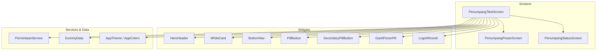
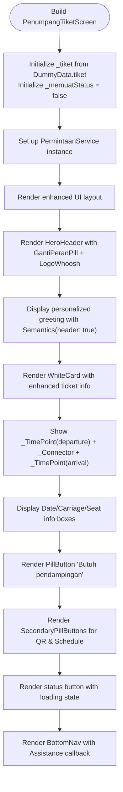
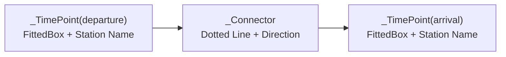
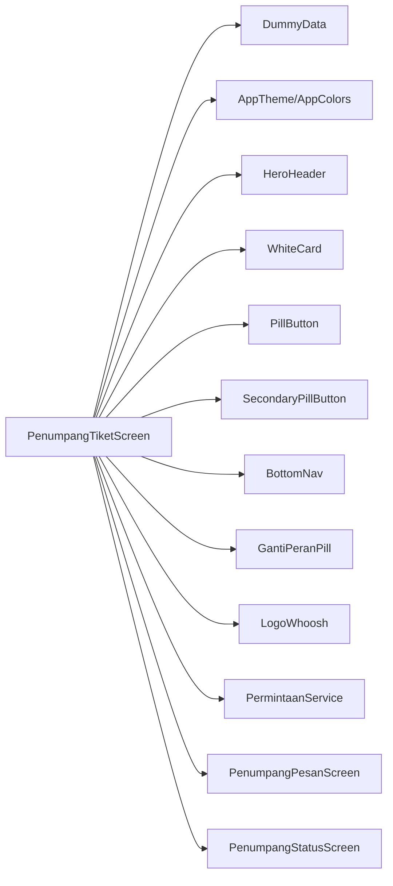

# Ticket Display Screen

<cite>
**Referenced Files in This Document**   
- [penumpang_tiket_screen.dart](file://whoosh_ramah/lib/screens/penumpang_tiket_screen.dart)
- [hero_header.dart](file://whoosh_ramah/lib/widgets/hero_header.dart)
- [white_card.dart](file://whoosh_ramah/lib/widgets/white_card.dart)
- [bottom_nav.dart](file://whoosh_ramah/lib/widgets/bottom_nav.dart)
- [pill_button.dart](file://whoosh_ramah/lib/widgets/pill_button.dart)
- [secondary_pill_button.dart](file://whoosh_ramah/lib/widgets/secondary_pill_button.dart)
- [ganti_peran_pill.dart](file://whoosh_ramah/lib/widgets/ganti_peran_pill.dart)
- [logo_whoosh.dart](file://whoosh_ramah/lib/widgets/logo_whoosh.dart)
- [dummy.dart](file://whoosh_ramah/lib/data/dummy.dart)
- [theme.dart](file://whoosh_ramah/lib/theme.dart)
- [penumpang_pesan_screen.dart](file://whoosh_ramah/lib/screens/penumpang_pesan_screen.dart)
- [penumpang_status_screen.dart](file://whoosh_ramah/lib/screens/penumpang_status_screen.dart)
- [permintaan_service.dart](file://whoosh_ramah/lib/services/permintaan_service.dart)
- [penumpang_tiket_test.dart](file://whoosh_ramah/test/penumpang_tiket_test.dart)
</cite>

## Update Summary
**Changes Made**   
- Enhanced ticket display screen with Brightline design system integration
- Added role switching pill component for user role management
- Integrated Whoosh logo component with accessibility features
- Improved responsive layouts with better spacing and typography
- Added comprehensive status tracking functionality with service integration
- Enhanced accessibility with proper semantics and high contrast colors
- Updated button interactions with real-time status loading states

## Table of Contents
1. [Introduction](#introduction)
2. [Project Structure](#project-structure)
3. [Core Components](#core-components)
4. [Architecture Overview](#architecture-overview)
5. [Detailed Component Analysis](#detailed-component-analysis)
6. [Dependency Analysis](#dependency-analysis)
7. [Performance Considerations](#performance-considerations)
8. [Troubleshooting Guide](#troubleshooting-guide)
9. [Conclusion](#conclusion)

## Introduction
This document explains the enhanced ticket display screen component that shows an active assistance request for a passenger using the Brightline design system. The `PenumpangTiketScreen` implementation provides:
- A personalized hero header with greeting, role switching, and brand logo
- A white card overlay containing train information, departure/arrival time points, and connector lines
- A ticket information grid (date, carriage, seat) with improved styling
- Primary and secondary buttons for requesting assistance, QR code viewing, and schedule modification
- Real-time status tracking with loading states and error handling
- A floating bottom navigation bar with accessible items

The design follows the Brightline style guide with white canvas, single red accent color, and high contrast accessibility standards.

## Project Structure
The ticket screen lives under the screens directory and composes reusable widgets from the widgets directory. It integrates with services for real-time data and uses dummy data for demonstration purposes.



**Diagram sources**
- [penumpang_tiket_screen.dart:1-16](file://whoosh_ramah/lib/screens/penumpang_tiket_screen.dart#L1-L16)
- [penumpang_tiket_screen.dart:30-38](file://whoosh_ramah/lib/screens/penumpang_tiket_screen.dart#L30-L38)
- [penumpang_tiket_screen.dart:128-362](file://whoosh_ramah/lib/screens/penumpang_tiket_screen.dart#L128-L362)

**Section sources**
- [penumpang_tiket_screen.dart:1-16](file://whoosh_ramah/lib/screens/penumpang_tiket_screen.dart#L1-L16)
- [dummy.dart:64-89](file://whoosh_ramah/lib/data/dummy.dart#L64-L89)
- [theme.dart:3-52](file://whoosh_ramah/lib/theme.dart#L3-L52)

## Core Components
- `PenumpangTiketScreen`: Main screen widget with state management for ticket data, status loading, and service integration
- `HeroHeader`: Clean white header with safe area support and dark system UI overlay
- `WhiteCard`: Reusable white card with 22px radius, subtle shadow, and border styling
- `_TimePoint`, `_Connector`, `_TicketInfo`: Internal components for timeline visualization and info display
- `GantiPeranPill`: Role switching pill component for user role management
- `LogoWhoosh`: Brand logo component with accessibility labels and inverted mode support
- `PillButton` and `SecondaryPillButton`: Primary and secondary action buttons with proper accessibility
- `BottomNav`: Floating bottom navigation with accessible items and active state styling
- `PermintaanService`: Service integration for real-time assistance status tracking

Key responsibilities:
- Manage ticket state with dynamic schedule updates
- Provide real-time assistance status with loading indicators
- Handle QR code generation and clipboard operations
- Support schedule modification with confirmation feedback
- Maintain accessibility compliance throughout all interactions

**Section sources**
- [penumpang_tiket_screen.dart:30-38](file://whoosh_ramah/lib/screens/penumpang_tiket_screen.dart#L30-L38)
- [penumpang_tiket_screen.dart:128-362](file://whoosh_ramah/lib/screens/penumpang_tiket_screen.dart#L128-L362)
- [hero_header.dart:6-36](file://whoosh_ramah/lib/widgets/hero_header.dart#L6-L36)
- [white_card.dart:5-44](file://whoosh_ramah/lib/widgets/white_card.dart#L5-L44)
- [ganti_peran_pill.dart:5-50](file://whoosh_ramah/lib/widgets/ganti_peran_pill.dart#L5-L50)
- [logo_whoosh.dart:5-42](file://whoosh_ramah/lib/widgets/logo_whoosh.dart#L5-L42)

## Architecture Overview
The screen follows a service-oriented architecture with clear separation of concerns:
- Data layer: `DummyData` provides static content while `PermintaanService` handles real-time data
- Presentation layer: `PenumpangTiketScreen` manages UI state and user interactions
- Service layer: `PermintaanService` abstracts backend communication for assistance requests
- Shared widgets: Reusable components following Brightline design system guidelines

```mermaid
sequenceDiagram
participant User as "User"
participant PTS as "PenumpangTiketScreen"
param PS as "PermintaanService"
participant Nav as "Navigator"
participant PPS as "PenumpangPesanScreen"
participant PSS as "PenumpangStatusScreen"
User->>PTS : Open ticket screen
PTS-->>User : Render enhanced UI with role switcher
User->>PTS : Tap "Butuh pendampingan"
PTS->>Nav : push(PenumpangPesanScreen)
Nav-->>PPS : Build assistance screen
User->>PTS : Tap "Lihat status pendampingan"
PTS->>PS : streamTerbaruPenumpang()
PS-->>PTS : Stream assistance status
PTS-->>User : Show loading state
User->>PTS : Tap status button again
PTS->>Nav : push(PenumpangStatusScreen)
Nav-->>PSS : Build status screen
```

**Diagram sources**
- [penumpang_tiket_screen.dart:55-96](file://whoosh_ramah/lib/screens/penumpang_tiket_screen.dart#L55-L96)
- [penumpang_tiket_screen.dart:98-102](file://whoosh_ramah/lib/screens/penumpang_tiket_screen.dart#L98-L102)
- [penumpang_tiket_screen.dart:112-125](file://whoosh_ramah/lib/screens/penumpang_tiket_screen.dart#L112-L125)

## Detailed Component Analysis

### PenumpangTiketScreen - Enhanced Implementation
Responsibilities:
- Manages ticket state with dynamic schedule updates via `_tiket` variable
- Handles real-time assistance status loading with `_memuatStatus` flag
- Integrates with `PermintaanService` for live data streaming
- Provides comprehensive error handling with SnackBar feedback
- Supports QR code generation and clipboard operations
- Enables schedule modification with confirmation dialogs

Implementation highlights:
- Hero header uses `HeroHeader` with custom padding and integrated role switcher
- White card displays enhanced ticket information with improved spacing
- Time point visualization uses `_TimePoint` and `_Connector` components
- Status tracking includes loading states, timeout handling, and error recovery
- Bottom navigation includes Assistance route with callback functionality



**Diagram sources**
- [penumpang_tiket_screen.dart:40-46](file://whoosh_ramah/lib/screens/penumpang_tiket_screen.dart#L40-L46)
- [penumpang_tiket_screen.dart:128-362](file://whoosh_ramah/lib/screens/penumpang_tiket_screen.dart#L128-L362)

**Section sources**
- [penumpang_tiket_screen.dart:30-38](file://whoosh_ramah/lib/screens/penumpang_tiket_screen.dart#L30-L38)
- [penumpang_tiket_screen.dart:40-46](file://whoosh_ramah/lib/screens/penumpang_tiket_screen.dart#L40-L46)
- [penumpang_tiket_screen.dart:128-362](file://whoosh_ramah/lib/screens/penumpang_tiket_screen.dart#L128-L362)

### Enhanced Hero Header Integration
- Provides clean white header with SafeArea support and dark system UI overlay
- Integrates `GantiPeranPill` for role switching functionality
- Includes `LogoWhoosh` component with accessibility labels
- Uses consistent padding and spacing following Brightline guidelines

Accessibility and contrast:
- Light background ensures dark icons and text readability
- System UI overlay style set to dark for visibility
- Proper semantic labeling for assistive technologies

**Section sources**
- [hero_header.dart:6-36](file://whoosh_ramah/lib/widgets/hero_header.dart#L6-L36)
- [penumpang_tiket_screen.dart:160-169](file://whoosh_ramah/lib/screens/penumpang_tiket_screen.dart#L160-L169)

### GantiPeranPill Component
- Pill-shaped component for role switching with arrow icon
- Follows Brightline design with block background and primary text color
- Provides accessible button semantics with explicit label
- Supports custom onPressed handler or default back navigation

**Section sources**
- [ganti_peran_pill.dart:5-50](file://whoosh_ramah/lib/widgets/ganti_peran_pill.dart#L5-L50)

### LogoWhoosh Component
- Brand logo component with rounded tile background
- Supports inverted mode for different background contexts
- Includes proper accessibility labels for screen readers
- Uses medium filter quality for optimal image rendering

**Section sources**
- [logo_whoosh.dart:5-42](file://whoosh_ramah/lib/widgets/logo_whoosh.dart#L5-L42)

### Enhanced Time Point Visualization
- `_TimePoint` displays large time text with station name using FittedBox for responsiveness
- `_Connector` draws dotted-style divider with directional indicators
- Both components use proper semantics for accessibility
- Responsive design maintains layout integrity across different text scaling levels



**Diagram sources**
- [penumpang_tiket_screen.dart:434-488](file://whoosh_ramah/lib/screens/penumpang_tiket_screen.dart#L434-L488)
- [penumpang_tiket_screen.dart:493-531](file://whoosh_ramah/lib/screens/penumpang_tiket_screen.dart#L493-L531)

**Section sources**
- [penumpang_tiket_screen.dart:434-488](file://whoosh_ramah/lib/screens/penumpang_tiket_screen.dart#L434-L488)
- [penumpang_tiket_screen.dart:493-531](file://whoosh_ramah/lib/screens/penumpang_tiket_screen.dart#L493-L531)

### Enhanced Ticket Information Grid
- Three `_TicketInfo` widgets render label/value pairs: date, carriage, and seat
- Each cell uses FittedBox for responsive text scaling and proper alignment
- Block background with inner radius for visual consistency
- Maintains equal distribution using Expanded children in Row

**Section sources**
- [penumpang_tiket_screen.dart:280-288](file://whoosh_ramah/lib/screens/penumpang_tiket_screen.dart#L280-L288)
- [penumpang_tiket_screen.dart:566-616](file://whoosh_ramah/lib/screens/penumpang_tiket_screen.dart#L566-L616)

### Enhanced Button Interactions
- Primary button ("Butuh pendampingan") triggers navigation to `PenumpangPesanScreen`
- Secondary buttons provide QR code viewing and schedule modification
- Status button includes loading state management with disabled state during API calls
- All buttons maintain proper accessibility semantics and minimum touch targets

```mermaid
sequenceDiagram
participant User as "User"
participant PTS as "PenumpangTiketScreen"
param PS as "PermintaanService"
participant Nav as "Navigator"
participant PSS as "PenumpangStatusScreen"
User->>PTS : Tap "Lihat status pendampingan"
PTS->>PTS : setState(_memuatStatus = true)
PTS->>PS : streamTerbaruPenumpang(id)
alt Success
PS-->>PTS : Return assistance request
PTS->>Nav : push(PenumpangStatusScreen)
else Error/Timeout
PS-->>PTS : Error/Timeout
PTS->>PTS : setState(_memuatStatus = false)
PTS-->>User : Show error SnackBar
end
```

**Diagram sources**
- [penumpang_tiket_screen.dart:55-96](file://whoosh_ramah/lib/screens/penumpang_tiket_screen.dart#L55-L96)
- [penumpang_tiket_screen.dart:349-354](file://whoosh_ramah/lib/screens/penumpang_tiket_screen.dart#L349-L354)

**Section sources**
- [penumpang_tiket_screen.dart:98-102](file://whoosh_ramah/lib/screens/penumpang_tiket_screen.dart#L98-L102)
- [penumpang_tiket_screen.dart:104-125](file://whoosh_ramah/lib/screens/penumpang_tiket_screen.dart#L104-L125)
- [penumpang_tiket_screen.dart:349-354](file://whoosh_ramah/lib/screens/penumpang_tiket_screen.dart#L349-L354)

### Enhanced Accessibility Features
- Comprehensive semantics wrapper around greeting header with `header: true`
- Buttons use `MergeSemantics` and `Semantics(button: true)` for proper interaction exposure
- Bottom navigation items use `MergeSemantics` and `Semantics(selected: ...)` for selection state
- Logo component includes explicit image semantics with descriptive labels
- High contrast colors throughout:
  - Primary red (`AppColors.redPrimary`) for key actions and accents
  - Dark text (`AppColors.textPrimary`) on light backgrounds (18.7:1 contrast ratio)
  - Secondary text (`AppColors.textSecondary`) for supporting information (7.9:1 contrast ratio)
  - Connector colors ensure clear separation between elements (4.8:1 contrast ratio)

Best practices observed:
- Minimum tap target sizes enforced by button themes (56dp for primary, 52dp for secondary)
- Clear semantic roles for headers, buttons, and navigation items
- Consistent color roles across components following WCAG guidelines
- Proper exclusion of decorative elements from semantics tree

**Section sources**
- [penumpang_tiket_screen.dart:185-197](file://whoosh_ramah/lib/screens/penumpang_tiket_screen.dart#L185-L197)
- [pill_button.dart:35-67](file://whoosh_ramah/lib/widgets/pill_button.dart#L35-L67)
- [secondary_pill_button.dart:29-48](file://whoosh_ramah/lib/widgets/secondary_pill_button.dart#L29-L48)
- [bottom_nav.dart:74-112](file://whoosh_ramah/lib/widgets/bottom_nav.dart#L74-L112)
- [logo_whoosh.dart:23-40](file://whoosh_ramah/lib/widgets/logo_whoosh.dart#L23-L40)
- [theme.dart:13-52](file://whoosh_ramah/lib/theme.dart#L13-L52)

## Dependency Analysis
The enhanced ticket screen depends on:
- Dummy data for initial content and demo scenarios
- Theme for consistent colors, radii, shadows, and typography
- Widgets for header, card, buttons, navigation, and brand components
- Services for real-time assistance status tracking
- Navigation to assistance and status screens



**Diagram sources**
- [penumpang_tiket_screen.dart:1-16](file://whoosh_ramah/lib/screens/penumpang_tiket_screen.dart#L1-L16)
- [penumpang_tiket_screen.dart:30-38](file://whoosh_ramah/lib/screens/penumpang_tiket_screen.dart#L30-L38)

**Section sources**
- [penumpang_tiket_screen.dart:1-16](file://whoosh_ramah/lib/screens/penumpang_tiket_screen.dart#L1-L16)
- [dummy.dart:64-89](file://whoosh_ramah/lib/data/dummy.dart#L64-L89)
- [theme.dart:3-52](file://whoosh_ramah/lib/theme.dart#L3-L52)

## Performance Considerations
- Static dummy data avoids unnecessary rebuilds during development
- Using `FittedBox` for labels and values prevents overflow and reduces layout complexity
- Minimal nested widgets inside the white card keep build cost low
- Service integration uses streams for efficient real-time updates
- Loading states prevent redundant API calls during network requests
- Image assets use medium filter quality for optimal performance
- Custom painters avoid expensive repaints with `shouldRepaint` returning false

## Troubleshooting Guide
Common issues and resolutions:
- White card not overlapping hero: Ensure proper container structure without negative margins
- Greeting not announced as header: Verify `Semantics(header: true)` wraps the greeting text
- Button not accessible: Confirm `MergeSemantics` and `Semantics(button: true)` are applied to custom buttons
- Low contrast text: Use `AppColors.textPrimary` and `AppColors.textSecondary` consistently; verify contrast ratios meet WCAG standards
- Status loading not working: Check that `PermintaanService` is properly injected and streams are handled correctly
- QR code not displaying: Verify asset paths and QR library integration
- Schedule modification not updating: Ensure state is properly managed with `setState` and service callbacks

Validation via tests:
- Tests assert presence of all UI elements including enhanced components
- Tests verify navigation to both assistance and status screens
- Tests confirm proper loading states and error handling
- Tests validate accessibility semantics and screen reader compatibility
- Tests ensure responsive behavior across different screen sizes

**Section sources**
- [penumpang_tiket_test.dart:87-124](file://whoosh_ramah/test/penumpang_tiket_test.dart#L87-L124)
- [penumpang_tiket_test.dart:149-213](file://whoosh_ramah/test/penumpang_tiket_test.dart#L149-L213)
- [penumpang_tiket_test.dart:215-358](file://whoosh_ramah/test/penumpang_tiket_test.dart#L215-L358)

## Conclusion
The enhanced ticket display screen provides a comprehensive, accessible presentation of active train tickets with improved styling, responsive layouts, and real-time functionality. The integration of the Brightline design system ensures visual consistency and accessibility compliance. Key enhancements include role switching capabilities, brand logo integration, real-time status tracking, and comprehensive error handling. The implementation leverages reusable components and consistent theming to maintain high standards of usability and accessibility across all user interactions.