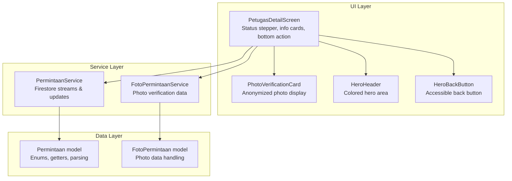
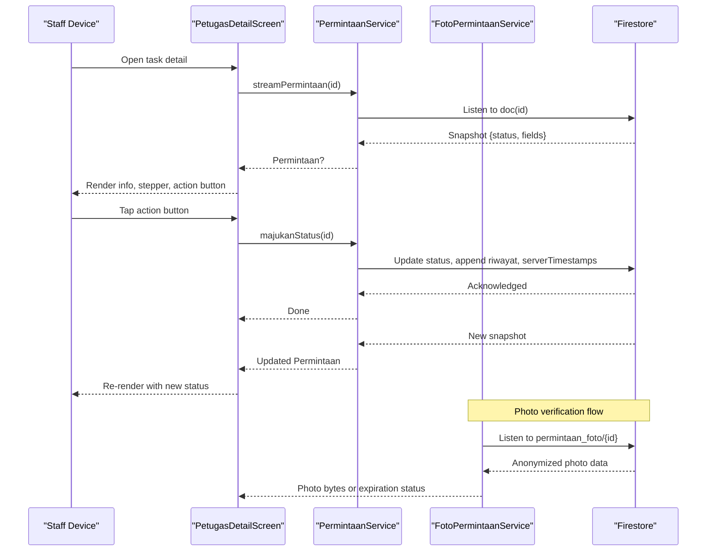
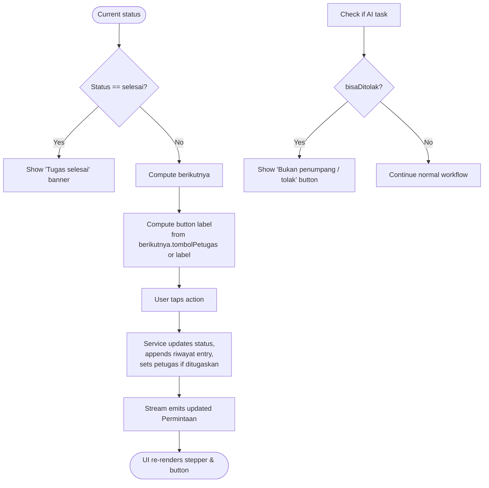
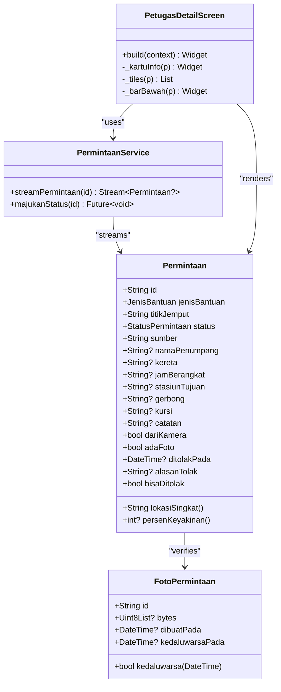
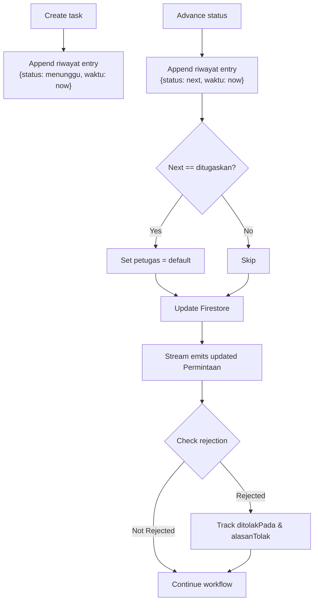
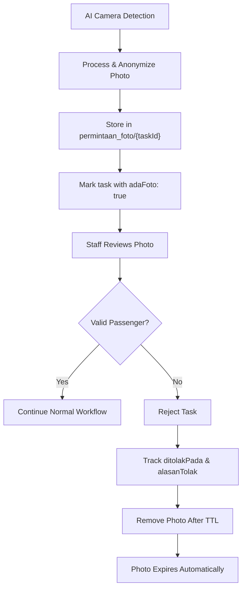
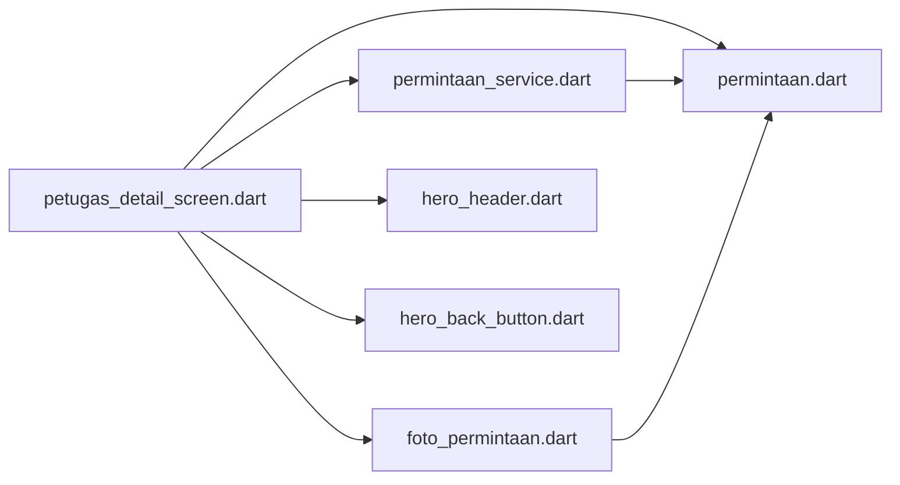

# Task Detail Screen

<cite>
**Referenced Files in This Document**
- [petugas_detail_screen.dart](file://whoosh_ramah/lib/screens/petugas_detail_screen.dart)
- [permintaan_service.dart](file://whoosh_ramah/lib/services/permintaan_service.dart)
- [permintaan.dart](file://whoosh_ramah/lib/models/permintaan.dart)
- [foto_permintaan.dart](file://whoosh_ramah/lib/models/foto_permintaan.dart)
- [theme.dart](file://whoosh_ramah/lib/theme.dart)
- [hero_header.dart](file://whoosh_ramah/lib/widgets/hero_header.dart)
- [hero_back_button.dart](file://whoosh_ramah/lib/widgets/hero_back_button.dart)
- [Petugas-Detail.dc.html](file://design/Petugas-Detail.dc.html)
- [petugas_detail_test.dart](file://whoosh_ramah/test/petugas_detail_test.dart)
- [permintaan_test.dart](file://whoosh_ramah/test/permintaan_test.dart)
- [foto_permintaan_test.dart](file://whoosh_ramah/test/foto_permintaan_test.dart)
</cite>

## Update Summary
**Changes Made**
- Added comprehensive photo verification workflow documentation
- Updated status progression workflow to include rejection capabilities
- Enhanced passenger information section with photo verification details
- Added new Photo Verification section covering anonymized photo handling
- Updated troubleshooting guide with photo-related issues
- Expanded accessibility features for photo verification interface

## Table of Contents
1. [Introduction](#introduction)
2. [Project Structure](#project-structure)
3. [Core Components](#core-components)
4. [Architecture Overview](#architecture-overview)
5. [Detailed Component Analysis](#detailed-component-analysis)
6. [Photo Verification Workflow](#photo-verification-workflow)
7. [Dependency Analysis](#dependency-analysis)
8. [Performance Considerations](#performance-considerations)
9. [Troubleshooting Guide](#troubleshooting-guide)
10. [Conclusion](#conclusion)

## Introduction
This document explains the staff task detail screen implementation that shows a comprehensive view of an assistance request (task). It covers passenger information, assistance type, location details, train/carriage/seat information, AI detection confidence scores, and **anonymized passenger photos for verification**. The screen implements a five-step status progression workflow with action buttons to move through states: "Ditugaskan ke Anda" → "Bertemu penumpang" → "Penumpang di kursi" → "Selesai", plus **rejection capabilities for AI-detected tasks marked as not a passenger**. It also documents the audit trail for status changes with timestamps and user actions, real-time updates via PermintaanService, UI components for different task sources (AI camera vs manual application), state management for transitions, permission checks for assignment, timeline visualization for status history, responsive design considerations, and accessibility features.

## Project Structure
The task detail screen is implemented as a Flutter widget within the screens layer, consuming a service for Firestore-backed data and using shared theme and header widgets. The photo verification system integrates with a separate collection for anonymized passenger photos.

**Diagram sources**
- [petugas_detail_screen.dart:18-123](file://whoosh_ramah/lib/screens/petugas_detail_screen.dart#L18-L123)
- [permintaan_service.dart:10-119](file://whoosh_ramah/lib/services/permintaan_service.dart#L10-L119)
- [permintaan.dart:7-57](file://whoosh_ramah/lib/models/permintaan.dart#L7-L57)
- [foto_permintaan.dart:14-63](file://whoosh_ramah/lib/models/foto_permintaan.dart#L14-L63)
- [hero_header.dart:9-43](file://whoosh_ramah/lib/widgets/hero_header.dart#L9-L43)
- [hero_back_button.dart:8-45](file://whoosh_ramah/lib/widgets/hero_back_button.dart#L8-L45)

**Section sources**
- [petugas_detail_screen.dart:18-123](file://whoosh_ramah/lib/screens/petugas_detail_screen.dart#L18-L123)
- [permintaan_service.dart:10-119](file://whoosh_ramah/lib/services/permintaan_service.dart#L10-L119)
- [permintaan.dart:7-57](file://whoosh_ramah/lib/models/permintaan.dart#L7-L57)
- [foto_permintaan.dart:14-63](file://whoosh_ramah/lib/models/foto_permintaan.dart#L14-L63)
- [hero_header.dart:9-43](file://whoosh_ramah/lib/widgets/hero_header.dart#L9-L43)
- [hero_back_button.dart:8-45](file://whoosh_ramah/lib/widgets/hero_back_button.dart#L8-L45)

## Core Components
- PetugasDetailScreen: A StatefulWidget that listens to a single Firestore document stream, renders passenger info, assistance type, location or train/carriage/seat details, a five-step status stepper, notes, communication shortcuts, and a primary action button to advance status.
- PermintaanService: Provides Firestore streams for a single task and all tasks, plus a method to advance status while appending an audit entry.
- Permintaan model: Encapsulates task data, enums for assistance type and status, helpers for source differentiation (camera vs app), short location extraction, confidence percentage formatting, **and photo verification fields (adaFoto, ditolakPada, alasanTolak)**.
- FotoPermintaan model: Handles anonymized passenger photo data including base64 decoding, expiration checking, and null-safe operations.
- Theme and widgets: Shared color palette, radii, shadows, HeroHeader, and HeroBackButton ensure consistent visual language and accessibility.

Key responsibilities:
- Real-time display of task data via StreamBuilder.
- Status progression with a single action button whose label adapts to the next step.
- **Photo verification workflow for AI-detected tasks showing anonymized passenger photos.**
- Conditional rendering for AI camera tasks (location + confidence + photo) versus app-created tasks (pickup point, train, carriage, seat, destination).
- Audit trail appended on each status change.
- **Task rejection capability for AI-detected false positives.**

**Section sources**
- [petugas_detail_screen.dart:18-123](file://whoosh_ramah/lib/screens/petugas_detail_screen.dart#L18-L123)
- [permintaan_service.dart:23-119](file://whoosh_ramah/lib/services/permintaan_service.dart#L23-L119)
- [permintaan.dart:7-57](file://whoosh_ramah/lib/models/permintaan.dart#L7-L57)
- [foto_permintaan.dart:14-63](file://whoosh_ramah/lib/models/foto_permintaan.dart#L14-L63)
- [theme.dart:7-48](file://whoosh_ramah/lib/theme.dart#L7-L48)

## Architecture Overview
The screen uses a reactive architecture:
- UI subscribes to a single-document stream from PermintaanService.
- When the user taps the action button, the service advances the status and writes an audit entry.
- **Photo verification data is handled separately through FotoPermintaan model with TTL-based expiration.**
- Firestore pushes updated data back to the UI automatically.

**Diagram sources**
- [petugas_detail_screen.dart:30-50](file://whoosh_ramah/lib/screens/petugas_detail_screen.dart#L30-L50)
- [permintaan_service.dart:65-119](file://whoosh_ramah/lib/services/permintaan_service.dart#L65-L119)
- [foto_permintaan.dart:40-63](file://whoosh_ramah/lib/models/foto_permintaan.dart#L40-L63)

## Detailed Component Analysis

### Status Progression Workflow
The workflow enforces a strict sequence:
- Menunggu → Ditugaskan → Bertemu → DiKursi → Selesai

The UI displays a five-step stepper and a single action button whose label reflects the next step. When the current status is Selesai, the button is replaced by a success banner. **For AI-detected tasks, staff can reject false positives at any stage before completion.**

**Diagram sources**
- [permintaan.dart:32-57](file://whoosh_ramah/lib/models/permintaan.dart#L32-L57)
- [permintaan.dart:161-163](file://whoosh_ramah/lib/models/permintaan.dart#L161-L163)
- [petugas_detail_screen.dart:312-406](file://whoosh_ramah/lib/screens/petugas_detail_screen.dart#L312-L406)
- [permintaan_service.dart:92-119](file://whoosh_ramah/lib/services/permintaan_service.dart#L92-L119)

**Section sources**
- [permintaan.dart:32-57](file://whoosh_ramah/lib/models/permintaan.dart#L32-L57)
- [permintaan.dart:161-163](file://whoosh_ramah/lib/models/permintaan.dart#L161-L163)
- [petugas_detail_screen.dart:312-406](file://whoosh_ramah/lib/screens/petugas_detail_screen.dart#L312-L406)
- [permintaan_service.dart:92-119](file://whoosh_ramah/lib/services/permintaan_service.dart#L92-L119)

### Passenger Information and Task Source Rendering
- Manual application tasks show:
  - Passenger name and assistance type badge.
  - Pickup point, train number with departure time, carriage and seat, destination.
  - Optional note card.
  - Communication shortcuts: message and call.
- AI camera tasks show:
  - Placeholder name "Penumpang belum diketahui".
  - Short location extracted from pickup point.
  - Confidence percentage derived from AI detection score.
  - **Anonymized passenger photo for verification (when available).**
  - No train/carriage/seat fields; instead, location and confidence are displayed.

**Diagram sources**
- [permintaan.dart:81-148](file://whoosh_ramah/lib/models/permintaan.dart#L81-L148)
- [foto_permintaan.dart:14-63](file://whoosh_ramah/lib/models/foto_permintaan.dart#L14-L63)
- [permintaan_service.dart:65-119](file://whoosh_ramah/lib/services/permintaan_service.dart#L65-L119)
- [petugas_detail_screen.dart:161-310](file://whoosh_ramah/lib/screens/petugas_detail_screen.dart#L161-L310)

**Section sources**
- [petugas_detail_screen.dart:161-310](file://whoosh_ramah/lib/screens/petugas_detail_screen.dart#L161-L310)
- [permintaan.dart:126-148](file://whoosh_ramah/lib/models/permintaan.dart#L126-L148)

### Audit Trail Implementation
Each status advancement appends an audit entry containing the new status and timestamp. The initial creation adds the first entry with status "menunggu". When transitioning to "ditugaskan", the assigned officer's name is set. **Rejection events are also tracked in the audit trail without changing the status enum.**

Key behaviors:
- Append to riwayat array atomically using arrayUnion.
- Use serverTimestamp for diperbaruiPada to reflect server time.
- For ditugaskan, set petugas field to a default value.
- **Track rejection timestamps and reasons separately from status changes.**

Timeline visualization:
- The UI does not render the full history list directly; it computes the active step based on the current status and highlights completed steps.
- The model parses riwayat entries into RiwayatStatus objects with status and optional waktu.

**Diagram sources**
- [permintaan_service.dart:23-61](file://whoosh_ramah/lib/services/permintaan_service.dart#L23-L61)
- [permintaan_service.dart:92-119](file://whoosh_ramah/lib/services/permintaan_service.dart#L92-L119)
- [permintaan.dart:59-75](file://whoosh_ramah/lib/models/permintaan.dart#L59-L75)
- [permintaan.dart:141-147](file://whoosh_ramah/lib/models/permintaan.dart#L141-L147)

**Section sources**
- [permintaan_service.dart:23-61](file://whoosh_ramah/lib/services/permintaan_service.dart#L23-L61)
- [permintaan_service.dart:92-119](file://whoosh_ramah/lib/services/permintaan_service.dart#L92-L119)
- [permintaan.dart:59-75](file://whoosh_ramah/lib/models/permintaan.dart#L59-L75)
- [permintaan.dart:141-147](file://whoosh_ramah/lib/models/permintaan.dart#L141-L147)

### Permission Checks for Task Assignment
The current implementation does not enforce role-based permissions at the screen level. Instead, it relies on the service logic to assign the officer when advancing to "ditugaskan". To add permission checks:
- Validate the current user's role before allowing the transition to "ditugaskan".
- Reject transitions if the user is not authorized.
- Return clear error feedback via SnackBar.

Suggested integration points:
- In _majukan(), check user role before calling majukanStatus().
- Extend PermintaanService.majukanStatus() to accept a userId and validate against a roles collection.

**Section sources**
- [petugas_detail_screen.dart:37-50](file://whoosh_ramah/lib/screens/petugas_detail_screen.dart#L37-L50)
- [permintaan_service.dart:92-119](file://whoosh_ramah/lib/services/permintaan_service.dart#L92-L119)

### State Management for Status Transitions
State is managed reactively:
- StreamBuilder listens to PermintaanService.streamPermintaan(id).
- Local loading state disables the action button during updates.
- Button label is computed from the next status enum.

Example patterns:
- Compute next status: p.status.berikutnya.
- Compute button label: use berikutnya.tombolPetugas or fallback to berikutnya.label; for final step, include destination station name.
- Disable button while loading and show spinner.

**Section sources**
- [petugas_detail_screen.dart:30-50](file://whoosh_ramah/lib/screens/petugas_detail_screen.dart#L30-L50)
- [petugas_detail_screen.dart:398-406](file://whoosh_ramah/lib/screens/petugas_detail_screen.dart#L398-L406)
- [permintaan.dart:45-57](file://whoosh_ramah/lib/models/permintaan.dart#L45-L57)

### Timeline Visualization for Status History
The stepper visualizes progress:
- Completed steps show a filled circle with a checkmark.
- Current step shows an outlined circle with a dot and "sekarang" suffix.
- Upcoming steps show an empty circle with neutral styling.

Labels adapt to context:
- "Penumpang di kursi" includes seat number when available.
- Final step includes destination station name.

**Section sources**
- [petugas_detail_screen.dart:312-348](file://whoosh_ramah/lib/screens/petugas_detail_screen.dart#L312-L348)
- [petugas_detail_screen.dart:408-424](file://whoosh_ramah/lib/screens/petugas_detail_screen.dart#L408-L424)
- [petugas_detail_screen.dart:429-505](file://whoosh_ramah/lib/screens/petugas_detail_screen.dart#L429-L505)

## Photo Verification Workflow

### Overview
The photo verification system allows staff to review anonymized passenger photos for AI-detected tasks and reject false positives. The system handles privacy-sensitive image data with automatic expiration and secure storage.

### Photo Data Flow

**Diagram sources**
- [foto_permintaan.dart:6-13](file://whoosh_ramah/lib/models/foto_permintaan.dart#L6-L13)
- [permintaan.dart:136-147](file://whoosh_ramah/lib/models/permintaan.dart#L136-L147)

### Anonymized Photo Handling
- Photos are stored as base64-encoded JPEG data in the `permintaan_foto/{id}` collection.
- Images are automatically anonymized (pixelated, face-blurred) before storage.
- Maximum size: 160 pixels to protect privacy.
- Automatic expiration via TTL (Time-To-Live) mechanism.
- Null-safe handling for missing or expired photos.

### Photo Expiration System
- Each photo has a creation timestamp (`dibuatPada`) and expiration timestamp (`kedaluwarsaPada`).
- Background processes automatically delete expired photos.
- UI displays appropriate states: valid photo, expired photo, or no photo available.
- The `FotoPermintaan.kedaluwarsa()` method determines if a photo is still valid.

### Staff Rejection Workflow
- Staff can reject AI-detected tasks marked as "not a passenger" using the rejection capability.
- Rejection is tracked via `ditolakPada` (timestamp) and `alasanTolak` (reason).
- Rejection does NOT change the task status enum but removes it from active task lists.
- The `bisaDitolak` getter ensures only AI-detected, non-completed, non-rejected tasks can be rejected.

### Privacy and Security
- Only staff screens can access photo verification data.
- Passengers and family members never receive photo data.
- Photos are automatically deleted after TTL period.
- Base64 encoding provides basic obfuscation of image data.

**Section sources**
- [foto_permintaan.dart:6-63](file://whoosh_ramah/lib/models/foto_permintaan.dart#L6-L63)
- [permintaan.dart:136-163](file://whoosh_ramah/lib/models/permintaan.dart#L136-L163)

### Responsive Design Considerations
- Hero header extends to status bar with rounded bottom corners and SafeArea handling.
- Cards overlap the hero using negative translation to match design specs.
- Two-column grid for info tiles adapts to screen width.
- Bottom action area remains fixed with padding and accessible tap targets.
- **Photo verification cards maintain aspect ratio and handle various image sizes gracefully.**

Design alignment:
- Colors, radii, and shadows follow AppColors and AppRadius.
- Typography uses Nunito with sizes and weights per design guidelines.

**Section sources**
- [hero_header.dart:9-43](file://whoosh_ramah/lib/widgets/hero_header.dart#L9-L43)
- [petugas_detail_screen.dart:53-123](file://whoosh_ramah/lib/screens/petugas_detail_screen.dart#L53-L123)
- [theme.dart:7-48](file://whoosh_ramah/lib/theme.dart#L7-L48)
- [Petugas-Detail.dc.html:18-80](file://design/Petugas-Detail.dc.html#L18-L80)

### Accessibility Features
- Back button exposes explicit label for screen readers.
- Action button uses Semantics with enabled state and label reflecting processing or action text.
- Secondary buttons wrap content with MergeSemantics and Semantics(button: true) for proper announcements.
- Touch targets meet minimum size requirements.
- **Photo verification elements provide appropriate semantic labels for screen readers.**
- **Rejection buttons include descriptive labels explaining the action.**

**Section sources**
- [hero_back_button.dart:8-45](file://whoosh_ramah/lib/widgets/hero_back_button.dart#L8-L45)
- [petugas_detail_screen.dart:622-670](file://whoosh_ramah/lib/screens/petugas_detail_screen.dart#L622-L670)
- [petugas_detail_screen.dart:587-620](file://whoosh_ramah/lib/screens/petugas_detail_screen.dart#L587-L620)

## Dependency Analysis
The following diagram maps dependencies between core files:

**Diagram sources**
- [petugas_detail_screen.dart:1-8](file://whoosh_ramah/lib/screens/petugas_detail_screen.dart#L1-L8)
- [permintaan_service.dart:1-4](file://whoosh_ramah/lib/services/permintaan_service.dart#L1-L4)
- [permintaan.dart:1-2](file://whoosh_ramah/lib/models/permintaan.dart#L1-L2)
- [foto_permintaan.dart:1-4](file://whoosh_ramah/lib/models/foto_permintaan.dart#L1-L4)
- [hero_header.dart:1-3](file://whoosh_ramah/lib/widgets/hero_header.dart#L1-L3)
- [hero_back_button.dart:1-3](file://whoosh_ramah/lib/widgets/hero_back_button.dart#L1-L3)

**Section sources**
- [petugas_detail_screen.dart:1-8](file://whoosh_ramah/lib/screens/petugas_detail_screen.dart#L1-L8)
- [permintaan_service.dart:1-4](file://whoosh_ramah/lib/services/permintaan_service.dart#L1-L4)
- [permintaan.dart:1-2](file://whoosh_ramah/lib/models/permintaan.dart#L1-L2)
- [foto_permintaan.dart:1-4](file://whoosh_ramah/lib/models/foto_permintaan.dart#L1-L4)

## Performance Considerations
- Single-document stream minimizes network overhead compared to listening to the entire collection.
- Avoid heavy computations inside build; delegate to model getters (e.g., lokasiSingkat, persenKeyakinan).
- Debounce rapid taps by disabling the action button during loading.
- Keep UI tree shallow where possible; reuse small widgets (_StepRow, _InfoTile, _Avatar, _BadgeSumber).
- **Photo verification uses efficient base64 decoding with null-safe error handling.**
- **Automatic photo expiration reduces storage overhead and privacy risks.**

[No sources needed since this section provides general guidance]

## Troubleshooting Guide
Common issues and resolutions:
- Task not found:
  - If the document does not exist, the UI shows a friendly message. Verify the ID passed to the screen.
- Network errors updating status:
  - The UI displays a SnackBar when majukanStatus throws. Retry after ensuring connectivity.
- Incorrect status labels:
  - Ensure enum values match Firestore strings; fallbacks default to "menunggu" or "kursi_roda".
- Missing train/carriage/seat info:
  - These fields are only present for app-created tasks; AI camera tasks show location and confidence instead.
- **Photo verification issues:**
  - **Expired photos: Display "Cuplikan sudah kedaluwarsa" state instead of error.**
  - **Missing photos: Handle null bytes gracefully and show appropriate placeholder.**
  - **Base64 decoding errors: Treat corrupted images as unavailable photos.**
- **Rejection workflow problems:**
  - **Ensure only AI-detected tasks can be rejected (check bisaDitolak).**
  - **Verify rejection doesn't affect task status enum (only sets ditolakPada).**

Relevant code paths:
- Error handling in _majukan(): catch exceptions and show SnackBar.
- Null-safe parsing in Permintaan.fromMap handles missing fields gracefully.
- **FotoPermintaan._decodeGambar() handles base64 decoding errors safely.**
- **Permintaan.bisaDitolak ensures proper rejection conditions.**

**Section sources**
- [petugas_detail_screen.dart:37-50](file://whoosh_ramah/lib/screens/petugas_detail_screen.dart#L37-L50)
- [permintaan.dart:157-189](file://whoosh_ramah/lib/models/permintaan.dart#L157-L189)
- [foto_permintaan.dart:55-62](file://whoosh_ramah/lib/models/foto_permintaan.dart#L55-L62)
- [permintaan.dart:161-163](file://whoosh_ramah/lib/models/permintaan.dart#L161-L163)

## Conclusion
The staff task detail screen delivers a clear, accessible, and responsive interface for managing assistance requests with integrated photo verification capabilities. It integrates real-time updates via PermintaanService, enforces a strict status progression workflow, maintains an audit trail for compliance and transparency, and provides robust photo verification for AI-detected tasks. The system handles anonymized passenger photos with automatic expiration, supports task rejection for false positives, and adapts to both AI camera and manual application tasks. With thoughtful accessibility, responsive design, and privacy-focused photo handling, the screen supports efficient staff workflows across devices while maintaining passenger privacy and security.

[No sources needed since this section summarizes without analyzing specific files]