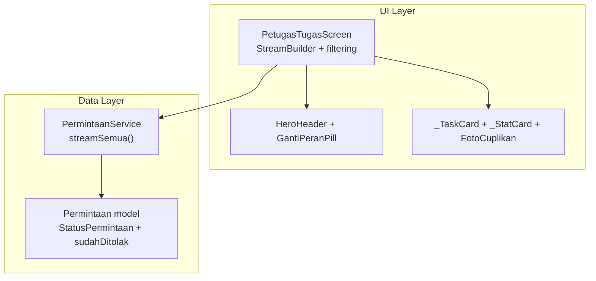
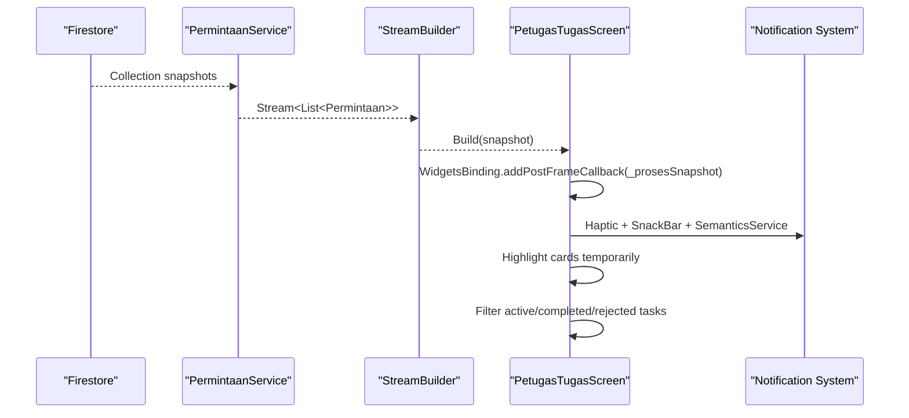
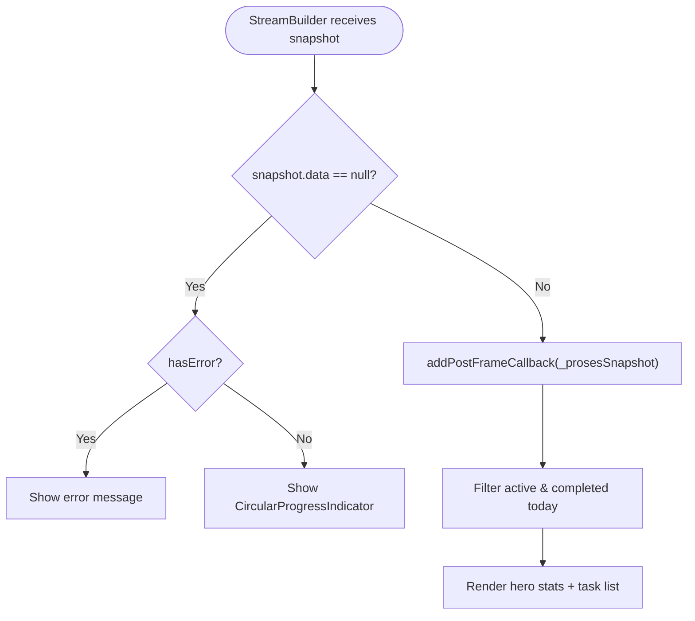
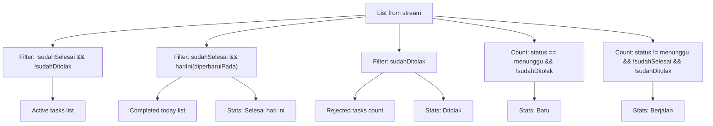
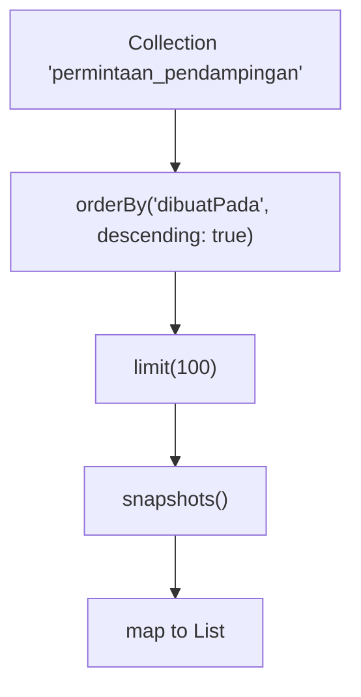
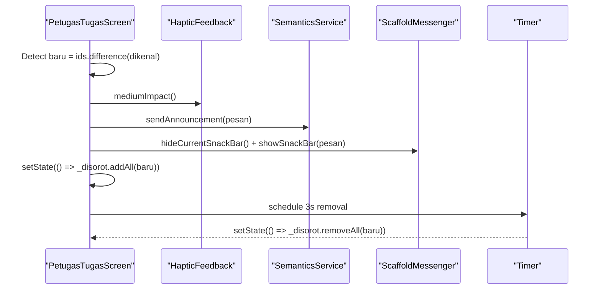
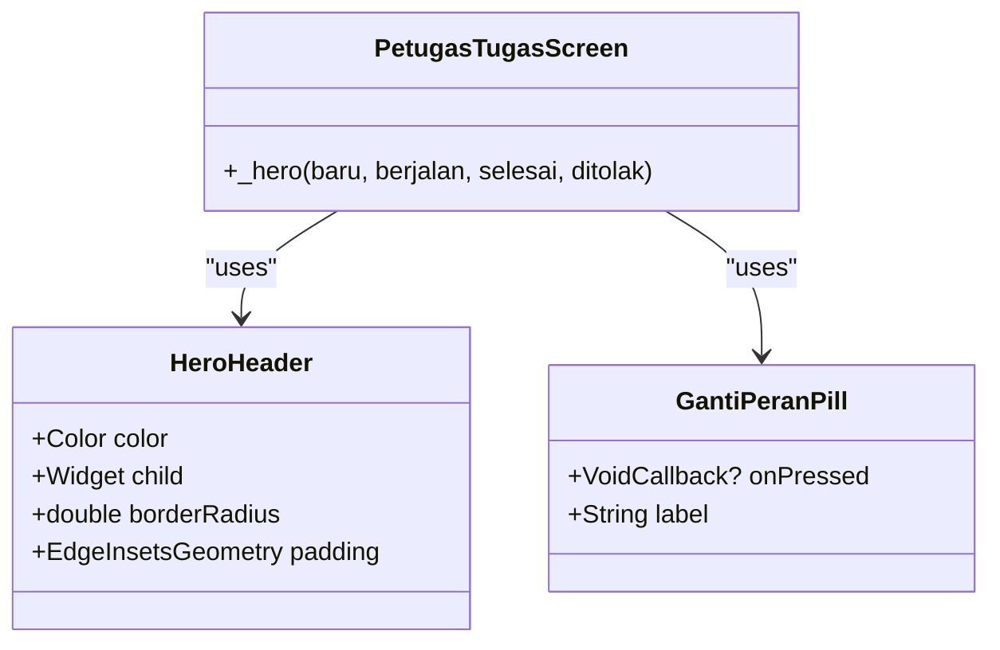
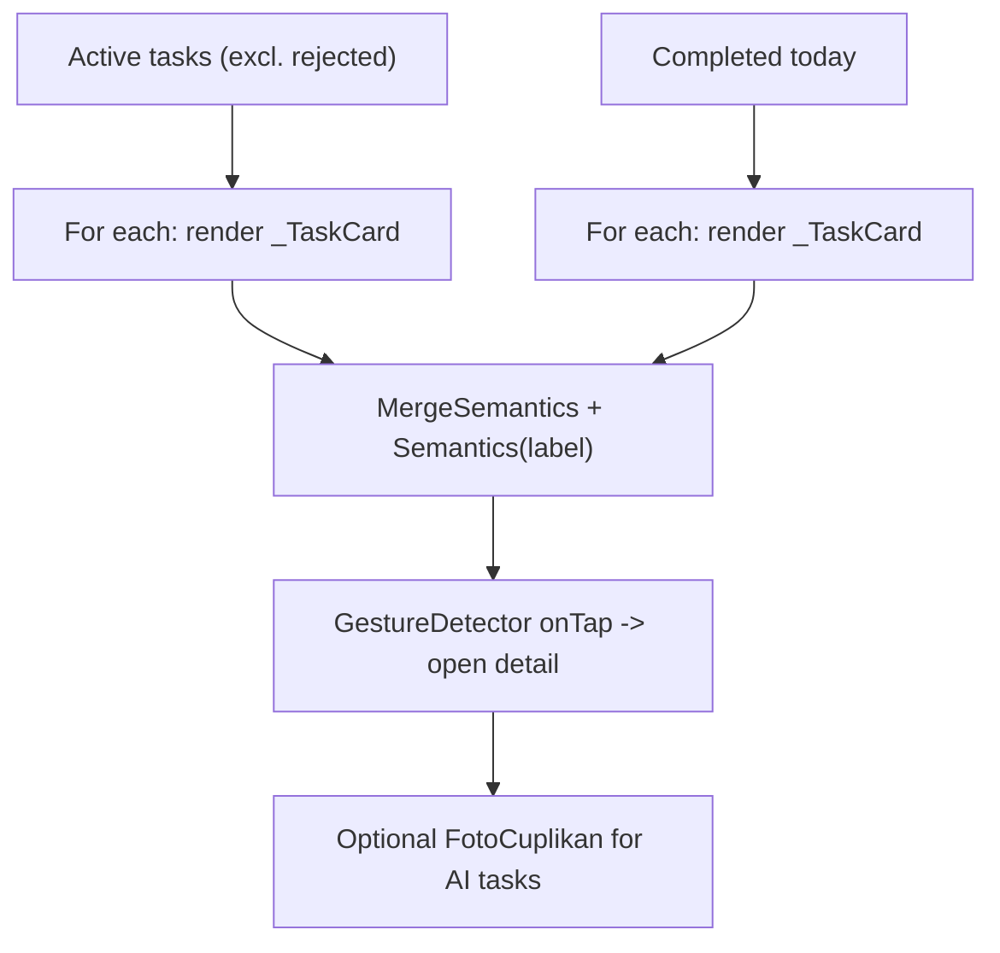
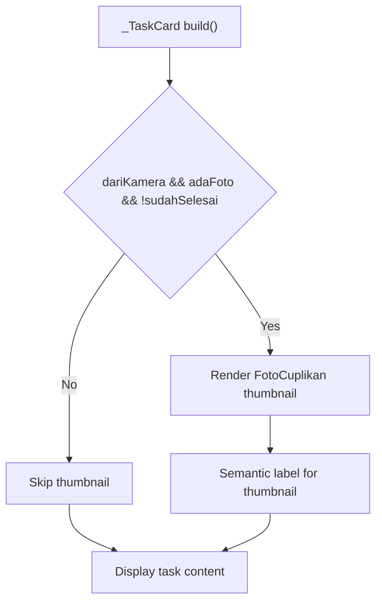
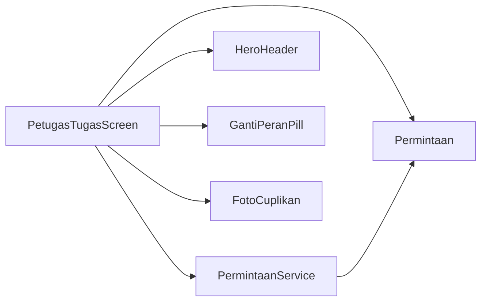

# Task List Screen

<cite>
**Referenced Files in This Document**
- [petugas_tugas_screen.dart](file://whoosh_ramah/lib/screens/petugas_tugas_screen.dart)
- [permintaan_service.dart](file://whoosh_ramah/lib/services/permintaan_service.dart)
- [permintaan.dart](file://whoosh_ramah/lib/models/permintaan.dart)
- [hero_header.dart](file://whoosh_ramah/lib/widgets/hero_header.dart)
- [ganti_peran_pill.dart](file://whoosh_ramah/lib/widgets/ganti_peran_pill.dart)
- [foto_cuplikan.dart](file://whoosh_ramah/lib/widgets/foto_cuplikan.dart)
</cite>

## Update Summary
**Changes Made**
- Updated task filtering logic to handle rejected tasks separately from active tasks
- Added new 'Ditolak' (Rejected) counter in statistics header alongside existing counters
- Enhanced task card structure with AI camera snapshot thumbnail support via FotoCuplikan widget
- Improved semantic structure and accessibility features throughout the task list implementation
- Updated notification system to work with the new rejected task handling

## Table of Contents
1. [Introduction](#introduction)
2. [Project Structure](#project-structure)
3. [Core Components](#core-components)
4. [Architecture Overview](#architecture-overview)
5. [Detailed Component Analysis](#detailed-component-analysis)
6. [Dependency Analysis](#dependency-analysis)
7. [Performance Considerations](#performance-considerations)
8. [Troubleshooting Guide](#troubleshooting-guide)
9. [Conclusion](#conclusion)

## Introduction
This document explains the staff task list screen implementation that displays real-time tasks for officers. It uses a stream-based approach to show active tasks and completed tasks from today, separates and sorts tasks on the client side, and provides a notification system for new tasks including haptic feedback, SnackBar messages, TalkBack announcements via SemanticsService, and temporary card highlighting. The hero section includes role switching, greeting display, duty badge, and statistics cards for new, in-progress, completed, and rejected tasks.

**Updated** Enhanced with separate handling for rejected tasks, new 'Ditolak' counter, improved task card structure with AI camera snapshot thumbnails, and better semantic structure for accessibility.

## Project Structure
The task list screen is implemented as a Flutter StatefulWidget with:
- A StreamBuilder wired to PermintaanService.streamSemua() for real-time updates.
- Client-side filtering into active tasks, completed tasks from today, and rejected tasks.
- A hero header built with HeroHeader and GantiPeranPill.
- A task list rendered with reusable widgets for status badges, source badges, AI camera snapshot thumbnails, and accessibility-aware task cards.

**Diagram sources**
- [petugas_tugas_screen.dart:92-133](file://whoosh_ramah/lib/screens/petugas_tugas_screen.dart#L92-L133)
- [permintaan_service.dart:70-78](file://whoosh_ramah/lib/services/permintaan_service.dart#L70-L78)
- [permintaan.dart:32-57](file://whoosh_ramah/lib/models/permintaan.dart#L32-L57)

**Section sources**
- [petugas_tugas_screen.dart:22-36](file://whoosh_ramah/lib/screens/petugas_tugas_screen.dart#L22-L36)
- [permintaan_service.dart:6-10](file://whoosh_ramah/lib/services/permintaan_service.dart#L6-L10)

## Core Components
- PetugasTugasScreen: Main screen stateful widget that subscribes to PermintaanService.streamSemua(), processes snapshots, filters tasks (including rejected), and renders the UI.
- PermintaanService.streamSemua(): Firestore stream returning all requests ordered by creation time descending, limited to 100 documents.
- Permintaan model: Data structure representing a request, including status enum, timestamps, helper properties like sudahSelesai, dariKamera, and sudahDitolak.
- HeroHeader and GantiPeranPill: Reusable widgets for the colored hero header and role-switching pill.
- FotoCuplikan: Widget for displaying AI camera snapshot thumbnails in task cards.

Key responsibilities:
- Real-time data subscription via StreamBuilder.
- Snapshot processing to detect new documents after initial load.
- Filtering active vs completed vs rejected tasks from today.
- Statistics computation (new, in-progress, completed, rejected).
- Notification pipeline for new tasks.
- Accessibility features for task cards and hero sections.
- AI camera snapshot thumbnail display for relevant tasks.

**Section sources**
- [petugas_tugas_screen.dart:38-57](file://whoosh_ramah/lib/screens/petugas_tugas_screen.dart#L38-L57)
- [permintaan_service.dart:70-78](file://whoosh_ramah/lib/services/permintaan_service.dart#L70-L78)
- [permintaan.dart:77-130](file://whoosh_ramah/lib/models/permintaan.dart#L77-L130)
- [hero_header.dart:9-43](file://whoosh_ramah/lib/widgets/hero_header.dart#L9-L43)
- [ganti_peran_pill.dart:10-48](file://whoosh_ramah/lib/widgets/ganti_peran_pill.dart#L10-L48)
- [foto_cuplikan.dart:9-41](file://whoosh_ramah/lib/widgets/foto_cuplikan.dart#L9-L41)

## Architecture Overview
The screen listens to a Firestore collection through PermintaanService.streamSemua(). Each snapshot triggers UI rebuilds via StreamBuilder. After the first frame, the screen detects newly added documents and notifies the user through multiple channels. Tasks are split into active (excluding rejected), completed-from-today, and rejected lists, then displayed under section headers with appropriate statistics.

**Diagram sources**
- [permintaan_service.dart:70-78](file://whoosh_ramah/lib/services/permintaan_service.dart#L70-L78)
- [petugas_tugas_screen.dart:92-133](file://whoosh_ramah/lib/screens/petugas_tugas_screen.dart#L92-L133)
- [petugas_tugas_screen.dart:59-90](file://whoosh_ramah/lib/screens/petugas_tugas_screen.dart#L59-L90)

## Detailed Component Analysis

### Real-Time Task Display with StreamBuilder
- The screen creates a late stream bound to PermintaanService.streamSemua().
- StreamBuilder builds the UI based on snapshot.data.
- On null data, it shows either a loading indicator or an error message.
- After each frame, it calls _prosesSnapshot to detect new documents and trigger notifications.

**Diagram sources**
- [petugas_tugas_screen.dart:92-133](file://whoosh_ramah/lib/screens/petugas_tugas_screen.dart#L92-L133)

**Section sources**
- [petugas_tugas_screen.dart:38-57](file://whoosh_ramah/lib/screens/petugas_tugas_screen.dart#L38-L57)
- [petugas_tugas_screen.dart:92-133](file://whoosh_ramah/lib/screens/petugas_tugas_screen.dart#L92-L133)

### Enhanced Task Filtering Logic
- Active tasks: all items where sudahSelesai is false AND sudahDitolak is false.
- Completed tasks from today: items where sudahSelesai is true and diperbaruiPada falls within the current day.
- Rejected tasks: items where sudahDitolak is true (separate from active/completed lists).
- Statistics:
  - New: count of items with status menunggu and not rejected.
  - In-progress: count of items not menunggu and not selesai and not rejected.
  - Completed today: length of completed-from-today list.
  - Rejected: count of already rejected tasks.

**Updated** Enhanced filtering logic now handles rejected tasks separately using the `sudahDitolak` property.

**Diagram sources**
- [petugas_tugas_screen.dart:155-171](file://whoosh_ramah/lib/screens/petugas_tugas_screen.dart#L155-L171)
- [permintaan.dart:158-163](file://whoosh_ramah/lib/models/permintaan.dart#L158-L163)

**Section sources**
- [petugas_tugas_screen.dart:155-171](file://whoosh_ramah/lib/screens/petugas_tugas_screen.dart#L155-L171)
- [permintaan.dart:158-163](file://whoosh_ramah/lib/models/permintaan.dart#L158-L163)

### Sorting Mechanism
- Firestore ordering: streamSemua() orders by dibuatPada descending, limiting to 100 documents.
- This ensures newest tasks appear at the top without requiring composite indexes.
- Additional client-side sorting is not applied; the order is inherited from the stream.

**Diagram sources**
- [permintaan_service.dart:70-78](file://whoosh_ramah/lib/services/permintaan_service.dart#L70-L78)

**Section sources**
- [permintaan_service.dart:70-78](file://whoosh_ramah/lib/services/permintaan_service.dart#L70-L78)

### Notification System for New Tasks
When a new document appears after the initial load:
- HapticFeedback.mediumImpact() provides tactile feedback.
- SemanticsService.sendAnnouncement() announces the message to TalkBack.
- ScaffoldMessenger shows a SnackBar with the same message.
- The affected card IDs are added to a highlight set and removed after 3 seconds.

**Diagram sources**
- [petugas_tugas_screen.dart:59-90](file://whoosh_ramah/lib/screens/petugas_tugas_screen.dart#L59-L90)

**Section sources**
- [petugas_tugas_screen.dart:59-90](file://whoosh_ramah/lib/screens/petugas_tugas_screen.dart#L59-L90)

### Enhanced Hero Section: Role Switching, Greeting, Duty Badge, and Statistics
- Role switching: GantiPeranPill navigates back to the root screen.
- Greeting: Displays a personalized greeting using DummyData.petugas.nama.
- Duty badge: Shows a green "Bertugas" badge indicating officer on duty.
- Statistics cards: Four cards showing counts for new, in-progress, completed, and rejected tasks.

**Updated** Added fourth statistics card for rejected tasks ('Ditolak') alongside existing counters.

**Diagram sources**
- [hero_header.dart:9-43](file://whoosh_ramah/lib/widgets/hero_header.dart#L9-L43)
- [ganti_peran_pill.dart:10-48](file://whoosh_ramah/lib/widgets/ganti_peran_pill.dart#L10-L48)
- [petugas_tugas_screen.dart:212-278](file://whoosh_ramah/lib/screens/petugas_tugas_screen.dart#L212-L278)

**Section sources**
- [petugas_tugas_screen.dart:212-278](file://whoosh_ramah/lib/screens/petugas_tugas_screen.dart#L212-L278)
- [hero_header.dart:9-43](file://whoosh_ramah/lib/widgets/hero_header.dart#L9-L43)
- [ganti_peran_pill.dart:10-48](file://whoosh_ramah/lib/widgets/ganti_peran_pill.dart#L10-L48)

### Enhanced Task List Rendering and Accessibility
- Task list rendering:
  - Section header "TUGAS MASUK" followed by active tasks (excluding rejected).
  - Optional section "SELESAI HARI INI" followed by completed tasks from today.
  - Empty state message when no active tasks exist.
- Accessibility:
  - Each task card wraps content in MergeSemantics and Semantics(button: true) with a descriptive label combining title, subtitle, status, and relative time.
  - Card tap area is fully interactive via GestureDetector with HitTestBehavior.opaque.
  - Hero greeting text is marked as a semantic header.
  - AI camera snapshot thumbnails have dedicated semantic labels for accessibility.

**Updated** Enhanced accessibility with better semantic structure and AI camera snapshot thumbnail support.

**Diagram sources**
- [petugas_tugas_screen.dart:280-336](file://whoosh_ramah/lib/screens/petugas_tugas_screen.dart#L280-L336)
- [petugas_tugas_screen.dart:493-650](file://whoosh_ramah/lib/screens/petugas_tugas_screen.dart#L493-L650)

**Section sources**
- [petugas_tugas_screen.dart:280-336](file://whoosh_ramah/lib/screens/petugas_tugas_screen.dart#L280-L336)
- [petugas_tugas_screen.dart:493-650](file://whoosh_ramah/lib/screens/petugas_tugas_screen.dart#L493-L650)

### Enhanced Task Card Structure with AI Camera Snapshot Thumbnails
- Task card rendering enhanced with conditional AI camera snapshot thumbnails.
- FotoCuplikan widget displays anonymous verification snapshots for AI-detected tasks.
- Thumbnail only appears for AI camera tasks with available photos and not yet completed.
- Semantic structure ensures proper accessibility for both card content and thumbnails.

**Updated** Enhanced task card structure now supports AI camera snapshot thumbnails via FotoCuplikan widget integration.

**Diagram sources**
- [petugas_tugas_screen.dart:526-528](file://whoosh_ramah/lib/screens/petugas_tugas_screen.dart#L526-L528)
- [foto_cuplikan.dart:22-41](file://whoosh_ramah/lib/widgets/foto_cuplikan.dart#L22-L41)

**Section sources**
- [petugas_tugas_screen.dart:526-528](file://whoosh_ramah/lib/screens/petugas_tugas_screen.dart#L526-L528)
- [foto_cuplikan.dart:22-41](file://whoosh_ramah/lib/widgets/foto_cuplikan.dart#L22-L41)

### Code Examples and Patterns

#### Stream Subscription Management
- The screen holds a late stream bound to PermintaanService.streamSemua().
- StreamBuilder manages subscription lifecycle automatically.
- No manual StreamController is used; disposal focuses on timers for card highlighting.

Reference paths:
- [Stream binding and StreamBuilder usage:38-41](file://whoosh_ramah/lib/screens/petugas_tugas_screen.dart#L38-L41)
- [StreamBuilder build logic:92-133](file://whoosh_ramah/lib/screens/petugas_tugas_screen.dart#L92-L133)
- [Dispose timers only:51-57](file://whoosh_ramah/lib/screens/petugas_tugas_screen.dart#L51-L57)

#### Snapshot Processing for New Documents
- Uses WidgetsBinding.instance.addPostFrameCallback to process snapshots after layout.
- Compares current known IDs with previous IDs to detect new documents.
- Skips notification on initial load by checking if known IDs were null.

Reference paths:
- [Snapshot processing and detection:59-90](file://whoosh_ramah/lib/screens/petugas_tugas_screen.dart#L59-L90)
- [Post-frame callback invocation:112-112](file://whoosh_ramah/lib/screens/petugas_tugas_screen.dart#L112-L112)

#### Enhanced Accessibility Features
- Semantic labels for task cards combine key information into a single accessible string.
- MergeSemantics groups related semantics for better screen reader experience.
- Hero greeting is marked as a semantic header.
- AI camera snapshot thumbnails have dedicated semantic labels for accessibility.

Reference paths:
- [Task card semantics:550-553](file://whoosh_ramah/lib/screens/petugas_tugas_screen.dart#L550-L553)
- [Hero greeting semantics:235-246](file://whoosh_ramah/lib/screens/petugas_tugas_screen.dart#L235-L246)
- [Thumbnail semantics:66-69](file://whoosh_ramah/lib/widgets/foto_cuplikan.dart#L66-L69)

## Dependency Analysis
The task list screen depends on:
- PermintaanService for streaming data.
- Permintaan model for data representation and status handling.
- HeroHeader and GantiPeranPill for UI composition.
- FotoCuplikan for AI camera snapshot thumbnail display.

**Diagram sources**
- [petugas_tugas_screen.dart:7-18](file://whoosh_ramah/lib/screens/petugas_tugas_screen.dart#L7-L18)
- [permintaan_service.dart:1-5](file://whoosh_ramah/lib/services/permintaan_service.dart#L1-L5)
- [permintaan.dart:1-5](file://whoosh_ramah/lib/models/permintaan.dart#L1-L5)
- [hero_header.dart:1-3](file://whoosh_ramah/lib/widgets/hero_header.dart#L1-L3)
- [ganti_peran_pill.dart:1-4](file://whoosh_ramah/lib/widgets/ganti_peran_pill.dart#L1-L4)
- [foto_cuplikan.dart:1-7](file://whoosh_ramah/lib/widgets/foto_cuplikan.dart#L1-L7)

**Section sources**
- [petugas_tugas_screen.dart:7-18](file://whoosh_ramah/lib/screens/petugas_tugas_screen.dart#L7-L18)
- [permintaan_service.dart:1-5](file://whoosh_ramah/lib/services/permintaan_service.dart#L1-L5)
- [permintaan.dart:1-5](file://whoosh_ramah/lib/models/permintaan.dart#L1-L5)
- [hero_header.dart:1-3](file://whoosh_ramah/lib/widgets/hero_header.dart#L1-L3)
- [ganti_peran_pill.dart:1-4](file://whoosh_ramah/lib/widgets/ganti_peran_pill.dart#L1-L4)
- [foto_cuplikan.dart:1-7](file://whoosh_ramah/lib/widgets/foto_cuplikan.dart#L1-L7)

## Performance Considerations
- Firestore query optimization:
  - Single-field orderBy avoids composite index requirements.
  - Limit of 100 documents reduces payload size.
- Client-side filtering:
  - Filtering and counting are performed on small lists derived from the stream.
  - Avoids additional network queries.
- UI efficiency:
  - StreamBuilder handles rebuilds efficiently.
  - Highlighting uses a Set of IDs and short-lived Timers to minimize re-renders.
- AI camera thumbnail optimization:
  - FotoCuplikan uses memory-only image display for security and performance.
  - Conditional rendering prevents unnecessary thumbnail loading.

## Troubleshooting Guide
Common issues and resolutions:
- No tasks appearing:
  - Verify Firestore collection name and fields match service expectations.
  - Ensure streamSemua() returns non-null data and check connection state.
- Notifications not triggering:
  - Confirm that known IDs are initialized after the first snapshot.
  - Check device permissions for haptics and screen readers.
- Incorrect sorting:
  - Confirm createdAt field exists and is populated; otherwise, ordering may be inconsistent.
- Accessibility not reading correctly:
  - Ensure MergeSemantics and Semantics are present around interactive elements.
  - Validate semantic labels include essential context.
- AI camera thumbnails not displaying:
  - Check that task is from AI camera source and has available photo data.
  - Verify FotoCuplikan widget is properly integrated in task cards.
- Rejected tasks not counted:
  - Ensure sudahDitolak field is properly set for rejected tasks.
  - Verify statistics calculation includes rejected task count.

**Section sources**
- [permintaan_service.dart:70-78](file://whoosh_ramah/lib/services/permintaan_service.dart#L70-L78)
- [petugas_tugas_screen.dart:59-90](file://whoosh_ramah/lib/screens/petugas_tugas_screen.dart#L59-L90)
- [petugas_tugas_screen.dart:493-650](file://whoosh_ramah/lib/screens/petugas_tugas_screen.dart#L493-L650)
- [foto_cuplikan.dart:43-62](file://whoosh_ramah/lib/widgets/foto_cuplikan.dart#L43-L62)

## Conclusion
The staff task list screen delivers a robust, real-time task management interface with enhanced functionality for handling rejected tasks. It leverages StreamBuilder with PermintaanService.streamSemua() for live updates, applies clear filtering and sorting rules including separate handling for rejected tasks, and provides comprehensive notifications and accessibility support. The hero section enhances usability with role switching, greeting, duty badge, and four statistics cards (new, in-progress, completed, rejected). The enhanced task card structure now supports AI camera snapshot thumbnails while maintaining excellent semantic structure for accessibility. Together, these components create an efficient and inclusive experience for officers managing assistance requests.