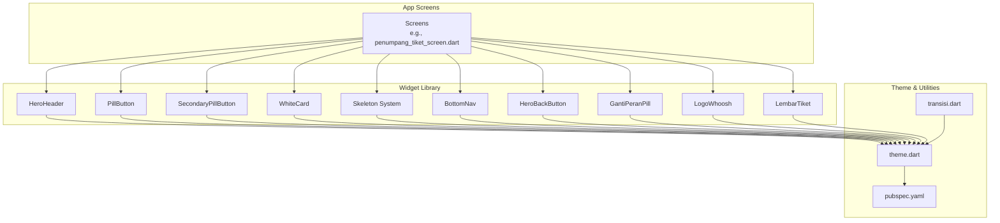
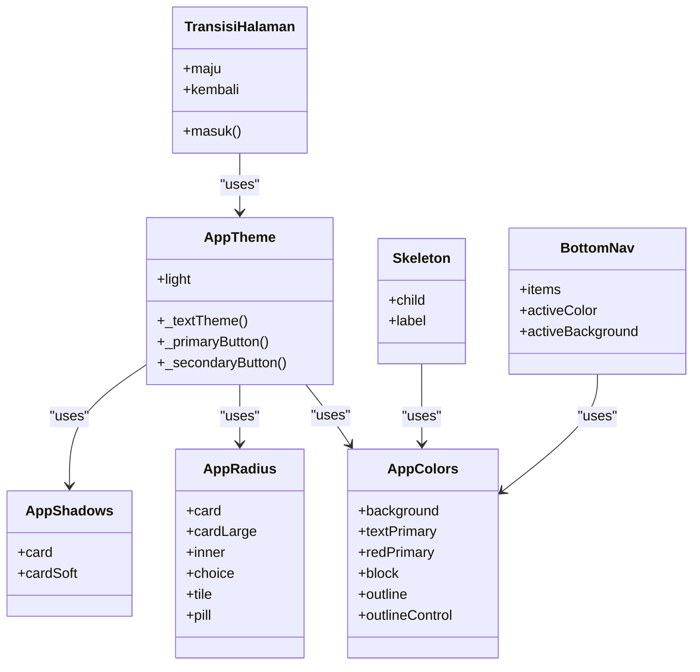
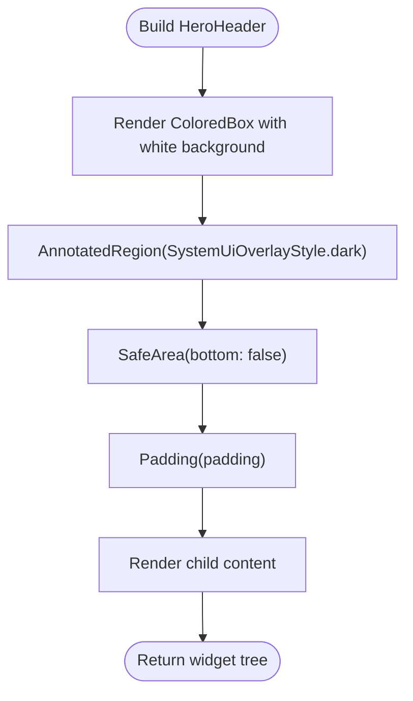
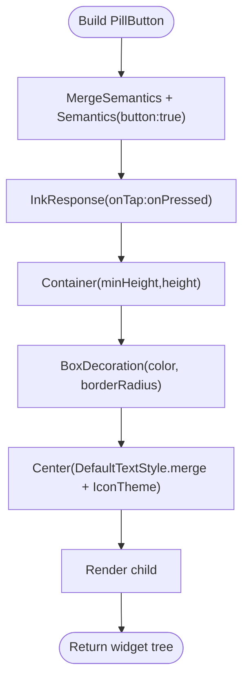
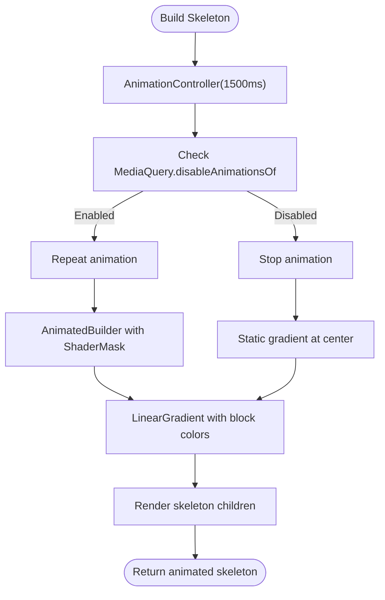
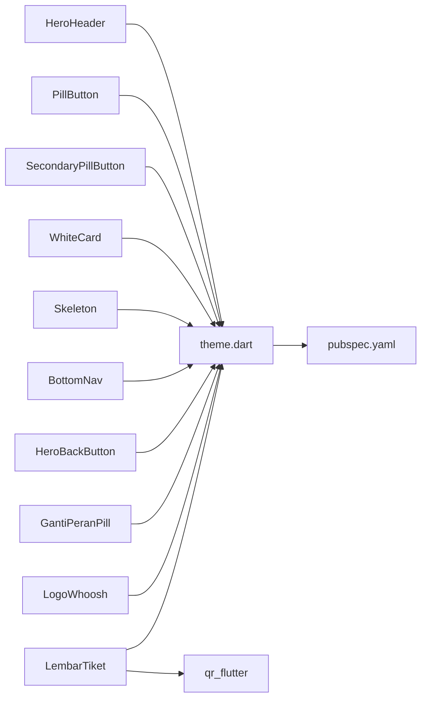

# Widget Library

<cite>
**Referenced Files in This Document**
- [hero_header.dart](file://whoosh_ramah/lib/widgets/hero_header.dart)
- [pill_button.dart](file://whoosh_ramah/lib/widgets/pill_button.dart)
- [secondary_pill_button.dart](file://whoosh_ramah/lib/widgets/secondary_pill_button.dart)
- [white_card.dart](file://whoosh_ramah/lib/widgets/white_card.dart)
- [skeleton.dart](file://whoosh_ramah/lib/widgets/skeleton.dart)
- [bottom_nav.dart](file://whoosh_ramah/lib/widgets/bottom_nav.dart)
- [hero_back_button.dart](file://whoosh_ramah/lib/widgets/hero_back_button.dart)
- [ganti_peran_pill.dart](file://whoosh_ramah/lib/widgets/ganti_peran_pill.dart)
- [logo_whoosh.dart](file://whoosh_ramah/lib/widgets/logo_whoosh.dart)
- [lembar_tiket.dart](file://whoosh_ramah/lib/widgets/lembar_tiket.dart)
- [theme.dart](file://whoosh_ramah/lib/theme.dart)
- [transisi.dart](file://whoosh_ramah/lib/transisi.dart)
- [pubspec.yaml](file://whoosh_ramah/pubspec.yaml)
</cite>

## Update Summary
**Changes Made**
- Added comprehensive skeleton loading component system with shimmer effects
- Integrated bottom navigation component with accessibility features
- Enhanced hero header with white background design system
- Added specialized navigation buttons (back button, role switcher pill)
- Included brand logo component with accessibility support
- Added modal bottom sheet components for ticket operations
- Integrated standardized transition effects and animation utilities
- Updated theme system with Brightline design language

## Table of Contents
1. [Introduction](#introduction)
2. [Project Structure](#project-structure)
3. [Core Components](#core-components)
4. [Architecture Overview](#architecture-overview)
5. [Detailed Component Analysis](#detailed-component-analysis)
6. [Skeleton Loading System](#skeleton-loading-system)
7. [Navigation Components](#navigation-components)
8. [Modal and Sheet Components](#modal-and-sheet-components)
9. [Transition Effects](#transition-effects)
10. [Dependency Analysis](#dependency-analysis)
11. [Performance Considerations](#performance-considerations)
12. [Troubleshooting Guide](#troubleshooting-guide)
13. [Conclusion](#conclusion)
14. [Appendices](#appendices)

## Introduction
This document describes the comprehensive reusable widget library for the Whoosh Ramah Flutter application. The library follows the Brightline design system and includes:

- **Hero Header**: Clean white header with status bar integration and safe area handling
- **Pill Buttons**: Primary and secondary variants with full accessibility support
- **Skeleton Loading System**: Shimmer-effect loading placeholders that mimic actual content layout
- **Navigation Components**: Bottom navigation, back buttons, and role-switching pills
- **Brand Components**: Logo display with inverted color support
- **Modal Components**: Bottom sheets for ticket QR display and schedule changes
- **Transition Effects**: Standardized page transitions with accessibility compliance

The widgets are built on Material 3 via the material_ui package and follow a consistent design language defined in the shared theme, emphasizing accessibility, performance, and user experience.

## Project Structure
The widget library lives under `lib/widgets` and is consumed by screens throughout the application. The shared design tokens (colors, radii, shadows, typography, and button styles) live in `lib/theme.dart`, while fonts are bundled through `pubspec.yaml`.

**Diagram sources**
- [hero_header.dart:1-36](file://whoosh_ramah/lib/widgets/hero_header.dart#L1-L36)
- [pill_button.dart:1-69](file://whoosh_ramah/lib/widgets/pill_button.dart#L1-L69)
- [secondary_pill_button.dart:1-50](file://whoosh_ramah/lib/widgets/secondary_pill_button.dart#L1-L50)
- [white_card.dart:1-44](file://whoosh_ramah/lib/widgets/white_card.dart#L1-L44)
- [skeleton.dart:1-236](file://whoosh_ramah/lib/widgets/skeleton.dart#L1-L236)
- [bottom_nav.dart:1-122](file://whoosh_ramah/lib/widgets/bottom_nav.dart#L1-L122)
- [hero_back_button.dart:1-47](file://whoosh_ramah/lib/widgets/hero_back_button.dart#L1-L47)
- [ganti_peran_pill.dart:1-50](file://whoosh_ramah/lib/widgets/ganti_peran_pill.dart#L1-L50)
- [logo_whoosh.dart:1-42](file://whoosh_ramah/lib/widgets/logo_whoosh.dart#L1-L42)
- [lembar_tiket.dart:1-478](file://whoosh_ramah/lib/widgets/lembar_tiket.dart#L1-L478)
- [theme.dart:1-182](file://whoosh_ramah/lib/theme.dart#L1-L182)
- [transisi.dart:1-67](file://whoosh_ramah/lib/transisi.dart#L1-L67)
- [pubspec.yaml:57-76](file://whoosh_ramah/pubspec.yaml#L57-L76)

## Core Components
This section summarizes the key reusable widgets and their responsibilities.

### Hero Header
A clean white header with status bar integration, safe area handling, and proper contrast for light backgrounds.

### Pill Buttons
Primary and secondary action buttons with full accessibility support, semantic merging, and disabled state styling.

### Skeleton Loading System
Comprehensive loading placeholders with shimmer effects that mimic actual content layout for better user experience.

### Navigation Components
Bottom navigation with accessibility features, back buttons with proper semantics, and role-switching pills.

### Brand Components
Logo display component with inverted color support and proper accessibility labeling.

### Modal Components
Bottom sheets for ticket operations including QR code display and schedule change functionality.

**Section sources**
- [hero_header.dart:1-36](file://whoosh_ramah/lib/widgets/hero_header.dart#L1-L36)
- [pill_button.dart:1-69](file://whoosh_ramah/lib/widgets/pill_button.dart#L1-L69)
- [secondary_pill_button.dart:1-50](file://whoosh_ramah/lib/widgets/secondary_pill_button.dart#L1-L50)
- [skeleton.dart:1-236](file://whoosh_ramah/lib/widgets/skeleton.dart#L1-L236)
- [bottom_nav.dart:1-122](file://whoosh_ramah/lib/widgets/bottom_nav.dart#L1-L122)
- [hero_back_button.dart:1-47](file://whoosh_ramah/lib/widgets/hero_back_button.dart#L1-L47)
- [ganti_peran_pill.dart:1-50](file://whoosh_ramah/lib/widgets/ganti_peran_pill.dart#L1-L50)
- [logo_whoosh.dart:1-42](file://whoosh_ramah/lib/widgets/logo_whoosh.dart#L1-L42)
- [lembar_tiket.dart:1-478](file://whoosh_ramah/lib/widgets/lembar_tiket.dart#L1-L478)

## Architecture Overview
The widget library follows a layered approach with clear separation of concerns:

- **Theme Layer**: Defines colors, radii, shadows, typography, and default button styles using the Brightline design system
- **Widget Layer**: Provides reusable UI primitives that consume theme tokens
- **Utility Layer**: Offers transition effects and animation utilities
- **Screen Layer**: Composes widgets into full pages and handles navigation and business logic

**Diagram sources**
- [theme.dart:7-182](file://whoosh_ramah/lib/theme.dart#L7-L182)
- [transisi.dart:28-67](file://whoosh_ramah/lib/transisi.dart#L28-L67)
- [skeleton.dart:21-95](file://whoosh_ramah/lib/widgets/skeleton.dart#L21-L95)
- [bottom_nav.dart:27-56](file://whoosh_ramah/lib/widgets/bottom_nav.dart#L27-L56)

## Detailed Component Analysis

### HeroHeader
HeroHeader renders a clean white header with proper status bar integration and safe area handling. It uses the Brightline design system's white canvas approach instead of colored hero sections.

Key behaviors:
- Extends to the status bar area with white background
- Uses SafeArea to protect content from system insets
- Sets dark status bar icons for optimal contrast against white background
- Provides configurable padding for content spacing

Customization options:
- child: Content placed inside the hero header
- padding: Internal spacing around the child content (default: 22px horizontal, 12px top, 10px bottom)

Accessibility considerations:
- Proper status bar icon color management for light backgrounds
- Semantic structure for screen readers

**Diagram sources**
- [hero_header.dart:23-35](file://whoosh_ramah/lib/widgets/hero_header.dart#L23-L35)

**Section sources**
- [hero_header.dart:1-36](file://whoosh_ramah/lib/widgets/hero_header.dart#L1-L36)

### PillButton
PillButton is the primary action button with a pill shape, bold text, and comprehensive accessibility support following WCAG guidelines.

Key behaviors:
- Wraps content in MergeSemantics and Semantics(button: true) for proper accessibility
- Provides InkResponse for ripple feedback
- Handles disabled states with proper contrast ratios (7.4:1 for white text)
- Ensures minimum height for comfortable touch targets (56dp)

Customization options:
- onPressed: VoidCallback? (required)
- child: Widget (required), typically Text or Row with icon+text
- backgroundColor: Color (default uses theme red)
- foregroundColor: Color (default white)
- height: double (default 56dp)
- disabledBackgroundColor: Color? (optional override for disabled state)

Accessibility features:
- Full semantic merging for entire button announcement
- Proper enabled/disabled state handling
- High contrast ratios meeting WCAG 1.4.3 standards

**Diagram sources**
- [pill_button.dart:35-67](file://whoosh_ramah/lib/widgets/pill_button.dart#L35-L67)

**Section sources**
- [pill_button.dart:1-69](file://whoosh_ramah/lib/widgets/pill_button.dart#L1-L69)

### SecondaryPillButton
SecondaryPillButton is an outlined pill-shaped button leveraging OutlinedButton for built-in accessibility and styling.

Key behaviors:
- Uses OutlinedButton.styleFrom to define appearance
- Enforces stadium shape and consistent text style
- Minimum height ensures adequate touch target size (52dp)
- Built-in accessibility semantics from Material components

Customization options:
- onPressed: VoidCallback? (required)
- label: String (required)
- height: double (default 52dp)
- borderColor: Color (default outline control color)
- foregroundColor: Color (default text primary color)

Accessibility features:
- Built-in semantics from OutlinedButton provide label and enabled/disabled states automatically
- Proper contrast ratios for borders (4.8:1 against white background)

**Section sources**
- [secondary_pill_button.dart:1-50](file://whoosh_ramah/lib/widgets/secondary_pill_button.dart#L1-L50)

### WhiteCard
WhiteCard provides a white container with configurable radius and shadow, designed according to the Brightline design system.

Key behaviors:
- Renders a white background with rounded corners and subtle border
- Wraps content in Material with transparency to support ink effects
- Applies card shadow from theme configuration

Customization options:
- child: Widget (required)
- margin: EdgeInsetsGeometry? (optional)
- padding: EdgeInsetsGeometry (default 20px all sides)
- radius: double (default card radius from theme)
- shadow: List<BoxShadow> (default card shadow from theme)

**Section sources**
- [white_card.dart:1-44](file://whoosh_ramah/lib/widgets/white_card.dart#L1-L44)

## Skeleton Loading System
The skeleton loading system provides comprehensive loading placeholders with shimmer effects that mimic actual content layout, improving perceived performance and user experience.

### Skeleton
The main wrapper component that manages the shimmer animation and accessibility announcements.

Key features:
- Single AnimationController for coordinated shimmer effect across all skeleton elements
- Respects system animation preferences (MediaQuery.disableAnimationsOf)
- Proper accessibility announcements for screen readers
- Gradient-based shimmer effect that sweeps across the entire skeleton

### SkeletonBox
Individual skeleton blocks that can be rectangles or circles.

Features:
- Configurable width, height, radius, and shape
- Circle constructor for avatars and timeline markers
- Consistent styling with theme colors

### SkeletonLine
Specialized skeleton for text lines with automatic radius calculation.

### SkeletonCard
Complete card skeleton with proper margins, padding, and shadow.

### SkeletonRincian
Pre-built detail card skeleton matching the actual content layout structure.

**Diagram sources**
- [skeleton.dart:38-95](file://whoosh_ramah/lib/widgets/skeleton.dart#L38-L95)

**Section sources**
- [skeleton.dart:1-236](file://whoosh_ramah/lib/widgets/skeleton.dart#L1-L236)

## Navigation Components

### BottomNav
A flat white bottom navigation bar with proper accessibility and interaction states.

Key features:
- Flat design with top border line
- Active item highlighting with soft background color
- Proper semantic labels for screen readers
- "Coming soon" feedback for items without handlers
- Minimum 56dp height for touch targets

### HeroBackButton
Circular back button with proper accessibility and hit testing.

Features:
- 48dp circular touch target
- Proper semantic labeling
- Chevron left icon with proper contrast
- Opaque hit testing for reliable touch response

### GantiPeranPill
Role-switching pill button with arrow icon and proper semantics.

Features:
- Default behavior navigates back if no handler provided
- Proper semantic merging for accessibility
- 48dp minimum touch target height
- Arrow icon with descriptive label

**Section sources**
- [bottom_nav.dart:1-122](file://whoosh_ramah/lib/widgets/bottom_nav.dart#L1-L122)
- [hero_back_button.dart:1-47](file://whoosh_ramah/lib/widgets/hero_back_button.dart#L1-L47)
- [ganti_peran_pill.dart:1-50](file://whoosh_ramah/lib/widgets/ganti_peran_pill.dart#L1-L50)

## Modal and Sheet Components

### LembarTiket
Comprehensive bottom sheet components for ticket operations including QR code display and schedule changes.

Key features:
- Modal bottom sheets with proper barrier colors
- Scrollable content with fixed action buttons
- QR code generation with fallback text display
- Schedule selection interface with visual feedback
- Proper accessibility semantics throughout

### QR Code Display
Generates scannable QR codes containing booking information with proper error handling.

### Schedule Change Interface
Interactive schedule selection with current trip highlighting and save functionality.

**Section sources**
- [lembar_tiket.dart:1-478](file://whoosh_ramah/lib/widgets/lembar_tiket.dart#L1-L478)

## Transition Effects
Standardized page transitions with accessibility compliance and performance optimization.

### TransisiHalaman
Centralized transition management providing consistent page animations.

Key features:
- Fade + slide + scale combination for forward navigation
- Faster reverse transitions for better UX
- Automatic respect for system animation preferences
- Configurable durations (300ms forward, 240ms backward)

### durasiGerak
Utility function for getting appropriate animation durations based on system preferences.

**Section sources**
- [transisi.dart:1-67](file://whoosh_ramah/lib/transisi.dart#L1-L67)

## Dependency Analysis
The widget library depends on:
- material_ui for Material 3 components and utilities
- theme.dart for design tokens and default styles
- pubspec.yaml for font assets and dependencies
- qr_flutter for QR code generation in ticket components

**Diagram sources**
- [hero_header.dart:1-36](file://whoosh_ramah/lib/widgets/hero_header.dart#L1-L36)
- [pill_button.dart:1-69](file://whoosh_ramah/lib/widgets/pill_button.dart#L1-L69)
- [secondary_pill_button.dart:1-50](file://whoosh_ramah/lib/widgets/secondary_pill_button.dart#L1-L50)
- [white_card.dart:1-44](file://whoosh_ramah/lib/widgets/white_card.dart#L1-L44)
- [skeleton.dart:1-236](file://whoosh_ramah/lib/widgets/skeleton.dart#L1-L236)
- [bottom_nav.dart:1-122](file://whoosh_ramah/lib/widgets/bottom_nav.dart#L1-L122)
- [hero_back_button.dart:1-47](file://whoosh_ramah/lib/widgets/hero_back_button.dart#L1-L47)
- [ganti_peran_pill.dart:1-50](file://whoosh_ramah/lib/widgets/ganti_peran_pill.dart#L1-L50)
- [logo_whoosh.dart:1-42](file://whoosh_ramah/lib/widgets/logo_whoosh.dart#L1-L42)
- [lembar_tiket.dart:1-478](file://whoosh_ramah/lib/widgets/lembar_tiket.dart#L1-L478)
- [theme.dart:1-182](file://whoosh_ramah/lib/theme.dart#L1-L182)
- [pubspec.yaml:30-34](file://whoosh_ramah/pubspec.yaml#L30-L34)

**Section sources**
- [theme.dart:1-182](file://whoosh_ramah/lib/theme.dart#L1-L182)
- [pubspec.yaml:30-34](file://whoosh_ramah/pubspec.yaml#L30-L34)

## Performance Considerations
- Prefer const constructors where possible to reduce rebuild overhead
- Use efficient layouts: constrain heights and avoid unnecessary nested containers
- Keep semantic trees minimal; only add semantics where necessary for accessibility
- Reuse theme tokens instead of hardcoding colors and sizes to prevent redundant style calculations
- Skeleton animations respect system preferences to avoid unnecessary processing
- QR code generation uses appropriate error correction levels for reliability
- Bottom navigation uses Expanded widgets for efficient space distribution

## Troubleshooting Guide
Common issues and resolutions:

### Hero Header Issues
- Status bar visibility problems: Ensure SafeArea is used and AnnotatedRegion sets appropriate SystemUiOverlayStyle
- Content overlap: Verify SafeArea bottom parameter is set correctly

### Button Accessibility Issues
- Missing semantic announcements: For PillButton, ensure MergeSemantics wraps content properly
- Touch target too small: Verify minimum height constraints are applied
- Contrast issues: Check that disabled states maintain proper contrast ratios

### Skeleton Loading Problems
- Animation not respecting system preferences: Verify MediaQuery.disableAnimationsOf is checked
- Shimmer effect not visible: Ensure AnimatedBuilder is properly configured with ShaderMask

### Navigation Issues
- Bottom nav items not responding: Check onTap handlers are properly assigned
- Screen reader confusion: Verify semantic labels distinguish between active and inactive items

### Modal Sheet Problems
- QR code not displaying: Check errorStateBuilder implementation for fallback text
- Action buttons not fixed: Ensure _BungkusLembar structure is maintained

**Section sources**
- [hero_header.dart:23-35](file://whoosh_ramah/lib/widgets/hero_header.dart#L23-L35)
- [pill_button.dart:35-67](file://whoosh_ramah/lib/widgets/pill_button.dart#L35-L67)
- [skeleton.dart:38-95](file://whoosh_ramah/lib/widgets/skeleton.dart#L38-L95)
- [bottom_nav.dart:58-122](file://whoosh_ramah/lib/widgets/bottom_nav.dart#L58-L122)
- [lembar_tiket.dart:155-299](file://whoosh_ramah/lib/widgets/lembar_tiket.dart#L155-L299)

## Conclusion
The comprehensive widget library provides a cohesive set of reusable components aligned with the Brightline design system. The library extends beyond basic UI components to include sophisticated loading experiences, navigation patterns, and accessibility-focused interactions. By centralizing design tokens in theme.dart and following consistent composition patterns, developers can extend the library with new components that integrate seamlessly while maintaining high standards for accessibility, performance, and user experience.

The addition of skeleton loading components, navigation utilities, and standardized transition effects demonstrates a mature approach to component development that prioritizes both developer experience and end-user satisfaction.

## Appendices

### Design System Principles
- **Colors**: Role-based naming with focus on accessibility (e.g., redPrimary for brand, block for neutral surfaces)
- **Radii**: Consistent rounding for headers, cards, and buttons following Brightline specifications
- **Shadows**: Soft elevation for cards to create depth without overwhelming the interface
- **Typography**: Plus Jakarta Sans font family with specified weights and sizes for headings, body, and labels
- **Buttons**: Primary and secondary styles with pill shapes and accessible touch targets meeting WCAG standards
- **Spacing**: Consistent padding and margins following established design tokens

**Section sources**
- [theme.dart:7-182](file://whoosh_ramah/lib/theme.dart#L7-L182)
- [pubspec.yaml:57-76](file://whoosh_ramah/pubspec.yaml#L57-L76)

### Extension Patterns for New Custom Components
- Define props with clear required and optional parameters
- Consume theme tokens (colors, radii, shadows, typography) instead of hardcoding values
- Provide accessibility semantics for interactive elements
- Compose existing widgets (HeroHeader, PillButton, SecondaryPillButton, WhiteCard, Skeleton components) to maintain consistency
- Add unit tests for rendering and interactions
- Respect system animation preferences when implementing motion
- Follow Brightline design principles for visual consistency

### Testing Strategies for UI Components
- **Render tests**: Assert presence of key widgets and correct styling
- **Interaction tests**: Simulate taps and verify callbacks or state changes
- **Accessibility tests**: Validate semantics labels and enabled/disabled states
- **Visual regression**: Compare screenshots across platforms if needed
- **Animation tests**: Verify transition effects and respect for system preferences
- **Skeleton tests**: Ensure loading placeholders render correctly and animations respect user preferences