# Project Overview

<cite>
**Referenced Files in This Document**
- [README.md](file://README.md)
- [PROJECT.md](file://PROJECT.md)
- [whoosh_ramah/README.md](file://whoosh_ramah/README.md)
- [detector/README.md](file://detector/README.md)
- [design/README.md](file://design/README.md)
- [main.dart](file://whoosh_ramah/lib/main.dart)
- [theme.dart](file://whoosh_ramah/lib/theme.dart)
- [permintaan.dart](file://whoosh_ramah/lib/models/permintaan.dart)
- [permintaan_service.dart](file://whoosh_ramah/lib/services/permintaan_service.dart)
</cite>

## Update Summary
**Changes Made**
- Updated Introduction section with new comprehensive README.md content
- Enhanced Project Structure section with updated repository organization
- Added new AI Camera System section covering the detector functionality
- Updated Architecture Overview with improved diagrams reflecting the complete system
- Expanded User Roles and Workflows section with detailed workflow descriptions
- Added Privacy Guidelines section based on new documentation
- Enhanced Setup Instructions with comprehensive running guide

## Table of Contents
1. [Introduction](#introduction)
2. [Project Structure](#project-structure)
3. [Core Components](#core-components)
4. [AI Camera System](#ai-camera-system)
5. [Architecture Overview](#architecture-overview)
6. [User Roles and Workflows](#user-roles-and-workflows)
7. [Setup and Running Guide](#setup-and-running-guide)
8. [Privacy Guidelines](#privacy-guidelines)
9. [Detailed Component Analysis](#detailed-component-analysis)
10. [Dependency Analysis](#dependency-analysis)
11. [Performance Considerations](#performance-considerations)
12. [Troubleshooting Guide](#troubleshooting-guide)
13. [Conclusion](#conclusion)

## Introduction
Whoosh Ramah is an accessibility management system for KCIC high-speed train stations (Whoosh). It helps priority passengers—elderly travelers, people with disabilities, pregnant women, sick passengers, and unaccompanied children—request assistance from station staff, while letting family members monitor the process in real time. The project was created as a hackathon prototype: a demonstrable end-to-end flow that can run on two or three phones and one laptop within a week.

The core problem it solves is that assistance requests are still manual. Passengers often have to approach station staff in person or call the contact center. Staff may only learn about the need when the passenger arrives, seat information is passed manually to the destination station, and families cannot track progress. Whoosh Ramah centralizes this workflow into a Flutter mobile app backed by Cloud Firestore, plus an optional Python AI camera detector that automatically creates assistance tasks when it detects a wheelchair at the station entrance.

Business context shows the scale of the issue: KCIC served around 9,000 priority passengers between January and August 2026, with elderly assistance requests averaging about 60 per day on weekdays and up to 100 per day on weekends. There are 64 trained service officers available, but the current manual process makes coordination difficult.

The target audience includes:
- Priority passengers who need assistance.
- Station staff responsible for receiving, assigning, and completing assistance tasks.
- Family members who want to monitor a passenger's journey and status.

What is out of scope for this hackathon prototype includes real login accounts, integration with KCIC ticketing systems, payment processing, automatic officer scheduling, push notifications, and storing facial photos. These are important production concerns, but they are intentionally excluded so the demo stays focused.

**Section sources**
- [README.md:12-33](file://README.md#L12-L33)
- [PROJECT.md:8-20](file://PROJECT.md#L8-L20)
- [whoosh_ramah/README.md:1-6](file://whoosh_ramah/README.md#L1-L6)

## Project Structure
At a high level, the repository contains:
- A Flutter application under `whoosh_ramah/`, which implements the passenger, officer, and family workflows.
- A Python-based wheelchair detector under `detector/`, which writes assistance tasks directly to Firebase Cloud Firestore.
- Design references under `design/`, describing the visual layout and interaction patterns for each screen.
- A master specification document `PROJECT.md` that defines business context, architecture, data model, screens, design rules, accessibility requirements, folder structure, implementation steps, demo checklist, and privacy notes.
- A comprehensive root `README.md` providing setup instructions, architecture overview, and running guides.

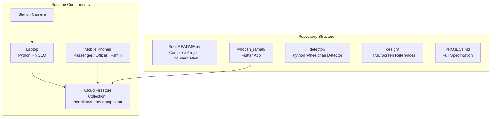

**Diagram sources**
- [README.md:35-46](file://README.md#L35-L46)
- [PROJECT.md:24-37](file://PROJECT.md#L24-L37)
- [detector/README.md:1-8](file://detector/README.md#L1-L8)

The Flutter app initializes Firebase, applies a consistent theme, and starts with a role-selection screen. The app does not run AI locally; it reads assistance documents written either by passengers through the app or by the Python detector.

**Section sources**
- [README.md:35-46](file://README.md#L35-L46)
- [PROJECT.md:24-37](file://PROJECT.md#L24-L37)
- [PROJECT.md:179-203](file://PROJECT.md#L179-L203)
- [main.dart:8-33](file://whoosh_ramah/lib/main.dart#L8-L33)

## Core Components
Whoosh Ramah has three main user roles, each with a clear workflow:

| Role | Purpose | Main Workflow |
| --- | --- | --- |
| Penumpang (Passenger) | Request assistance and track its progress | View active ticket → request assistance → choose assistance type and pickup point → view real-time status timeline → optionally share with family |
| Petugas (Officer) | Receive, assign, and complete assistance tasks | View active tasks → open task details → advance status through waiting, assigned, met, seated, completed → update history |
| Keluarga (Family) | Monitor a specific passenger's latest assistance request | Open monitoring screen → see current status, journey progress, and timestamped history |

The system supports six assistance types: wheelchair, blind passenger, deaf passenger, elderly, pregnant woman, and porter. Tasks also distinguish whether they came from the app or the AI camera.

The data model centers on a single Firestore collection called `permintaan_pendampingan`. Each document represents one assistance request and includes fields such as assistance type, pickup location, source, passenger identifiers, train details, officer name, camera identifier, confidence score, history log, and timestamps.

The required status progression is:
1. Waiting (`menunggu`)
2. Assigned (`ditugaskan`)
3. Met (`bertemu`)
4. Seated (`di_kursi`)
5. Completed (`selesai`)

This ordered state machine ensures that both passenger and family views show a consistent journey, while officers move the task forward with one primary action per step.

**Section sources**
- [README.md:47-67](file://README.md#L47-L67)
- [PROJECT.md:54-95](file://PROJECT.md#L54-L95)
- [PROJECT.md:121-135](file://PROJECT.md#L121-L135)
- [permintaan.dart:3-57](file://whoosh_ramah/lib/models/permintaan.dart#L3-L57)

## AI Camera System
The AI camera system runs independently on a laptop, separate from the Flutter app. It uses computer vision to detect wheelchair users at station entrances and automatically creates assistance tasks in Firestore.

### Detection Pipeline
The detector supports multiple model configurations:
- **YOLO-World** (default): Uses pre-trained models without requiring API keys
- **Roboflow**: Hosted models with API key authentication
- **Local YOLO**: Custom-trained models for offline operation

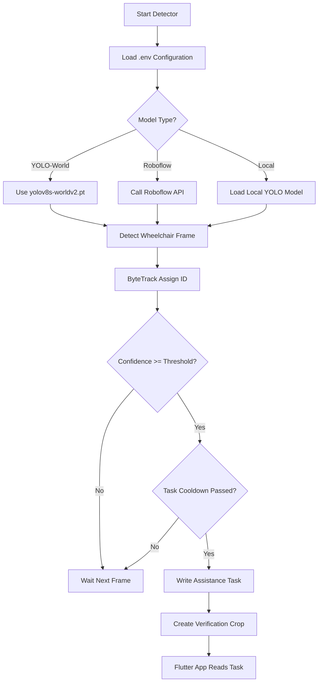

**Diagram sources**
- [README.md:69-92](file://README.md#L69-L92)
- [detector/README.md:21-61](file://detector/README.md#L21-L61)
- [detector/README.md:77-93](file://detector/README.md#L77-L93)

### Key Features
- **One task per person**: ByteTrack tracking assigns unique IDs to wheelchairs, preventing duplicate tasks
- **Verification crops**: Stores base64 images in Firestore for officer verification
- **Automatic cleanup**: Photos auto-delete after 10 minutes via background threads
- **Privacy modes**: Supports both raw crops (demo) and anonymized faces (production)
- **Configurable thresholds**: Adjustable confidence levels, frame requirements, and cooldown periods

**Section sources**
- [README.md:69-92](file://README.md#L69-L92)
- [detector/README.md:1-99](file://detector/README.md#L1-L99)

## Architecture Overview
The solution combines a Flutter mobile app with a Python AI detection system. They do not communicate directly; instead, they share Cloud Firestore as the single source of truth.

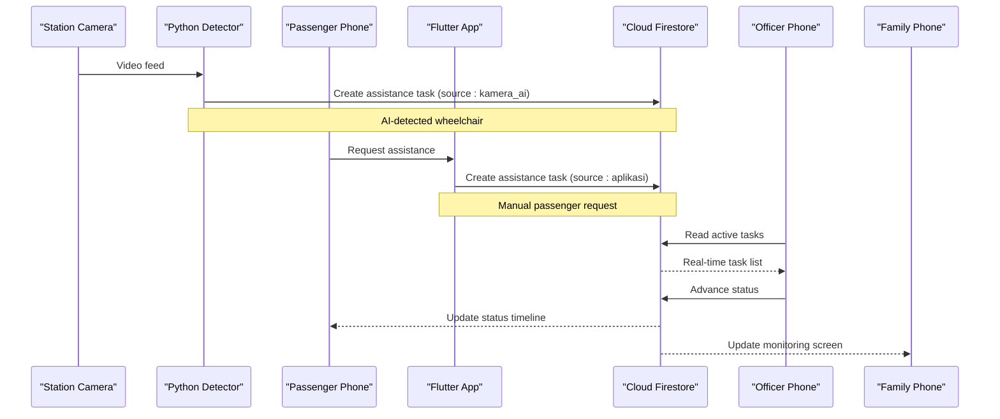

**Diagram sources**
- [README.md:23-29](file://README.md#L23-L29)
- [PROJECT.md:24-37](file://PROJECT.md#L24-L37)
- [PROJECT.md:121-135](file://PROJECT.md#L121-L135)
- [permintaan_service.dart:23-60](file://whoosh_ramah/lib/services/permintaan_service.dart#L23-L60)
- [permintaan_service.dart:92-119](file://whoosh_ramah/lib/services/permintaan_service.dart#L92-L119)
- [detector/README.md:39-61](file://detector/README.md#L39-L61)

Key architectural points:
- One Flutter app handles all three roles through role selection.
- Cloud Firestore provides real-time updates without a custom backend server.
- The Python detector runs separately and writes assistance documents with `sumber = kamera_ai`.
- The Flutter app only consumes these documents; it does not run AI inference.
- All UI flows are guided by HTML design references in the `design/` folder.

**Section sources**
- [README.md:23-29](file://README.md#L23-L29)
- [PROJECT.md:24-37](file://PROJECT.md#L24-L37)
- [design/README.md:1-8](file://design/README.md#L1-L8)

## User Roles and Workflows

### Passenger Workflow
A passenger opens the app, sees their active ticket, requests assistance, selects the assistance type and pickup point, and then tracks the real-time status timeline. The passenger can also share the request with family.

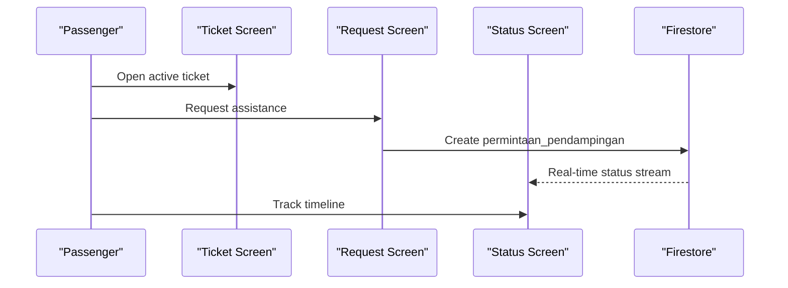

**Diagram sources**
- [PROJECT.md:121-131](file://PROJECT.md#L121-L131)
- [permintaan_service.dart:23-60](file://whoosh_ramah/lib/services/permintaan_service.dart#L23-L60)

### Officer Workflow
An officer views all active tasks, opens a task detail, and advances the status using one primary button. The UI shows badges indicating whether a task came from the app or the AI camera.

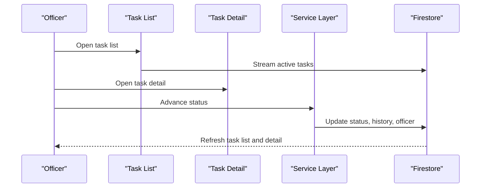

**Diagram sources**
- [PROJECT.md:132-133](file://PROJECT.md#L132-L133)
- [permintaan_service.dart:70-78](file://whoosh_ramah/lib/services/permintaan_service.dart#L70-L78)
- [permintaan_service.dart:92-119](file://whoosh_ramah/lib/services/permintaan_service.dart#L92-L119)

### Family Workflow
A family member monitors the latest assistance request for a specific passenger ID. The screen shows current status, journey progress, and a timestamped history.

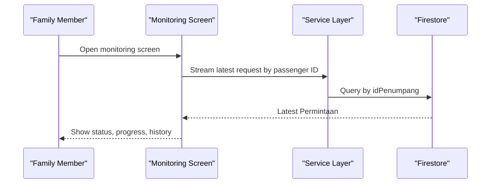

**Diagram sources**
- [PROJECT.md:134-135](file://PROJECT.md#L134-L135)
- [permintaan_service.dart:80-90](file://whoosh_ramah/lib/services/permintaan_service.dart#L80-L90)

## Setup and Running Guide

### Prerequisites
- **Flutter 3.50.1 / stable** (Dart 3.14) + JDK 17 + Android device/emulator
- **Python 3.10+** (3.12 recommended) for the detector
- Firebase project with Cloud Firestore enabled

### Flutter App Setup
```bash
cd whoosh_ramah
flutter pub get
flutter run                 # pick an Android device when prompted
```

Deploy the Firestore rules (open, demo-only) before using the app:
```bash
cd whoosh_ramah
firebase deploy --only firestore:rules,firestore:indexes
```

### Wheelchair Detector Setup
```bash
cd detector
python -m venv venv
source venv/bin/activate        # Windows: venv\Scripts\activate
pip install -r requirements.txt
cp .env.example .env            # then fill in as needed
```

Test detection without Firebase first (webcam or video):
```bash
python detect_wheelchair.py --tanpa-firebase
python detect_wheelchair.py --sumber contoh.mp4 --tanpa-firebase
```

To write tasks to Firestore, download a service account key from the Firebase console → save it as `detector/firebase-key.json` (**never commit it**), then run `python detect_wheelchair.py`. Every detected wheelchair shows up as a "Kamera AI" card on the officer's phone within seconds.

### Demo Seed (Optional)
Populate the officer list with three demo documents (safe to re-run):
```bash
detector/venv/bin/python whoosh_ramah/tool/seed_demo.py
detector/venv/bin/python whoosh_ramah/tool/seed_demo.py --bersih
```

**Section sources**
- [README.md:94-153](file://README.md#L94-L153)
- [whoosh_ramah/README.md:11-59](file://whoosh_ramah/README.md#L11-L59)
- [detector/README.md:10-61](file://detector/README.md#L10-L61)

## Privacy Guidelines
The project follows strict privacy guidelines to protect user data:

### Photo Handling
- **Demo mode** (`FOTO_ANONIM=false`): Raw verification crops allowed for hackathon with consenting participants, auto-deleted within 10 minutes
- **Production mode** (`FOTO_ANONIM=true`): Faces must be blurred using Haar cascade + pixelated, maximum 160px size, quality 60
- Base64 image length kept well below Firestore's 1MB document limit
- Background thread automatically deletes expired photos after TTL period

### Data Protection
- All names and ticket data are samples/dummy data
- Open Firestore rules (`allow read, write: if true`) are **demo-only**; never use them in production
- Only officer screens access verification photo collections (need-to-know basis)
- Passenger and family screens never receive verification photos

### Accessibility Requirements
- Touch targets minimum 48dp
- Semantic labels on icon-only controls
- Status never conveyed by color alone
- WCAG-passing contrast ratios
- Layouts remain functional at 130-150% text scaling
- Animations respect system reduce motion settings
- Full passenger flow operable with TalkBack/VoiceOver without looking at screen

**Section sources**
- [README.md:169-183](file://README.md#L169-L183)
- [PROJECT.md:269-273](file://PROJECT.md#L269-L273)
- [detector/README.md:77-99](file://detector/README.md#L77-L99)

## Detailed Component Analysis

### Application Entry Point and Theme
The Flutter app entry point initializes Firebase, sets the app title, disables debug banners, applies the light theme, and opens the role-selection screen. The theme defines colors, typography, radii, shadows, and button styles following the "bright and friendly" design style.

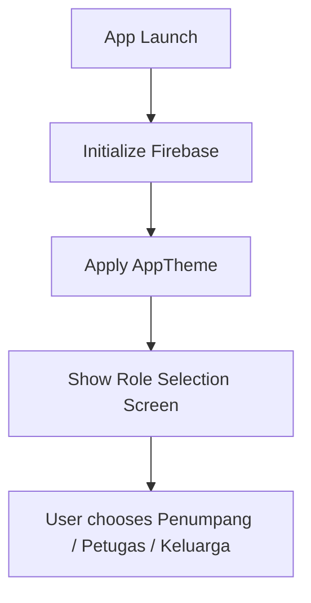

**Diagram sources**
- [main.dart:8-33](file://whoosh_ramah/lib/main.dart#L8-L33)
- [theme.dart:65-113](file://whoosh_ramah/lib/theme.dart#L65-L113)

**Section sources**
- [main.dart:8-33](file://whoosh_ramah/lib/main.dart#L8-L33)
- [theme.dart:1-164](file://whoosh_ramah/lib/theme.dart#L1-L164)

### Data Model and State Machine
The data model defines enums for assistance type and status, a history entry class, and a null-safe `Permintaan` document model. It maps Firestore strings to enums, computes derived values like short pickup location and confidence percentage, and serializes back to Firestore maps.

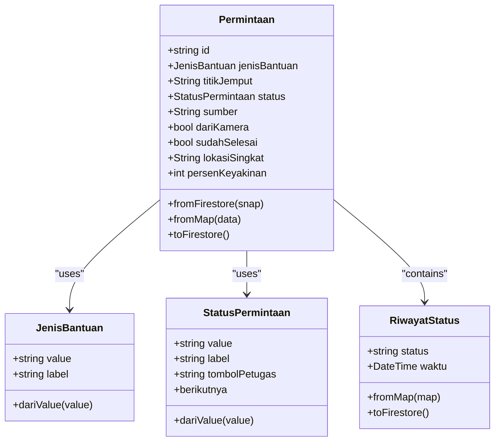

**Diagram sources**
- [permintaan.dart:3-57](file://whoosh_ramah/lib/models/permintaan.dart#L3-L57)
- [permintaan.dart:59-149](file://whoosh_ramah/lib/models/permintaan.dart#L59-L149)
- [permintaan.dart:150-213](file://whoosh_ramah/lib/models/permintaan.dart#L150-L213)

**Section sources**
- [permintaan.dart:3-213](file://whoosh_ramah/lib/models/permintaan.dart#L3-L213)

### Firestore Service Layer
The service layer encapsulates all Firestore operations for the `permintaan_pendampingan` collection. It creates new assistance requests, streams a single document, streams all active tasks, streams the latest request for a passenger, and advances the status through the required sequence.

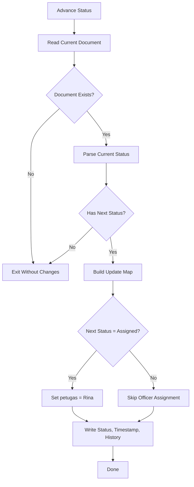

**Diagram sources**
- [permintaan_service.dart:92-119](file://whoosh_ramah/lib/services/permintaan_service.dart#L92-L119)

Important behaviors:
- New requests use dummy passenger and ticket data for the demo.
- Requests from the app set `sumber = aplikasi`; requests from the detector set `sumber = kamera_ai`.
- Status advancement appends a history entry and updates the last-updated timestamp.
- When moving to the assigned status, the officer field is filled with the demo officer name.
- Streams avoid composite indexes by limiting ordering to one field or sorting client-side.

**Section sources**
- [permintaan_service.dart:6-135](file://whoosh_ramah/lib/services/permintaan_service.dart#L6-L135)

### AI Wheelchair Detector
The detector runs on a laptop, reads video input from a camera, detects wheelchairs, and writes assistance tasks to Firestore. It uses either a Roboflow-hosted model or a locally trained YOLO model. Privacy is preserved by sending only assistance type, location, time, and confidence to Firestore—not faces or images.

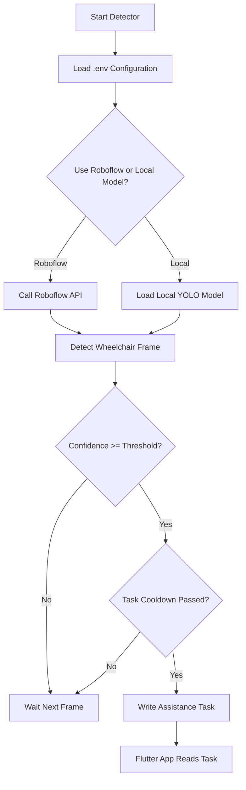

**Diagram sources**
- [detector/README.md:21-61](file://detector/README.md#L21-L61)
- [detector/README.md:77-93](file://detector/README.md#L77-L93)

**Section sources**
- [detector/README.md:1-99](file://detector/README.md#L1-L99)

## Dependency Analysis
The Flutter app depends on Firebase Core and Cloud Firestore for initialization and real-time data access. The data model depends on Firestore types for timestamps and map conversion. The service layer depends on the data model and dummy data. The detector is independent of the Flutter app and communicates only through Firestore.

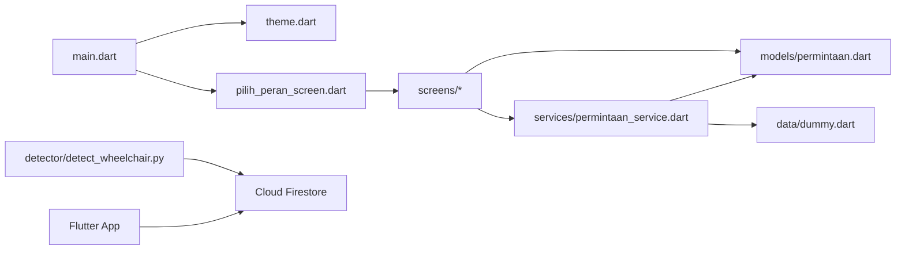

**Diagram sources**
- [main.dart:1-33](file://whoosh_ramah/lib/main.dart#L1-L33)
- [permintaan_service.dart:1-135](file://whoosh_ramah/lib/services/permintaan_service.dart#L1-L135)
- [permintaan.dart:1-213](file://whoosh_ramah/lib/models/permintaan.dart#L1-L213)
- [detector/README.md:39-61](file://detector/README.md#L39-L61)

Coupling and cohesion observations:
- The service layer isolates Firestore logic, improving testability and keeping screens focused on presentation.
- The data model centralizes enum mapping and serialization, reducing duplication across screens.
- The detector is decoupled from the app, communicating only through a stable Firestore schema.
- The design references are external to runtime code but guide UI consistency.

**Section sources**
- [PROJECT.md:179-203](file://PROJECT.md#L179-L203)
- [permintaan_service.dart:1-135](file://whoosh_ramah/lib/services/permintaan_service.dart#L1-L135)
- [permintaan.dart:1-213](file://whoosh_ramah/lib/models/permintaan.dart#L1-L213)

## Performance Considerations
- Firestore queries avoid composite indexes by limiting ordering to one field or sorting results client-side.
- The task list stream limits results to 100 documents to keep real-time updates manageable.
- The detector uses configuration options such as confidence threshold, consecutive frames, cooldown interval, and detection frequency to balance accuracy, performance, and API usage.
- The app relies on real-time streams rather than polling, reducing unnecessary network calls.
- Image verification crops are compressed and sized appropriately to stay within Firestore document limits.
- Background cleanup processes handle photo expiration efficiently without blocking main operations.

## Troubleshooting Guide
Common issues and how to address them:
- If AI-detected tasks do not appear for officers, verify that the detector writes to the correct Firestore collection and that the schema matches the expected fields.
- If status updates do not propagate to passengers or family, confirm that the service correctly advances status, appends history, and updates timestamps.
- If the app crashes on documents from the detector, ensure null-safe handling for missing fields such as history, passenger ID, train details, and officer name.
- If the demo fails due to internet problems, prepare a backup demo video as recommended by the project checklist.
- If accessibility testing fails, ensure buttons meet minimum touch targets, icons have semantics or tooltips, and layouts remain usable at larger text sizes.
- If verification photos don't display, check that the detector successfully wrote the base64 image and that the photo hasn't expired.
- If the detector doesn't connect to Firebase, verify the service account key is properly configured and not committed to version control.

**Section sources**
- [PROJECT.md:95-108](file://PROJECT.md#L95-L108)
- [PROJECT.md:169-176](file://PROJECT.md#L169-L176)
- [PROJECT.md:237-243](file://PROJECT.md#L237-L243)
- [permintaan.dart:77-149](file://whoosh_ramah/lib/models/permintaan.dart#L77-L149)
- [permintaan_service.dart:92-119](file://whoosh_ramah/lib/services/permintaan_service.dart#L92-L119)

## Conclusion
Whoosh Ramah addresses a real operational gap in KCIC station assistance by digitizing and coordinating support for priority passengers. It brings together three user roles—passengers, officers, and family—into one coherent workflow, while optionally automating task creation through an AI camera detector. The hackathon scope keeps the prototype focused, accessible, and demonstrable, leaving production features like authentication, ticketing integration, payments, scheduling, and push notifications for future work. For international developers, the key takeaway is a simple but robust pattern: a Flutter frontend, a shared Firestore schema, and a separate AI component writing structured assistance tasks.

The comprehensive documentation now provides clear setup instructions, detailed architecture explanations, and thorough privacy guidelines, making it easier for new contributors to understand and extend the system while maintaining the focus on accessibility and user experience that defines the project's mission.