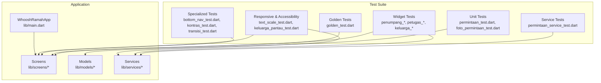
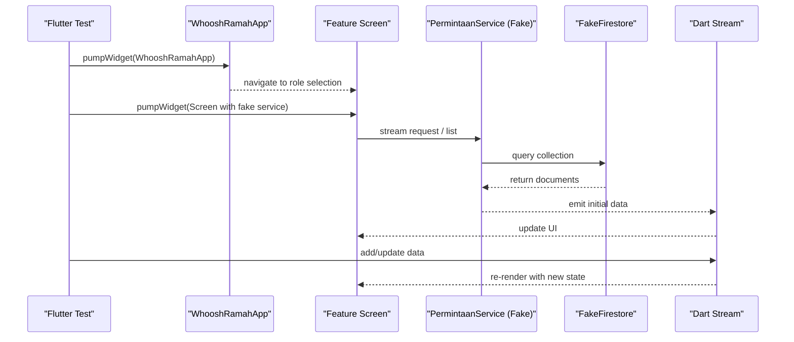
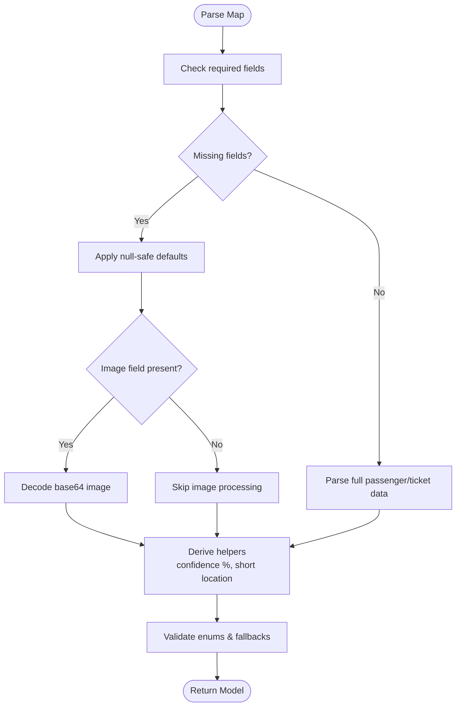
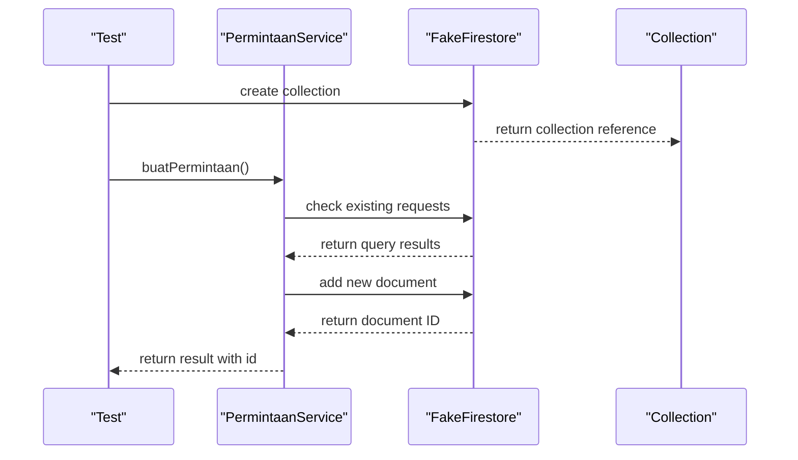
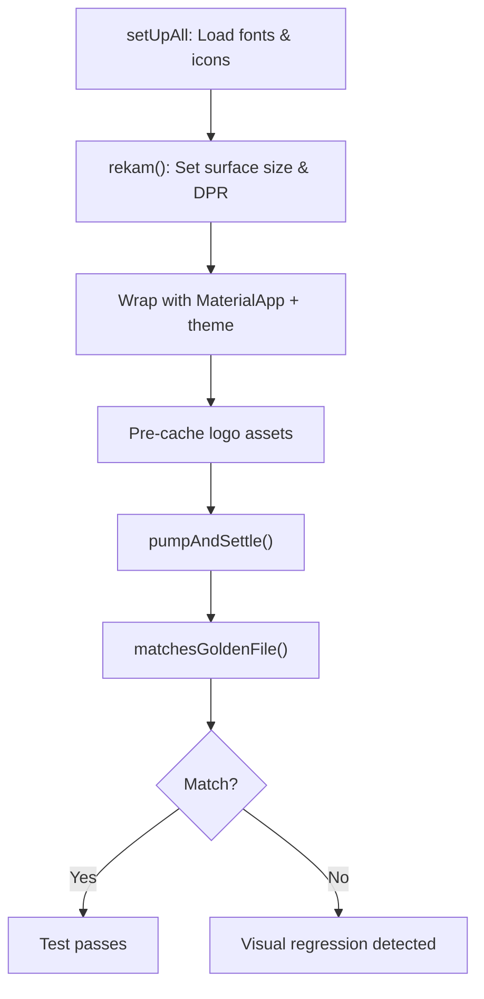
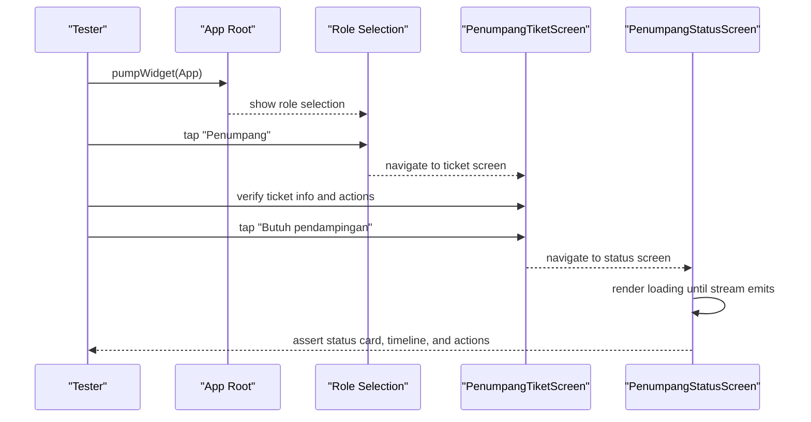
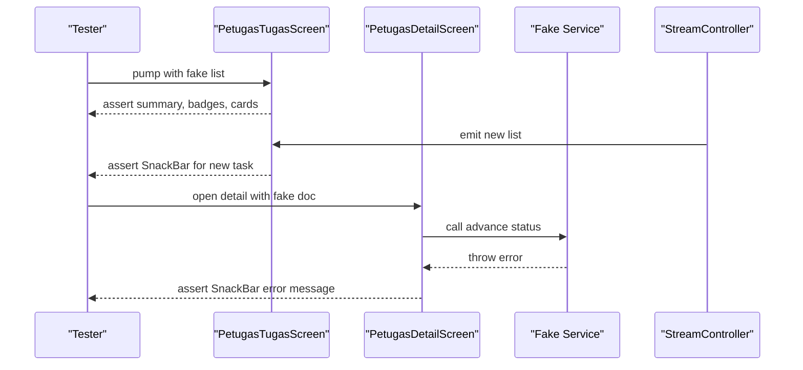
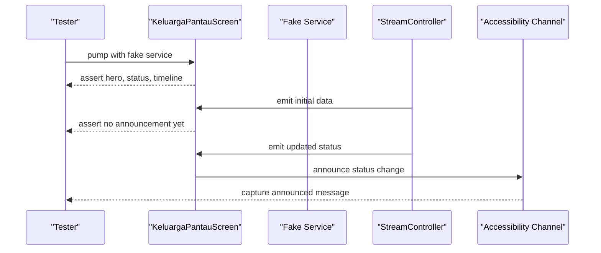
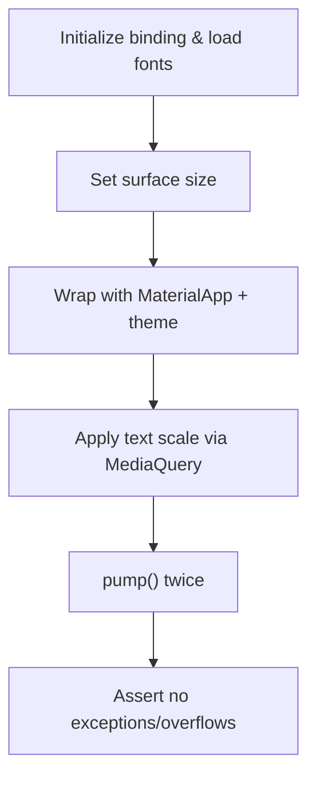
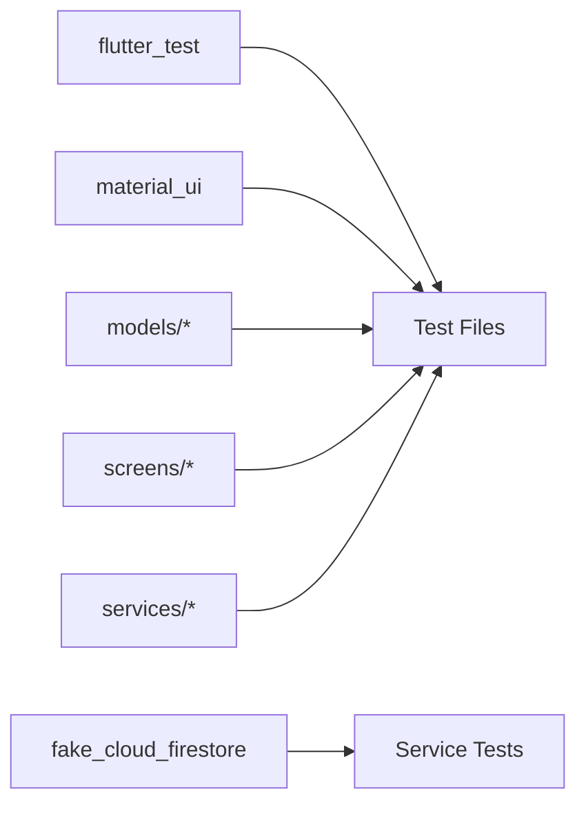

# Testing Strategy

<cite>
**Referenced Files in This Document**
- [pubspec.yaml](file://whoosh_ramah/pubspec.yaml)
- [main.dart](file://whoosh_ramah/lib/main.dart)
- [permintaan_test.dart](file://whoosh_ramah/test/permintaan_test.dart)
- [foto_permintaan_test.dart](file://whoosh_ramah/test/foto_permintaan_test.dart)
- [permintaan_service_test.dart](file://whoosh_ramah/test/permintaan_service_test.dart)
- [golden_test.dart](file://whoosh_ramah/test/golden_test.dart)
- [bottom_nav_test.dart](file://whoosh_ramah/test/bottom_nav_test.dart)
- [transisi_test.dart](file://whoosh_ramah/test/transisi_test.dart)
- [kontras_test.dart](file://whoosh_ramah/test/kontras_test.dart)
- [gagal_init_test.dart](file://whoosh_ramah/test/gagal_init_test.dart)
- [widget_test.dart](file://whoosh_ramah/test/widget_test.dart)
- [penumpang_tiket_test.dart](file://whoosh_ramah/test/penumpang_tiket_test.dart)
- [penumpang_status_test.dart](file://whoosh_ramah/test/penumpang_status_test.dart)
- [petugas_detail_test.dart](file://whoosh_ramah/test/petugas_detail_test.dart)
- [petugas_tugas_test.dart](file://whoosh_ramah/test/petugas_tugas_test.dart)
- [keluarga_pantau_test.dart](file://whoosh_ramah/test/keluarga_pantau_test.dart)
- [text_scale_test.dart](file://whoosh_ramah/test/text_scale_test.dart)
</cite>

## Update Summary
**Changes Made**
- Added comprehensive golden tests for visual regression testing with pixel-perfect rendering
- Expanded unit test coverage for photo model (FotoPermintaan) with base64 decoding and expiration logic
- Added extensive service layer tests using fake Cloud Firestore for real-time data operations
- Included component-specific tests for bottom navigation, transitions, contrast compliance, and error handling
- Enhanced coverage of critical user flows including Firebase initialization failures and accessibility features

## Table of Contents
1. [Introduction](#introduction)
2. [Project Structure](#project-structure)
3. [Core Components](#core-components)
4. [Architecture Overview](#architecture-overview)
5. [Detailed Component Analysis](#detailed-component-analysis)
6. [Dependency Analysis](#dependency-analysis)
7. [Performance Considerations](#performance-considerations)
8. [Troubleshooting Guide](#troubleshooting-guide)
9. [Conclusion](#conclusion)

## Introduction
This document explains the comprehensive testing strategy for the Whoosh Ramah Flutter application. The testing suite now includes extensive coverage across multiple tiers: unit tests for data models and services, widget tests for user interfaces, golden tests for visual regression, integration-style tests for Firebase operations, and specialized tests for accessibility, contrast compliance, and responsive layouts. The suite uses Flutter's built-in testing utilities, avoids live network calls during tests, and includes comprehensive coverage of critical user flows while ensuring inclusive and robust behavior across devices and text scales.

## Project Structure
The test suite lives under `whoosh_ramah/test` and mirrors the feature structure of the app with expanded coverage:
- Model-level unit tests validate parsing and enum logic for both Permintaan and FotoPermintaan models.
- Service layer tests use fake Cloud Firestore to verify real-time data operations without external dependencies.
- Golden tests provide pixel-perfect visual regression testing for key screens.
- Screen-level widget tests verify UI content, navigation, and user interactions.
- Specialized tests cover accessibility, contrast compliance, transitions, and error handling.
- Stream-based tests simulate Firestore-like updates using Dart streams.

**Diagram sources**
- [main.dart:8-33](file://whoosh_ramah/lib/main.dart#L8-L33)
- [permintaan_test.dart:10-259](file://whoosh_ramah/test/permintaan_test.dart#L10-L259)
- [foto_permintaan_test.dart:13-63](file://whoosh_ramah/test/foto_permintaan_test.dart#L13-L63)
- [permintaan_service_test.dart:21-424](file://whoosh_ramah/test/permintaan_service_test.dart#L21-L424)
- [golden_test.dart:69-139](file://whoosh_ramah/test/golden_test.dart#L69-L139)

**Section sources**
- [pubspec.yaml:45-52](file://whoosh_ramah/pubspec.yaml#L45-L52)
- [main.dart:8-33](file://whoosh_ramah/lib/main.dart#L8-L33)

## Core Components
The testing strategy is organized around five comprehensive layers:

- Unit tests for models
  - Validate safe parsing from Firestore-like maps for both Permintaan and FotoPermintaan.
  - Verify enum conversions, fallbacks, derived fields, and base64 image decoding.
  - Ensure null safety and deterministic outputs across all model types.

- Service layer tests
  - Use fake_cloud_firestore for in-memory Firestore operations.
  - Test real-time streams, transactions, and array operations.
  - Verify data contracts and business logic without external dependencies.

- Golden tests for visual regression
  - Pixel-perfect rendering comparison for key screens.
  - Font and icon loading for consistent visual output.
  - Tagged tests that can be excluded from CI environments.

- Widget tests for screens
  - Render screens with controlled services.
  - Assert visible labels, cards, timelines, and buttons.
  - Simulate navigation flows between role selection and feature screens.

- Specialized tests
  - Bottom navigation accessibility and interaction testing.
  - WCAG contrast compliance verification.
  - Transition animation testing with reduced motion support.
  - Error handling for Firebase initialization failures.

Key testing patterns used:
- Fake services implementing the same interface as production services.
- Fake Cloud Firestore for realistic database operations.
- `tester.binding.setSurfaceSize` to emulate device dimensions.
- `MaterialApp` with a stable theme to avoid font/layout drift.
- `StreamController` to simulate Firestore snapshots.
- System channel mocking for accessibility announcements.
- Golden file comparison for visual regression testing.

**Section sources**
- [permintaan_test.dart:10-259](file://whoosh_ramah/test/permintaan_test.dart#L10-L259)
- [foto_permintaan_test.dart:13-63](file://whoosh_ramah/test/foto_permintaan_test.dart#L13-L63)
- [permintaan_service_test.dart:21-424](file://whoosh_ramah/test/permintaan_service_test.dart#L21-L424)
- [golden_test.dart:69-139](file://whoosh_ramah/test/golden_test.dart#L69-L139)
- [bottom_nav_test.dart:12-123](file://whoosh_ramah/test/bottom_nav_test.dart#L12-L123)
- [kontras_test.dart:26-136](file://whoosh_ramah/test/kontras_test.dart#L26-L136)
- [transisi_test.dart:49-169](file://whoosh_ramah/test/transisi_test.dart#L49-L169)

## Architecture Overview
The application initializes Firebase and renders a root app that starts on the role-selection screen. Tests bypass live Firebase by injecting fake services into screens that depend on real-time data, with comprehensive coverage of error scenarios and edge cases.

**Diagram sources**
- [main.dart:8-33](file://whoosh_ramah/lib/main.dart#L8-L33)
- [permintaan_service_test.dart:21-424](file://whoosh_ramah/test/permintaan_service_test.dart#L21-L424)
- [penumpang_status_test.dart:29-115](file://whoosh_ramah/test/penumpang_status_test.dart#L29-L115)

## Detailed Component Analysis

### Unit Tests for Models
Model tests focus on both `Permintaan.fromMap` and `FotoPermintaan.fromMap`, covering comprehensive scenarios:

**Permintaan Model Tests:**
- Safe handling of partial detector documents.
- Null-safe defaults for missing fields.
- Correct conversion of Firestore timestamps to `DateTime`.
- Derived values such as confidence percentage and short location strings.
- Enum fallbacks and value/label consistency with the backend schema.
- Photo rejection and arrival time handling.

**FotoPermintaan Model Tests:**
- Base64 image decoding with error handling.
- Null-safe handling of missing or corrupted image data.
- Expiration date calculation and boundary conditions.
- Round-trip serialization/deserialization.

**Diagram sources**
- [permintaan_test.dart:10-259](file://whoosh_ramah/test/permintaan_test.dart#L10-L259)
- [foto_permintaan_test.dart:13-63](file://whoosh_ramah/test/foto_permintaan_test.dart#L13-L63)

**Section sources**
- [permintaan_test.dart:10-259](file://whoosh_ramah/test/permintaan_test.dart#L10-L259)
- [foto_permintaan_test.dart:13-63](file://whoosh_ramah/test/foto_permintaan_test.dart#L13-L63)

### Service Layer Tests
Service tests use fake_cloud_firestore to comprehensively test real-time data operations:

- **Data Contract Verification**: Ensures all fields are correctly written and read.
- **Duplicate Request Prevention**: Validates business logic for preventing duplicate active requests.
- **Real-time Streams**: Tests stream behavior for single document and collection queries.
- **Transaction Safety**: Verifies atomic status updates with proper ordering.
- **Edge Cases**: Handles missing documents, concurrent operations, and malformed data.

**Diagram sources**
- [permintaan_service_test.dart:70-131](file://whoosh_ramah/test/permintaan_service_test.dart#L70-L131)

**Section sources**
- [permintaan_service_test.dart:21-424](file://whoosh_ramah/test/permintaan_service_test.dart#L21-L424)

### Golden Tests for Visual Regression
Golden tests provide pixel-perfect visual regression testing:

- **Font Loading**: Ensures custom fonts (Plus Jakarta Sans) and Material Icons are properly loaded.
- **Device Emulation**: Uses fixed device dimensions (390x844) and device pixel ratio (1.0).
- **Asset Pre-caching**: Handles async image loading for consistent golden output.
- **Tagged Tests**: All golden tests are tagged for selective execution in CI environments.
- **Screen Coverage**: Tests role selection, passenger ticket, and passenger status screens.

**Diagram sources**
- [golden_test.dart:69-139](file://whoosh_ramah/test/golden_test.dart#L69-L139)

**Section sources**
- [golden_test.dart:69-139](file://whoosh_ramah/test/golden_test.dart#L69-L139)

### Widget Tests for Passenger Screens
Passenger ticket and status screens are tested for:
- Correct display of ticket details and bottom navigation.
- Navigation flow from role selection to passenger features.
- Loading, empty, and success states for real-time status updates.
- Status-driven UI changes such as showing staff cards and timeline highlights.

**Diagram sources**
- [widget_test.dart:4-13](file://whoosh_ramah/test/widget_test.dart#L4-L13)
- [penumpang_tiket_test.dart:8-73](file://whoosh_ramah/test/penumpang_tiket_test.dart#L8-L73)
- [penumpang_status_test.dart:29-115](file://whoosh_ramah/test/penumpang_status_test.dart#L29-L115)

**Section sources**
- [widget_test.dart:4-13](file://whoosh_ramah/test/widget_test.dart#L4-L13)
- [penumpang_tiket_test.dart:8-73](file://whoosh_ramah/test/penumpang_tiket_test.dart#L8-L73)
- [penumpang_status_test.dart:29-115](file://whoosh_ramah/test/penumpang_status_test.dart#L29-L115)

### Widget Tests for Staff Screens
Staff task list and detail screens are validated for:
- Summary counts and source badges.
- Cards for camera-detected and app-created requests.
- Real-time notifications when new tasks arrive.
- Action button behavior and error feedback when advancing status fails.

**Diagram sources**
- [petugas_tugas_test.dart:58-135](file://whoosh_ramah/test/petugas_tugas_test.dart#L58-L135)
- [petugas_detail_test.dart:60-161](file://whoosh_ramah/test/petugas_detail_test.dart#L60-L161)

**Section sources**
- [petugas_tugas_test.dart:58-135](file://whoosh_ramah/test/petugas_tugas_test.dart#L58-L135)
- [petugas_detail_test.dart:60-161](file://whoosh_ramah/test/petugas_detail_test.dart#L60-L161)

### Family Monitoring and Accessibility
Family monitoring tests cover:
- Hero section, current status card, journey progress, and timeline ordering.
- Empty state when no assistance request exists.
- Accessibility announcements via `SemanticsService` when status changes.

**Diagram sources**
- [keluarga_pantau_test.dart:48-148](file://whoosh_ramah/test/keluarga_pantau_test.dart#L48-L148)

**Section sources**
- [keluarga_pantau_test.dart:48-148](file://whoosh_ramah/test/keluarga_pantau_test.dart#L48-L148)

### Responsive Layout and Text Scale Tests
Responsive tests ensure screens render without overflow at different text scales and device sizes:
- Surface size is set to phone dimensions.
- `TextScaler.linear` simulates large text settings.
- Fonts are loaded from local assets to stabilize measurements.
- Multiple screens are rendered at multiple scales to catch layout regressions.

**Diagram sources**
- [text_scale_test.dart:67-99](file://whoosh_ramah/test/text_scale_test.dart#L67-L99)
- [text_scale_test.dart:101-127](file://whoosh_ramah/test/text_scale_test.dart#L101-L127)

**Section sources**
- [text_scale_test.dart:67-127](file://whoosh_ramah/test/text_scale_test.dart#L67-L127)

### Specialized Component Tests

**Bottom Navigation Tests:**
- Active item behavior (no action for current page).
- Action items trigger their callbacks.
- Placeholder items show "coming soon" feedback.
- Accessibility labels are accurate and descriptive.
- Touch targets meet minimum 48dp requirements.

**Contrast Compliance Tests:**
- WCAG 1.4.3 text contrast ratios (≥4.5:1 for normal text).
- WCAG 1.4.11 component border contrast (≥3:1).
- Color token usage verification in actual widgets.
- Disabled state contrast maintenance.

**Transition Animation Tests:**
- Proper transition durations (300ms forward, 240ms backward).
- Reduced motion support for accessibility.
- Fade, slide, and scale animations.
- Pop navigation behavior.

**Error Handling Tests:**
- Firebase initialization failure screen.
- Retry mechanism functionality.
- Spinner and disabled state during retry attempts.
- Application wrapper with proper theming.

**Section sources**
- [bottom_nav_test.dart:12-123](file://whoosh_ramah/test/bottom_nav_test.dart#L12-L123)
- [kontras_test.dart:26-136](file://whoosh_ramah/test/kontras_test.dart#L26-L136)
- [transisi_test.dart:49-169](file://whoosh_ramah/test/transisi_test.dart#L49-L169)
- [gagal_init_test.dart:13-97](file://whoosh_ramah/test/gagal_init_test.dart#L13-L97)

## Dependency Analysis
The test suite depends on:
- Flutter testing SDK (`flutter_test`).
- Material UI components for assertions and widgets.
- Fake Cloud Firestore for realistic database operations.
- Application models and screens under test.
- Fake service implementations that mirror the production service interface.

**Diagram sources**
- [pubspec.yaml:45-52](file://whoosh_ramah/pubspec.yaml#L45-L52)
- [permintaan_service_test.dart:8-13](file://whoosh_ramah/test/permintaan_service_test.dart#L8-L13)

**Section sources**
- [pubspec.yaml:45-52](file://whoosh_ramah/pubspec.yaml#L45-L52)

## Performance Considerations
- Prefer `pump()` for animations like spinners; use `pumpAndSettle()` only when all timers and animations have settled.
- Use static streams for fast setup and teardown; reserve `StreamController` for tests that require dynamic updates.
- Avoid heavy initialization in `setUpAll`; load fonts once and reuse fixtures.
- Keep test surfaces realistic but minimal (e.g., phone-sized widths) to reduce rendering overhead.
- Golden tests should be run selectively in CI due to OS-specific font rendering differences.
- Fake Firestore provides faster alternatives to real database operations for service tests.

## Troubleshooting Guide
Common issues and resolutions observed in the test suite:

- **Spinner never settles**
  - Cause: Using `pumpAndSettle()` on an animating spinner.
  - Resolution: Use one or two `pump()` calls instead.

- **Font measurement instability**
  - Cause: Missing bundled fonts in tests.
  - Resolution: Load local fonts via `FontLoader` before rendering.

- **Accessibility announcements not captured**
  - Cause: Not intercepting the accessibility system channel.
  - Resolution: Mock `SystemChannels.accessibility` and inspect messages.

- **Stream-based UI stuck in loading**
  - Cause: Stream never emits.
  - Resolution: Provide a fake service that emits initial data or use a controller to push values.

- **Network errors not surfaced**
  - Cause: Fake service does not throw.
  - Resolution: Configure fake service to throw and assert SnackBar feedback.

- **Golden test failures**
  - Cause: Different font rendering across operating systems.
  - Resolution: Run golden tests only on macOS or exclude from Linux CI.

- **Firebase initialization failures**
  - Cause: Network connectivity issues during tests.
  - Resolution: Use fake services and test error handling paths.

**Section sources**
- [penumpang_status_test.dart:42-55](file://whoosh_ramah/test/penumpang_status_test.dart#L42-L55)
- [text_scale_test.dart:91-99](file://whoosh_ramah/test/text_scale_test.dart#L91-L99)
- [keluarga_pantau_test.dart:114-147](file://whoosh_ramah/test/keluarga_pantau_test.dart#L114-L147)
- [petugas_detail_test.dart:148-160](file://whoosh_ramah/test/petugas_detail_test.dart#L148-L160)
- [golden_test.dart:11-12](file://whoosh_ramah/test/golden_test.dart#L11-L12)
- [gagal_init_test.dart:30-97](file://whoosh_ramah/test/gagal_init_test.dart#L30-L97)

## Conclusion
The Whoosh Ramah test suite combines comprehensive model unit tests, service layer tests with fake Firestore, golden tests for visual regression, widget tests, and specialized tests for accessibility, contrast compliance, and error handling. By replacing Firebase with fake services and leveraging Flutter's testing utilities, the suite remains fast, reliable, and independent of external infrastructure. The extensive patterns demonstrated here—fake services, controlled streams, accessibility mocking, responsive layout checks, golden file comparison, and comprehensive error handling—provide a solid foundation for maintaining high-quality tests as the application evolves. The multi-tiered approach ensures thorough coverage of critical user flows while maintaining performance and reliability.