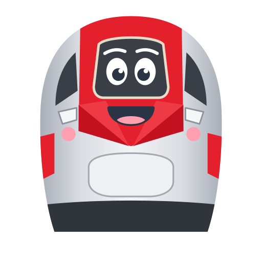

<p align="center">
  
</p>

<h1 align="center">Whoosh Ramah</h1>

<p align="center">
  Priority-passenger assistance for the Whoosh high-speed rail (KCIC).<br />
  One Flutter app, three roles, plus an AI camera that spots wheelchair users automatically.
</p>

Hackathon prototype for **priority-passenger assistance on the Whoosh high-speed
rail (KCIC)** — elderly travelers, people with disabilities, pregnant women, sick
passengers, and unaccompanied children. One Flutter app covers three roles
(**Penumpang** / passenger, **Petugas** / station officer, **Keluarga** / family),
plus a Python **AI camera** that detects wheelchair users at the station entrance
and creates assistance tasks automatically.

The manual flow becomes real-time: passengers request assistance from their
phone, officers accept and advance tasks, families monitor the journey — all
synchronized through Cloud Firestore with no custom backend server.

```
Camera ──► detector/detect_wheelchair.py ──┐
                                           ▼
Passenger phone ──► Flutter app ──► Cloud Firestore ──► Officer phone (real-time)
                                           │
                                           └──────────► Family phone (real-time)
```

> **Status:** hackathon demo prototype (2–3 phones + 1 laptop). Not a production
> system: no real login, KCIC ticketing integration, payments, automatic
> scheduling, or push notifications. Firestore rules are open for the demo only.

## Repository contents

| Folder / file | Contents |
| --- | --- |
| [`whoosh_ramah/`](whoosh_ramah/README.md) | Flutter app (passenger, officer, family) + tests, goldens, CI, demo seed |
| [`detector/`](detector/README.md) | Python wheelchair detector (YOLO-World / Roboflow / local model) + verification crops |
| [`design/`](design/README.md) | HTML screen design references (Gaya B canvas) |
| `whoosh-ramah-gaya-baru/` | **Brightline** design references used by the current app |
| [`PROJECT.md`](PROJECT.md) | Full specification & source of truth: data schema (§4), screens (§6), accessibility (§8), privacy (§12) |
| `mise.toml` | Tool version pins (Python 3.12 via [mise](https://mise.jdx.dev/)) |
| `.qoder/repowiki/` | Detailed repo wiki (architecture, detection pipeline, screen flows, troubleshooting) |

## Three roles, one collection

All roles read/write the Firestore collection `permintaan_pendampingan`
(full schema: [PROJECT.md §4](PROJECT.md)). One document = one assistance
request, with an ordered status enum:

`menunggu → ditugaskan → bertemu → di_kursi → selesai`
(waiting → assigned → met → seated → completed)

| Role | Main flow |
| --- | --- |
| **Penumpang** (passenger) | View sample ticket (G1123 Halim → Tegalluar) → request assistance (6 assistance types, 3 pickup points) → track the real-time status timeline → share with family |
| **Petugas** (officer) | Real-time task list (**Kamera AI** / **Aplikasi** source badges, Baru/Berjalan/Selesai/Ditolak recap) → task detail → one large button advances the status. AI-camera tasks show a **verification crop** plus a **"Bukan penumpang / tolak"** (not a passenger / reject) button when the AI misdetected |
| **Keluarga** (family) | Monitor the demo passenger's latest request (`demo-siti`): current status, journey progress, timestamped history |

Rejecting a camera task does not add a status enum value — the document gets
`ditolakPada`, leaves the active list, and is counted separately in the
"Ditolak" (rejected) recap.

Assistance types: `kursi_roda`, `tunanetra`, `tuli`, `lansia`, `hamil`, `porter`
(wheelchair, blind, deaf, elderly, pregnant, porter).

## AI camera (detector)

The detector runs on a laptop, separate from the app; the two only meet in
Firestore. Default mode is **YOLO-World** (`yolov8s-worldv2.pt`) — just write the
object name, runs without an API key. Alternatives: a Roboflow-hosted model
(path A) or your own trained YOLO model (path B).

- **One task per person**, not per pause: ByteTrack tracking assigns an id per
  wheelchair; a task is created only for an id never sent before that has been
  seen `FRAME_BERTURUT` consecutive times. The `JEDA_ANTAR_TUGAS_DETIK` cooldown
  applies per id.
- **Verification crop** for officers: stored as base64 in the separate
  collection `permintaan_foto/{idTugas}` (not Cloud Storage — the project is on
  the Spark plan), then **auto-deleted after 10 minutes** (`FOTO_TTL_DETIK=600`)
  by a background thread plus a startup sweep. If writing the photo fails, the
  task is still created without one.
  - `FOTO_ANONIM=false` (demo default, consenting participants): **raw** crop,
    max 480 px, JPEG q80, no blur/pixelation.
  - `FOTO_ANONIM=true` (**mandatory for production**): face blurred (Haar
    cascade) + pixelated, max 160 px, q60.
  - Base64 length is kept far below the 1 MiB Firestore document limit.

Full guide (venv setup, `.env`, testing without Firebase, training a model):
[`detector/README.md`](detector/README.md).

## Running

Prerequisites: **Flutter 3.50.1 / stable** (Dart 3.14) + JDK 17 + an Android
device/emulator; **Python 3.10+** (3.12 recommended) for the detector.

### 1. Flutter app

The demo project's Firebase configuration already ships in the repo
(`lib/firebase_options.dart`, `android/app/google-services.json`) — no need to
run `flutterfire configure` again.

```bash
cd whoosh_ramah
flutter pub get
flutter run                 # pick an Android device when prompted
```

Deploy the Firestore rules (open, demo-only) before using the app:

```bash
cd whoosh_ramah
firebase deploy --only firestore:rules,firestore:indexes
```

No composite indexes: every query uses a single field; the rest is filtered
app-side.

### 2. Wheelchair detector

```bash
cd detector
python -m venv venv
source venv/bin/activate        # Windows: venv\Scripts\activate
pip install -r requirements.txt
cp .env.example .env            # then fill in as needed
```

Test detection without Firebase first (webcam or video):

```bash
python detect_wheelchair.py --tanpa-firebase
python detect_wheelchair.py --sumber contoh.mp4 --tanpa-firebase
```

To write tasks to Firestore, download a service account key from the Firebase
console → save it as `detector/firebase-key.json` (**never commit it**), then
run `python detect_wheelchair.py`. Every detected wheelchair shows up as a
"Kamera AI" card on the officer's phone within seconds.

### 3. Demo seed (optional)

Populate the officer list with three demo documents (safe to re-run):

```bash
detector/venv/bin/python whoosh_ramah/tool/seed_demo.py
detector/venv/bin/python whoosh_ramah/tool/seed_demo.py --bersih
```

The full ±3-minute demo walkthrough lives in
[`whoosh_ramah/README.md`](whoosh_ramah/README.md).

## Testing & CI

```bash
cd whoosh_ramah
flutter analyze
flutter test                         # full suite, including goldens
flutter test --exclude-tags golden   # without goldens (Linux/CI)
```

The suite covers data contracts & transactions against `fake_cloud_firestore`,
WCAG contrast regressions, every screen at 1.3/1.5 text scale, and pixel goldens
(recorded on macOS). CI (`.github/workflows/ci.yml`) runs analyze + test on
Linux, goldens on macOS, and a detector syntax check.

## Accessibility (mandatory)

Touch targets ≥ 48 dp, `Semantics` on icon-only controls, status never conveyed
by color alone, WCAG-passing contrast, layouts intact at 130–150% text scale,
animations respect *reduce motion*, and the passenger flow can be completed
with TalkBack/VoiceOver without looking at the screen.

## Privacy

- For the hackathon demo with consenting participants, raw crops may be used
  and are auto-deleted within 10 minutes. Production versions must anonymize
  faces.
- All names and ticket data are samples.
- Open Firestore rules (`allow read, write: if true`) are **demo-only**; never
  use them in production.

## Design & technical notes

The look follows the **Brightline** style (references:
`whoosh-ramah-gaya-baru/design/`): white canvas, a single brand-red accent
`#E11D2E`, and **Plus Jakarta Sans** (500–800) bundled locally so the demo needs
no internet. The UI uses the `package:material_ui` fork; all tokens live in
`whoosh_ramah/lib/theme.dart`. Technical details (transitions, skeletons,
per-id write queue, duplicate-request guard):
[`whoosh_ramah/README.md`](whoosh_ramah/README.md).

Deeper documentation — system architecture, detection pipeline, data schema,
per-screen flows, troubleshooting — is available in the repo wiki
(`.qoder/repowiki/`).